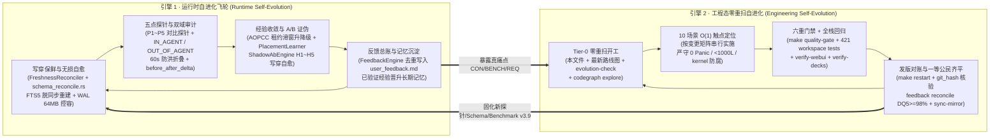

# Agent Body — 自进化工程手册与零重扫演进活地图 (`EVOLUTION_GUIDE.md`)

<!-- MANIFEST: modules=27 mcp_tools=43 spi_methods=88 tables=27 workloads=20 micro=6 dq=10 pr_rules=14 kernel_crates=3 contrib_exts=11 distributions=3 verified_tests=421 -->

> **核心定位（解决 ISSUE #17 / #22 / #26 / #52）**：同时统筹 Agent Body 的**运行时自进化飞轮**与**工程态零重扫演进闭环**——让任何新接手的 AI Agent 或开发者在不重复扫描全仓源码与 70+ 份历史阶段文档的前提下，**2 轮以内**完成需求定位、变更触点锁定、无损升级校验与高质量交付。

---

## 一、双引擎自进化全景架构

Agent Body 的自进化不是抽象口号，而是由**运行时数据自愈飞轮**与**工程态零重扫确定性门禁**咬合而成的双闭环系统：



---

## 二、零重扫 5 分钟开工协议（必读 SOP）

任何新会话接手研发、排障或文档迭代，**严禁全仓 `grep` 或通读历史归档 `roadmap-phase*.md`**，必须按以下 3 步在 2 轮内进入实施：

1. **只读 `Tier-0` 入口（仅 2 份文档）**：
   - 本文件 `EVOLUTION_GUIDE.md`（架构锚点 + 10 大场景变更触点矩阵 + 模块/测试坐标）；
   - 当前最新活跃路线图 [docs/src_doc/roadmap-phase76-78.md](docs/src_doc/roadmap-phase76-78.md)（`ISSUE #55` PG SPI 事务级海马体方案 A → B；已完成基线见 [docs/src_doc/roadmap-phase75.md](docs/src_doc/roadmap-phase75.md) 与 [docs/src_doc/progress.md](docs/src_doc/progress.md)）。
2. **运行 O(1) 实时架构快照（`<100ms`，禁止手工数模块/工具/SPI 数）**：
   ```bash
   make evolution-check
   # 需要完整工具/表/负载/扩展清单时：
   python3 scripts/evolution_manifest.py --json
   ```
3. **查源码符号优先用 CodeGraph**：
   ```bash
   codegraph explore "<SymbolOrFile>"
   # 源码改动收口后刷新符号地图：make codegraph
   ```

### 文档三级分层与禁扫令 (Document Tiering)

| 层级 | 文档集合 | 阅读规则 |
|:---:|---|---|
| **`Tier-0`** | `EVOLUTION_GUIDE.md` + 最新活跃 `docs/src_doc/roadmap-phase*.md` | **每次新会话必读** |
| **`Tier-1`** | `docs/design_doc/05~22`、`docs/manual/01~10`、`docs/src_doc/{development,progress}.md`、`user_feedback.md`、`ISSUE.md` | **按变更场景精准跳读** |
| **`Tier-2`** | `docs/src_doc/archive/`、`docs/src_doc/roadmap-phase52..75.md`、`docs/design_doc/review*.md` | **历史冻结，严禁常规迭代全量扫描** |

---

## 三、10 大高频演进场景 O(1) 变更触点矩阵 (Change-Impact Matrix)

> 遇到以下任何演进需求，直接按行锁定串行改点与必跑门禁，杜绝“漏改一端导致漂移或现网老库崩溃”：

| 演进场景 | 必改代码触点（按串行修改顺序） | 必改测试 / 门禁 / 文档触点 |
|---|---|---|
| **1. 新增 / 修改原生 MCP 工具或子动作** | 1. `src/api/mcp_schemas.rs` + `src/api/mcp_schemas_ops.rs`<br/>2. `src/api/mcp_tools/mod.rs` (`core_handlers.rs` / `infra_handlers.rs` / `body_handlers.rs`)<br/>3. `src/cli_args.rs` + `src/cli_subcommands.rs` + `src/cli_handlers/*` (1:1 CLI 子命令)<br/>4. `src/web/server.rs` & `src/web/parity_api/*` (REST API + `parity/matrix`)<br/>5. `src/web/assets/{index.html,style.css,js/*.js}` (Web 工作台) | `src/api/mcp.rs` + `src/web/mod.rs` + `tests/mcp_all_tools_e2e.rs` + `tests/web_full_e2e.rs` + `make verify-webui` + `docs/manual/03,04,08` + `make evolution-check` |
| **2. 新增 / 修改数据库表、列或 FTS 索引** | 1. `src/storage/{schema,pg_schema,duckdb_schema}.sql`<br/>2. `src/storage/sqlite_provider/schema_reconcile.rs`（**强制**：老库事务式列改名/补列 + FTS5 一致性检查）<br/>3. `src/storage/models.rs` + `src/storage/spi.rs`<br/>4. `src/storage/{sqlite,pg,duckdb}_provider/{mod,assets,facts,memory,locks,audit}.rs`<br/>5. `src/storage/migration.rs` (三后端热迁移同步) | `tests/schema_migration_regression.rs` + `tests/storage_spi_contract.rs` + `tests/duckdb_integration.rs` + `make evolution-check` |
| **3. 新增 / 修改 Benchmark 负载或 DQ** | 1. `src/benchmark/{micro,dq,competitors,competitor_tracks}.rs` & `src/benchmark/workloads/*`<br/>2. `src/benchmark/mod.rs` (`run_suite` / 汇总)<br/>3. `src/benchmark/report.rs` (`BENCHMARK_SPEC_VERSION` / 渲染) | `tests/benchmarks.rs` + `docs/design_doc/10-benchmark-spec.md` + `docs/manual/10-benchmark-and-roi.md` + `make evolution-check` |
| **4. 新增 / 修改安全脱敏与 Pre-Hook 门禁** | 1. `src/scanner/redactor.rs` (`SecretRedactor` / `PromptInjectionScanner`)<br/>2. `src/api/hooks.rs` (`pre_tool_call` 高危拦截)<br/>3. `src/hooks/dispatcher.rs` / `src/web/server.rs` (`check_auth`) | `src/benchmark/workloads/advanced.rs` (`W11`) + `src/benchmark/dq.rs` (`DQ4`) + `docs/design_doc/11-security-spec.md` |
| **5. 新增 / 修改资产放置规约** | 1. `src/storage/schema.sql` (`placement_rules` 预置)<br/>2. `src/placement/{engine_v2,conventions,learner}.rs`<br/>3. `contrib/gov_placement/`（若涉及精简发行版规约同步） | `src/placement/` 单测 + `contrib/gov_placement/tests/regress.rs` + `README.md` 放置规范 |
| **6. 新增 / 修改宿主机物理事实探针** | 1. `src/fact/` (`capability`/`process_net`/`automation`/`assets_catalog`/`knowledge_graph`)<br/>2. `src/platform/` (Linux/macOS/Windows 抽象)<br/>3. `src/brief/assembler.rs` (必须走索引优先 `Index-First`) | `src/fact/` 单测 + `W1`/`W2`/`W8` Benchmark 回归 |
| **7. 新增 / 修改效能存证规则 `PR-XX`** | 1. `src/benchmark/provenance.rs` (`ProvenanceRule` 枚举与推导公式)<br/>2. `src/benchmark/ledger.rs` (`record_channel_call`)<br/>3. 对应 CLI/MCP/Web 入口埋点 | `src/benchmark/ledger.rs` 单测 + `make evolution-check` |
| **8. 新增 / 修改配置项或外部依赖** | 1. `src/config/mod.rs` (`Config` + `validate()`)<br/>2. `config.example.toml`<br/>3. `src/preflight/mod.rs` (启动预检探针) | `INSTALL.md` + `skills/agent-body-guide/SKILL.md` + `agent-body preflight` 冒烟 |
| **9. 新增 / 修改微内核 SPI 或 `contrib/` 扩展与发行版** | 1. `kernel/body-sdk/src/lib.rs`、`kernel/body-protocol/src/lib.rs`、`kernel/body-kernel/src/lib.rs`<br/>2. `contrib/<ext>/` 标准五件套（`Cargo.toml` + `.control.toml` + `sql/` `ext_<ext>__*` + `body_module_magic!()` + `contrib/<ext>/tests/regress.rs`）<br/>3. `distributions/<edition>/`（`kernel-minimal` / `aiops-probe` / `dba-sentinel`） | `scripts/arch_boundary_check.py` + `make arch-check` + `RUST_TEST_THREADS=1 make test` + `docs/design_doc/20-plugin-microkernel-architecture-spec.md` |
| **10. 升级自进化闭环、A/B 证伪、可观测或质量/演说门禁** | 1. `src/feedback/{mod,probes}.rs` (`FreshnessReconciler` / `P1~P5`) & `src/audit/` (双域审计与租约校准)<br/>2. `src/body/` (`shadow_ab.rs` `H1~H5` / `perf_awr/*` / `metrics`)<br/>3. `scripts/{evolution_manifest,code_hygiene,arch_boundary_check,verify_webui_e2e,verify_presentations}.py` & `scripts/build_*.py` | `tests/audit_integration.rs` + `tests/body_awr_integration.rs` + `make quality-gate` + `make verify-webui` + `make verify-decks` + `docs/design_doc/{13,16,21}-*.md` |

---

## 四、架构资产与测试全景坐标表

### 4.1 旗舰 27 个顶层模块坐标（`src/lib.rs` · 全量 `<1000L`）

| 模块路径 | 核心公开 Struct / Trait | 职责边界（严守规约 #2） |
|---|---|---|
| `src/api/` | `McpToolRegistry`, `AgentHookEngine`, `McpServer` | 43 个原生 MCP stdio 工具注册、Schema 档位与 Hook 门禁（不写业务逻辑） |
| `src/audit/` | `AuditLogger`, `AuditEvolutionAnalyzer`, `AuditOlapReport` | `IN_AGENT`/`OUT_OF_AGENT` 双域行为审计、脱敏防洪、AOPCC 滑窗自进化与 DuckDB OLAP |
| `src/benchmark/` | `BenchmarkEngine`, `EffectivenessLedger`, `ProvenanceRule` | 三轨实证评测 `v3.9`（`W1~W20`/`M1~M6`/`DQ1~DQ10`/`COMP-C1~C4`）与 `PR-01~14` 存证 |
| `src/body/` | `BodyManifestEngine`, `ContinuityManager`, `HomeostasisVitalsEngine`, `AutonomyEnvelope`, `ShadowAbEngine`, `BodyPerfEngine` | 本体身份证、`<=300 tok` 跨大脑胶囊、五维稳态自愈、`L0~L3` 包络、Shadow A/B `H1~H5` 自愈与 18 等待事件 AWR/ADDM |
| `src/brief/` | `BriefAssembler`, `BriefRequest`, `OptimisticLeaseEngine` | 索引优先自适应情境组装（`<15ms`，40% 记忆预算，AOPCC 乐观直通租约） |
| `src/changes/` | `ChangesEngine` | 宿主变更审计流与开工回溯摘要（含脱敏） |
| `src/config/` | `Config`, `WebConfig`, `StorageConfig`, `RuntimeConfig` | TOML 配置加载、校验、三态运行模式与 `~/.agent-body/` 权限收敛 |
| `src/coordination/` | `CoordinationEngine`, `DeadlockDetector`, `LockWaitQueue` | 多 Agent 协作锁、层级互斥传播与 WFG 死锁环路检测 |
| `src/daemon/` | `BodyDaemon`, `BackgroundScheduler` | 常驻守护主循环、后台巡检、堆页收敛与生命周期托管 |
| `src/demo/` | `DemoEngine`, `RoiReport` | 7 大路演沙盒剧目（`demo:*` 隔离，真引擎实跑） |
| `src/ecosystem/` | `McpConfigScanner`, `SkillCatalogScanner`, `ContextBudgetRouter` | MCP/SKILL 目录、外部服务通讯录与 Token 防爆路由 |
| `src/env/` | `EnvCollector`, `PortChecker`, `HostGarbageCollector` | `/proc` 任务采集（脱敏+去噪）、端口防撞与白名单 `dry-run` GC |
| `src/fact/` | `FactFacade`, `CapabilityEngine`, `ProcessNetTopology`, `AutomationScanner`, `PropertyGraphOrganizer`, `KnowledgeGraphBuilder`, `KnowHowExtractor` | 宿主机客观事实图谱（工具/端口/Systemd/Cron/资料编目、`L1~L3` 属性图与 Know-How 知识网络） |
| `src/feedback/` | `FeedbackEngine`, `FreshnessReconciler`, `SelfEvolutionProbeEngine` | `user_feedback.md` 双向总账、新鲜度写穿对账与 `P1~P5` 五点对比自进化探针 |
| `src/hooks/` | `EventBus`, `HookDispatcher`, `ClientHookGenerator`, `HookPipelineEngine`, `OptimisticFailureDiagnoser` | 事件总线、POSIX 转义防注入、客户端生成与 `<2ms` 碰壁处方自愈 |
| `src/links/` | `LinksEngine`, `ImpactAnalyzer`, `LinkAuditor`, `LinkRepairer`, `CodeGraphBridge` | 宏观依赖拓扑、加权 3 跳爆炸半径、假阳性免疫与 CodeGraph 桥接 |
| `src/memory/` | `MemoryManager`, `TxMemoryProvider`, `PgTxMemoryAdapter`, `MemoryFactory`, `MemoryIntakeFilter` | FTS5+CJK+Ollama RRF 混合检索、PG 事务级海马体 (`pg_tx` 透明降级)、SPI 与 Mem0/Letta/PowerContext 适配 |
| `src/mesh/` | `MeshClient`, `MeshNodeFacts`, `MeshEnvelope` | 轻量多机联邦 HTTP Peer Mesh、HMAC 防重放信封、跨机对话与 `<=10MB` 沙盒收件箱 |
| `src/placement/` | `PlacementEngineV2`, `ConventionChecker`, `PlacementLearner` | 8 大目录放置建议、工程安全规约与搬移纠偏自演化 |
| `src/platform/` | `PlatformProbe`, `LinuxProbe`, `MacosProbe`, `WindowsProbe` | 跨平台系统探针抽象与纯函数解析 |
| `src/preflight/` | `PreflightChecker`, `PreflightReport` | 依赖预检、磁盘水位预警与 `0600/0700` 安全基线检查 |
| `src/scanner/` | `Scanner`, `SecretRedactor`, `PromptInjectionScanner`, `OllamaAnnotator`, `AssetSearchEngine`, `multimodal`, `multimodal_ext` | 白黑灰分级扫描、纯 Rust 多模态 L1A & 魔数统一分类、Omni-RRF + `kv_filter` 检索及三层语义标注 |
| `src/session/` | `SessionManager`, `SessionLifecycleManager` | 会话绑定、完工结清与临时垃圾回收 |
| `src/storage/` | `Storage`, `StorageProvider`, `Sqlite/Pg/DuckDbStorageProvider`, `DuckDbAnalyticsEngine`, `schema_reconcile` | 88 方法 SPI 门面、三后端分域实现、老库无损 Schema 自愈与 FTS5 重建、热迁移与 Parquet/CSV 导出 |
| `src/tui/` | `TuiDashboard` | 终端单屏实时看板 |
| `src/watcher/` | `FileWatcher`, `ChangeHandler` | `inotify` 剪枝监听、300ms 防抖与 60s 审计防洪同步 |
| `src/web/` | `WebServer`, `TopologyGraph`, `parity_api/*`, `assets/*` | 单二进制 HTTP/SSE、昼夜双主题 9 大工作台、`/metrics`、`X-Trace-Id`、`check_auth` 与 Parity 校验 |

### 4.2 微内核、周边插件与精简发行版坐标（`kernel/` · `contrib/` · `distributions/`）

| 层次 | 成员清单 | 防腐门禁与自检命令 |
|---|---|---|
| **微内核 `kernel/` (3 Crates)** | `body-sdk` · `body-protocol` · `body-kernel`（8 张 `body_cat_*` 目录 + 7 Hook + 6 Routine + `ObservabilityProvider` + 轨 B 沙盒） | `make arch-check`（单向依赖，0 业务词/观测协议词污染） |
| **周边 `contrib/` (11 五件套)** | `idx_fts_fuzzy` · `gov_placement` · `probe_db_engines` · `probe_linux_ops` · `probe_jvm_middleware` · `hook_auth_mtls_rbac` · `hook_gov_compliance` · `hook_audit_siem` · `fdw_cmdb_ticket` · `obs_telemetry` · `mem_pg_tx` | `ext_<id>__*` 表前缀隔离 + `body_module_magic!()` + `contrib/<ext>/tests/regress.rs` |
| **发行版 `distributions/` (3 精简版)** | `kernel-minimal` (`~3.9M`) · `aiops-probe` (`~6.7M`) · `dba-sentinel` (`~6.4M`) | 零 DuckDB / 零 C++ 运行时；内置 `self-check` / `metrics` / `diagnose` |

### 4.3 17 套自动化集成与回归测试矩阵（全工作区 `421` 项测试）

| 测试类别 | 覆盖文件（`tests/`） | 守护目标 |
|---|---|---|
| **存储契约、事务记忆与无损迁移** | `tests/schema_migration_regression.rs` · `tests/storage_spi_contract.rs` · `tests/duckdb_integration.rs` · `tests/pg_tx_memory_integration.rs` | 老库列改名/补列无损自愈（含 `body_checkpoints.tx_epoch`）、FTS5 重建、WAL 控容、SQLite/DuckDB 12 域等价、PG 18 16 线程 MVCC 压测与透明降级 |
| **全端 E2E 与 Parity** | `tests/mcp_all_tools_e2e.rs` · `tests/web_full_e2e.rs` · `tests/test_web_dashboard.rs` · `tests/cli_e2e.rs` | 43/43 MCP 工具真调用与必填校验、Web 全工作台 API & 鉴权 & 错误透传、CLI 端到端行为 |
| **核心引擎与协同安全** | `tests/coordination_integration.rs` · `tests/deadlock_wait_integration.rs` · `tests/mesh_integration.rs` · `tests/ecosystem_integration.rs` · `tests/hooks_integration.rs` | 目录祖先/后代互斥锁、WFG 死锁唤醒、Mesh HMAC 防重放与收件箱隔离、Hook 自动同步与碰壁自愈 |
| **自进化、多模态与基准** | `tests/audit_integration.rs` · `tests/body_awr_integration.rs` · `tests/multimodal_integration.rs` · `tests/benchmarks.rs` | 双域审计脱敏与自进化、AWR 快照与 `L0~L3` 包络、纯 Rust 多模态解析、`v3.9` 基准与微基准 SLA |

---

## 五、演进提交与发布前门禁矩阵

```bash
export PATH="$HOME/.cargo/bin:$PATH"

# 1. 必跑：六重确定性门禁 + 全工作区 421 项测试（串行防微基准争抢）
make quality-gate && RUST_TEST_THREADS=1 make test

# 2. 改动 Web / 存储 Schema / API 时必跑：Playwright 9 大工作台 + 老库迁移 E2E
make verify-webui

# 3. 改动 presentation/ 或演说脚本时必跑：Playwright 9 份演说视觉与交互全检
make verify-decks

# 4. 核心代码/发版收口时必跑：重编安装、核验 git_hash、现网对账与镜像同步
make restart && agent-body --version && agent-body feedback reconcile && make sync-mirror
```
