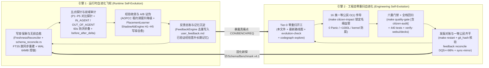

# Agent Body — 自进化工程手册与零重扫演进活地图 (`EVOLUTION_GUIDE.md`)

<!-- MANIFEST: modules=27 mcp_tools=43 spi_methods=95 tables=28 workloads=22 micro=6 dq=12 pr_rules=16 kernel_crates=3 contrib_exts=11 distributions=3 verified_tests=440 -->

> **核心定位（解决 ISSUE #17 / #22 / #26 / #52）**：同时统筹 Agent Body 的**运行时自进化飞轮**与**工程态零重扫演进闭环**——让任何新接手的 AI Agent 或开发者在不重复扫描全仓源码与 70+ 份历史阶段文档的前提下，**2 轮以内**完成需求定位、变更触点锁定、无损升级校验与高质量交付。

---

## 一、双引擎自进化全景架构

Agent Body 的自进化不是抽象口号，而是由**运行时数据自愈飞轮**与**工程态零重扫确定性门禁**咬合而成的双闭环系统：



---

## 二、零重扫 5 分钟开工协议（必读 SOP）

任何新会话接手研发、排障或文档迭代，**严禁全仓 `grep` 或通读历史归档 `roadmap-phase*.md`**，必须按以下 3 步在 2 轮内进入实施：

1. **只读 `Tier-0` 入口（仅 2 份文档）**：
   - 本文件 `EVOLUTION_GUIDE.md`（架构锚点 + 10 大场景变更触点矩阵 + 模块/测试坐标）；
   - 当前最新活跃路线图 [docs/src_doc/roadmap-phase79.md](docs/src_doc/roadmap-phase79.md)（`ISSUE #56` 超集检索 × DB 侧模糊索引 × 真基线 A/B；历史 PG 事务海马体方案 A→B 见 [docs/src_doc/roadmap-phase76-78.md](docs/src_doc/roadmap-phase76-78.md)；已完成基线见 [docs/src_doc/roadmap-phase75.md](docs/src_doc/roadmap-phase75.md) 与 [docs/src_doc/progress.md](docs/src_doc/progress.md)）。
2. **运行 O(1) 实时架构快照与一等公民变更路由（`<100ms`，禁止手工扫全仓）**：
   ```bash
   # 看全局计数与漂移校验
   make evolution-check
   # 改完代码后一键路由受影响的毛细血管与最小验证命令（替代全仓扫描，省 90%+ Token）
   make citizen-impact
   # 执行 16 类一等公民 7 项动态交叉审计（CC-1 ~ CC-7）
   make citizen-audit
   ```
3. **查源码符号优先用 CodeGraph**：
   ```bash
   codegraph explore "<SymbolOrFile>"
   # 源码改动收口后刷新符号地图：make codegraph
   ```

### 一等公民 16 维全景图谱（四圈层 × 战略到毛细血管）

> **治理核心哲学**：改代码/改战略就像公司下发指令，必须从 `Ring 1` 源码契约精准穿透 `Ring 4` 对外认知毛细血管——**不靠人脑记忆、不靠高成本全仓 `grep`、全靠确定性路由 + 动态交叉门禁**：

| 圈层 | 编号 | 一等公民类别 | 真相源与关键落点 |
|:---:|:---:|---|---|
| **Ring 1 · 内核与契约源头** | **C01** | 源码内联注释、Rustdoc 与错误消息 | `src/lib.rs` (`//!`) · 各引擎 Rustdoc (`ledger.rs`/`probes.rs`/`types.rs`) |
| | **C02** | 四类多层次测试套件 | `tests/*.rs` (`19` 集成/契约/PG18压测/E2E) · `contrib/*/tests/regress.rs` · Playwright E2E |
| | **C03** | CLI 命令树与 `--help` 文本 | `src/main.rs` · `src/cli_args.rs` · `src/cli_subcommands.rs` · `src/cli_handlers/*` |
| | **C04** | MCP Schema、Web API、Parity 与 UI | `src/api/mcp_schemas*.rs` · `src/web/{server.rs,parity_api/*,assets/*}` |
| | **C05** | 配置模板、环境变量与部署清单 | `config.example.toml`（与 `src/config/types.rs` 逐字段对齐）· `Dockerfile` · `docker-compose.yml` · `Makefile` |
| | **C06** | 三后端存储 Schema 与无损迁移 | `src/storage/{schema,pg_schema,duckdb_schema}.sql` · `schema_reconcile.rs` · `contrib/mem_pg_tx/src/schema.rs` |
| **Ring 2 · 自动化验证与门禁** | **C07** | 三轨实证 Benchmark 与 PR 账本 | `src/benchmark/{mod,dq,provenance,ledger}.rs` · `workloads/*` |
| | **C08** | 六重确定性质量门禁与 CI/CD | `evolution_manifest.py` · `citizen_sync.py` · `arch_boundary_check.py` · `code_hygiene.py` · `.github/workflows/{ci,release}.yml` |
| | **C09** | 自进化活地图与 CodeGraph 索引 | `EVOLUTION_GUIDE.md`（`<!-- MANIFEST: -->` + 矩阵）· `.codegraph/codegraph.db` |
| **Ring 3 · 工程知识与操作手册** | **C10** | 架构规格书与产品边界准则 | `docs/design_doc/05~22` · `docs/src_doc/product-boundaries-and-governance.md` |
| | **C11** | 需求账、体验总账与活跃路线图 | `ISSUE.md` · `user_feedback.md` · `docs/src_doc/roadmap-phase*.md` · `progress.md` |
| | **C12** | 开发指南、安装手册与三视角指南 | `docs/src_doc/development.md` · `INSTALL.md` · `docs/arch/01~03` |
| | **C13** | 10 卷官方使用手册与总索引 | `docs/README.md` · `docs/src_doc/product-manual.md` · `docs/manual/README.md` + `01~10` |
| **Ring 4 · 对外阵地与智能体认知** | **C14** | 项目总门面与版本发版说明 | `README.md` · `docs/releases/README.md` · `docs/releases/vX.Y.Z.md` |
| | **C15** | Agent 内置技能包 (`SKILL.md`) | `skills/agent-body-{developer,doc-writer,guide}/SKILL.md` |
| | **C16** | Decks-as-Code 演说、长文与 SVG | `scripts/{deck_engine,deck_visuals,build_*}.py` · `presentation/*.html` · `docs/markdown/{why-*,svg/architecture.svg}` |

### 高效率 × 高质量：O(1) 增量交叉对齐四步工作法

1. **动态 SSoT（一次定义、处处派生）**：所有可计算数字（模块/工具/SPI/表/Workload/DQ/PR/Contrib/Test 总数与版本号）由 `evolution_manifest.py` 从源码实时提取；`scripts/build_*.py`、`deck_engine.py`、`deck_visuals.py` 一律读取 Manifest，严禁手写“旧版 Bench 版本 / 旧测试总数”类静态孤立数字。
2. **增量变更路由（`make citizen-impact`）**：编码或修改设计后立即执行 `make citizen-impact`（基于 `git diff` 匹配申报式路径规则，`<100 ms`），直接列出**需要补齐的毛细血管清单**和**最小精准验证命令**，彻底告别高消耗、易遗漏的“盲目全仓扫描”。
3. **L1 / L2 / L3 分级传导节奏**：
   - **`L1 微改`**（纯内部实现/Bugfix）：跑 `citizen-impact` 命中测试 + `C01` 注释/`C02` 单测即可；
   - **`L2 特性接口`**（改参数/配置/CLI/MCP/Web/测试）：同步 `C03~C05` + `C13` 手册 + 对应集成测试；
   - **`L3 里程碑全栈`**（改 Schema/Benchmark/Contrib/发版）：全量刷新 `C01~C16`（含 `C14` Release Notes、`C15` SKILL、`C16` 演说 HTML 与 `architecture.svg`）。
4. **7 项交叉自动门禁（`make citizen-audit`，已并入 `make quality-gate`）**：动态校验全毛细血管 Bench/计数零漂移 (`CC-1`)、`config.example.toml` 字段零缺失 (`CC-2`)、`tests/*.rs` 文档全登记 (`CC-3`)、Rustdoc/注释鲜活 (`CC-4`)、演说脚本零硬编码 (`CC-5`)、发版说明/长文/SVG/边界同步 (`CC-6`) 与注册路径全有效 (`CC-7`)。

### 文档三级分层与禁扫令 (Document Tiering)

| 层级 | 文档集合 | 阅读规则 |
|:---:|---|---|
| **`Tier-0`** | `EVOLUTION_GUIDE.md` + 最新活跃 `docs/src_doc/roadmap-phase*.md` | **每次新会话必读** |
| **`Tier-1`** | `docs/design_doc/05~22`、`docs/manual/01~10`、`docs/src_doc/{development,progress}.md`、`user_feedback.md`、`ISSUE.md` | **按变更场景精准跳读** |
| **`Tier-2`** | `docs/src_doc/archive/`、`docs/src_doc/roadmap-phase52..75.md`、`docs/design_doc/review*.md` | **历史冻结，严禁常规迭代全量扫描** |

---

## 三、10 大高频演进场景 O(1) 变更触点矩阵 (Change-Impact Matrix)

> 遇到以下任何演进需求，直接按行锁定串行改点与必跑门禁，杜绝“漏改一端导致漂移或现网老库崩溃”：

| 演进场景 | 必改代码触点（按串行修改顺序） | 必改测试 / 门禁 / 文档触点 |
|---|---|---|
| **1. 新增 / 修改原生 MCP 工具或子动作** | 1. `src/api/mcp_schemas.rs` + `src/api/mcp_schemas_ops.rs` + `src/api/mcp_tools/*`<br/>2. `src/cli_args.rs` + `src/cli_subcommands.rs` + `src/cli_handlers/*` (含 `--help` 文本)<br/>3. `src/web/{server.rs,parity_api/*,assets/*}` (`parity/matrix`) | `tests/{mcp_all_tools_e2e,web_full_e2e,cli_e2e}.rs` + `make verify-webui` + `docs/manual/{03,04,08}` + `docs/design_doc/06-api-spec.md` + `make citizen-audit` |
| **2. 新增 / 修改数据库表、列或 FTS 索引** | 1. `src/storage/{schema,pg_schema,duckdb_schema}.sql` + `contrib/mem_pg_tx/src/schema.rs`<br/>2. `src/storage/sqlite_provider/schema_reconcile.rs`（老库无损补列/改名 + FTS5 自愈）<br/>3. `src/storage/{models,spi,migration}.rs` + `{sqlite,pg,duckdb}_provider/*` | `tests/{schema_migration_regression,storage_spi_contract,duckdb_integration}.rs` + `docs/design_doc/07-data-model.md` + `make citizen-audit` |
| **3. 新增 / 修改 Benchmark 负载 / DQ / PR 规则** | 1. `src/benchmark/{mod,micro,dq,provenance,ledger,report,competitors}.rs` & `workloads/*`<br/>2. `src/cli_args.rs` (`bench` help) + `src/feedback/probes.rs` + `src/benchmark/ledger.rs` (注释) | `tests/benchmarks.rs` + `docs/design_doc/10-benchmark-spec.md` + `docs/manual/10-benchmark-and-roi.md` + `docs/markdown/{why-*,svg/architecture.svg}` + 重生成演说 HTML |
| **4. 新增 / 修改安全脱敏与 Pre-Hook 门禁** | 1. `src/scanner/redactor.rs` (`SecretRedactor` / `PromptInjectionScanner`)<br/>2. `src/api/hooks.rs` (`pre_tool_call`) + `src/hooks/dispatcher.rs` + `src/web/server.rs` (`check_auth`) | `W11` + `DQ4` + `docs/design_doc/11-security-spec.md` + `docs/src_doc/product-boundaries-and-governance.md` |
| **5. 新增 / 修改资产放置规约** | 1. `src/storage/schema.sql` (`placement_rules` 预置)<br/>2. `src/placement/{engine_v2,conventions,learner}.rs` + `contrib/gov_placement/` | `src/placement/` 单测 + `contrib/gov_placement/tests/regress.rs` + `README.md` 放置规范 |
| **6. 新增 / 修改宿主机物理事实探针** | 1. `src/fact/` (`capability`/`process_net`/`automation`/`knowledge_graph`) + `src/platform/`<br/>2. `src/brief/assembler.rs` (`Index-First`) + 对应 `contrib/probe_*` | `src/fact/` 单测 + `W1`/`W2`/`W8` Benchmark 回归 + `docs/arch/01~03` |
| **7. 新增 / 修改效能存证规则 `PR-XX`** | 1. `src/benchmark/{provenance,ledger}.rs`（`PR-XX` 枚举 + Rustdoc 注释）<br/>2. `src/cli_args.rs` + 对应 CLI/MCP/Web 入口埋点 | `src/benchmark/ledger.rs` 单测 + `docs/manual/10` + `docs/design_doc/10` + `make citizen-audit` |
| **8. 新增 / 修改配置项或外部依赖** | 1. `src/config/{types,mod}.rs` (`Config` + `validate()`)<br/>2. `config.example.toml` + `src/preflight/mod.rs` + `Dockerfile`/`docker-compose.yml` | `INSTALL.md` + `skills/agent-body-guide/SKILL.md` + `agent-body preflight` + `citizen-audit (CC-2)` |
| **9. 新增 / 修改微内核 SPI 或 `contrib/` 扩展与发行版** | 1. `kernel/body-{sdk,protocol,kernel}/src/`<br/>2. `contrib/<ext>/`（标准五件套）+ `distributions/{kernel-minimal,aiops-probe,dba-sentinel}/` | `make arch-check` + `RUST_TEST_THREADS=1 make test` + `docs/design_doc/{20,21,22}-*.md` + `docs/markdown/svg/architecture.svg` |
| **10. 升级自进化、演说、发版、长文或全栈门禁** | 1. `src/feedback/{mod,probes}.rs` + `src/audit/` + `src/body/`<br/>2. `scripts/{evolution_manifest,citizen_sync,code_hygiene,arch_boundary_check,build_*}.py` | `README.md` + `docs/releases/{README,v*}.md` + `docs/markdown/why-*` + `skills/*/SKILL.md` + `make quality-gate` + `make verify-webui` + `make verify-decks` |

---

## 四、架构资产与测试全景坐标表

### 4.1 旗舰 27 个顶层模块坐标（`src/lib.rs` · 全量 `<1000L`）

| 模块路径 | 核心公开 Struct / Trait | 职责边界（严守规约 #2） |
|---|---|---|
| `src/api/` | `McpToolRegistry`, `AgentHookEngine`, `McpServer` | 43 个原生 MCP stdio 工具注册、Schema 档位与 Hook 门禁（不写业务逻辑） |
| `src/audit/` | `AuditLogger`, `AuditEvolutionAnalyzer`, `AuditOlapReport` | `IN_AGENT`/`OUT_OF_AGENT` 双域行为审计、脱敏防洪、AOPCC 滑窗自进化与 DuckDB OLAP |
| `src/benchmark/` | `BenchmarkEngine`, `EffectivenessLedger`, `ProvenanceRule` | 三轨实证评测 `v4.1`（`W1~W22`/`M1~M6`/`DQ1~DQ12`/`COMP-C1~C4`）与 `PR-01~16` 存证 |
| `src/body/` | `BodyManifestEngine`, `ContinuityManager`, `HomeostasisVitalsEngine`, `AutonomyEnvelope`, `ShadowAbEngine`, `BodyPerfEngine` | 本体身份证、`<=300 tok` 跨大脑胶囊、五维稳态自愈、`L0~L3` 包络、Shadow A/B `H1~H5` 自愈与 18 等待事件 AWR/ADDM |
| `src/brief/` | `BriefAssembler`, `BriefRequest`, `OptimisticLeaseEngine` | 索引优先自适应情境组装（`<15ms`，40% 记忆预算，AOPCC 乐观直通租约） |
| `src/changes/` | `ChangesEngine` | 宿主变更审计流与开工回溯摘要（含脱敏） |
| `src/config/` | `Config`, `WebConfig`, `StorageConfig`, `RuntimeConfig` | TOML 配置加载、校验、三态运行模式与 `~/.agent-body/` 权限收敛 |
| `src/coordination/` | `CoordinationEngine`, `DeadlockDetector`, `LockWaitQueue` | 多 Agent 协作锁、层级互斥传播与 WFG 死锁环路检测 |
| `src/daemon/` | `BodyDaemon`, `BackgroundScheduler` | 常驻守护主循环、后台巡检、堆页收敛与生命周期托管 |
| `src/demo/` | `DemoEngine`, `RoiReport` | 7 大路演沙盒剧目（`demo:*` 隔离，真引擎实跑） |
| `src/ecosystem/` | `McpConfigScanner`, `SkillCatalogScanner`, `ContextBudgetRouter` | MCP/SKILL 目录、外部服务通讯录与 Token 防爆路由 |
| `src/env/` | `EnvCollector`, `PortChecker`, `HostGarbageCollector` | `/proc` 任务采集（脱敏+去噪）、端口防撞与白名单 `dry-run` GC |
| `src/fact/` | `FactFacade`, `CapabilityEngine`, `ProcessNetTopology`, `AutomationScanner`, `PropertyGraphOrganizer`, `KnowledgeGraphBuilder`, `KnowHowExtractor` | 宿主机客观事实图谱（工具/端口/Systemd/Cron/资料编目、`L1~L3` 属性图与 Know-How 知识网络） |
| `src/feedback/` | `FeedbackEngine`, `FreshnessReconciler`, `SelfEvolutionProbeEngine` | `user_feedback.md` 双向总账、新鲜度写穿对账与 `P1~P5` 五点对比自进化探针 |
| `src/hooks/` | `EventBus`, `HookDispatcher`, `ClientHookGenerator`, `HookPipelineEngine`, `OptimisticFailureDiagnoser` | 事件总线、POSIX 转义防注入、客户端生成与 `<2ms` 碰壁处方自愈 |
| `src/links/` | `LinksEngine`, `ImpactAnalyzer`, `LinkAuditor`, `LinkRepairer`, `CodeGraphBridge` | 宏观依赖拓扑、加权 3 跳爆炸半径、假阳性免疫与 CodeGraph 桥接 |
| `src/memory/` | `MemoryManager`, `TxMemoryProvider`, `PgTxMemoryAdapter`, `MemoryFactory`, `MemoryIntakeFilter` | FTS5+CJK+Ollama RRF 混合检索、PG 事务级海马体 (`pg_tx` 透明降级)、SPI 与 Mem0/Letta/PowerContext 适配 |
| `src/mesh/` | `MeshClient`, `MeshNodeFacts`, `MeshEnvelope` | 轻量多机联邦 HTTP Peer Mesh、HMAC 防重放信封、跨机对话与 `<=10MB` 沙盒收件箱 |
| `src/placement/` | `PlacementEngineV2`, `ConventionChecker`, `PlacementLearner` | 8 大目录放置建议、工程安全规约与搬移纠偏自演化 |
| `src/platform/` | `PlatformProbe`, `LinuxProbe`, `MacosProbe`, `WindowsProbe` | 跨平台系统探针抽象与纯函数解析 |
| `src/preflight/` | `PreflightChecker`, `PreflightReport` | 依赖预检、磁盘水位预警与 `0600/0700` 安全基线检查 |
| `src/scanner/` | `Scanner`, `SecretRedactor`, `PromptInjectionScanner`, `OllamaAnnotator`, `AssetSearchEngine`, `multimodal`, `multimodal_ext` | 白黑灰分级扫描、纯 Rust 多模态 L1A & 魔数统一分类、Omni-RRF + `kv_filter` 检索及三层语义标注 |
| `src/session/` | `SessionManager`, `SessionLifecycleManager` | 会话绑定、完工结清与临时垃圾回收 |
| `src/storage/` | `Storage`, `StorageProvider`, `Sqlite/Pg/DuckDbStorageProvider`, `DuckDbAnalyticsEngine`, `schema_reconcile` | 95 方法 SPI 门面、三后端分域实现、老库无损 Schema 自愈与 FTS5 重建、热迁移与 Parquet/CSV 导出 |
| `src/tui/` | `TuiDashboard` | 终端单屏实时看板 |
| `src/watcher/` | `FileWatcher`, `ChangeHandler` | `inotify` 剪枝监听、300ms 防抖与 60s 审计防洪同步 |
| `src/web/` | `WebServer`, `TopologyGraph`, `parity_api/*`, `assets/*` | 单二进制 HTTP/SSE、昼夜双主题 9 大工作台、`/metrics`、`X-Trace-Id`、`check_auth` 与 Parity 校验 |

### 4.2 微内核、周边插件与精简发行版坐标（`kernel/` · `contrib/` · `distributions/`）

| 层次 | 成员清单 | 防腐门禁与自检命令 |
|---|---|---|
| **微内核 `kernel/` (3 Crates)** | `body-sdk` · `body-protocol` · `body-kernel`（8 张 `body_cat_*` 目录 + 7 Hook + 6 Routine + `ObservabilityProvider` + 轨 B 沙盒） | `make arch-check`（单向依赖，0 业务词/观测协议词污染） |
| **周边 `contrib/` (11 五件套)** | `idx_fts_fuzzy` · `gov_placement` · `probe_db_engines` · `probe_linux_ops` · `probe_jvm_middleware` · `hook_auth_mtls_rbac` · `hook_gov_compliance` · `hook_audit_siem` · `fdw_cmdb_ticket` · `obs_telemetry` · `mem_pg_tx` | `ext_<id>__*` 表前缀隔离 + `body_module_magic!()` + `contrib/<ext>/tests/regress.rs` |
| **发行版 `distributions/` (3 精简版)** | `kernel-minimal` (`~3.9M`) · `aiops-probe` (`~6.7M`) · `dba-sentinel` (`~6.4M`) | 零 DuckDB / 零 C++ 运行时；内置 `self-check` / `metrics` / `diagnose` |

### 4.3 20 套自动化集成与回归测试矩阵（全工作区 `440` 项测试）

| 测试类别 | 覆盖文件（`tests/`） | 守护目标 |
|---|---|---|
| **存储契约、事务记忆与无损迁移** | `tests/schema_migration_regression.rs` · `tests/storage_spi_contract.rs` · `tests/duckdb_integration.rs` · `tests/pg_tx_memory_integration.rs` · `tests/sleep_compaction_integration.rs` · `tests/fast_weight_m3_integration.rs` | 老库列改名/补列无损自愈（含 `tx_epoch` 与 `Continuity v2` 快权重列）、FTS5 重建、WAL 控容、SQLite/DuckDB 12 域等价、PG 18 MVCC 压测、M2 睡眠整理、M3 百万事件流与三门禁回滚 |
| **全端 E2E 与 Parity** | `tests/superset_search_regression.rs` · `tests/mcp_all_tools_e2e.rs` · `tests/web_full_e2e.rs` · `tests/test_web_dashboard.rs` · `tests/cli_e2e.rs` | 43/43 MCP 工具真调用与必填校验、Web 全工作台 API & 鉴权 & 错误透传、CLI 端到端行为 |
| **核心引擎与协同安全** | `tests/coordination_integration.rs` · `tests/deadlock_wait_integration.rs` · `tests/mesh_integration.rs` · `tests/ecosystem_integration.rs` · `tests/hooks_integration.rs` | 目录祖先/后代互斥锁、WFG 死锁唤醒、Mesh HMAC 防重放与收件箱隔离、Hook 自动同步与碰壁自愈 |
| **自进化、多模态与基准** | `tests/audit_integration.rs` · `tests/body_awr_integration.rs` · `tests/multimodal_integration.rs` · `tests/benchmarks.rs` | 双域审计脱敏与自进化、AWR 快照与 `L0~L3` 包络、纯 Rust 多模态解析、`v4.1` 基准与微基准 SLA |

---

## 五、演进提交与发布前门禁矩阵

```bash
export PATH="$HOME/.cargo/bin:$PATH"

# 0. O(1) 锁定本次改动受影响的一等公民毛细血管（<100ms，禁止手工扫描全仓）
make citizen-impact

# 1. 必跑：六重确定性门禁 (evolution + citizen-audit + arch + panic + hygiene + strict) + 全工作区 440 项测试
make quality-gate && RUST_TEST_THREADS=1 make test

# 2. 改动 Web / 存储 Schema / API 时必跑：Playwright 9 大工作台 + 老库迁移 E2E
make verify-webui

# 3. 改动 presentation/ 或演说脚本时必跑：Playwright 9 份演说视觉与交互全检
make verify-decks

# 4. 核心代码/发版收口时必跑：重编安装、核验 git_hash、现网对账与镜像同步
make restart && agent-body --version && agent-body feedback reconcile && make sync-mirror
```
