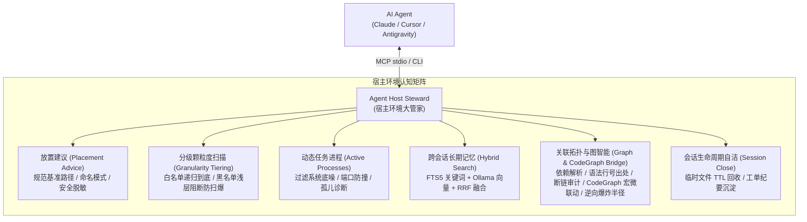

# Agent Host Steward (宿主环境大管家)

> **管记忆、管素材、管软件环境、管动态进程、管一切静态与动态对象的位置规范。**  
> 驻留在 Agent 宿主机中的轻量级系统级认知底座（Rust Edition · 单二进制交付）。

[](LICENSE)
[](https://www.rust-lang.org/)
[](https://sqlite.org/)
[](https://modelcontextprotocol.io/)

---

## 什么是 Agent Host Steward？

这不是为了让 Agent 做好某一次任务、一次协作而生的应用框架，而是让 Agent **更清晰地了解自己所处的宿主系统环境**，更好地完成任务和长期协作。

可以把它理解成：**Agent 所处宿主机上的一切动态与静态对象（文件、进程、文件夹、端口、记忆）元数据 + 对象位置的大管家**。



---

## 核心设计信条与红线

1. **放置建议是第一优先级（Placement Advice）**：当 Agent 产生新项目、脚本或临时文件时，大管家主动推荐存放目录与命名规范，杜绝文件散落污染；
2. **颗粒度分级与白黑名单深度法则（Granularity Tiering）**：
   - **白名单目录**（如 `/root/new/work/`）：深度递归到底，构建结构化元数据与 FTS5 全文索引；
   - **黑名单目录**（如 `node_modules/`, `.cache/`, `.git/`）：**严格止于当前目录层级仅记标量，严禁下钻，绝不扫描子文件**，彻底杜绝数据库扫爆与敏感信息泄露；
3. **动态任务进程过滤底噪**：深度结合 Linux 内核 `/proc` 文件系统，纳管普通 Python 脚本、构建 Worker、端口监听，自动过滤内核系统底噪；
4. **事前防撞与图智能联邦推演**：起服务前调用 `steward_port_check` 避免端口冲突；改动核心库前调用 `steward_links_impact` 推演多跳下游影响，并可通过 `steward_codegraph_bridge` 穿透代码符号级调用图；
5. **本地优先、隐私优先、单二进制交付**：全部数据存放在 `~/.steward/steward.db`，内嵌 SQLite FTS5，零重型外部依赖。

---

## 官方使用手册 (User Manual)

完整的手册已全面发布于 **[`manual/`](manual/)** 目录：

- 🚀 **[01-getting-started.md](manual/01-getting-started.md)**：快速上手、环境依赖准备与首次编译运行
- 🧠 **[02-core-concepts.md](manual/02-core-concepts.md)**：核心理念：大管家定位、黑白名单浅层阻断、放置建议哲学
- 📖 **[03-cli-reference.md](manual/03-cli-reference.md)**：全量 CLI 命令行实操字典（全子命令 + 真实输出）
- 🔌 **[04-mcp-integration.md](manual/04-mcp-integration.md)**：Agent 接入指南：22 个原生 MCP 工具与 Claude/Cursor 配置
- 🔄 **[05-daemon-and-watcher.md](manual/05-daemon-and-watcher.md)**：后台常驻守护服务、inotify 300ms 防抖与 systemd 自启
- ⚡ **[06-advanced-features.md](manual/06-advanced-features.md)**：v3.1 进阶特性：断链智能修复、放置规则自演化、宿主资源 GC、记忆生命周期与 TUI 看板
- 🛠️ **[07-troubleshooting.md](manual/07-troubleshooting.md)**：故障诊断与常见问题 (FAQ)

---

## 快速上手 (Quick Start)

### 1. 编译安装
```bash
# 确保 Rust 工具链生效
export PATH="/root/.cargo/bin:$PATH"

# 编译 release 生产二进制
cargo build --release

# 查看运行状态 (自动完成 ~/.steward 数据初始化)
./target/release/agent-steward status
```

### 2. 常用 CLI 命令一览

```bash
# 1. 开工获取系统硬件、活跃任务、最近资产与长期记忆简报
./target/release/agent-steward brief

# 2. 准备写一个爬虫脚本？先问大管家放哪里
./target/release/agent-steward place suggest --type script --name sec_fetcher --intent "抓取美股财报"

# 3. 准备启动一个测试服务？先探测 8080 端口是否已被占用 (防撞预警)
./target/release/agent-steward env port 8080

# 4. 计划改动公共模块？先推演上下游依赖与多跳爆炸半径
./target/release/agent-steward links impact /root/new/shared_proj/test.py

# 5. 跨会话搜索过去的决策与排障经验 (FTS5 + Ollama 向量混合 RRF 检索)
./target/release/agent-steward memory search "数据库连接池故障应急" --hybrid

# 6. 本次会话完成？清理 /root/new/tmp/ 临时测试文件并沉淀工单纪要进长期记忆
./target/release/agent-steward close session-20261115-01 --clean-temp
```

### 3. Agent MCP 挂载配置

在 Claude Desktop 或 Antigravity MCP 配置文件中添加：
```json
{
  "mcpServers": {
    "agent-steward": {
      "command": "/root/new/work/agent-steward/target/release/agent-steward",
      "args": ["mcp"]
    }
  }
}
```

---

## 项目设计与演进文档

- **产品设计文档 (v2.0)**:
  - [01-scenarios.md](design_doc/01-scenarios.md) | [02-requirements.md](design_doc/02-requirements.md) | [03-feature-spec.md](design_doc/03-feature-spec.md) | [04-product-manual.md](design_doc/04-product-manual.md)
  - [05-architecture.md](design_doc/05-architecture.md) | [06-api-spec.md](design_doc/06-api-spec.md) | [07-data-model.md](design_doc/07-data-model.md)
  - [review-v2-status-and-evolution.md](design_doc/review-v2-status-and-evolution.md)
- **研发断点与演进路线**:
  - [roadmap-phase2.md](src_doc/roadmap-phase2.md) (核心骨架已交付)
  - [roadmap-phase3.md](src_doc/roadmap-phase3.md) (混合检索/端口防撞/影响面分析已交付)
  - [roadmap-phase4.md](src_doc/roadmap-phase4.md) (图智能与 CodeGraph 宏微联邦已交付)
  - [roadmap-phase5.md](src_doc/roadmap-phase5.md) (系统级实装/Systemd/长文图文已交付)
  - [roadmap-phase6.md](src_doc/roadmap-phase6.md) (目录结构与规范化重构已交付)
  - [roadmap-phase7.md](src_doc/roadmap-phase7.md) (拓扑自愈/规则演化/宿主GC与自治生态已交付)
- **内置 Agent 技能库**:
  - [`skills/agent-steward-developer/`](skills/agent-steward-developer/SKILL.md)：指导 Agent 持续开发迭代项目的工程技能
  - [`skills/agent-steward-doc-writer/`](skills/agent-steward-doc-writer/SKILL.md)：指导 Agent 编写高质量使用手册与 README 的文档技能
  - [`skills/agent-steward-guide/`](skills/agent-steward-guide/SKILL.md)：面向初访 Agent 的全景导览与部署使用技能

---

## 开源协议

本项目采用 [Apache-2.0](LICENSE) 开源许可证。
