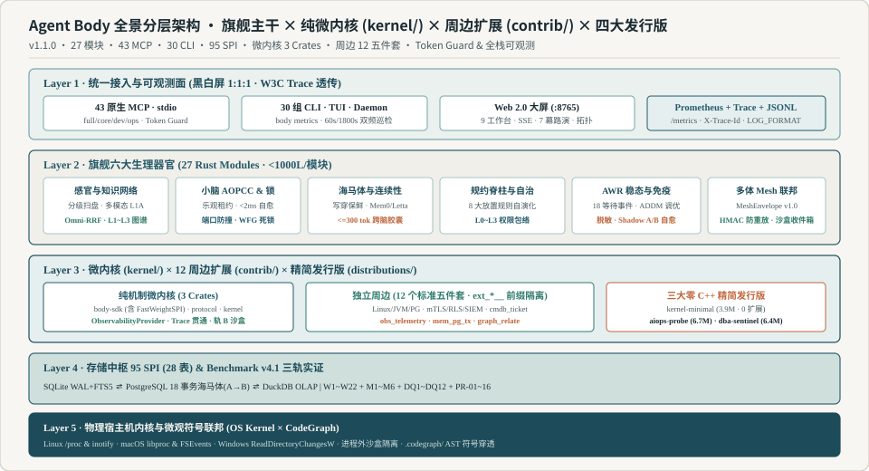
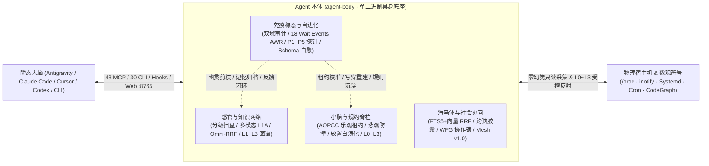

# Agent Body — Agent 本体（宿主机具身底座）

> **脑体分离架构**：大语言模型与客户端是可随时切换的**瞬态大脑**，本项目是永驻物理宿主机的 **Agent 本体（Agent Embodiment Substrate）**。  
> **六大生理器官 × 单二进制交付**：感官与知识网络 · 小脑 AOPCC 反射 · 海马体与跨大脑连续性 · 规约脊柱与 `L0~L3` 包络 · AWR 稳态代谢与自进化 · 多体联邦 Mesh。

[](docs/releases/v1.1.0.md)
[](https://www.rust-lang.org/)
[](docs/src_doc/development.md)
[](docs/manual/04-mcp-integration.md)
[](https://sqlite.org/)
[](https://modelcontextprotocol.io/)
[](LICENSE)

**快速直达**：[系列演讲总览（6 讲 × 30 分钟专题 + 总览版）](https://htmlpreview.github.io/?https://github.com/digoal/agent-body/blob/main/presentation/index.html) · [深度技术演讲 PPT](https://htmlpreview.github.io/?https://github.com/digoal/agent-body/blob/main/presentation/agent-body-deck.html) · [对外路演 PPT](https://htmlpreview.github.io/?https://github.com/digoal/agent-body/blob/main/presentation/presentation.html) · [生产安装手册](INSTALL.md) · [零重扫演进活地图](EVOLUTION_GUIDE.md)

---

## 为什么需要 Agent 本体？

市面上已有大量聚焦“对话摘要”或“外部向量记忆”的项目，但它们没有解决 AI Agent 在真实宿主机干活时更底层的断层：**LLM 只有临时大脑皮层，却没有常驻宿主机的物理身体（无本体感觉、无痛觉反射、无跨大脑连续性）**。

| 孤魂 Agent 的典型翻车现场 | 接入 Agent 本体后的确定性护航 |
|---|---|
| 不知道机器上已有 `pdftotext` 或源码仓库，反复 `pip install` / 重新克隆编译 | **宿主机事实感官**：直接查询工具能力、进程/端口、Systemd/Cron、Git 仓库与 Know-How 知识网络 |
| 启动服务直接 `bind :8080` 撞崩线上进程；多 Agent 并发改同目录互相覆盖 | **小脑反射 × 协作锁**：`body_port_check` 毫秒防撞 + 祖先/后代目录互斥锁 + WFG 死锁环路检测 |
| 改动一个公共脚本，无意击穿下游 3 个 Systemd 服务和定时任务 | **宏微联邦爆炸半径**：`L1/L2/L3` 有向加权图谱多跳推演 + 桥接 `CodeGraph` 穿透函数级调用链 |
| 每次都要事前查表多走一整轮 LLM 对话税，或改文件后旧向量/旧记忆长期僵尸驻留 | **AOPCC 自适应并发 × 写穿保鲜**：开工签发乐观直通租约，碰壁 `< 2ms` 反查注入处方；改删即写穿失效 |
| 新建脚本随手乱丢污染工作区；换一个 LLM 客户端会话就彻底失忆 | **规约脊柱 × 海马体接力**：8 大规范放置自演化 + `<= 300 tok` 脱敏抗投毒跨大脑接力胶囊 |

> 💡 **产品边界与三层命名兼容（递弱代偿红线）**：本项目专为 **AI Agent 大脑** 提供宿主机具身底座，**绝不**内置主战 LLM ReAct 规划循环，**不替代** LangGraph/CrewAI 编排框架、Docker/gVisor 沙箱、Vault 密钥库、通用 OLTP 数据库或企业级 SIEM。对外叙事全面统一为「Agent 本体」，同时工程标识（`agent-body`、`body_*` 43 个原生 MCP 工具、`~/.agent-body/`）100% 向后兼容（详见 [04-agent-body-philosophy.md](docs/idea_doc/04-agent-body-philosophy.md) 与 [17-agent-embodiment-and-continuity-spec.md](docs/design_doc/17-agent-embodiment-and-continuity-spec.md)）。

---

## 全景分层架构与脑体闭环





---

## 核心实证与真机实跑示例 (Execution-Verified)

### 1. 工程与实证关键指标（`v1.1.0`）

| 维度 | 实测指标 | 校验入口 |
|---|---|---|
| **架构规模与纯度** | 旗舰 `27` 顶层模块 · `43` MCP / `30` CLI / Web `1:1:1` 对齐 · `88` SPI / `27` 表 · 微内核 `3` crates + `11` `contrib/` 五件套 + `3` 精简发行版 | `make evolution-check` / `make arch-check` |
| **帕累托实证基准 (`v4.1`)** | `W1~W22` A/B 负载 + `M1~M6` 微基准 + `DQ1~DQ12` 质量门禁 + `COMP-C1~C4` 竞品对标 + `PR-01~16` 账本；放置 `~30 μs`、3 跳图遍历 `~120 μs`、FTS5 `~250 μs`、Token 节省 `99%+` 且质量净升 | `agent-body bench run --suite full` |
| **代码质量与自愈硬化** | **435 项全工作区测试全绿**（根包 `387` + `kernel` `27` + `contrib` `17` + `distributions` `4`）· `0` `unwrap`/`expect` · `0` `>1000L` 文件 · `0/15` 静默 `let _ =` · `18/18` `WaitEventId` · 事务式老库无损 Schema 自愈与 FTS5 重建 | `make quality-gate && make test` |
| **端到端无头视觉验真** | Playwright 9 大 WebUI 工作台 + 老库热迁移 E2E 回归（`verify-webui`）+ 9 份演说 HTML 零溢出/零重叠验真（`verify-decks`） | `make verify-webui` / `make verify-decks` |

### 2. 真实 CLI 执行输出（`v1.1.0` 现网实跑捕获）

<details open>
<summary><b>展开查看真实执行输出：本体六器官自省 / 五维稳态 / 规范放置 / 端口防撞</b></summary>

```text
$ agent-body body manifest
🧬 Agent 本体身份证: body-54f9ef0a9a203852 (digoal-home, linux / x86_64)
📦 活跃接力胶囊: 0 | 六大器官状态:
  - sensory      [ready] 感官与本体感觉 (Fact Graph & Assets)
  - cerebellum   [ready] 小脑与条件反射 (AOPCC & Hooks)
  - hippocampus  [ready] 海马体与连续性 (Memory & ContinuityCapsule)
  - spine        [ready] 规约脊柱 (Placement & AutonomyEnvelope)
  - metabolism   [ready] 代谢免疫与自稳态 (Dual-Domain Audit & Freshness)
  - social       [ready] 社会协同 (Coordination Locks & Mesh)

$ agent-body body vitals
🩺 五维本体生命体征 [body-54f9ef0a9a203852]: 综合稳态分 99.9/100 (healthy)
  - 感官清晰度      (25%): 100.0 [healthy] 资产 2000 条 · 节点 402 · 边 938
  - 反射灵敏度      (20%):  99.3 [healthy] 24h 反射样本 297 条 (命中 295 / 碰壁 2)
  - 海马体纯净度     (20%): 100.0 [healthy] 记忆 32 条 · 活跃胶囊 0 个
  - 代谢健康度      (20%): 100.0 [healthy] 最高磁盘使用率 83.2% · 过期锁 0 个
  - 免疫可溯度      (15%): 100.0 [healthy] 抽检最近 200 条双域审计流水

$ agent-body place suggest --type script --name sec_fetcher --intent "抓取美股财报"
推荐目标路径:   "<workspace>/shared_proj/sec_fetcher/"
命中规范规则:   shared_tools (长期沉淀的可复用脚本与程序库)
冲突状态:       ✅ 路径空闲可用

$ agent-body env port 8765
{
  "port": 8765,
  "status": "FREE",
  "conflict": null,
  "recommended_free_ports": [],
  "advice": "✅ 端口 8765 处于空闲可用状态，可以安全绑定启动服务。"
}
```

</details>

---

## 四大发行版谱系（旗舰全功能 × 零 C++ 微内核精简版）

借鉴 PostgreSQL `src/backend/` + `contrib/` 架构哲学，本项目实现了纯机制微内核（`kernel/`）与 11 个标准五件套周边扩展（`contrib/`，含 `obs_telemetry` 可观测导出与 `mem_pg_tx` PG 事务海马体）的物理隔离，按场景交付四款产物（详见 [20-plugin-microkernel-architecture-spec.md](docs/design_doc/20-plugin-microkernel-architecture-spec.md) 与 [21-observability-and-telemetry-spec.md](docs/design_doc/21-observability-and-telemetry-spec.md)）：

| 发行版 | 二进制名 | 体积参考 | 运行依赖 | 核心能力与适用场景 |
|---|---|---|---|---|
| **个人旗舰版** | `agent-body` | 全功能单二进制 | SQLite + DuckDB (`libstdc++6`) + Web UI | 43 MCP + 30 CLI + 昼夜 9 工作台 Web UI + 7 幕路演 + Benchmark v4.1 + `/metrics` + W3C Trace |
| **政务云 AIOps 探针** | `agent-body-probe` | `~6.7 MB` | **纯 Rust（零 DuckDB / 零 C++）** | Linux/JVM/Nginx 只读采集、mTLS/RLS、合规脱敏、SIEM、CMDB 轨 B 沙盒与 `obs_telemetry` (`metrics`/`diagnose`) |
| **DBA 专项哨兵** | `agent-body-dba` | `~6.4 MB` | **纯 Rust（零 DuckDB / 零 C++）** | PostgreSQL / 达梦 / 人大金仓实例与参数诊断、脱敏合规与 `OBS-01~05` 自诊断 |
| **纯微内核最小版** | `agent-body-kernel-minimal` | `~3.9 MB` | **纯 Rust（`0` `contrib`）** | 8 张 `body_cat_*` 目录表 + 7 Hook + 6 Routine + 轨 B 沙盒最小防腐验证基座 |

---

## 快速上手 (Quick Start)

> 💡 **完整生产部署、跨平台依赖矩阵、Docker（含 `--target probe` 极简镜像）与 Systemd 托管**：详见 [INSTALL.md](INSTALL.md)。

### 1. 编译安装（旗舰版与零 C++ 精简版）

```bash
export PATH="$HOME/.cargo/bin:$PATH"

# 方式 A：编译安装全功能旗舰版（自动初始化 ~/.agent-body/body.db 并执行事务式 Schema 自愈）
make build && sudo make install
agent-body preflight && agent-body status

# 方式 B：按需编译零 DuckDB / 零 C++ 运行时精简发行版并自检
cargo build --release -p agent-body-kernel-minimal -p agent-body-probe -p agent-body-dba
./target/release/agent-body-probe self-check && ./target/release/agent-body-dba self-check
./target/release/agent-body-probe metrics | head -n 20
./target/release/agent-body-probe diagnose
```

### 2. 日常高频 CLI 工作流

```bash
# 1. 开工获取硬件、活跃任务、最近资产、长期记忆与 AOPCC 乐观直通租约
agent-body brief

# 2. 写新脚本/建项目前先问规范放置路径，终结工作区散落污染
agent-body place suggest --type script --name sec_fetcher --intent "抓取美股财报"

# 3. 启动服务前探测端口冲突（支持自动推荐连续空闲端口）
agent-body env port 8080

# 4. 修改公共模块前推演 L1/L2/L3 多跳爆炸半径，或穿透 CodeGraph 查微观函数调用方
agent-body links impact <workspace>/shared_proj/demo.py
agent-body links codegraph <repo-root> StorageProvider

# 5. 跨会话混合检索历史决策与排障经验（FTS5 + CJK 回退 + 本地向量 RRF）
agent-body memory search "数据库连接池故障应急" --hybrid

# 6. 查看本体六器官状态、五维稳态与 Prometheus / OpenMetrics 指标
agent-body body manifest && agent-body body vitals
agent-body body metrics --format prometheus | head -n 20

# 7. 启动单二进制 Web 2.0 监控大屏（9 大工作台 / 昼夜双主题 / SSE / 7 幕路演 / 默认 :8765）
agent-body web --port 8765

# 8. 会话完工自洁（清理临时测试文件并沉淀工单纪要进长期记忆）
agent-body close session-20261128-01 --clean-temp
```

### 3. AI Agent MCP 原生挂载（支持 `core` 减税档位）

在 Antigravity、Claude Desktop 或 Cursor 的 MCP 配置中挂载（默认 `full` 暴露全量 43 工具；可在 `~/.agent-body/config.toml` `[runtime]` 中设置 `mcp_profile = "core"` 仅暴露 10 个核心工具，立省 `~78%` Schema Context 税）：

```json
{
  "mcpServers": {
    "agent-body": {
      "command": "/usr/local/bin/agent-body",
      "args": ["mcp"]
    }
  }
}
```

### 4. 质量门禁与全栈验证

```bash
export PATH="$HOME/.cargo/bin:$PATH"
make quality-gate                 # 六重确定性门禁 (evolution / citizen-audit / arch / panic / hygiene / strict)
RUST_TEST_THREADS=1 make test     # 全工作区 435 项单元/集成/契约/迁移/MCP/Web E2E 测试
make verify-webui                 # Playwright 9 大 WebUI 工作台 + 老库无损迁移 E2E 验真
make verify-decks                 # Playwright 9 份演说 HTML 视觉与快捷键全检
```

---

## 双引擎自进化体系 (Self-Evolution Flywheel)

Agent Body 将“运行时自我保鲜纠偏”与“工程迭代零重扫演进”打通为双引擎闭环：

- **运行时自进化（Runtime Self-Evolution）**：
  - **写穿保鲜与无损自愈**：`FreshnessReconciler` 周期对账物理磁盘、`/proc` 端口与 `.codegraph/`，自动重置变更向量与剪枝幽灵节点；[schema_reconcile.rs](src/storage/sqlite_provider/schema_reconcile.rs) 启动即完成老库事务式列改名/补列、FTS5 脱同步自动重建与 SQLite WAL `64MB` 有界控容（详见 [13-freshness-and-self-evolution-spec.md](docs/design_doc/13-freshness-and-self-evolution-spec.md)）。
  - **五点探针 × 双域审计 × Shadow A/B 证伪**：`P1~P5` 探针与 `IN_AGENT`/`OUT_OF_AGENT` 双域审计流驱动 AOPCC 乐观租约滑窗升降级与 `PlacementLearner` 目录聚类演化；三态 `[runtime]` 支持 `shadow_ab` 真实世界对照与 `H1~H5` 自动写穿自愈，异常证据自动去重入账 [user_feedback.md](user_feedback.md)（详见 [16-dual-domain-audit-and-self-evolution-spec.md](docs/design_doc/16-dual-domain-audit-and-self-evolution-spec.md)）。
- **工程态自进化（Engineering Self-Evolution · O(1) 一等公民传导）**：
  - 任何战略、架构或源码变更就像公司下发指令，必须高效、精准穿透到全仓毛细血管而不漏一处。新会话遵循 [EVOLUTION_GUIDE.md](EVOLUTION_GUIDE.md) 的 **Tier-0 零重扫协议**，编码后执行 `make citizen-impact`（基于 `git diff` O(1) 列出受影响的 16 类一等公民毛细血管与最小验证命令，告别全仓盲扫），提交前由六重确定性门禁（含 `evolution-check` 与 `citizen-audit` 7 项动态交叉审计）自动守卫配置、测试、Rustdoc、CLI help、手册、发版说明、演说 HTML 与技术长文零漂移。

---

## 演进路线：PostgreSQL SPI 事务级海马体（Phase 76 ~ 78）

在不打破「脑体分离」与「递弱代偿防膨胀」红线（**绝不内置大模型推理/训练循环、绝不将 GB 级权重存进 PG 堆表、严禁跨推理持 2PL 长锁**）的前提下，项目基于 [22-pg-tx-memory-spi-a-to-b-spec.md](docs/design_doc/22-pg-tx-memory-spi-a-to-b-spec.md) 与 [roadmap-phase76-78.md](docs/src_doc/roadmap-phase76-78.md)，以第 11 个独立周边扩展 `contrib/mem_pg_tx/` + 旗舰无侵入适配（SQLite 透明降级、43 工具零膨胀）三阶段推进**方案 A → 方案 B** 事务级记忆原型：

| 里程碑 | 核心目标 | 量化硬验收门禁与实测 | 状态 |
|---|---|---|:---:|
| **Phase 76 (M1 · 方案 A 事务底座)** | 落地 `TxMemoryProvider` / `PgTxMemoryAdapter`（连接池 + 同键 `pg_advisory_xact_lock` 写穿 + `REPEATABLE READ READ ONLY` 快照读 + LSM 解耦检索段与墓碑过滤 + SQLite 降级）并贯通 AOPCC 租约与 `ContinuityCapsule` | PG 18.6 真机实测 16 线程 × 5 并发写（80 tx）丢写率 **`0%`** · `search_tx` **`P50 = 3.28 ms` / `P99 = 4.34 ms`** (`< 20 ms`) · 僵尸召回率 **`0%`** · `W20` 基准全绿 | ✅ 已完成 |
| **Phase 77 (M2 · 方案 A 满血形态)** | 在 `L1_AUTONOMIC` 守护挂载空闲期 `SleepTimeCompactor` 与 STC 显著性评分（`SalienceScorer`），叠加低可预测查询自动旁路门禁（`QueryPredictabilityGate`）、三端 `sleep_action`/`force` 与 `OUT_OF_AGENT` 脱敏审计 | PG 18.6 真机实测压缩比 **`3.73×`** (`272→73 tok`) · 保留事实 **`100% (6/6)`** · 热路径 **`P50 = 5.19 ms` / `P99 = 10.65 ms`** (`< 20 ms`) · Bench `v4.0` (`W21`/`DQ11`/`PR-15`) 全绿 | ✅ 已完成 |
| **Phase 78 (M3 · 方案 B 快慢权重闭环)** | 落地 `FastWeightCheckpointSpi` + JSON-RPC 2.0 旁路控制面（零推理/权重进本体）、`fast_weight_snapshots` 血缘、三门禁原子切换、`selective_unlearn`、epoch 回滚与 `ContinuityCapsule v2` 热挂 | PG 18.6 **1,000,003 事件**实测 **`search_tx P50 = 2.66 ms` / `P99 = 4.42 ms`** (`< 20 ms`) · `lineage P99 = 1.94 ms` · 回滚 **`24 ms`** · 3 类故障 `100%` 拦截 · Bench `v4.1` (`W22` `320→48 tok`/`DQ12`/`PR-16`) 全绿 | ✅ 已完成 |

---

## 文档全景导航

### 1. 思想起源与角色视角指南

| 类别 | 推荐入口 | 核心价值 |
|---|---|---|
| **思想哲学 (`docs/idea_doc/`)** | [00-comparative-advantage-origin.md](docs/idea_doc/00-comparative-advantage-origin.md) · [03-modular-body-architecture.md](docs/idea_doc/03-modular-body-architecture.md) · [04-agent-body-philosophy.md](docs/idea_doc/04-agent-body-philosophy.md) | 比较优势缘起 → 三位一体内核 → 「脑体分离 · Agent 本体」第一性原理 |
| **角色指南 (`docs/arch/`)** | [01-for-architects.md](docs/arch/01-for-architects.md)（架构师） · [02-for-developers.md](docs/arch/02-for-developers.md)（开发者） · [03-for-users.md](docs/arch/03-for-users.md)（用户与 Agent） | 存储 SPI/锁算法/NFR、27 模块与 4 大 How-To、作业六部曲与 FAQ |
| **演进与交付 (`docs/src_doc/`)** | [EVOLUTION_GUIDE.md](EVOLUTION_GUIDE.md) · [roadmap-phase76-78.md](docs/src_doc/roadmap-phase76-78.md) · [development.md](docs/src_doc/development.md) · [progress.md](docs/src_doc/progress.md) · [product-boundaries-and-governance.md](docs/src_doc/product-boundaries-and-governance.md) | 零重扫活地图、Phase 76~78 路线图、19 套件测试、全阶段里程碑与治理边界 |

### 2. 官方使用手册（[`docs/manual/`](docs/manual/README.md) · 10 卷）

- [01-getting-started.md](docs/manual/01-getting-started.md) 快速上手与编译部署 · [02-core-concepts.md](docs/manual/02-core-concepts.md) 核心理念与黑白名单分级扫描 · [03-cli-reference.md](docs/manual/03-cli-reference.md) 全量 30 组 CLI 实战字典 · [04-mcp-integration.md](docs/manual/04-mcp-integration.md) 43 个原生 MCP 工具接入 · [05-daemon-and-watcher.md](docs/manual/05-daemon-and-watcher.md) 常驻守护与 `inotify` 防抖
- [06-advanced-features.md](docs/manual/06-advanced-features.md) 端口防撞/断链修复/WFG 死锁/GC/TUI · [07-troubleshooting.md](docs/manual/07-troubleshooting.md) 排障 FAQ · [08-web-dashboard.md](docs/manual/08-web-dashboard.md) Web UI 2.0 昼夜蓝图与 9 工作台 · [09-hooks-integration.md](docs/manual/09-hooks-integration.md) Hook 驱动引擎与 Pipeline · [10-benchmark-and-roi.md](docs/manual/10-benchmark-and-roi.md) 实证 Benchmark v4.1 与 `PR-01~16` 存证账本

### 3. 核心架构与技术规格说明书（[`docs/design_doc/`](docs/design_doc/)）

| 领域 | 规格文档 |
|---|---|
| **基础架构与接口** | [03-feature-spec.md](docs/design_doc/03-feature-spec.md) 功能规格 · [05-architecture.md](docs/design_doc/05-architecture.md) 分层架构 · [06-api-spec.md](docs/design_doc/06-api-spec.md) API/MCP 契约 · [07-data-model.md](docs/design_doc/07-data-model.md) 27 表模型 · [09-modular-roadmap.md](docs/design_doc/09-modular-roadmap.md) 模块化路线 |
| **安全、并发与图谱联邦** | [11-security-spec.md](docs/design_doc/11-security-spec.md) 五层纵深安全与抗投毒 · [14-graph-intelligence-and-mesh-protocol-spec.md](docs/design_doc/14-graph-intelligence-and-mesh-protocol-spec.md) `L1~L3` 图谱与 `MeshEnvelope v1.0` · [15-adaptive-optimistic-pessimistic-concurrency-spec.md](docs/design_doc/15-adaptive-optimistic-pessimistic-concurrency-spec.md) AOPCC 乐观-悲观自适应并发 · [19-knowledge-network-and-graph-recall-spec.md](docs/design_doc/19-knowledge-network-and-graph-recall-spec.md) 行业 Know-How 知识网络与 Omni-RRF |
| **本体稳态、审计与自进化** | [13-freshness-and-self-evolution-spec.md](docs/design_doc/13-freshness-and-self-evolution-spec.md) 新鲜度对账、Schema 自愈与 `P1~P5` 探针 · [16-dual-domain-audit-and-self-evolution-spec.md](docs/design_doc/16-dual-domain-audit-and-self-evolution-spec.md) 双域全链路审计与数据驱动自进化 · [17-agent-embodiment-and-continuity-spec.md](docs/design_doc/17-agent-embodiment-and-continuity-spec.md) 本体身份证、跨脑接力与 `L0~L3` 包络 · [18-wait-events-and-awr-perf-diagnostics-spec.md](docs/design_doc/18-wait-events-and-awr-perf-diagnostics-spec.md) 18 等待事件与内生 AWR/ADDM |
| **实证评测、微内核、可观测与事务记忆** | [10-benchmark-spec.md](docs/design_doc/10-benchmark-spec.md) 实证基准 v4.0 与效能账本 · [12-competitor-benchmark-spec.md](docs/design_doc/12-competitor-benchmark-spec.md) 四赛道竞品同机对标 · [20-plugin-microkernel-architecture-spec.md](docs/design_doc/20-plugin-microkernel-architecture-spec.md) 纯微内核 `kernel/` 与 `contrib/` 插件体系 · [21-observability-and-telemetry-spec.md](docs/design_doc/21-observability-and-telemetry-spec.md) 全栈可观测闭环（`/metrics` + W3C Trace + `OBS-01~05`） · [22-pg-tx-memory-spi-a-to-b-spec.md](docs/design_doc/22-pg-tx-memory-spi-a-to-b-spec.md) PostgreSQL SPI 事务级海马体（方案 A → 方案 B） |

---

## 项目结构

- `src/` : 旗舰版 Rust 核心源码（27 个顶层模块，全量 `<1000L` 模块化）
- `kernel/` : 纯机制微内核底座（3 crates：`body-sdk` / `body-protocol` / `body-kernel`，0 业务词污染）
- `contrib/` : 独立周边扩展插件目录（11 个标准五件套模块，含 `obs_telemetry` 可观测导出与 `mem_pg_tx` PG 事务海马体）
- `distributions/` : 零 C++/DuckDB 精简发行版组装入口（`kernel-minimal` / `aiops-probe` / `dba-sentinel`）
- `tests/` : 19 个自动化集成、契约、PG 18 百万事件/并发与睡眠整理压测、老库迁移回归、43 工具 MCP 与 Web 全栈 E2E 测试套件（435 项全绿）
- `scripts/` : 工程门禁与自动化工具集（`evolution_manifest.py`、`citizen_sync.py` 16 类一等公民增量路由与交叉审计、`code_hygiene.py`、`arch_boundary_check.py`、Playwright `verify_webui_e2e.py` / `verify_presentations.py`、4 套演说生成器与向量回填）
- `skills/` : 项目内置 AI Agent 技能包（`agent-body-developer` / `agent-body-doc-writer` / `agent-body-guide`）
- `presentation/` : 单文件零依赖浅色工程蓝图 HTML 演讲体系（`index.html` + 路演版 + 深度技术版 + `01~06` 六讲专题）
- `docs/` : 统一文档中心（详见 [docs/README.md](docs/README.md)）
  - `docs/arch/` : 面向架构师、开发者、用户的三视角全景指南
  - `docs/design_doc/` : 22 份闭环架构设计与技术规格说明书
  - `docs/idea_doc/` : 比较优势起源与脑体分离哲学沉淀
  - `docs/manual/` : 10 卷官方使用手册
  - `docs/markdown/` : 对外技术长文与矢量 SVG 图表（`docs/markdown/svg/`）
  - `docs/releases/` : 版本发版说明（`v0.1.0` ~ `v1.1.0`）
  - `docs/src_doc/` : 开发指南、边界治理、活跃演进路线图、进度总表与历史归档 (`archive/`)
- `paper/` : 面向国际顶会（OSDI / SIGMOD / SIGIR / ICSE / USENIX Security）的 `1+4` 系统论文矩阵与确定性矢量图表库（详见 [paper/README.md](paper/README.md)）
- 根目录核心文件：
  - `README.md` : 项目总览、脑体分离全景架构、实跑验证输出、四大发行版选型、快速上手、项目结构与 28 条顶层设计规约
  - `INSTALL.md` : 生产安装部署手册（多发行版系统依赖矩阵、Docker 容器化、Systemd 常驻托管与故障排查）
  - `EVOLUTION_GUIDE.md` : 零重扫项目演进活地图（机器校验架构锚点、双引擎自进化架构、10 大演进场景 O(1) 变更触点矩阵与 27 模块坐标表）
  - `ISSUE.md` : 未来演进路线与待探讨议题（Roadmap & Open Issues）总账，记录历史落盘状态与后续探索方向
  - `user_feedback.md` : 主理人与 Agent 现网使用体验、痛点与自进化探针上报总账（与 `body_feedback` 双向同步）
  - `Cargo.toml` : Rust Workspace 元数据、生产依赖清单与 Release 编译优化配置
  - `Cargo.lock` : Rust 依赖树精确版本锁定文件，保障跨环境确定性可复现构建
  - `build.rs` : Rust 编译期构建脚本，负责注入 Git Commit Hash、构建时间与目标平台信息至 `--version`
  - `Makefile` : 一键构建、六重质量门禁（`quality-gate` 含 `citizen-audit`）、`citizen-impact`、435 项测试（`test`）、WebUI 与演说 Playwright 验真（`verify-webui` / `verify-decks`）、热重启与开源镜像同步入口
  - `Dockerfile` : 多阶段轻量容器镜像构建文件（含旗舰镜像与零 `libstdc++6` 的 `--target probe` 极简探针镜像）
  - `docker-compose.yml` : 本地及生产容器化一键编排配置（数据卷挂载、端口映射、健康检查与环境变量模板）
  - `config.example.toml` : 带完整参数注释的 `~/.agent-body/config.toml` 配置模板（存储后端、三态运行模式、扫描策略、安全鉴权、Web/Mesh 与 Ollama 配置）
  - `.gitignore` : Git 版本控制忽略清单（排除 `target/` 构建产物、本地缓存、临时数据与敏感文件）
  - `.dockerignore` : Docker 构建上下文排除清单（排除 `target/`、`.git/`、`.codegraph/` 等大目录以加速镜像构建）
  - `LICENSE` : 本项目开源许可协议全文（Apache License 2.0）

---

## 核心设计原则与顶层规约（28 条架构不变量）

### 一、产品定位与脑体边界（#1 ~ #3）

1. **脑体分离与本体定位准则**：LLM/客户端是瞬态大脑皮层，本项目是永驻物理宿主机的 Agent 本体；核心消费者始终是 AI Agent，所有接口以极低认知负载、零幻觉提取、语义自解释为第一标准。
2. **递弱代偿防膨胀红线**：专注宿主机具身稳态的原子/分子能力。明确不内置主战 LLM ReAct 规划循环与模型训练/微调循环，不将 GB 级模型权重作为裸 BLOB 存入堆表，不替代编排框架、容器沙箱、密钥托管、通用 OLTP、Raft 共识、Rsync 同步或通用 SIEM，坚守纯微内核 `kernel/` 与周边 `contrib/` 物理隔离。
3. **大脑无关性与跨大脑连续性**：任何符合 MCP / Hook / CLI 协议的大脑均可无缝接入同一本体，通过 `<= 300 tok` 脱敏接力胶囊实现“换脑不失忆”，演进为面向智能体时代的下一代 OS 原生具身底座。

### 二、数据治理与分级感知（#4 ~ #7）

4. **摄入取舍与双流防洪折叠**：事实、记忆与变更流严格按重要性过滤；对 `inotify` 同路径 60 秒内高频保存做内存防抖折叠，并将底层 I/O 流水（`changes`）与双域治理账本（`audit_events`）物理分离。
5. **实事求是、零捏造与图谱三层证据**：所有事实源自宿主机真实物理状态；关系边强制标注 `L1_EXPLICIT`（物理硬依赖）、`L2_STRUCTURAL`（结构上卷）或 `L3_SEMANTIC`（语义近邻），严禁语义相似伪装物理硬依赖。
6. **颗粒度分级与白黑名单深度法则**：白名单目录深度递归入库全文与语义；黑名单目录（`node_modules/`、`.cache/`、`.git/`、`.ssh/`）仅记录当前目录实体本身，严禁下钻或入库子文件；受限目录仅索引入口与 README。
7. **动态进程底噪过滤**：仅纳管 Agent 任务、脚本、构建 Worker 与测试服务，内核线程及基础系统进程由白名单与启发式规则过滤，并全链路脱敏命令行参数。

### 三、自治权限、性能与依赖贯通（#8 ~ #10）

8. **四级自治包络（`L0~L3`）与自治留痕红线**：严格划分 `L0_OBSERVE`（只读）、`L1_AUTONOMIC`（可逆稳态反射）、`L2_SUPERVISED`（宿主写操作默认 `dry-run` 或强鉴权）与 `L3_FORBIDDEN`（绝对痛觉禁区）；本体在 Agent 之外执行的任何清理、修复、对账与规则演化必须 100% 记入脱敏审计账本（含 `before_after_delta`）。
9. **亚毫秒极速与堆内存自收敛**：核心只读与决策 API 保持微秒/毫秒级（放置 `~30 μs`、3 跳图 `~120 μs`、FTS5 `~250 μs`、冷简报 `< 15 ms`）；CLI/MCP `< 15 MB`，全功能守护 `< 90 MB`、空闲 CPU `< 0.5%`，大批量巡检后触发 SQLite `PRAGMA shrink_memory`、WAL `TRUNCATE` 与 `malloc_trim(0)` 控容。
10. **运行依赖四层贯通**：任何运行假设与外部依赖必须同步贯通 **代码 × 配置 × 文档 × SKILL** 四层，并由 `agent-body preflight` 启动预检兜底，缺失可选组件时优雅降级。

### 四、工业级工程、测试与同步门禁（#11 ~ #17）

11. **全量 16 类一等公民平权、O(1) 战略传导与发版对账**：源码注释/Rustdoc、四层测试、CLI `--help`、MCP/Web、配置与部署模板、Schema/迁移、Benchmark/PR 账本、门禁与 CI、演进地图/CodeGraph、设计规格与边界、ISSUE/反馈/路线图、开发/安装/架构指南、10 卷手册、`README.md`、发版说明、内置 `SKILL` 及演说 HTML/长文/SVG **全部视为一等公民**。变更须经 `make citizen-impact` 分级传导，提交前通过 `make citizen-audit` 与发版校验（二进制 `git_hash == HEAD` 且 `DQ5 >= 98%`）。
12. **零 Panic 铁律**：生产代码路径严禁出现 `.unwrap()` 与 `.expect()`，统一以 `anyhow::Result` / `thiserror` 向上冒泡并受 `make lint-panic` 强制门禁守护。
13. **测试驱动、无损自愈与六重确定性门禁**：新增特性或表结构变更必须同步补齐测试与无损迁移回归（`tests/schema_migration_regression.rs`、`tests/storage_spi_contract.rs`、`tests/pg_tx_memory_integration.rs`、`tests/sleep_compaction_integration.rs`、`tests/fast_weight_m3_integration.rs`、`tests/mcp_all_tools_e2e.rs`、`tests/web_full_e2e.rs`）；任何提交前须通过 `make quality-gate`（`evolution-check` + `citizen-audit` + `arch-check` + `lint-panic` + `lint-hygiene` + `lint-strict`）与 `RUST_TEST_THREADS=1 make test`（435 项全绿），前端/演说改动须追加通过 `make verify-webui` 与 `make verify-decks`。
14. **断点续传与零碎片追踪**：大型演进在活跃 `docs/src_doc/roadmap-phase*.md` 维护原子检查点，收口同步更新 [docs/src_doc/progress.md](docs/src_doc/progress.md) 与 [EVOLUTION_GUIDE.md](EVOLUTION_GUIDE.md) 的 `Tier-0` 指针，确保任意中断可瞬间续传。
15. **宏微联邦与不重复造轮子**：Agent 本体负责宏观拓扑与文件依赖上卷，微观 AST/符号调用通过 `CodeGraphBridge` 桥接 CodeGraph；长期记忆通过开放 SPI 兼容内置 SQLite、Phase 76~78 已全量落地的 PostgreSQL 事务海马体方案 A→B 闭环（`contrib/mem_pg_tx/` + `kernel/body-sdk/src/fast_weight.rs`，详见 [22-pg-tx-memory-spi-a-to-b-spec.md](docs/design_doc/22-pg-tx-memory-spi-a-to-b-spec.md)）及 Mem0 / Letta / PowerContext，一切快权重前向计算与后台神经合并留在旁路模型运行时。
16. **黑白屏动作级 1:1:1 双向同步**：43 个原生 MCP 工具、30 组 CLI 命令、Web REST API 与 9 大工作台按子动作粒度严格对齐（新能力优先以 `action` 子模式内聚防 Context 膨胀），由 `/api/v1/parity/matrix` 与自动化契约测试守卫 100% 一致。
17. **真引擎路演与 Decks-as-Code 代码化演说**：Web 端 7 幕路演与黑屏 `body_demo_scenario` 同源且运行在 `demo:*` 沙盒；所有演说 HTML 均由确定性 Python 引擎（`scripts/deck_engine.py` + `scripts/deck_visuals.py` + `scripts/build_*.py`）动态读取架构快照生成，严禁手工打补丁，并经 `make verify-decks` Playwright 无头验真。

### 五、实证基准、安全防御与演进地图（#18 ~ #20）

18. **帕累托双门禁与双账本实证（Bench `v4.1`）**：所有效能宣称必须通过可复现 A/B 负载（`W1~W22` + `M1~M6` + `DQ1~DQ12` + `COMP-C1~C4`）与生产效能存证账本（`effectiveness_ledger` `PR-01~16`）双轨验证，强制满足 `Q_body >= Q_baseline` 且关键事实 100% 命中，严禁丢事实换压缩率。
19. **五层纵深安全、全链路脱敏与抗投毒**：采集、记忆、审计、Mesh 对话与模型输入全链路经 `SecretRedactor` 脱敏与 `PromptInjectionScanner` 清洗；Hook 命令强制 POSIX 转义、DuckDB 导出白名单沙盒化；Web/Mesh 默认回环且全写端点受 `auth_token` 保护；本地目录/库保持 `0700`/`0600` 最小权限（详见 [11-security-spec.md](docs/design_doc/11-security-spec.md)）。
20. **零重扫演进地图、根目录自文档化与竞品对标**：新会话仅读 `EVOLUTION_GUIDE.md` + 最新路线图并用 `make evolution-check` + `.codegraph/` 定位改点；根目录核心文件变动必须在本文「项目结构」逐项登记；横向竞品严格区分实跑 `LIVE_BENCHMARKED` 与源码核实 `ARCH_VERIFIED`。

### 六、新鲜度、图谱联邦、并发审计与代码卫生（#21 ~ #28）

21. **全生命周期保鲜、写穿失效与事务式 Schema 自愈**：文件内容变化即写穿置 `embedding_status="stale"` 清旧向量并刷新依赖边；物理删除后 FTS 强制 `status='active'` 零僵尸召回并级联清理图谱与重复 `auto_sync` 记忆；启动时自动运行 `schema_reconcile.rs` 无损兼容历史老库列改名与 FTS5 脱同步重建（详见 [13-freshness-and-self-evolution-spec.md](docs/design_doc/13-freshness-and-self-evolution-spec.md)）。
22. **五点探针与审计驱动闭环自进化**：在 `SessionStart`/`PreToolUse`/`InFlight`/`PostToolUse`/`Periodic` 部署 `P1~P5` 对比探针，叠加 `audit_events` 滑动窗口经验统计与 `ShadowAbEngine` `H1~H5` 自愈，任何优化均以 Before/After/Delta 数字佐证并自动去重同步至 [user_feedback.md](user_feedback.md)。
23. **多维证据分层与加权衰减爆炸半径**：`L1_EXPLICIT`（`0.85~1.00`）、`L2_STRUCTURAL`（`0.55~0.84`）、`L3_SEMANTIC`（`0.35~0.65`，每节点 `Top-K <= 3` 稀疏剪枝）；爆炸半径按 `S = prod(w_e * 0.8^(hop-1))` 衰减推演。
24. **零信任 Mesh 线协议与沙盒收件箱**：跨机协同强制采用 `MeshEnvelope v1.0`（`HMAC-SHA256` + `+-300s` 时间窗 + `NonceCache` 防重放 + 最小 Scope）；文件传输限额 `<= 10MB` 校验 SHA-256 并隔离落盘 `~/.agent-body/mesh_inbox/`（`0600`）待显式审批（详见 [14-graph-intelligence-and-mesh-protocol-spec.md](docs/design_doc/14-graph-intelligence-and-mesh-protocol-spec.md)）。
25. **AOPCC 乐观-悲观自适应并发与秒级碰壁自愈**：只读/客户端直连/已授权工具消费开工乐观租约（`P_valid >= 0.90`）零前置查询直行，省去整轮 LLM 对话税；高危写/端口 bind/共享锁坚守 `PESSIMISTIC_LOCK`；乐观碰壁由 `body_hook_post(success=false)` `< 2ms` 反查宿主机注入替代处方（详见 [15-adaptive-optimistic-pessimistic-concurrency-spec.md](docs/design_doc/15-adaptive-optimistic-pessimistic-concurrency-spec.md)）。
26. **双域全链路行为审计与因果存证**：全量覆盖 `IN_AGENT`（Brief/Hook/MCP/CLI/Web/Mesh）与 `OUT_OF_AGENT`（Daemon/Watcher/GC/LinkRepair/Reconciler/Learner），每条 `audit_events` 携带 `trace_id`、`before_after_delta`（`<= 4KB` 脱敏）与 `evidence_sha256`，`< 80 μs` 非阻塞落盘并支持 DuckDB OLAP 与安全导出（详见 [16-dual-domain-audit-and-self-evolution-spec.md](docs/design_doc/16-dual-domain-audit-and-self-evolution-spec.md)）。
27. **五维稳态自治、内生 AWR 与全栈可观测**：聚合五维生命体征（`0~100`）；内置 `< 100 ns` 无锁 18 等待事件直方图、`/proc/self` 探针、AWR 黄金基线差分与 ADDM `L1` 自调优；全栈暴露 Prometheus `/metrics`、W3C `traceparent`、`AGENT_BODY_LOG_FORMAT=json` 与 `contrib/obs_telemetry` `OBS-01~05` 自诊断（详见 [18-wait-events-and-awr-perf-diagnostics-spec.md](docs/design_doc/18-wait-events-and-awr-perf-diagnostics-spec.md) 与 [21-observability-and-telemetry-spec.md](docs/design_doc/21-observability-and-telemetry-spec.md)）。
28. **位置无关交付、`<1000L` 模块化与错误可观测性**：生产路径 `0` 处 `env!("CARGO_MANIFEST_DIR")` 及宿主机硬编码，单二进制搬移任意目录 100% 通过全量基准；所有生产 `.rs` 文件严格 `< 1,000` 行；核心自治、微内核与周边路径静默 `let _ =` 清零（全仓预算 `<= 15`，当前实测 `0/15`）。

---

## 开源协议

本项目采用 [Apache-2.0](LICENSE) 开源许可证。
