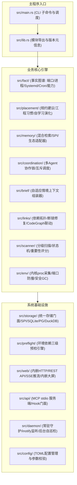
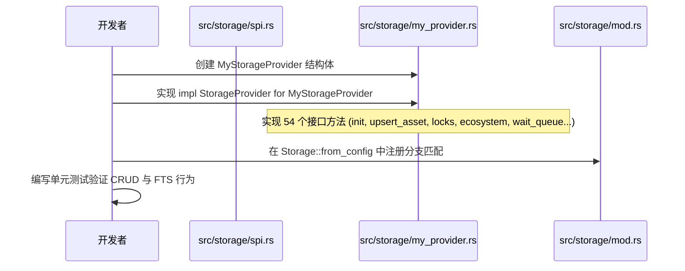

# Agent Host Steward — 开发者全景开发指南 (面向开发者)

> **目标受众**：Rust 研发工程师、开源贡献者、智能体插件与 MCP 工具生态开发者  
> **工程要求**：严格类型安全 · 零内存泄漏 · 100% 测试全绿门禁 · 工业级可调试性

---

## 一、源码工程组织全景图

Agent Host Steward 采用高内聚、低耦合的模块化设计。核心源码集中于 `src/` 目录：



### 核心模块目录速查表

| 目录/模块 | 核心职责 | 关键数据类型 / 入口结构 |
|:---|:---|:---|
| `src/storage/` | 存储中枢与多后端 SPI 抽象 | `StorageProvider`, `SqliteStorageProvider`, `PgStorageProvider`, `DuckDbStorageProvider` |
| `src/fact/` | 宿主机只读物理事实采集 | `FactFacade`, `CapabilityAnnotation`, `AutomationScanner`, `PropertyGraphOrganizer` |
| `src/coordination/`| 多 Agent 协作锁与排它协调 | `CoordinationEngine`, `CoordinationLock`, `LockRegistry` |
| `src/placement/` | 资产规范放置与行为聚类学习 | `PlacementEngine`, `PlacementLearner`, `ConventionChecker` |
| `src/memory/` | 跨会话长期记忆与三方适配 | `MemoryManager`, `BuiltinLocalProvider`, `Mem0Adapter`, `LettaAdapter`, `PowerContextAdapter` |
| `src/links/` | 依赖关系网与爆炸半径推演 | `LinksEngine`, `CodeGraphBridge`, `LinkRepairer` |
| `src/scanner/` | 资产扫描与断点续扫状态机 | `Scanner`, `ScanStateMachine`, `ImportanceScorer` |
| `src/api/` | 38 个原生 MCP 工具服务端 | `McpServer`, `AgentHookEngine`, `StewardResponse` |
| `src/platform/` | 跨平台原生探针 (Linux/macOS/Windows) | `PlatformProbe`, `LinuxProbe`, `MacosProbe`, `WindowsProbe` |
| `src/mesh/` | 轻量多机联邦 HTTP Peer Mesh | `MeshClient`, `MeshNodeFacts`, `handle_mesh_*` |
| `src/ecosystem/` | MCP/SKILL 目录、外部服务通讯录与 Context 防爆路由 | `McpConfigScanner`, `SkillCatalogScanner`, `ExternalContactsManager`, `ContextBudgetRouter` |
| `src/hooks/` | HOOK 事件总线与自动同步/生成/Pipeline | `EventBus`, `HookDispatcher`, `AutoSyncEngine`, `ClientHookGenerator`, `HookPipelineEngine` |
| `src/session/` | 会话生命周期自动绑定与安全归档 | `SessionManager`, `SessionLifecycleManager` |
| `src/web/` | 内嵌轻量 HTTP 引擎与大屏 | `WebServer`, `HttpRequest`, `TopologyGraph`, `LockViewItem` |
| `src/preflight/` | 运行时依赖预检与降级保护 | `PreflightChecker`, `PreflightReport`, `CheckItem` |
| `src/brief/` | 自适应情境上下文组装器 | `BriefAssembler`, `BriefQuality` |
| `src/changes/` | 宿主变更历史与开工回溯摘要 | `ChangesEngine` |
| `src/daemon/` | 常驻守护进程与后台巡检调度 | `StewardDaemon`, `BackgroundScheduler` |
| `src/env/` | 内核 `/proc` 进程采集、端口防撞与安全 GC | `EnvCollector`, `PortChecker`, `HostGarbageCollector` |
| `src/tui/` | 交互式终端全景实时看板 | `TuiDashboard` |
| `src/watcher/` | `inotify` 文件监听与 300ms 防抖流水线 | `FileWatcher`, `ChangeHandler` |
| `src/config/` | TOML 配置文件引导与参数校验 | `Config`, `WebConfig`, `StorageConfig` |

---

## 二、本地开发环境与日常命令流

### 1. 环境准备与依赖
本项目基于 Rust 1.99.0+ 构建。编译 DuckDB bundled 与 SQLite bundled 需要基础 C/C++ 工具链：

```bash
# Ubuntu / Debian
apt-get update && apt-get install -y gcc g++ make cmake libstdc++6

# 确保 Cargo 工具链生效
export PATH="/root/.cargo/bin:$PATH"
```

### 2. 常用开发命令流

```bash
# 1. 快速语法与类型检查 (耗时约 2~4 秒)
cargo check

# 2. 运行全量 161 项自动化测试套件
cargo test

# 3. 运行特定模块的单元测试 (如测试 web 模块)
cargo test web::tests

# 4. 运行端到端集成测试
cargo test --test test_web_dashboard
cargo test --test coordination_integration

# 5. 运行微基准压测
cargo test --test benchmarks -- --nocapture

# 6. 编译 Release 生产二进制
cargo build --release
```

---

## 三、三大核心扩展实战指南 (How-Tos)

### How-To 1: 如何添加一个新的原生 MCP 工具？

系统原生注册了 38 个 MCP 工具。若需新增一个例如 `steward_system_clean` 工具：

1. **在 `src/api/mcp_tools.rs` 中声明工具元数据**：
   ```rust
   // 定义入参结构
   #[derive(Debug, Deserialize)]
   pub struct SystemCleanParams {
       pub dry_run: Option<bool>,
   }

   // 在 list_tools() 注册 Tool 定义
   Tool {
       name: "steward_system_clean".to_string(),
       description: "扫描并清理系统过期的临时构建残留".to_string(),
       input_schema: serde_json::json!({
           "type": "object",
           "properties": {
               "dry_run": { "type": "boolean", "description": "是否仅预览" }
           }
       }),
   }
   ```

2. **在 `call_tool()` 分发匹配执行**：
   ```rust
   "steward_system_clean" => {
       let params: SystemCleanParams = serde_json::from_value(args)?;
       let result = my_engine.clean(params.dry_run.unwrap_or(true))?;
       Ok(CallToolResult::text(serde_json::to_string_pretty(&result)?))
   }
   ```

---

### How-To 2: 如何扩展一个新的 StorageProvider 存储后端？

大管家通过 `StorageProvider` Trait 抽象底层持久化。扩展新存储引擎（如 MySQL 或 RocksDB）流程：



核心需实现的契约骨架：
```rust
use crate::storage::spi::StorageProvider;
use anyhow::Result;

pub struct MyCustomProvider { /* 连接句柄 */ }

impl StorageProvider for MyCustomProvider {
    fn init(&self) -> Result<()> { /* 创建 schema */ Ok(()) }
    fn provider_name(&self) -> &'static str { "custom" }
    // 实现其余 38+ 个接口...
}
```

---

### How-To 3: 如何扩展环境预检项 (Preflight Check)？

当引入新的系统特性（如依赖特定 Linux 内核能力）时，必须在 `src/preflight/` 中增加预检项：

```rust
// 在 src/preflight/mod.rs 中定义检查函数
pub fn check_custom_feature() -> CheckItem {
    let exists = std::path::Path::new("/dev/my_device").exists();
    CheckItem {
        name: "Custom Device Access".to_string(),
        category: CheckCategory::Optional,
        status: if exists { CheckStatus::Pass } else { CheckStatus::Warn },
        message: if exists { "设备就绪".to_string() } else { "未挂载自定义设备".to_string() },
        remedy: Some("请在宿主机执行 mknod 或使用特权容器".to_string()),
    }
}
```

---

## 四、质量门禁与断点续传开发规范

1. **零 Panic 原则**：在非测试代码中，严禁在生产路径直接使用 `unwrap()` 或 `expect()`。一律使用 `anyhow::Result` 或 `thiserror` 向上冒泡错误。
2. **四层贯通准则**：
   - 增加配置项 -> `src/config/` + `config.example.toml` + `INSTALL.md`；
   - 增加 MCP 工具 -> `src/api/` + `manual/04-mcp-integration.md` + 单元测试。
3. **断点续传检查点机制**：
   - 在开发任何跨步骤大型特性时，必须在 `src_doc/progress.md` 中建立检查点表格；
   - 确保中断后任何新会话均能通过读取 `progress.md` 恢复上下文无缝继续。
