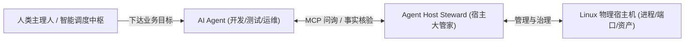
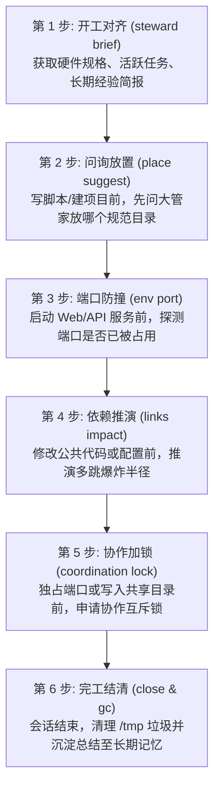

# Agent Host Steward — 用户与 Agent 终极实操指南 (面向用户)

> **目标受众**：人类工程师、系统运维管理员、以及运行在物理宿主机中的各类 AI Agent 智能体  
> **核心体验**：零幻觉感知 · 杜绝系统碰撞 · 规范资产治理 · 极简开箱即用

---

## 一、大管家的心智模型：你是谁？大管家是谁？

在没有 Agent Host Steward 之前，Agent 在 Linux 机器上干活就像盲人走钢丝：不知端口谁在用、不知公用库放在哪、不知改动一个配置文件会不会搞垮后台服务。

**Agent Host Steward（宿主环境大管家）** 就是你的**物理世界领航员与安全哨兵**：
- 它对系统底层（进程、端口、systemd、定时任务、文件拓扑）**了如指掌**；
- 它对主人习惯（脚本放哪、项目放哪、临时文件放哪）**烂熟于心**；
- 它对多 Agent 协同（谁在占端口、谁在写目录）**秩序井然**。



---

## 二、典型工作流六部曲（Agent 闭环作业 SOP）

无论你是人类手动通过 CLI 运维，还是 AI Agent 自动化作业，遵循以下标准闭环流程可确保系统稳定与资产规整：



### 1. 开工对齐：`steward brief`
一键获取宿主机当前客观规格、最近修改过的资产、活跃服务与历史排障经验：
```bash
agent-steward brief
```

### 2. 问询放置：`steward place suggest`
准备写一个美股财报抓取脚本？绝不随手乱丢在当前工作区：
```bash
agent-steward place suggest --type script --name sec_crawler --intent "抓取美股财报"
```
> **大管家返回**：建议放置在 `/root/new/shared_proj/sec_crawler/`，临时数据丢 `/root/new/tmp/`。

### 3. 端口防撞：`steward env port`
准备启动一个测试 API 服务？先看 8080 是否被已有生产进程占用：
```bash
agent-steward env port 8080
```
> **大管家返回**：8080 已被 PID `18493` (`uvicorn`) 占用！推荐改用空闲端口 `8081` 或 `8082`。

### 4. 依赖推演：`steward links impact`
准备重构或改动公共模块？先看谁在依赖它：
```bash
agent-steward links impact /root/new/shared_proj/test.py
```
> **大管家返回**：发现 2 个 systemd 服务与 3 个定时任务依赖该文件，盲目修改将引发次生灾害！

### 5. 并发协作锁：`agent-steward coordination`
多 Agent 协作防止踩踏，锁定工作目录或通信端口：
```bash
# 查看当前所有活跃的协作互斥锁
agent-steward coordination list

# 异常超时锁管理员手动强制释放
agent-steward coordination release --lock-id "lock-port-8080"
```

### 6. 会话完工结清：`steward close`
任务完成，一键清理垃圾并归档沉淀：
```bash
agent-steward close session-20261118-01 --clean-temp
```

---

## 三、三大接入方式全景

### 方式 1：CLI 命令行终端操作（人类最爱）
适合日常快速巡检、排障与脚本编写：
```bash
agent-steward status       # 查看大管家健康状态
agent-steward tui          # 启动全屏终端 ANSI 实时看板
agent-steward memory search "数据库连接池排障" --hybrid # 混合检索记忆
```

### 方式 2：AI Agent MCP 原生挂载（智能体首选）
在 Claude Desktop、Cursor 或 Antigravity 的配置文件中添加（即插即用 31 个原生工具）：
```json
{
  "mcpServers": {
    "agent-steward": {
      "command": "/root/new/work/agent-steward/target/release/agent-steward",
      "args": ["mcp"]
    }
  }
}
```

### 方式 3：基于浏览器的 Web 可视化大屏
单二进制内嵌 Web 监控大屏，零外部依赖极速启动：
```bash
agent-steward web --port 8765
```
打开浏览器访问 `http://127.0.0.1:8765`，全景观测：
- 🌐 宿主机物理拓扑（进程、端口、服务连线图）；
- 🔒 活跃协作锁矩阵与剩余 TTL 倒计时；
- ⚡ 全链路 SSE 实时事件滚动推流。

```
┌────────────────────────────────────────────────────────────────────────┐
│  🌐 Agent Host Steward 监控大屏控制台 (http://127.0.0.1:8765)           │
├───────────────────────────────────┬────────────────────────────────────┤
│ 事实图谱拓扑视图 (Canvas 力导向图)│ 活跃多 Agent 协作锁矩阵            │
│  [进程] -> :8080 [端口]           │  • port:8080 (Exclusive, 45s TTL)  │
│  [服务] -> steward.service        │  • dir:/work (Shared, 120s TTL)    │
│  [资产] -> shared_proj/           │                                    │
│                                   │ ⚡ 实时 SSE 事件推流                │
│                                   │  [18:20] Agent-A 申请加锁成功      │
└───────────────────────────────────┴────────────────────────────────────┘
```

---

## 四、常见问题速查表 (FAQ)

| 疑问 / 现象 | 根因解释 | 快速解决指引 |
|:---|:---|:---|
| **执行命令报 `steward: command not found`** | 编译产物在 `target/release/`，未加入系统 PATH | 执行 `export PATH="/root/new/work/agent-steward/target/release:$PATH"` |
| **端口已被占用，大管家如何处理？** | 内核 `/proc/net/tcp` 扫描到绑定记录 | `steward env port <PORT>` 会直接列出占用者的 PID、进程名及推荐的备选端口 |
| **多 Agent 并发操作报 `CONFLICT` 锁冲突** | 另一 Agent 持有该资源排他锁或祖先目录排他锁 | 等待持锁 Agent 释放或租约到期；紧急情况下可用 `coordination release` 强制释放 |
| **Web 监控大屏在外部机器打不开** | 默认仅监听本地安全地址 `127.0.0.1` | 启动时添加 `--host 0.0.0.0` 允许跨网络访问：`agent-steward web --host 0.0.0.0` |
| **数据存放在哪里？如何备份？** | 默认全部持久化在 `~/.steward/` 目录下 | 备份 `~/.steward/steward.db` 文件或通过 `agent-steward storage migrate` 导出 |
