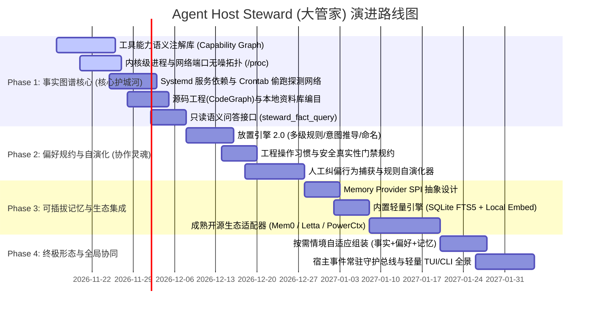

# 09 — 模块化大管家演进路线图 (Modular Roadmap)

> Agent Host Steward 产品设计 · 交付件 9/9  
> 版本: v2.0 · 编制: 联合创始人 (digoal德哥 & Antigravity) · 日期: 2026-11-15  
> 战略方向: **事实图谱为基石护城河 · 偏好规约为协作准则 · 记忆模块开放插拔成熟生态**

---

## 一、战略路线全景总览 (Overview)

---

## 二、四大阶段里程碑详述

### 【Phase 1: 宿主机事实图谱核心（Host Reality Graph Core）】—— 铸就绝对护城河
> **目标**：彻底消除 Agent 对宿主机物理世界的“全盲”状态。提供零幻觉、带语义注解的只读事实接口。  
> **核心原则**：不写主观推断，只采集客观物理真理；不仅给物理路径，更给**工具能力语义**与**推荐用法**。

| 模块 | 核心任务与交付件 | 验收标准 (DoD) |
|------|----------------|----------------|
| **1. 工具能力语义注解库 (Capability Graph)** | • 扫描系统 `$PATH` 及已安装系统包； • 内置 100+ 类实用工具的“能力知识库”（涵盖 PDF 解析、图像处理、音视频转码、JSON 处理、网络抓包、极速检索等）； • 提炼常用命令的最佳实践参数（如 `pdftotext -layout`，`ffmpeg -c:v libx264`）。 | Agent 发起 `steward_fact_query(type="capability", intent="处理 PDF 提取排版文字")`，秒级返回 `pdftotext`、物理路径、版本、推荐参数及备选工具。 |
| **2. 运行时进程与网络拓扑 (/proc & Ports)** | • 基于 Linux `/proc` 文件系统与内核网络套接字微秒级扫描； • 过滤系统内核底噪（`kworker` 等），专注应用进程； • 端口反查：PID、完整执行命令行、Cwd 工作目录、运行时间、监听 IP。 | 询问“8080 端口被谁占了”，准确返回占用进程的 PID、命令行和工作目录；起服务前调用 `steward_port_check` 实现冲突预警。 |
| **3. 系统自动化依赖网络 (Systemd & Cron)** | • 解析 `/etc/systemd/system/` 单元文件的 `ExecStart`、`EnvironmentFile`、`WorkingDirectory`； • 扫描系统级与用户级 `crontab` 任务（识别何时跑、跑哪个脚本、输出到何处）； • 建立“配置文件 -> 服务”的依赖双向边。 | Agent 问“改了某个 config 会影响哪个后台服务”，能指出依赖它的 systemd 服务；能列出所有“偷跑的 cron 任务”。 |
| **4. 源码库与本地资料编目 (Code & Assets)** | • 自动发现 `/root/new/src`、`/root/new/work` 下的 Git 仓库； • 检测仓库是否存在 `.codegraph`，提示 Agent 优先调用 codegraph； • 编目 `/root/new/note/` 权威网站清单与离线知识库。 | Agent 问“本地有哪些数据库源码或参考资料”，大管家直接返回已克隆项目列表、代码地图就绪状态与权威清单路径。 |
| **5. 统一只读查询接口 (Read-Only API)** | • 实现 `steward_fact_query`、`steward_port_check`、`steward_automation_map` 原生 MCP 工具； • 严格只读，零破坏性，单次查询延迟 < 50ms。 | 在 Claude / Cursor / Antigravity 中挂载 MCP，均能流畅调用且回答零幻觉。 |

---

### 【Phase 2: 偏好模块深度化与纠偏自演化（Preference & Governance）】—— 协作灵魂
> **目标**：解决“用户偏好把文件放哪”、“用户偏好遵守什么工程习惯”，实现人机默契，杜绝地皮污染。  
> **核心原则**：规范是活的，从用户的纠正行为中自主学习进化。

| 模块 | 核心任务与交付件 | 验收标准 (DoD) |
|------|----------------|----------------|
| **1. 放置规则引擎 2.0 (Placement Engine)** | • 支持基准物理路径规约（`/root/new/shared_proj`, `/root/new/skills`, `/root/new/tmp` 等）； • 引入意图打分与模糊匹配； • 自动执行命名规范校验（小写、下划线、禁止非法字符）。 | Agent 请求放置建议时，根据其任务意图推荐符合用户偏好的绝对路径与命名规范。 |
| **2. 工程操作习惯规约 (Conventions)** | • 固化用户工程习惯：有 `.codegraph` 优先用 CodeGraph，禁止全盘 `grep`； • 写入技术文档时强制数据源溯源，禁止捏造数字； • 时区强制统一为北京时间（Asia/Shanghai）。 | 在 brief 和放置建议中主动附加工程规范提醒，形成统一协作纪律。 |
| **3. 纠偏自演化学习器 (Rule Learner)** | • inotify 监听 Agent 产生文件的后续移动与重命名行为； • 识别“Agent 放在 A，用户移动到 B”的纠偏模式； • 自动提炼新规则草案，更新偏好规则库。 | 当用户多次纠正某一类文件位置后，大管家自动沉淀为新规则，后续 Agent 咨询时直接应用新偏好。 |

---

### 【Phase 3: 记忆模块可插拔架构与生态集成（Pluggable Memory）】—— 生态共赢
> **目标**：绝不重复发明轮子，开放拥抱成熟开源记忆生态（Mem0, Letta, PowerContext, Zep 等）。  
> **核心原则**：统一接口 SPI，开箱自带轻量默认实现，一行配置无缝外挂第三方。

| 模块 | 核心任务与交付件 | 验收标准 (DoD) |
|------|----------------|----------------|
| **1. Memory Provider SPI 抽象** | • 在 Rust 核心中抽象 `MemoryProvider` Trait； • 统一 `search`、`store`、`get_context`、`evict` 契约； • 保证上层 MCP 工具与具体记忆实现彻底解耦。 | 无论底层是 SQLite 还是外部服务，上层统一调用 `steward_memory_search` / `steward_memory_store`。 |
| **2. 内置轻量引擎 (Built-in Local Provider)** | • 基于 SQLite FTS5 + 本地 Ollama/微型 Embedding； • 支持 BM25 + 向量 RRF 混合重排序； • 零外部网络依赖，单机开箱即用。 | 在无任何外部服务时，大管家自包含完成跨会话关键决策沉淀与检索。 |
| **3. 成熟开源适配器 (Ecosystem Adapters)** | • **Mem0 Adapter**: 桥接 Mem0 REST API，享受工业级事实提取与用户画像； • **Letta Adapter**: 桥接 Letta 核心与归档记忆； • **PowerContext Adapter**: 桥接针对本地工程优化的上下文体系。 | 在 `steward.toml` 中配置 `provider = "mem0"`，透明切换到 Mem0 服务，无需修改 Agent 客户端。 |

---

### 【Phase 4: 终极形态与全局协同（Unified Steward Engine）】—— 智能中枢
> **目标**：事实、偏好、记忆深度交融，成为 Agent 在 Linux 宿主机上不可或缺的智能中枢。

| 模块 | 核心任务与交付件 | 验收标准 (DoD) |
|------|----------------|----------------|
| **1. 自适应情境组装 (Adaptive Context Injection)** | • 在 Agent 开工时，根据任务意图动态从“事实图谱 + 偏好规约 + 记忆经验”中提取 Top-K 精准上下文； • 严格控制 Prompt 体积（< 1500 tokens），防止上下文污染。 | 开工一次调用 `steward_brief`，Agent 立即获得当前机器最相关的事实、偏好与避坑经验。 |
| **2. 常驻守护总线与自动化巡检 (Daemon & Bus)** | • systemd 常驻守护，常驻内存 < 30MB，CPU 空闲 < 0.5%； • inotify 变更事件流自动维护事实图谱更新； • 孤儿进程诊断与临时文件 TTL 定时回收。 | 系统长期运行无内存泄漏，临时文件不堆积，图谱随物理环境实时保鲜。 |
| **3. 全景可视化 CLI / TUI** | • 提供 `agent-steward tui` / `agent-steward status`； • 终端一屏展示：事实图谱节点数、活跃端口、偏好规则、记忆连接状态。 | 开发者随时在终端输入命令，直观查看大管家对宿主机的全景认知状态。 |

---

## 三、各阶段实施原则（先设计、先规约、后代码）

1. **先规约、后代码**：每一个子模块实施前，必须先定义好数据 Schema 与接口契约；
2. **零破坏、纯只读事实**：事实图谱模块严禁对宿主机产生任何副作用操作，保障绝对安全；
3. **分层验证、可复现落地**：每个阶段均设立明确可测量的 DoD，并在宿主机上实操验证。
