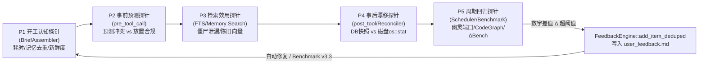

# 13 — 全生命周期信息新鲜度对账与五点对比探针闭环自进化规格说明书

> **Agent Host Steward 产品设计 · 交付件 13**  
> **版本**: v1.0 · **编制**: Antigravity · **日期**: 2026-11-21  
> **对齐约束**: [README.md 规约 #21, #22](../README.md) · [ISSUE #21, #22](../README.md#L406) · [roadmap-phase38-39.md](../src_doc/roadmap-phase38-39.md)

---

## 一、七大信息过旧漏斗（`STALE-01 ~ STALE-07`）与根治机制

宿主机信息过旧并非单一文件改删漏同步，而是分布在存储、索引、向量、图谱、记忆与外部工具链中的 7 类生命周期断层：

| 漏斗编号 | 过旧类型 | 现网实测症状 | 根治策略（Phase 38 落地） |
|:---:|---|---|---|
| **`STALE-01`** | 修改后旧向量与 L2 描述僵尸驻留 | `assets.size_bytes` 与磁盘失配（34 条），`embedding` 仍保留旧向量且 `backfill_embeddings.py` 永不重算 | `merge_with_existing_asset` 在 `old_hash != new_hash` 或尺寸变化时写入 `embedding_status="stale"` 与 `annotation_status="needs_re_enrich"`；`upsert_asset` 检测到 `"stale"` 自动重置 `embedding = '[]'`。 |
| **`STALE-02`** | 文件删除后 FTS 与图谱仍召回幽灵 | `search_assets_fts` 未过滤 `status='active'`（19 条 `missing` 仍可搜中）；`ChangeHandler` 未删 `file:<path>` 节点与入向边 | `search_assets_fts` 在 SQLite/PG/DuckDB 三后端统一强制 `status = 'active'`；`Deleted` 分支级联清理 `fact_nodes`、`links` 入出边与 `auto_sync` 记忆。 |
| **`STALE-03`** | `AutoSyncEngine` 同文件摘要记忆重复堆叠 | `edit_file` 每次新建记忆，导致 `user_feedback.md` 摘要在 `brief` Top-5 中霸屏重复 | `AutoSyncEngine` 插入 `产出文件 \`<path>\` 摘要:` 前先将同路径旧活跃记忆全部归档为 `"archived"`，并调用 `LinksEngine::refresh_links_for_asset`。 |
| **`STALE-04`** | `fact_nodes` 历史端口/文件节点只增不删 | 实听端口仅 ~12 个，库内残留 84 个 `port:*` 节点及失踪 `file:` 节点 | 新增 SPI `delete_fact_node`；`PropertyGraphOrganizer::build_host_graph` 与 `FreshnessReconciler` 按物理实测剪除幽灵节点。 |
| **`STALE-05`** | `inotify` 盲区与离线窗口漏同步 | `skills/`、`note/`、`src/` 或守护停机期间变更未入库 | `FreshnessReconciler::reconcile` 在 `BackgroundScheduler`（30min）与 `feedback reconcile` 按需对账，补齐磁盘存在性与 `mtime`/`size` 对齐。 |
| **`STALE-06`** | 微观 `.codegraph/codegraph.db` 滞后于源码 | 源码修改后 `.codegraph` 未重索引导致符号穿透陈旧 | `FreshnessReconciler` 对比 `.codegraph/codegraph.db` 与源码目录 `mtime`，在简报与探针报告中提示需要 `codegraph sync`。 |
| **`STALE-07`** | 长期记忆引用失效路径未衰减 | `auto_sync` 记忆指向已删除文件却仍保持 `active` | 物理删除或对账标记 `missing` 时同步归档对应 `auto_sync` 记忆。 |

---

## 二、执行回路五点对比探针架构（`P1 ~ P5`）

### 2.1 五点探针精确规格

| 探针 | 放置位置 (Where) | 触发时机 (When) | 采集指标 (What) | 对比参照系 (Compare With) | 自愈与 `feedback add` 联动 |
|:---:|---|---|---|---|---|
| **`P1`** | `BriefAssembler` | 每次 `brief` 调用 | `brief_elapsed_us`、记忆唯一率、简报引用节点新鲜度 | SLA (`<=15ms`, 记忆唯一率 `>=85%`, 新鲜度 `100%`) | 低于阈值时触发记忆去重与新鲜度刷新；显著超时则自动登记 `CON` |
| **`P2`** | `AgentHookEngine::pre_tool_call` | 写文件/跑命令/绑端口前 | 事前冲突拦截数、路径放置合规率 | 先验拦截预测 vs `effectiveness_ledger` 事后实况 | 高频未覆盖越界路径自动记为规则演进线索 |
| **`P3`** | `McpToolRegistry` / `Storage::search_assets_fts` | 检索资产或记忆时 | `zombie_leak_count` (`status!='active'`)、`stale_vec_count` | `0` 僵尸泄漏、`0` 陈旧向量、`M2 <= 1500 μs` | 检出泄漏立即触发清理并生成数字证据条目 |
| **`P4`** | `AutoSyncEngine` / `FreshnessReconciler` | 文件改删后 / 对账时 | `drifted_assets`、`missing_assets`、`duplicate_memories` | DB 快照 (`size_bytes`/`mtime_secs`) vs 磁盘 `os::stat` | 写穿刷新并置 `embedding_status="stale"`；漂移率 `>1%` 上报 |
| **`P5`** | `BackgroundScheduler` / `SelfEvolutionProbeEngine` | 30min 巡检 / `feedback probes` | `ghost_port_nodes`、`stale_codegraph_repos`、最新两批 Benchmark 差值 $\Delta$ | `/proc` 实时监听端口、上一批 `benchmark_runs` | 剪除幽灵端口；若 Benchmark 出现质量/耗时退化自动去重入账 |
