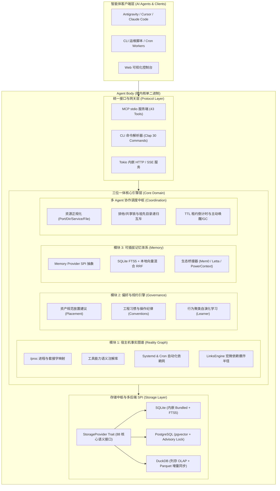
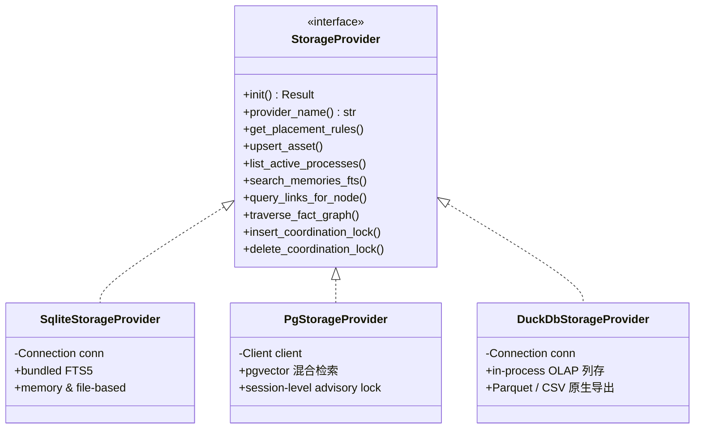
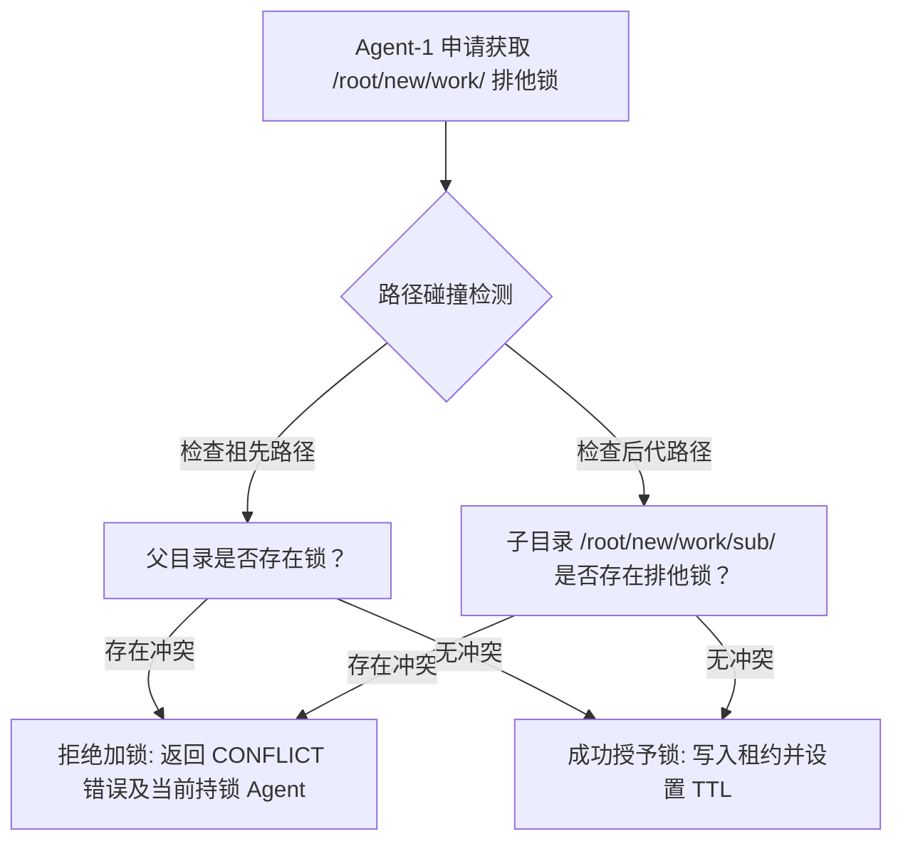
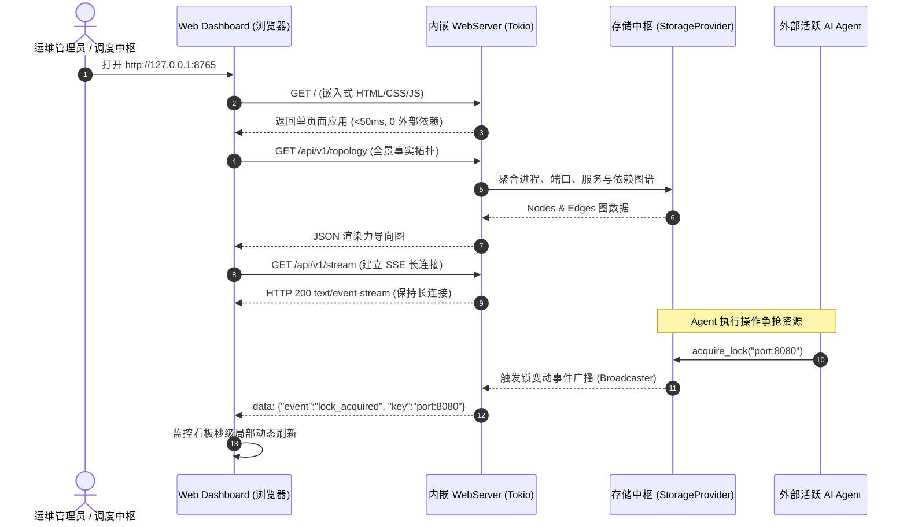

# Agent Body — Agent 本体架构设计与系统规格全景图 (面向架构师)

> **目标受众**：系统架构师、技术决策者、Agent 基础设施与智能体平台研发负责人  
> **核心定位**：**脑体分离架构下的 Agent 本体（宿主机具身底座）**——LLM 为可随时切换的瞬态大脑，本工具为永驻宿主机的数字躯干（原外置辅助工具隐喻为本体面向环境治理与比较优势协同的两大侧面）  
> **设计哲学**：三位一体认知底座 · 递弱代偿原子边界 · 单二进制微内核交付 · 亚毫秒级响应

---

## 一、架构背景与战略定位

### 1. 痛点：Agent 在物理宿主机的“盲人摸象”困境

当前大语言模型（LLM）与智能体系统（Agentic Workflows）已经具备极强的跨会话文本推理与代码生成能力，但当 Agent 真正运行在 Linux 宿主机物理环境时，存在一个致命的**客观物理认知鸿沟**：

```
传统架构痛点:
┌────────────────────────────────────────────────────────────────────────┐
│                        AI Agent (逻辑与推理空间)                        │
└───────────────────────────────────┬────────────────────────────────────┘
                                    │ 盲目执行 shell 命令 / 试错探测
                                    ▼
┌────────────────────────────────────────────────────────────────────────┐
│                       Linux 宿主机 (物理运行空间)                      │
│                                                                        │
│ • 盲目端口绑定: 尝试 bind 8080，导致已有生产进程崩溃                     │
│ • 盲目依赖安装: 不知系统已有 pdftotext，反复 pip install 报错          │
│ • 盲目文件修改: 修改通用配置文件，引发后台依赖该文件的 systemd 服务瘫痪 │
│ • 资源竞争踩踏: 多 Agent 并发操作同一目录/文件，无协作锁导致脏写        │
│ • 垃圾泛滥失控: 大量中间测试脚本随手乱丢，导致工作区污染与内存泄漏      │
└────────────────────────────────────────────────────────────────────────┘
```

**Agent Body（Agent 本体 · 宿主机具身底座）** 的使命，就是作为驻留在宿主机中的**单二进制客观物理世界具身躯干（包含感官、小脑反射、海马体连续性、规约脊柱、代谢免疫与多体协同六大器官）**，为瞬态接入的 AI Agent 大脑提供零幻觉、结构化、毫秒级响应的系统全景感知、跨大脑接力、协作准则与稳态治理。

---

## 二、三位一体核心架构模型

系统严格解耦为**事实、偏好、记忆**三大领域，确立三位一体架构：



---

## 三、关键子系统架构深度剖析

### 1. 存储层抽象：统一 SPI 驱动的多引擎拓扑

为了兼顾“极简无网络单机交付”与“企业级大规模分析并发”，存储架构采用了**基于 SPI 的统一中枢门面模式 (Facade + SPI Provider)**：



- **双向无损热迁移 (`StorageMigrator`)**：支持从 SQLite 到 PostgreSQL / DuckDB 的全量数据冷热迁移；
- **增量同步管道 (`SyncPipeline`)**：基于 `sync_watermark` 高水位标记，以毫秒级时延将主库事务流水同步至分析型 DuckDB 副本，实现 OLTP 与 OLAP 物理负载隔离。

### 4. 微内核 (`kernel/`) 与周边 (`contrib/`) 分离及四大发行版谱系 (Phase 70~73 · ISSUE #52)

借鉴 PostgreSQL `src/backend/` + `contrib/` 插件体系，项目完成微内核与周边的物理和逻辑分离（详见 [20-plugin-microkernel-architecture-spec.md](../design_doc/20-plugin-microkernel-architecture-spec.md)）：

- **纯机制微内核 (`kernel/`)**：由 `body-sdk`（6 大开放 Routine + 7 大 Lifecycle Hook + 只读 `ObservabilityProvider` + `body_module_magic!()`）、`body-protocol`（`.control.toml` 前缀隔离校验与 JSON-RPC 2.0 线协议）及 `body-kernel`（8 张 `body_cat_*` 目录表 + 5 张基表 + `ScopedSqlExecutor` + `KernelDispatcher` 四端自动派发 + `KernelStatsRegistry` / `InFlightRegistry` / `SlowOpRing` + 轨 B `OutOfProcessFdwAdapter` 超时强杀沙盒）组成，`make arch-check` 强制守卫零跨层依赖与零周边业务/观测协议词污染；
- **独立周边扩展 (`contrib/`)**：统一采用标准五件套（`Cargo.toml` + `.control.toml` + `sql/` `ext_<id>__*` + `body_module_magic!()` + `contrib/<ext>/tests/regress.rs`），已落地 12 个模块（`idx_fts_fuzzy`、`gov_placement`、`probe_db_engines` 及面向运维/政务云/可观测/事务海马体 `M1~M3` 与嵌入式 openCypher 图谱的 `probe_linux_ops`、`probe_jvm_middleware`、`hook_auth_mtls_rbac`、`hook_gov_compliance`、`hook_audit_siem`、`fdw_cmdb_ticket`、`obs_telemetry`、`mem_pg_tx`、`graph_relate`）；
- **四大发行版谱系 (`distributions/`)**：旗舰全功能版 `agent-body`（向后兼容 43 工具与 DuckDB/WebUI，支持 `GET /metrics`、W3C `traceparent` 与 `AGENT_BODY_LOG_FORMAT=json`）与三大零 C++/零 DuckDB 精简发行版——`agent-body-kernel-minimal`（3.9 MB，0 `contrib`）、`agent-body-probe`（6.7 MB，政务云/AIOps 极简探针）及 `agent-body-dba`（6.4 MB，PG/达梦/人大金仓专项哨兵，详见 [21-observability-and-telemetry-spec.md](../design_doc/21-observability-and-telemetry-spec.md)）。

---

### 2. 多 Agent 协作锁与互斥协调模型 (`CoordinationEngine`)

在多 Agent 并发作业环境下，资源竞争会导致灾难性的冲突（例如同时修改同一目录下的文件，或争抢同一测试端口）。

#### (1) 资源正规化与层级互斥传播
系统抽象了 5 大资源类型（`Port`, `Directory`, `Service`, `File`, `Custom`），并实现了**目录祖先-后代递归互斥传播算法**：



#### (2) 存储层原子保证
- **SQLite 模式**：通过单写者事务与 `coordination_locks` 表约束保证互斥；
- **PostgreSQL 模式**：将资源标识通过确定性散列（Murmur3/CityHash）映射为 `i64` Key，原生调用底层 **PG Advisory Lock (`pg_try_advisory_lock`)**，实现跨连接、跨会话的内核级强互斥。

---

### 3. 内嵌式 Web 可视化大屏与实时可观测性体系



---

## 四、工业级非功能特性设计 (NFR)

| 架构维度 | 设计指标 | 落地实现手段 |
|:---|:---|:---|
| **交付形态** | 微内核单二进制 | Rust 静态链接，HTML/CSS/JS 与 SQLite 驱动编译期嵌入，无外挂动态库依赖 |
| **启动性能** | 冷启动 `< 50ms` | 零复杂框架初始化，零重型反射机制，首帧亚毫秒级就绪 |
| **资源开销** | 空闲内存 `< 25MB` | Tokio 协程多路复用，无请求时 CPU 利用率趋近于 0 |
| **运行可用性** | 99.99% 防御性容错 | 运行时执行 `Preflight` 预检，内核级 `/proc` 与 inotify 缺失时优雅降级 |
| **并发吞吐** | 10,000+ QPS (本地) | 亚毫秒内存/嵌入式 FTS 检索，锁判定与冲突检测耗时 `< 1ms` |
| **实证可核验** | 100% 有据可查（规约 #18） | 三轨实证引擎 v4.1：W1~W22 同机 A/B 负载 + M1~M6 微基准 SLA + DQ1~DQ12 质量、AWR 与快权重血缘门禁 + COMP-C1~C4 竞品对标 + PR-01~16 生产效能账本与 SHA-256 防篡改签名 |

---

## 五、架构边界与“递弱代偿”原则

根据王东岳“递弱代偿”哲学：**系统越往底层，其功能越基础（原子化），其生存度与不可替代性越高**。

1. **坚持只读事实核心**：宿主机事实图谱严禁推导不可验证的主观假设；
2. **坚持 Agent-Native 语义输出**：数据响应以纯净、结构化、无幻觉为第一原则；
3. **坚持轻量防踩踏底座**：Agent 本体不负责代替 Agent 写业务代码，而是作为哨兵规避物理世界碰撞。
