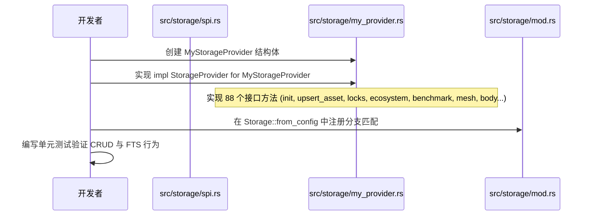

# Agent Body — Agent 本体开发者全景开发指南 (面向开发者)

> **目标受众**：Rust 研发工程师、开源贡献者、智能体插件与 MCP 工具生态开发者  
> **定位准则**：**脑体分离架构下的 Agent 本体（宿主机具身底座，27 模块 / 43 MCP / 88 SPI / 27 表 · 0 `>1000L` 文件 · 微内核 3 crates / contrib 11 扩展 / 3 精简发行版）**，严守三层命名兼容纪律（对外叙事为 Agent 本体，底层 `agent-body` / `body_*` / `~/.agent-body/` 100% 向后兼容）  
> **工程要求**：严格类型安全 · 零内存泄漏 · 100% 测试全绿门禁 · 工业级可调试性

---

## 一、源码工程组织全景图

Agent Body 采用“微内核 (`kernel/`) + 独立周边 (`contrib/`) + 多发行版 (`distributions/`)”与旗舰主干 (`src/`) 并行兼容的模块化架构：

- `kernel/`：纯机制微内核底座（`body-sdk` / `body-protocol` / `body-kernel`，含只读 `ObservabilityProvider` 与 `KernelObservability`），受 `scripts/arch_boundary_check.py` 强制约束零业务/观测协议词污染；
- `contrib/`：11 个按需挂载的标准五件套扩展模块（`idx_fts_fuzzy` / `gov_placement` / `probe_db_engines` / `probe_linux_ops` / `probe_jvm_middleware` / `hook_auth_mtls_rbac` / `hook_gov_compliance` / `hook_audit_siem` / `fdw_cmdb_ticket` / `obs_telemetry` / `mem_pg_tx`，详见 [21-observability-and-telemetry-spec.md](../design_doc/21-observability-and-telemetry-spec.md) 与 [22-pg-tx-memory-spi-a-to-b-spec.md](../design_doc/22-pg-tx-memory-spi-a-to-b-spec.md)）；
- `distributions/`：3 个零 C++/DuckDB 精简发行版装配入口（`kernel-minimal` / `aiops-probe` / `dba-sentinel`）；
- `src/`：旗舰全功能版核心源码（27 个顶层模块）：

```mermaid
graph TD
    subgraph MainApp["主程序入口"]
        M["src/main.rs (CLI 子命令与调度)"]
        L["src/lib.rs (模块导出与版本元信息)"]
    end

        subgraph CoreEngines["业务核心引擎"]
            FACT["src/fact/ (事实图谱: 端口/进程/Systemd/Cron/L1~L3 属性图)"]
            PLACE["src/placement/ (规约建议/工程习惯/自学习演化)"]
            MEM["src/memory/ (混合检索/SPI/生态适配器)"]
            COORD["src/coordination/ (多Agent协作锁/WFG死锁/互斥调度)"]
            BRIEF["src/brief/ (自适应情境上下文组装器 + AOPCC 乐观租约)"]
            LINKS["src/links/ (分层加权依赖拓扑/断链修复/CodeGraph联动)"]
            SCAN["src/scanner/ (分级扫描/全链路脱敏/抗投毒/三层元数据)"]
            ENV["src/env/ (内核proc采集/端口防撞/安全GC)"]
            BENCH["src/benchmark/ (三轨 Benchmark v4.1 / PR-01~16 账本)"]
            FB["src/feedback/ (使用反馈总账 / 新鲜度对账 / P1~P5 探针)"]
            BODY["src/body/ (Agent 本体中枢: 身份证/接力胶囊/五维稳态/L0~L3/18 AWR)"]
        end

    subgraph Infrastructure["系统基础设施"]
        STORAGE["src/storage/ (统一存储门面/88 SPI/SQLite/PG/DuckDB)"]
        PRE["src/preflight/ (环境依赖三级预检引擎)"]
        WEB["src/web/ (内嵌HTTP/REST API/SSE推流/9大工作台)"]
        MCP["src/api/ (MCP stdio 服务端 43 Tools / AOPCC Hook门面)"]
        DAEMON["src/daemon/ (常驻守护/inotify监听/后台自巡检)"]
        CFG["src/config/ (TOML配置管理与参数校验)"]
    end

    M --> L
    L --> CoreEngines
    CoreEngines --> Infrastructure
```



### 核心模块目录速查表

| 目录/模块 | 核心职责 | 关键数据类型 / 入口结构 |
|:---|:---|:---|
| `src/storage/` | 存储中枢、多后端分域 SPI (88 方法，27 表) 与事务式老库无损自愈 (`schema_reconcile.rs`) | `StorageProvider`, `SqliteStorageProvider`, `PgStorageProvider`, `DuckDbStorageProvider` |
| `src/body/` | Agent 本体中枢（身份证、跨大脑接力胶囊、五维稳态、`L0~L3` 包络、三态运行模式与 Shadow A/B 证伪、`18/18` Wait Events AWR/ADDM） | `BodyManifestEngine`, `ContinuityManager`, `HomeostasisVitalsEngine`, `AutonomyEnvelope`, `BodyPerfEngine`, `ShadowAbEngine` |
| `src/audit/` | 双域全链路行为审计（`IN_AGENT`/`OUT_OF_AGENT`）、60s 折叠与自进化 | `AuditLogger`, `AuditEvolutionAnalyzer` |
| `src/fact/` | 宿主机只读物理事实采集、L1~L3 属性图与行业 Know-How/Hierarchy 知识网络 | `FactFacade`, `CapabilityAnnotation`, `AutomationScanner`, `PropertyGraphOrganizer`, `KnowledgeNetworkEngine` |
| `src/coordination/`| 多 Agent 协作锁、排队唤醒与 WFG 死锁检测 | `CoordinationEngine`, `CoordinationLock`, `DeadlockDetector` |
| `src/placement/` | 资产规范放置与行为聚类学习 | `PlacementEngine`, `PlacementLearner`, `ConventionChecker` |
| `src/memory/` | 跨会话长期记忆、PG 事务级海马体 (`PgTxMemoryAdapter` / `SleepCompactionOrchestrator` / `FastWeightOrchestrator`)、三方适配与 Omni-RRF 多路融合检索 | `MemoryManager`, `TxMemoryProvider`, `PgTxMemoryAdapter`, `FastWeightOrchestrator`, `BuiltinMemoryProvider`, `Mem0Adapter`, `LettaAdapter`, `PowerContextAdapter` |
| `src/links/` | 分层加权依赖关系网与爆炸半径推演 | `LinksEngine`, `CodeGraphBridge`, `LinkRepairer` |
| `src/scanner/` | 资产扫描、全链路脱敏、抗投毒、多模态深度解析（L1A+L2）、原子 Know-How 抽取与 Omni-RRF 检索 | `Scanner`, `SecretRedactor`, `PromptInjectionScanner`, `MultimodalExtractor`, `KnowHowExtractor`, `AssetSearchEngine`, `OllamaAnnotator` |
| `src/api/` | 43 个原生 MCP 工具服务端（含 `core`/`dev`/`ops`/`full` Schema 减税档位） | `McpServer`, `AgentHookEngine`, `BodyResponse` |
| `src/benchmark/` | 三轨实证 Benchmark v4.1 (`W1~W22`/`M1~M6`/`DQ1~DQ12`/`PR-01~16`) | `BenchmarkEngine`, `EffectivenessLedger`, `ProvenanceRule` |
| `src/feedback/` | 使用反馈总账、新鲜度对账与五点对比自进化探针 | `FeedbackEngine`, `FreshnessReconciler`, `SelfEvolutionProbeEngine` |
| `src/demo/` | 路演沙盒引擎与 ROI 核算 | `DemoEngine`, `DemoExecutionResult`, `RoiReport` |
| `src/platform/` | 跨平台原生探针 (Linux/macOS/Windows) | `PlatformProbe`, `LinuxProbe`, `MacosProbe`, `WindowsProbe` |
| `src/mesh/` | 轻量多机联邦 HTTP Peer Mesh & `MeshEnvelope v1.0` | `MeshClient`, `MeshNodeFacts`, `MeshEnvelope` |
| `src/ecosystem/` | MCP/SKILL 目录、外部服务通讯录与 Context 防爆路由 | `McpConfigScanner`, `SkillCatalogScanner`, `ExternalContactsManager`, `ContextBudgetRouter` |
| `src/hooks/` | HOOK 事件总线、自动同步、客户端生成与碰壁秒级自愈 | `EventBus`, `AutoSyncEngine`, `ClientHookGenerator`, `OptimisticFailureDiagnoser` |
| `src/session/` | 会话生命周期自动绑定与安全归档 | `SessionManager`, `SessionLifecycleManager` |
| `src/web/` | 内嵌轻量 HTTP 引擎与昼夜蓝图 9 大工作台 | `WebServer`, `HttpRequest`, `TopologyGraph`, `LockViewItem` |
| `src/preflight/` | 运行时依赖预检与降级保护 | `PreflightChecker`, `PreflightReport`, `CheckItem` |
| `src/brief/` | 自适应情境上下文组装器与 AOPCC 乐观租约 | `BriefAssembler`, `BriefQuality`, `OptimisticLeaseEngine` |
| `src/changes/` | 宿主变更历史与开工回溯摘要 | `ChangesEngine` |
| `src/daemon/` | 常驻守护进程与后台巡检调度 | `BodyDaemon`, `BackgroundScheduler` |
| `src/env/` | 内核 `/proc` 进程采集、端口防撞与安全 GC | `EnvCollector`, `PortChecker`, `HostGarbageCollector` |
| `src/tui/` | 交互式终端全景实时看板 | `TuiDashboard` |
| `src/watcher/` | `inotify` 文件监听与 300ms 防抖流水线 | `FileWatcher`, `ChangeHandler` |
| `src/config/` | TOML 配置文件引导与参数校验 | `Config`, `WebConfig`, `StorageConfig` |

---

## 二、本地开发环境与日常命令流

### 1. 环境准备与依赖
本项目基于 Rust 1.99.0+ 构建。编译 DuckDB bundled 与 SQLite bundled 需要基础 C/C++ 工具链：

```bash
# Ubuntu / Debian
apt-get update && apt-get install -y gcc g++ make cmake libstdc++6

# 确保 Cargo 工具链生效
export PATH="$HOME/.cargo/bin:$PATH"
```

### 2. 常用开发命令流

```bash
# 1. 快速语法与类型检查 (耗时约 2~4 秒)
cargo check

# 2. 运行全工作区 435 项自动化测试套件（含旗舰版 387 + kernel 27 + contrib 17 + distributions 4）
RUST_TEST_THREADS=1 cargo test --workspace

# 2b. 单独校验微内核防腐边界、Playwright WebUI 9 工作台 + 老库迁移 E2E 与精简发行版自检
make arch-check && make verify-webui
cargo build --release -p agent-body-kernel-minimal -p agent-body-probe -p agent-body-dba
./target/release/agent-body-probe self-check && ./target/release/agent-body-dba self-check

# 3. 运行特定模块的单元测试 (如测试 web 模块)
cargo test web::tests

# 4. 运行核心端到端与回归集成测试
cargo test --test schema_migration_regression
cargo test --test mcp_all_tools_e2e
cargo test --test web_full_e2e
cargo test --test coordination_integration

# 5. 运行微基准压测
cargo test --test benchmarks -- --nocapture

# 6. 编译 Release 生产二进制
cargo build --release
```

---

## 三、三大核心扩展实战指南 (How-Tos)

### How-To 1: 如何添加一个新的原生 MCP 工具？

系统原生注册了 43 个 MCP 工具。若需新增一个例如 `body_system_clean` 工具：

1. **在 `src/api/mcp_schemas.rs` & `src/api/mcp_tools/mod.rs` 中声明与分发工具**：
   ```rust
   // 定义入参结构
   #[derive(Debug, Deserialize)]
   pub struct SystemCleanParams {
       pub dry_run: Option<bool>,
   }

   // 在 all_tool_schemas() 注册 Tool 定义
   Tool {
       name: "body_system_clean".to_string(),
       description: "扫描并清理系统过期的临时构建残留".to_string(),
       input_schema: serde_json::json!({
           "type": "object",
           "properties": {
               "dry_run": { "type": "boolean", "description": "是否仅预览" }
           }
       }),
   }
   ```

2. **在 `call_tool_inner()` 分发匹配执行**（并同步 `cli_args.rs` + `cli_handlers/*` + `parity_api/*`）：
   ```rust
   "body_system_clean" => {
       let params: SystemCleanParams = serde_json::from_value(args)?;
       let result = my_engine.clean(params.dry_run.unwrap_or(true))?;
       Ok(CallToolResult::text(serde_json::to_string_pretty(&result)?))
   }
   ```

---

### How-To 2: 如何扩展一个新的 StorageProvider 存储后端？

Agent 本体通过 `StorageProvider` Trait 抽象底层持久化。扩展新存储引擎（如 MySQL 或 RocksDB）流程：



核心需实现的契约骨架：
```rust
use crate::storage::spi::StorageProvider;
use anyhow::Result;

pub struct MyCustomProvider { /* 连接句柄 */ }

impl StorageProvider for MyCustomProvider {
    fn init(&self) -> Result<()> { /* 创建 schema */ Ok(()) }
    fn provider_name(&self) -> &'static str { "custom" }
    // 实现其余 86 个接口（共 88 个 SPI 方法）...
}
```

---

### How-To 3: 如何扩展环境预检项 (Preflight Check)？

当引入新的系统特性（如依赖特定 Linux 内核能力）时，必须在 `src/preflight/` 中增加预检项：

```rust
// 在 src/preflight/mod.rs 中定义检查函数
pub fn check_custom_feature() -> CheckItem {
    let exists = std::path::Path::new("/dev/my_device").exists();
    CheckItem {
        name: "Custom Device Access".to_string(),
        category: CheckCategory::Optional,
        status: if exists { CheckStatus::Pass } else { CheckStatus::Warn },
        message: if exists { "设备就绪".to_string() } else { "未挂载自定义设备".to_string() },
        remedy: Some("请在宿主机执行 mknod 或使用特权容器".to_string()),
    }
}
```

---

### How-To 4: 如何在 `contrib/` 新增一个标准五件套扩展？

凡是行业、操作系统发行版、中间件或合规规则能力，均严禁写入 `kernel/`，必须按标准五件套落在 `contrib/<ext_name>/`：
1. `Cargo.toml`：单向依赖 `agent-body-sdk`（与按需 `agent-body-protocol`），严禁依赖兄弟 `contrib/` 或根包；
2. `<ext_name>.control.toml`：声明 `id`、`kind`（`compiled_crate` / `out_of_process`）、`table_prefix = "ext_<ext_name>__"` 与提供的 Routine/Hook 能力；
3. `sql/<ext_name>--0.1.0.sql`：所有 `TABLE` 与 `INDEX` 命名必须严格以 `ext_<ext_name>__` 开头（由 `ScopedSqlExecutor` 拦截校验）；
4. `src/lib.rs`：实现 `BodyExtension` Trait 并在 Crate 根调用 `body_module_magic!();`；
5. `contrib/<ext_name>/tests/regress.rs`：在 `KernelRuntime` 上完成独立安装与端到端回归测试，并执行 `make arch-check && make quality-gate` 校验零边界越权。

---

## 四、质量门禁与断点续传开发规范

1. **零 Panic 原则**：在非测试代码中，严禁在生产路径直接使用 `unwrap()` 或 `expect()`。一律使用 `anyhow::Result` 或 `thiserror` 向上冒泡错误（`make lint-panic` 门禁）。
2. **四层贯通与防漂移门禁**：
   - 增加配置项 -> `src/config/` + `config.example.toml` + `INSTALL.md`；
   - 增加或调整 MCP/CLI/Web 工具 -> `src/api/mcp_schemas.rs` + `src/api/mcp_tools/mod.rs` + `src/main.rs` + `src/web/` + `docs/manual/03,04,08` + `skills/` + `make evolution-check`。
3. **零重扫与断点续传检查点机制**：
   - 新会话先读根目录 [EVOLUTION_GUIDE.md](../../EVOLUTION_GUIDE.md) 与当前活跃 `docs/src_doc/roadmap-phase*.md`，跑 `make evolution-check` 并用 `codegraph explore` 查符号；
   - 在 `docs/src_doc/roadmap-phase*.md` 与总表 `docs/src_doc/progress.md` 中维护原子检查点表格，确保中断后任何新会话均可瞬间恢复上下文无缝继续。
