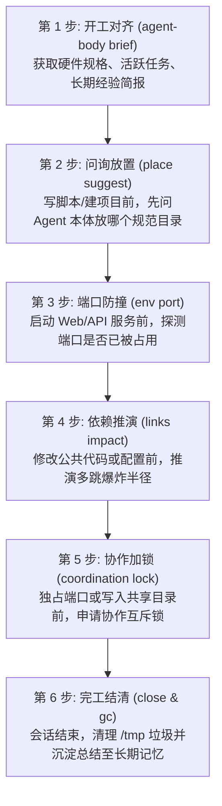

# Agent Body — Agent 本体实操指南 (面向用户与瞬态大脑)

> **目标受众**：人类主理人、系统运维管理员、以及接入宿主机干活的各类 AI Agent 大脑（Antigravity / Claude Code / Cursor / Codex）  
> **核心体验**：脑体分离 · 本体感觉零幻觉 · 换脑不失忆 · 稳态自愈 · 极简开箱即用

---

## 一、心智模型：脑体分离下的「Agent 本体」

在没有 **Agent 本体** 之前，大模型客户端（LLM）就像只有临时大脑皮层、却没有物理身体的孤魂：换个窗口就失忆、不知端口谁在用、不知公用库放在哪、不知改动配置会不会搞垮后台服务。

**Agent Body** 就是驻留在物理宿主机上的 **Agent 本体（Agent Embodiment Substrate）**（统筹本体的**感官盘点能力**与**防撞稳态能力**）：
- **感官与本体感觉**：对系统底层（进程、端口、systemd、定时任务、文件拓扑）**了如指掌**；
- **脊柱与反射弧**：对主人习惯（脚本/项目/临时文件规范）与痛觉红线（`L0~L3` 权限包络）**条件反射式拦截**；
- **海马体与连续性**：为换脑/换客户端交接提供 `<300 tok` **跨大脑接力胶囊**，实现换脑不失忆；
- **社会协同**：多大脑共享同一宿主机时通过协作锁与 WFG 死锁检测维持秩序。


---

## 二、典型工作流六部曲（Agent 闭环作业 SOP）

无论你是人类手动通过 CLI 运维，还是 AI Agent 自动化作业，遵循以下标准闭环流程可确保系统稳定与资产规整：



### 1. 开工对齐与领取乐观租约：`agent-body brief`
一键获取宿主机当前客观规格、最近修改过的资产、活跃服务、历史排障经验，以及 **⚡ AOPCC 乐观直通契约 (`Optimistic Leases`)**（如本机 `:5432` PostgreSQL、已就绪 CLI 与 `<temp_dir>` 沙盒），允许低风险可逆操作免前置查询直接执行（失败时由 `PostToolUse` `<2ms` 注入替代处方）：
```bash
agent-body brief
```

### 2. 问询放置：`agent-body place suggest`
准备写一个美股财报抓取脚本？绝不随手乱丢在当前工作区：
```bash
agent-body place suggest --type script --name sec_crawler --intent "抓取美股财报"
```
> **本体返回**：建议放置在 `<workspace_base>/shared_proj/sec_crawler/`，临时数据丢 `<temp_dir>`。

### 3. 端口防撞：`agent-body env port`
准备启动一个测试 API 服务？先看 8080 是否被已有生产进程占用：
```bash
agent-body env port 8080
```
> **Agent 本体返回**：8080 已被 PID `18493` (`uvicorn`) 占用！推荐改用空闲端口 `8081` 或 `8082`。

### 4. 依赖推演：`agent-body links impact`
准备重构或改动公共模块？先看谁在依赖它：
```bash
agent-body links impact <workspace_base>/shared_proj/test.py
```
> **Agent 本体返回**：发现 2 个 systemd 服务与 3 个定时任务依赖该文件，盲目修改将引发次生灾害！

### 5. 并发协作锁：`agent-body coordination`
多 Agent 协作防止踩踏，锁定工作目录或通信端口：
```bash
# 查看当前所有活跃的协作互斥锁
agent-body coordination list

# 异常超时锁管理员手动强制释放
agent-body coordination release --lock-id "lock-port-8080"
```

### 6. 会话完工结清：`agent-body close`
任务完成，一键清理垃圾并归档沉淀：
```bash
agent-body close session-20261118-01 --clean-temp
```

---

## 三、三大接入方式与四大发行版选择

### 0. 按场景选择发行版（Phase 70~73）

| 发行版 | Release 二进制 | 运行依赖 | 适用场景与快速自检 |
|---|---|---|---|
| **个人旗舰版** | `agent-body` | SQLite + DuckDB (`libstdc++6`) + Web UI | 个人开发者 / 本机全功能伴侣（43 MCP + Web 大屏 + `/metrics` + Benchmark v3.9） |
| **政务云 AIOps 探针** | `agent-body-probe` (`6.7 MB`) | **纯 Rust（零 DuckDB / 零 C++）** | 服务器与政务云只读采集、mTLS/RLS、脱敏、SIEM 与可观测自诊断（`self-check` / `metrics` / `diagnose`） |
| **DBA 专项哨兵** | `agent-body-dba` (`6.4 MB`) | **纯 Rust（零 DuckDB / 零 C++）** | PostgreSQL / 达梦 / 人大金仓配置诊断、脱敏与指标导出（`self-check` / `metrics` / `diagnose`） |
| **纯微内核验证版** | `agent-body-kernel-minimal` (`3.9 MB`) | **纯 Rust（0 `contrib`）** | 验证微内核目录表、Hooks 与轨 B 沙盒最小基座（`agent-body-kernel-minimal self-check`） |

### 方式 1：CLI 命令行终端操作（人类最爱）
适合日常快速巡检、排障与脚本编写：
```bash
agent-body status       # 查看Agent 本体健康状态
agent-body tui          # 启动全屏终端 ANSI 实时看板
agent-body body metrics --format prometheus   # 导出 OpenMetrics 0.0.4 指标
agent-body memory search "数据库连接池排障" --hybrid # 混合检索记忆
```

### 方式 2：AI Agent MCP 原生挂载（智能体首选）
在 Claude Desktop、Cursor 或 Antigravity 的配置文件中添加（即插即用 **43 个原生工具**，含本体中枢 `body_state`）：
```json
{
  "mcpServers": {
    "agent-body": {
      "command": "/root/new/work/agent-body/target/release/agent-body",
      "args": ["mcp"]
    }
  }
}
```

### 方式 3：基于浏览器的 Web 可视化大屏
单二进制内嵌 Web 监控大屏，零外部依赖极速启动：
```bash
agent-body web --port 8765
```
打开浏览器访问 `http://127.0.0.1:8765`，全景观测（支持 `T` 键实时切换「☀️ 白天工程蓝图 / 🌙 夜间深空」双主题）：
- 🌐 宿主机物理拓扑（进程、端口、服务连线图）；
- 🔒 活跃协作锁矩阵、等待队列与 WFG 死锁雷达；
- 🎬 7 幕真引擎路演演示剧场与 📊 实证基准存证账本（等价黑屏 CLI：`agent-body bench`）；
- 📡 内置 `/metrics` OpenMetrics 0.0.4 实时抓取（含 Web 工作台预览面板）与全响应 `X-Trace-Id` / W3C `traceparent` 追踪；
- ⚡ 全链路 SSE 实时事件滚动推流与全局黑屏命令镜像。

```
┌────────────────────────────────────────────────────────────────────────┐
│  🌐 Agent Body 监控大屏控制台 (http://127.0.0.1:8765)           │
├───────────────────────────────────┬────────────────────────────────────┤
│ 事实图谱拓扑视图 (Canvas 力导向图)│ 活跃多 Agent 协作锁矩阵            │
│  [进程] -> :8080 [端口]           │  • port:8080 (Exclusive, 45s TTL)  │
│  [服务] -> agent-body.service     │  • dir:/work (Shared, 120s TTL)    │
│  [资产] -> shared_proj/           │                                    │
│                                   │ ⚡ 实时 SSE 事件推流                │
│                                   │  [18:20] Agent-A 申请加锁成功      │
└───────────────────────────────────┴────────────────────────────────────┘
```

---

## 四、常见问题速查表 (FAQ)

| 疑问 / 现象 | 根因解释 | 快速解决指引 |
|:---|:---|:---|
| **执行命令报 `agent-body: command not found`** | 编译产物在 `target/release/`，未加入系统 PATH | 执行 `export PATH="<workspace>/target/release:$PATH"` 或运行 `make restart` 安装至 `/usr/local/bin` |
| **端口已被占用，本体如何处理？** | 内核 `/proc/net/tcp` 扫描到绑定记录 | `agent-body env port <PORT>` 会直接列出占用者的 PID、进程名及推荐的备选端口 |
| **多 Agent 并发操作报 `CONFLICT` 锁冲突** | 另一 Agent 持有该资源排他锁或祖先目录排他锁 | 等待持锁 Agent 释放或租约到期；紧急情况下可用 `coordination release` 强制释放 |
| **Web 监控大屏在外部机器打不开** | 默认仅监听本地安全地址 `127.0.0.1` | 启动时添加 `--host 0.0.0.0` 允许跨网络访问：`agent-body web --host 0.0.0.0` |
| **数据存放在哪里？如何备份？** | 默认全部持久化在 `~/.agent-body/` 目录下 | 备份 `~/.agent-body/body.db` 文件或通过 `agent-body storage migrate` 导出 |
