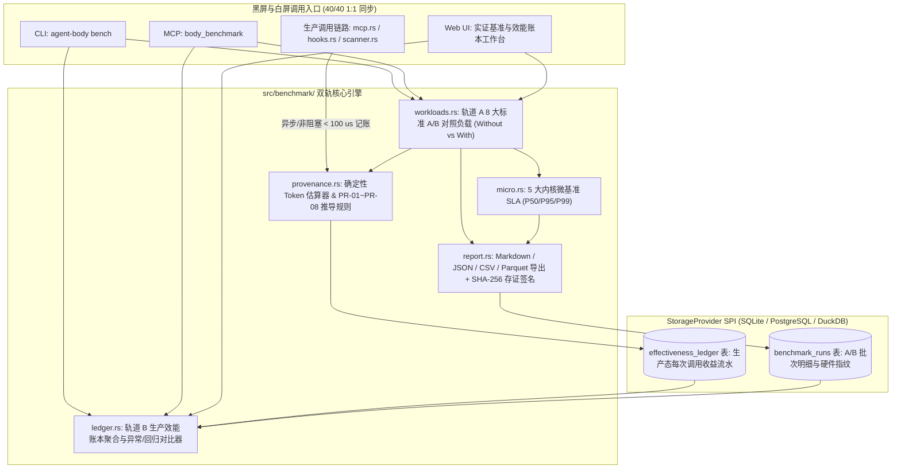

# 10 — 实证 Benchmark 对照评测与生产效能存证账本规格说明书 (Benchmark & Verifiable ROI Spec)

> **Agent Body 产品设计 · 交付件 10**  
> **版本**: v0.4.0 → Phase 27~64 演进基线（当前 Spec **`v3.9`** · `v1.1.0`） · **编制**: Antigravity · **日期**: 2026-11-27  
> **对齐约束**: [README.md 规约 #1、#5、#9、#12、#13、#16、#17、#18](../../README.md#L234-L311) · [ISSUE.md #13](../../ISSUE.md#L73)

---

## 一、设计背景与第一性原理：什么叫真正的“效果有据可查”？

### 1.1 现网基线审计与评测盲区

截至 `v0.4.0`（23 个 `src/lib.rs` 顶层模块、39 个黑白屏 1:1 同步 MCP 工具、55 个 `StorageProvider` SPI 方法、198 项通过测试），本机现网数据库 `/root/.agent-body/body.db` 已真实沉淀 `26,081` 条纳管资产、`6,397` 条代码/服务依赖边、`336` 个属性图节点、`77` 条属性图边、`121` 个本地 SKILL 与 `5` 个 MCP Server。然而从“使用效果有据可查”的第一性原理审视，现有测评体系存在三个结构性盲区：

1. **微基准与业务收益脱节**：[tests/benchmarks.rs](../../tests/benchmarks.rs) 仅包含 5 个底层函数微基准（属性图 3 跳遍历、FTS5 检索、放置决策、DuckDB 聚合与 Parquet 导出）。它们只回答了“Rust 函数跑得有多快”，**没有回答“AI Agent 用上Agent 本体后，到底比不用少花了多少 Token、少走了多少弯路、少踩了多少坑”**。
2. **静态估算缺乏物理基线对照**：[src/demo/mod.rs](../../src/demo/mod.rs) 的 `DemoEngine` 虽已呈现 6 大路演对比场景与 `compute_roi()` 快照，但缺少可独立复现的 **Without Agent Body 裸奔真实探针基线** 与 **With Agent Body Agent 本体赋能实测** 成对跑批机制，无法输出跨版本可对比、带 SHA-256 校验摘要的基准评测报告。
3. **缺少生产运行态持久记账（Telemetry Ledger）**：日常每一次 `body_brief`、`body_skill_route`、`body_hook_pre`、`body_asset_scan`、`body_links_audit` 产生的实际收益，目前“用完即逝”。如果运行一周后主理人追问：*“Agent 本体这 7 天到底帮我省了多少 Token、拦截了多少次端口冲突和黑名单扫爆？”*——系统拿不出一本带推导公式编号的原始流水账。

### 1.2 核心设计哲学：双轨实证闭环 (Dual-Track Empirical Loop)

为严格履行 [README.md 规约 #5（实事求是、零捏造）](../../README.md#L249-L251) 与 **规约 #18（实证基准与效能有据可查）**，确立以下双轨（现已演进至含轨道 C 竞品对标的三轨）架构：

- **轨道 A — 实验室可复现 A/B 对照基准引擎 (`BenchmarkEngine`)**：
  在同一台宿主机、同一个时间窗口、同一个隔离沙盒（`bench:*` 命名空间）内，先真实执行 **Without Agent Body（裸奔模式物理等价操作）** 记录基线耗时、输出字节/Token、探索轮次与故障/噪音数，再执行 **With Agent Body（Agent 本体 API/引擎）** 记录实测结果；两者自动配对计算加速比、压缩率与拦截率，并生成带宿主机硬件/Git 指纹与 SHA-256 内容签名的不可抵赖评测报告。
- **轨道 B — 生产运行态效能存证账本 (`EffectivenessLedger`)**：
  在日常每次 MCP 调用、CLI 执行、Pre/Post Hook 门禁和分层扫描完成时，以 `< 100 μs` 极低开销向 `effectiveness_ledger` 表追加一条不可伪造的效能事件；每一条收益记录都必须显式携带**确定性推导规则 ID (`provenance_rule`: `PR-01` ~ `PR-08`)**、原始输入规模 (`baseline_tokens` / `raw_bytes`)、实际输出规模 (`body_tokens` / `body_bytes`) 及真实微秒耗时 (`elapsed_us`)，做到 **笔笔有依据、条条可反算**。

---

## 二、五维量化评估指标体系 (5-Dimension Evaluation Matrix)

所有评测批次（轨道 A）与生产流水（轨道 B）统一收敛至以下 5 个正交评估维度：

| 维度 ID | 维度名称 | 核心指标字段 | 数学定义与物理口径 |
|:---:|---|---|---|
| **D1** | **上下文与 Token 经济性**<br/>(`Token Efficiency`) | `baseline_tokens`<br/>`body_tokens`<br/>`tokens_saved`<br/>`token_savings_pct` | 统一由确定性分词估算器 `estimate_tokens(text)` 计算：<br/>ASCII 按 `ceil(ascii_bytes / 4.0)`，多字节 CJK 按 `ceil(non_ascii_chars * 1.5)`，并同步落盘 `baseline_bytes` 与 `body_bytes`。<br/>`tokens_saved = baseline_tokens.saturating_sub(body_tokens)`<br/>`token_savings_pct = (tokens_saved / baseline_tokens) * 100.0` |
| **D2** | **探索轮次收敛度**<br/>(`Exploration Turn Reduction`) | `baseline_rounds`<br/>`body_rounds`<br/>`rounds_saved` | `baseline_rounds`：裸奔 Agent 完成等价宿主认知或排障所需的最少工具/Shell 交互轮次；<br/>`body_rounds`：使用Agent 本体所需调用次数（通常为 `1`）；<br/>`rounds_saved = baseline_rounds.saturating_sub(body_rounds)` |
| **D3** | **端到端耗时与延迟 SLA**<br/>(`Wall-Clock Latency & Speedup`) | `baseline_elapsed_us`<br/>`body_elapsed_us`<br/>`speedup_factor`<br/>`p50_us` / `p95_us` / `p99_us` | 由 Rust `std::time::Instant` 实测的真实物理耗时（微秒）。<br/>`speedup_factor = baseline_elapsed_us as f64 / body_elapsed_us.max(1) as f64`<br/>内核微基准额外采样多次迭代的 `P50 / P95 / P99` 分位数与预算上限对比。 |
| **D4** | **风险与冲突事前拦截率**<br/>(`Hazard Interception`) | `baseline_failures`<br/>`hazards_intercepted`<br/>`interception_rate_pct` | 统计原本会发生的端口碰撞（占用进程端口）、并发排他锁踩踏/WFG 死锁、路径违规散落以及悬空断链漏检数，对比 Pre-Hook 与图谱审计在执行前成功阻断/预警的比例。 |
| **D5** | **数据治理纯净度与底噪阻断**<br/>(`Noise Blocking & Purity`) | `raw_entries_count`<br/>`kept_entries_count`<br/>`blocked_noise_count`<br/>`noise_reduction_pct` | 统计未开启分级策略时全盘递归的条目总量 `raw_entries_count`，对比经过 `shallow` 黑名单阻断、`restricted` 受限深度与 `NoiseFilter` 过滤后的净入库量，计算噪音削减率。 |

---

## 三、双轨系统架构与数据流图



### 新增模块规划（`src/benchmark/` — 第 24 个顶层模块）

| 文件路径 | 职责与核心抽象 |
|---|---|
| `src/benchmark/mod.rs` | `BenchmarkEngine` 门面入口、隔离沙盒 `bench:*` 清理器 `reset_sandbox()`、宿主机指纹收集器（OS/CPU/Git Commit/DB 规模）。 |
| `src/benchmark/provenance.rs` | `estimate_tokens(text)` 确定性分词估算器、`ProvenanceRule` 枚举（`PR-01` ~ `PR-08`）及每条规则的静态文档描述与反算公式。 |
| `src/benchmark/workloads.rs` | 8 大标准业务工作负载（`W1` ~ `W8`）的 **Without Agent Body 裸奔真实探针** 与 **With Agent Body Agent 本体真引擎** 成对实跑器。 |
| `src/benchmark/micro.rs` | 纳管并升级现有 5 大微基准（`M1` ~ `M5`），统一采集 `avg_us` / `p50_us` / `p95_us` / `p99_us` 与 SLA 通过门禁判定。 |
| `src/benchmark/ledger.rs` | `EffectivenessLedger` 生产效能流水记录器（静默失败容错，绝不阻断主业务）、按时间窗（`24h`/`7d`/`30d`/`all`）与工具维度聚合成总账、以及跨版本 `compare_runs(run_a, run_b)` 回归检测器。 |
| `src/benchmark/report.rs` | 报告渲染与导出器：生成带 SHA-256 摘要签名的结构化 JSON、可发表 Markdown 评测报告（含 Mermaid 对比图表与原始命令参数表）及 DuckDB Parquet/CSV 归档。 |

---

## 四、轨道 A 详细规格：8 大标准业务负载 (`W1`~`W8`) 与 5 大内核微基准 (`M1`~`M5`)

> **铁律**：所有 `Without Agent Body` 基线数据必须由真实物理执行或宿主机当前真实目录/数据库采样得出，**严禁在代码里硬编码“假设裸奔需要 20 分钟”之类无实测支撑的常数**。为保障基准运行可安全重复且不拖慢 CI，所有隔离写入均限定在 `bench:*` 前缀与 `tempfile::TempDir` 中，并在结束后立即清除。

### 4.1 8 大标准业务工作负载 (Macro A/B Workloads)

| 负载 ID | 负载名称 | Without Agent Body（裸奔基线真机执行逻辑） | With Agent Body（大Agent 本体真引擎执行逻辑） | 核心评测维度 | 通过门禁 (SLA) |
|:---:|---|---|---|---|---|
| **W1** | `capability_discovery`<br/>（宿主工具能力发现） | 真实对 5 项常用宿主能力任务（PDF 文本提取、图片格式转换、音视频转码、极速文本检索、JSON 解析）依次执行 `which <candidates>` 与 `<bin> --version`/`--help` 外部进程探测，统计真实进程启动耗时与原始 help 文本字节/Token。 | 调用 1 次 `CapabilityEngine` 语义检索（或 5 项并发内存索引查询），记录真实耗时与精简结构化返回（路径、版本、推荐参数）Token。 | D1 Token<br/>D2 轮次<br/>D3 耗时 | `speedup >= 5x`<br/>`rounds_saved >= 4`<br/>`body_elapsed_us < 10_000` |
| **W2** | `port_collision_avoidance`<br/>（端口防撞与空闲选址） | 基于宿主机当前真实监听端口（`ProcessNetTopology` 取 1 个 `>=1024` 活跃端口作为靶标）与另外 4 个候选端口，模拟裸奔 Agent 盲目尝试 `TcpListener::bind` 撞车失败再顺延重试直至命中空闲端口的过程。 | 先调用 `AgentHookEngine::hook_pre("bind_port", {"port": target})` 拦截冲突，同时由 `PortChecker` 一次性返回占用进程 PID/Cwd 与推荐空闲端口，最后在推荐端口一次 `bind` 成功并立即释放。 | D2 轮次<br/>D3 耗时<br/>D4 拦截率 | `baseline_failures >= 1`<br/>`hazards_intercepted >= 1`<br/>`interception_rate == 100%` |
| **W3** | `granularity_scan_noise_gate`<br/>（分级扫描与噪音阻断） | 在独立 `TempDir` 中构建高保真混合项目树：包含正常源码/文档（`src/main.rs`, `README.md`），以及受限/黑名单/噪音夹层（`node_modules/` 120 文件、`.git/objects/` 80 文件、`__pycache__/` 40 `.pyc` 文件、`.cache/` 40 `.tmp/.log` 文件）；裸奔模式执行无过滤递归 `WalkDir` 统计全量入库条目与总字节数。 | 执行 `Scanner` + `PolicyMatcher` + `ImportanceScorer` + `NoiseFilter` 分级扫描，核对白名单深度入库与黑名单浅层阻断零逃逸（子文件 `0` 入库）。 | D1 Token<br/>D3 耗时<br/>D5 噪音阻断 | `noise_reduction_pct >= 80%`<br/>黑名单子文件入库数 `== 0` |
| **W4** | `placement_governance`<br/>（资产放置规范与防乱放） | 模拟 8 类待新建对象（可复用脚本、临时文件、技能、开源源码、重要笔记、工作项目等）默认裸放在当前项目根目录或使用驼峰非法命名（如 `TmpScript.py`），统计由此产生的规约违规数与假想二次搬迁成本。 | 逐一调用 `PlacementEngineV2::suggest` 与 `hook_pre("write_file", ...)`，统计违规路径事前拦截率、自动推导标准路径（如 `/root/new/shared_proj/...`）与蛇形命名修正率。 | D2 轮次<br/>D3 耗时<br/>D4 拦截率 | `body_elapsed_us < 5_000`<br/>`interception_rate == 100%` |
| **W5** | `dependency_impact_and_repair`<br/>（3 跳爆炸半径与断链自愈） | 在隔离工作树创建 40 个文件（含跨脚本/配置/Systemd Unit/Crontab 模拟 3 跳引用关系及 2 处刻意制造的重命名断链）；裸奔模式逐文件全文读取并用正则全量搜索引用链耗时与全文本 Token。 | 调用 `LinksEngine` 图查询获取 3 跳爆炸半径子图 + `LinkAuditor` 检出断链 + `LinkRepairer` 推演修复候选补丁。 | D1 Token<br/>D3 耗时<br/>D4 拦截率 | `hazards_intercepted >= 2`<br/>`token_savings_pct >= 70%` |
| **W6** | `multi_agent_deadlock_resolution`<br/>（并发抢锁与死锁破局） | 在 `bench:*` 沙盒中模拟双 Agent（`bench-alpha`、`bench-beta`）无死锁检测器时交叉申请排他锁陷入互相等待直至超时窗口（受控微秒/毫秒模拟超时窗口，如 50ms 探测基线）才能被迫中止的盲等代价。 | 使用 `CoordinationEngine` + `DeadlockDetector`（WFG DFS 环路检测）与 `LockWaitQueue`，实测从发起交叉排队到精准识别环路并裁决退让的微秒耗时。 | D3 耗时<br/>D4 拦截率 | `hazards_intercepted >= 1`<br/>`body_elapsed_us < 5_000` |
| **W7** | `context_budget_routing`<br/>（百级 SKILL 路由与渐进披露） | 读取宿主机真实存储中已纳管的全部 `skills_catalog`（当前 `121` 个）与 `mcp_catalog`（`5` 个）/工具清单全量 `est_tokens` 总和，再叠加 20 个命中源码文件的原始全文总 Token（L0+L1+全量正文）。 | 调用 `ContextBudgetRouter`（`budget_tokens = 600`）精准召回 Top-K 技能/工具名片，并采用 `Micro (~25 tok)` / `Standard (~85 tok)` 渐进元数据披露对比。 | D1 Token<br/>D3 耗时 | `token_savings_pct >= 90%`<br/>`body_tokens <= 1200` |
| **W8** | `adaptive_brief_assembly`<br/>（冷启动态势简报组装） | 在当前宿主机实跑等价的 6 步冷启动探索命令组合（系统硬件/磁盘读取、`/proc` 进程扫描、端口监听列表、`git status/log`、目录列表、近期笔记检索），累计真实执行耗时、6 轮交互开销与原始输出总 Token。 | 调用 1 次 `BriefAssembler::assemble(budget = 1500)`，记录单轮耗时、输出 Token 与简报信息密度评分（`quality_score`）。 | D1 Token<br/>D2 轮次<br/>D3 耗时 | `rounds_saved == 5`<br/>`body_elapsed_us < 50_000`<br/>`token_savings_pct >= 50%` |

### 4.2 5 大内核微基准 SLA (`M1`~`M5` — 复用并升级 `tests/benchmarks.rs`)

| 微基准 ID | 名称 | 基准负载规模 | 采集指标 | Debug SLA | Release SLA |
|:---:|---|---|---|---:|---:|
| **M1** | `micro_graph_3hop` | 100 节点 / 99~150 边，50 次迭代 | `avg_us`, `p50_us`, `p95_us`, `p99_us` | `< 5,000 μs` | `< 800 μs` |
| **M2** | `micro_fts5_search` | 300 条中文/英文混合资产，50 次迭代 | `avg_us`, `p50_us`, `p95_us`, `p99_us` | `< 5,000 μs` | `< 1,000 μs` |
| **M3** | `micro_placement_suggest` | 8 大放置规则模糊匹配，200 次迭代 | `avg_us`, `p50_us`, `p95_us`, `p99_us` | `< 1,000 μs` | `< 200 μs` |
| **M4** | `micro_duckdb_heatmap` | 1,000 条变更记录 OLAP 热力图 + Top-N 聚合，20 次迭代 | `avg_us`, `p50_us`, `p95_us`, `p99_us` | `< 150,000 μs` | `< 30,000 μs` |
| **M5** | `micro_duckdb_parquet` | 1,000 条资产全量列存导出 Parquet | `elapsed_us`, `file_size_bytes` | `< 500,000 μs` | `< 100,000 μs` |

---

## 五、轨道 B 详细规格：生产效能存证账本与确定性推导规则 (`PR-01` ~ `PR-08`)

生产运行期间，Agent 本体绝不随意“给每次调用加 1000 个 Token”。所有写入 `effectiveness_ledger` 表的收益事件，必须绑定以下 8 条可审计的确定性推导规则编号之一：

| 规则编号 | 触发工具 / 模块 | 基线规模 (`baseline_tokens` / `baseline_rounds`) 确定性公式 | 实际规模 (`body_tokens` / `body_rounds`) | 拦截 / 噪音字段记账规则 |
|:---:|---|---|---|---|
| **PR-01** | `body_skill_route` / `body_mcp_catalog` / `body_service_contact` | `baseline_tokens = sum(skills_catalog.est_tokens) + sum(mcp_catalog.est_tokens)`（从当前库实时求和，不写死数字）；`baseline_rounds = 3` | `body_tokens = estimate_tokens(routed_response)`；`body_rounds = 1` | 附带记录 `catalog_total_count` 与 `routed_count` |
| **PR-02** | `body_asset_search` / `body_asset_register` | `baseline_tokens = sum(matched_assets.size_bytes.min(65536) / 4)`（等价未索引时直接读取原始文件）；`baseline_rounds = 4` | `body_tokens = estimate_tokens(json_response)`（按 `Micro/Standard/Full` 披露级别实际返回）；`body_rounds = 1` | 记录 `disclosure_level` |
| **PR-03** | `body_hook_pre` (`AgentHookEngine::hook_pre`) | 当判定为 `BLOCK` 或 `WARN` 时：`baseline_rounds = 3`（避开崩溃+排障+重跑），`baseline_tokens = 600`（单次报错回溯平均栈/上下文，仅在发生真实拦截时入账） | `body_tokens = estimate_tokens(hook_response)`；`body_rounds = 1` | **`hazard_intercepted = 1`**，细节标明冲突类型（`port_occupied` / `lock_conflict` / `placement_violation`） |
| **PR-04** | `body_fact_query` / `body_port_check` / `body_env_processes` / `body_env_show` | 优先取最近一次 `benchmark_runs` 中 `W1/W2` 同类真实探针的平均原始输出 Token；若尚无基线运行记录，则保守按 `baseline_tokens = estimate_tokens(response) * 2` 且注明 `uncalibrated_floor`；`baseline_rounds = 4` | `body_tokens = estimate_tokens(response)`；`body_rounds = 1` | 若 `port_check` 发现端口已被占用，记 **`hazard_intercepted = 1`** |
| **PR-05** | `body_links_impact` / `body_links_audit` / `body_links_repair` / `body_codegraph_bridge` | `baseline_tokens = total_managed_code_assets_count.min(500) * 12`（或最近一次 `W5` 实测全扫描 Token）；`baseline_rounds = 4` | `body_tokens = estimate_tokens(response)`；`body_rounds = 1` | 每次 `links_audit` / `links_repair` 检出或生成修复方案的真实断链数 `N`，记 **`hazard_intercepted = N`** |
| **PR-06** | `body_asset_scan` / `Scanner` / `FileWatcher` | `raw_entries = kept_count + shallow_blocked_count + noise_filtered_count`；`baseline_tokens = noise_blocked_count * 25`（若未过滤将挤占 FTS/上下文的垃圾元数据开销） | `body_tokens = 0`（不入上下文）；`body_rounds = 1` | **`noise_blocked = shallow_blocked + noise_filtered`** |
| **PR-07** | `body_lock_acquire` / `body_lock_wait` / `body_lock_deadlock_check` | 仅当发生锁冲突拒批（`Denied`/`WaitQueued`）或检测到死锁环路时入账：`baseline_rounds = 3` | `body_rounds = 1` | **`hazard_intercepted = 1`**（或检出的环路数） |
| **PR-08** | `body_brief` (`BriefAssembler`) | 引用最近一次 `W8` 实测 6 步冷启动基线 Token 与 `baseline_rounds = 6`（无 `W8` 记录时采用保守实测下界并标注） | `body_tokens = estimate_tokens(brief_markdown)`；`body_rounds = 1` | 附带 `brief_quality_score` |

---

## 六、存储层数据模型与 SPI 契约扩展

在保持 **SQLite（`src/storage/schema.sql`）、PostgreSQL（`src/storage/pg_schema.sql`）、DuckDB（`src/storage/duckdb_schema.sql`）** 三后端结构等价的前提下，新增两张核心存证表：

### 6.1 `benchmark_runs`（A/B 基准评测批次表）

```sql
CREATE TABLE IF NOT EXISTS benchmark_runs (
    run_id TEXT PRIMARY KEY,
    suite_name TEXT NOT NULL,           -- 'full' | 'macro' | 'micro' | 'workload:W1' ...
    git_commit TEXT NOT NULL,
    app_version TEXT NOT NULL,
    host_fingerprint TEXT NOT NULL,     -- OS / Arch / CPU cores / DB asset count JSON
    workload_count INTEGER NOT NULL,
    total_baseline_tokens INTEGER NOT NULL,
    total_body_tokens INTEGER NOT NULL,
    overall_token_savings_pct REAL NOT NULL,
    overall_speedup_factor REAL NOT NULL,
    total_hazards_intercepted INTEGER NOT NULL,
    total_noise_blocked INTEGER NOT NULL,
    sla_passed INTEGER NOT NULL,        -- 1 = all passed, 0 = failed
    results_json TEXT NOT NULL,         -- 各 W1~W8 与 M1~M5 完整明细数组
    report_sha256 TEXT NOT NULL,        -- 确定性报告体 SHA-256 指纹，防篡改
    duration_ms INTEGER NOT NULL,
    created_at TEXT NOT NULL
);
CREATE INDEX IF NOT EXISTS idx_benchmark_runs_created ON benchmark_runs(created_at);
```

### 6.2 `effectiveness_ledger`（生产运行态效能存证账本表）

```sql
CREATE TABLE IF NOT EXISTS effectiveness_ledger (
    id INTEGER PRIMARY KEY AUTOINCREMENT, -- PG 使用 BIGSERIAL, DuckDB 使用序列或自增
    event_id TEXT NOT NULL UNIQUE,
    session_id TEXT NOT NULL DEFAULT 'default',
    source_channel TEXT NOT NULL,       -- 'mcp' | 'cli' | 'hook' | 'scanner' | 'web'
    tool_or_action TEXT NOT NULL,       -- 例如 'body_skill_route', 'body_hook_pre'
    provenance_rule TEXT NOT NULL,      -- 'PR-01' ~ 'PR-08'
    baseline_tokens INTEGER NOT NULL DEFAULT 0,
    body_tokens INTEGER NOT NULL DEFAULT 0,
    tokens_saved INTEGER NOT NULL DEFAULT 0,
    baseline_rounds INTEGER NOT NULL DEFAULT 1,
    body_rounds INTEGER NOT NULL DEFAULT 1,
    rounds_saved INTEGER NOT NULL DEFAULT 0,
    hazard_intercepted INTEGER NOT NULL DEFAULT 0,
    noise_blocked INTEGER NOT NULL DEFAULT 0,
    elapsed_us INTEGER NOT NULL DEFAULT 0,
    evidence_summary TEXT NOT NULL,     -- 可读溯源依据（禁止含敏感明文）
    created_at TEXT NOT NULL
);
CREATE INDEX IF NOT EXISTS idx_ledger_created ON effectiveness_ledger(created_at);
CREATE INDEX IF NOT EXISTS idx_ledger_tool ON effectiveness_ledger(tool_or_action);
CREATE INDEX IF NOT EXISTS idx_ledger_rule ON effectiveness_ledger(provenance_rule);
```

### 6.3 `StorageProvider` SPI 新增 6 个方法（55 → 61 方法）

1. `insert_benchmark_run(&self, run: &BenchmarkRunRecord) -> Result<()>`
2. `get_benchmark_run(&self, run_id: &str) -> Result<Option<BenchmarkRunRecord>>`
3. `list_benchmark_runs(&self, limit: usize) -> Result<Vec<BenchmarkRunRecord>>`
4. `insert_effectiveness_event(&self, event: &EffectivenessLedgerRecord) -> Result<()>`
5. `query_effectiveness_ledger(&self, window: &str, tool_filter: Option<&str>, limit: usize) -> Result<EffectivenessSummary>`
6. `delete_bench_sandbox_records(&self) -> Result<usize>`（一键清理 `bench:*` 隔离测试数据）

---

## 七、40/40 黑白屏双向同步接口设计（对齐规约 #16）

### 7.1 黑屏侧：第 40 个原生 MCP 工具 & CLI `bench` 命令族

- **MCP 工具名**：`body_benchmark`（加入 `src/api/mcp_tools.rs`，原生工具数 `39 → 40`）
  - `action`: `"run" | "report" | "ledger" | "compare" | "workloads" | "export" | "reset"`
  - `suite`（可选）：`"full" | "macro" | "micro"` 或指定单个负载如 `"W1"`, `"W7"`, `"M1"`
  - `window`（可选，默认 `"7d"`）：`"24h" | "7d" | "30d" | "all"`
  - `run_id` / `baseline_run_id` / `target_run_id`（可选，用于查询或跨版本回归对比）
  - `format`（可选）：`"json" | "markdown" | "csv"`
- **CLI 1:1 映射**：`agent-body bench <subcommand>`
  - `agent-body bench workloads`：列出 W1~W8、M1~M5 与 PR-01~PR-08 规则字典
  - `agent-body bench run [--suite full|macro|micro|W1..W8] [--save]`：宿主机真机跑批并打印 5 维对照表格
  - `agent-body bench report [--run-id <id>] [--format table|json|markdown]`：查看最近一次或指定批次实证报告及 SHA-256 签名
  - `agent-body bench ledger [--window 24h|7d|30d|all] [--tool <name>]`：核查生产运行态累计收益账单与逐笔溯源明细
  - `agent-body bench compare <run_a> <run_b>`：跨版本/跨配置性能与 Token 节省回归比对
  - `agent-body bench export --format markdown|json|csv|parquet --out <path>`：导出可发表存证报告（输出默认引导至 `/root/new/tmp/` 或受控路径）
  - `agent-body bench reset`：清理所有 `bench:*` 隔离测试产物

### 7.2 白屏侧：Web REST API &「📊 实证基准与效能账本」工作台

- **新增 REST API**（全部返回标准 `WebResponse<T>`，挂载于 `src/web/server.rs` 与 `src/web/parity_api.rs`）：
  1. `GET /api/v1/benchmark/workloads` — 返回 W1~W8、M1~M5 与 PR-01~PR-08 规范清单；
  2. `POST /api/v1/benchmark/run` — 触发真机 A/B 对照基准跑批并落库，同时向 SSE `/api/v1/stream` 广播实时进度；
  3. `GET /api/v1/benchmark/report` — 获取指定 `run_id` 或最近一次完整基准报告与 SHA-256 指纹；
  4. `GET /api/v1/benchmark/ledger?window=7d&limit=50` — 获取生产态累计总账 KPI、按规则（`PR-01`~`PR-08`）聚合分布与近期流水明细；
  5. `GET /api/v1/benchmark/compare?a=<id>&b=<id>` — 两个评测批次各工作负载延迟/Token/拦截率 Diff 对比；
  6. `POST /api/v1/benchmark/reset` — 一键清理 `bench:*` 沙盒状态。
- **Web UI 视图升级**：
  - 在 `src/web/assets/mod.rs` 左侧导航新增 **「📊 实证基准与效能账本」**（第 7 个主工作台），完美支持白天工程蓝图 / 夜间深空双色调，并内嵌黑屏命令镜像条；
  - 顶部 KPI 呈现生产态累计真实战绩（累计节省 Token、累计缩减探索轮次、累计拦截高危冲突、累计阻断垃圾文件、最新 Benchmark 综合加速比与 SHA-256 存证徽章）；
  - 主体提供「🧪 一键运行 A/B 对照基准（W1~W8 + M1~M5 实测对比柱状条）」、「📒 生产效能溯源账本（按 PR-01~PR-08 规则过滤+查看推导依据）」与「🔁 跨版本回归对比器」；
  - **路演演示剧场联动**：在 `DemoEngine::compute_roi()` 与 `scene-1`~`scene-6` 底部补充“📎 关联最新实证 Benchmark 批次与生产账本实测锚点”。
- **Parity 矩阵门禁**：`GET /api/v1/parity/matrix` 与契约测试自动校验原生工具 **100% 映射**（Phase 44 已随 `body_state` 扩展至 **43/43**）。

---

## 八、Benchmark 标准 v2.0 持续迭代增量规格（Phase 31）

1. **版本化协议 (`spec_version`)**：`BenchmarkReportPayload` 与 `benchmark_runs.results_json` 显式标记 `spec_version = "2.0"`，历史 `v1.0` 记录向后兼容反序列化，跨版本比对自动标记 `spec_version_changed`。
2. **科学综合加速比**：采用几何平均加速比 `geometric_mean_speedup = (∏ speedup_i)^(1/N)` 为主口径，并拆分 `query_guard_speedup`（`W1,W2,W4,W6,W7,W8,W9`）与原始算术总比对照。
3. **新增 D6 质量维度 (`Quality & Precision`)**：
   - **`W9 (hybrid_semantic_recall)`**：混合语义检索 `Recall@5 >= 90%`；
   - **`W10 (link_precision_regression)`**：`CON-02` 对抗样本依赖抽取 `Precision >= 95%` (`FPR <= 5%`)；
   - **`DQ1 ~ DQ3`**：宿主机真实库描述覆盖率、Ollama Embedding 向量覆盖率与依赖拓扑纯净度审计。
4. **全渠道账本 (`PR-01 ~ PR-10`)**：扩展 `PR-09`（混合检索）与 `PR-10`（反馈与长期记忆沉淀），打通 `mcp` / `cli` / `web` / `hook` 统一 `record_channel_call` 记账。

---

## 九、Benchmark `v3.1`「既省 Token × 质量不降反升」帕累托双门禁规格（Phase 36）

为贯彻 [ISSUE #19](../../ISSUE.md#L96)（不能只体现省 Token，必须同时实证上下文质量不降反升），确立以下确定性四维上下文质量评分公式（$Q \in [0, 100]$）：

$$Q = \text{round2}\Big(100 \times (0.40 \cdot R_{\text{fact}} + 0.30 \cdot P_{\text{signal}} + 0.20 \cdot A_{\text{action}} + 0.10 \cdot S_{\text{safety}})\Big)$$

1. **$R_{\text{fact}} = \text{facts\_hit} / \text{required\_facts\_total}$**（关键事实完整度，权重 40%）：在真实输出中逐项核验完成任务必需的真值事实清单；
2. **$P_{\text{signal}}$**（信噪比/纯净度，权重 30%）：有效信号条目或字节占总返回量的比例；
3. **$A_{\text{action}}$**（结构化可行动性，权重 20%）：是否直接包含推荐命令、规范路径、修复补丁或死锁裁决；
4. **$S_{\text{safety}}$**（安全与抗污染度，权重 10%）：明文凭据脱敏率、防命令注入与抗提示词投毒合规度。
5. **有效信息密度与密度提升倍数**：$\rho = (\text{facts\_hit} / \max(\text{tokens}, 1)) \times 1000$，$\text{info\_density\_gain} = \rho_{\text{agent-body}} / \max(\rho_{\text{baseline}}, 0.01)$。
6. **帕累托 SLA 双门禁**：`W1~W17` 与 `COMP-C1~C4` 必须同时满足效率达标、`body_facts_hit == required_facts_total` 及 `body_quality_score >= baseline_quality_score`，严禁通过丢失关键事实骗取高 Token 节省率。

---

## 十、Benchmark `v3.2` 等价口径校准（Phase 37）

1. **`DQ3` 物理健康度联合门禁 (`BENCH-07`)**：与 `LinkAuditor` 100% 拉齐，同时排除测试夹具/`#[cfg(test)]`/Markdown 示例假边并核验 `asset` 物理文件存在性，避免出现“`DQ3` 高分 PASS 但 `links audit` 跌至 `0/100`”的口径撕裂。
2. **`W10` 抗测试/文档自污染回归**：新增 Rust `#[cfg(test)]` 与 `.md` 代码块示例对抗样本（`13` 项干扰 `0` 误报）。

---

## 十一、Benchmark `v3.3` 实时新鲜度与自愈评测基准（Phase 38~39）

1. **新增 `W12 (freshness_and_staleness_healing)`**：面向 [ISSUE #21](../../ISSUE.md#L105) 构建沙盒实测负载，模拟单次操作同时触发“活跃文件改写内容漂移 + 旧文件物理删除 + 幽灵 `file:` 事实节点 + 同路径多版本 `auto_sync` 记忆重复”，对比无写穿失效基线与 `FreshnessReconciler` 自愈链路：要求 `embedding_status="stale"` 与 `embedding='[]'` 清空、已删除资产 FTS 零命中、幽灵节点剪枝及同路径重复记忆归档 `4/4` 全命中且帕累托质量净胜。
2. **新增 `DQ5 (freshness_and_reconciliation_health)`**：抽检宿主机活跃资产物理存在性、未标 `stale` 漂移率、幽灵 `port:/file:` 事实节点与 `auto_sync` 同路径重复记忆，要求综合新鲜度健康率 `>= 98.0%`。

---

## 十二、Benchmark `v3.4` 多维分层图谱与 Mesh 安全协同门禁（Phase 40~41）

1. **新增 `W13 (semantic_and_weighted_graph_discovery)`**：面向 [ISSUE #23](../../ISSUE.md#L111) 在沙盒构建 `L2` 结构上卷、`L3` 向量隐式语义边与加权衰减爆炸半径校验，要求有效边分层精确且跨项目隐式语义关系 `4/4` 命中并实现帕累托净胜。
2. **新增 `W14 (mesh_protocol_security_and_collab)`**：面向 [ISSUE #24](../../ISSUE.md#L116) 实测 `MeshEnvelope v1.0` HMAC-SHA256 规范验签、时间窗/Nonce 防重放拦截、双向脱敏抗投毒结构化对话与 `<=10MB` 沙盒投递防敏感泄露。
3. **新增 `DQ6 (graph_connectivity_and_tier_hygiene)`**：考核现网 `fact_nodes`/`fact_edges` 工程节点连通率及 `L1/L2/L3` 边权重分层合规率（`100.0%`）。

---

## 十三、Benchmark `v3.5` AOPCC 自适应并发与整轮对话税门禁（Phase 42）

1. **新增 `W15 (optimistic_vs_pessimistic_execution_loop)`**：面向 [ISSUE #25](../../ISSUE.md#L120) 同场对比“全悲观前置查询 vs 裸奔盲猜 vs AOPCC 自适应（开工乐观租约直通 + `PostToolUse` `<2ms` 碰壁秒级自愈）”，考核整轮对话税 (`rounds_saved`)、首击成功率与 `100%` 故障恢复事实完整度。
2. **新增 `PR-11 (OptimisticLeaseAndRecovery)`**：记录 `body_brief` 乐观租约直行命中节省的对话轮次及 `body_hook_post(success=false)` 秒级自愈存证流水。

---

## 十四、Benchmark `v3.6 ~ v3.7` 双域行为审计与 Agent 本体连续性门禁（Phase 43~44）

1. **Benchmark `v3.6` (`W16` + `DQ7` + `PR-12`)**：面向 [ISSUE #26](../../ISSUE.md#L126) 验证 `IN_AGENT` + `OUT_OF_AGENT` 双域全链路脱敏留痕、`Watcher` 60 秒时间窗折叠防洪（10 噪声折叠为 1 条）及历史审计驱动 AOPCC 租约升降级。
2. **Benchmark `v3.7` (`W17` + `DQ8` + `PR-13`)**：面向 [ISSUE #27](../../ISSUE.md#L132) 新增：
   - **`W17 (cross_brain_continuity_and_body_proprioception)`**：模拟大脑 A (`antigravity`) 写入含敏感凭据与间接注入文本的接力胶囊，大脑 B (`claude-code`) 接入本体恢复；考核 6 器官 `BodyManifest` 自省、`<300 tok` 零泄露接力、`L3_FORBIDDEN` 包络拦截及 `rounds_saved >= 2` / `+ΔQ > 0`；
   - **`DQ8 (body_homeostasis_and_envelope_hygiene)`**：校验五维本体生命体征分值合法性、`AutonomyEnvelope` 对 `/etc/shadow` 拦截率 100% 与 `body_checkpoints` 零泄露/预算合规；
   - **`PR-13 (CrossBrainContinuitySaved)`**：记录 `body_state` 在跨大脑连续性接力与器官自省中节省的冷重探 Token 与轮次。

---

## 十五、Benchmark `v3.8 ~ v3.9` 内生 AWR 稳态、纯 Rust 多模态回填与 Shadow A/B 证伪门禁（Phase 50~63 · `v1.1.0`）

1. **Benchmark `v3.8` (`W18` + `M6` + `DQ9` + `PR-14`)**：
   - **`W18 (wait_events_awr_and_addm_tune)`**：实测 6 大类 `18/18` 内生 `WaitEventId` 无锁埋点、AWR 黄金基线快照差分报告与 `L1` ADDM 自调优；
   - **`M6 (wait_event_probe_latency)`**：考核亚微秒级 `WaitEventGuard` 探针开销微基准 SLA；
   - **`DQ9 (kernel_telemetry_and_awr_integrity)`**：考核现网内核内存/锁水位与 `18/18` 等待事件全量覆盖健康度；
   - **`PR-14 (BodyPerfAwrAnalyzed)`**：记录内生 AWR 快照与调优分析节省的排障轮次存证。
2. **Benchmark `v3.9` (`W19` + `DQ10` · Phase 63 · `v1.1.0`)**：
   - **`W19 (multimodal_metadata_and_knowhow_backfill)`**：验证纯 Rust 多模态 L1A (`schema_version=2.0`) 提取、`asset_chunk` 章节切片、Know-How 知识网络边与 7 路 `Omni-RRF` 混合检索的端到端命中质量与帕累托净胜；
   - **`DQ10 (shadow_ab_falsification_and_zero_panic_probe)`**：验证多模态扫描/回填全格式零 Panic、`Shadow A/B` 帮倒忙率审计及 `H1~H5` 自动自愈机制现网稳态合规度。
