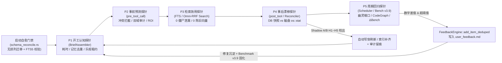

# 13 — 全生命周期信息新鲜度对账、无损 Schema 自愈与五点探针闭环自进化规格说明书

> **Agent Body 产品设计 · 交付件 13**  
> **版本**: v1.1（对齐 `v1.1.0` & Benchmark `v3.9`） · **编制**: Antigravity · **更新日期**: 2026-11-28  
> **对齐约束**: [README.md 规约 #21, #22](../../README.md) · [ISSUE #21, #22](../../ISSUE.md#L105-L109) · [EVOLUTION_GUIDE.md](../../EVOLUTION_GUIDE.md) · [roadmap-phase38-39.md](../src_doc/archive/roadmap-phase38-39.md)

---

## 一、九大信息过旧与数据漂移漏斗（`STALE-01 ~ STALE-09`）与根治机制

宿主机长期运行中的信息失真并非单一“文件改删漏同步”，而是分布在存储 Schema、全文/向量索引、依赖图谱、记忆摘要、外部工具链与真实检索对比中的 **9 类生命周期断层**：

| 漏斗编号 | 过旧 / 漂移类型 | 现网实测症状 | 根治与自愈机制（已落地代码） |
|:---:|---|---|---|
| **`STALE-01`** | 修改后旧向量与 L2 描述僵尸驻留 | `assets.size_bytes` 与磁盘失配，旧向量长期保留且回填脚本永不重算 | `merge_with_existing_asset` 在 `old_hash != new_hash` 或尺寸变化时写穿标记 `embedding_status="stale"` 与 `annotation_status="needs_re_enrich"`；`upsert_asset` 检测到 `"stale"` 自动重置 `embedding = '[]'`。 |
| **`STALE-02`** | 文件删除后 FTS 与图谱仍召回幽灵 | `search_assets_fts` 召回 `status='missing'` 幽灵；`ChangeHandler` 未清理 `file:<path>` 节点与入向边 | SQLite / PG / DuckDB 三后端 `search_assets_fts` 统一强制 `status = 'active'`；`Deleted` 分支级联清理 `fact_nodes`、`links` 入出边与 `auto_sync` 记忆。 |
| **`STALE-03`** | `AutoSyncEngine` 同文件摘要记忆堆叠 | `edit_file` 每次新建记忆，导致单文件摘要在 `brief` Top-5 霸屏重复 | `AutoSyncEngine` 写入同路径新摘要前先将旧活跃记忆全部归档为 `"archived"`，并调用 `LinksEngine::refresh_links_for_asset`。 |
| **`STALE-04`** | `fact_nodes` 历史端口/文件节点只增不删 | 实听端口仅 ~12 个，库内残留数十个幽灵 `port:*` 与失踪 `file:` 节点 | SPI `delete_fact_node` + `PropertyGraphOrganizer::build_host_graph` 与 `FreshnessReconciler` 按物理实测剪除幽灵节点。 |
| **`STALE-05`** | `inotify` 盲区与离线停机窗口漏同步 | 守护进程停机或目录树外变更导致库内快照滞后 | `FreshnessReconciler::reconcile` 在 `BackgroundScheduler`（30min）与 `feedback reconcile` 按需对账，补齐磁盘存在性与 `mtime`/`size` 对齐。 |
| **`STALE-06`** | 微观 `.codegraph/codegraph.db` 滞后于源码 | 源码修改后 `.codegraph` 未重索引导致微观符号穿透陈旧 | `FreshnessReconciler` 对比 `.codegraph/codegraph.db` 与源码目录 `mtime`，在简报与探针报告中明确提示 `codegraph sync`。 |
| **`STALE-07`** | 长期记忆引用失效路径未衰减 | `auto_sync` 记忆指向已删除文件却仍保持 `active` | 物理删除或对账标记 `missing` 时同步归档对应 `auto_sync` 记忆，保障海马体纯净度。 |
| **`STALE-08`** | 跨版本老库 Schema 漂移、FTS5 脱同步与 WAL 膨胀 | 现网升级后旧列名（如早期 `benchmark_runs` / `effectiveness_ledger` 字段）触发 `no such column` 报错、外部内容 FTS5 与基表脱节、WAL 增长至 200MB+ | [schema_reconcile.rs](../../src/storage/sqlite_provider/schema_reconcile.rs) 启动即运行**事务式无损 Schema 自愈**（自动识别并改名/补齐老列、重建脱同步 FTS5 虚表），配合 `wal_autocheckpoint=1000`、`journal_size_limit=64MB` 与 `perf_tune` `TRUNCATE` checkpoint 控容；DuckDB / PG 同步内置历史列迁移兜底。 |
| **`STALE-09`** | 真实检索暴露的索引滞后与代码驼峰词漏召回 | `shadow_ab` 实测发现实时扫描命中而 FTS 索引漏召回代码标识符或未回填多模态文件 | `ShadowAbEngine`（`src/body/`）将帮倒忙场景归类为 `H1~H5`，自动触发索引追平、驼峰拆词/精确标识符 `exact_id` 通道增强与写穿自愈。 |

---

## 二、执行回路五点对比探针与闭环自进化架构（`P1 ~ P5`）



### 2.1 五点探针精确规格

| 探针 | 放置位置 (Where) | 触发时机 (When) | 采集指标 (What) | 对比参照系 (Compare With) | 自愈与反馈联动 |
|:---:|---|---|---|---|---|
| **`P1`** | `BriefAssembler` | 每次 `brief` / `probes` 调用 | `brief_elapsed_us`、记忆唯一率、活跃乐观租约数与碰壁降级数 | SLA (`<= 25,000 μs`、记忆唯一率 `>= 85%`、新鲜度 `100%`) | 超阈值时触发记忆去重与新鲜度刷新；显著超时登记 `CON` 并提示排查慢路径 |
| **`P2`** | `AgentHookEngine::pre_tool_call` | 写文件/跑命令/绑端口前 | 事前冲突拦截数、累计省 Token/轮次、双域审计 (`IN`/`OUT`) 覆盖量 | 零护航基线与 `effectiveness_ledger` 事后实况 | 高频违规目录引导运行 `audit evolve` / `place learn` 自动演化规则 |
| **`P3`** | `McpToolRegistry` / `AssetSearchEngine` | 检索资产或记忆时 | `zombie_leak_count` (`status!='active'`)、`stale_vec_count` | `0` 僵尸泄漏、`0` 陈旧向量、`M2 <= 1,500 μs` | 检出泄漏立即触发清理并生成数字证据条目 |
| **`P4`** | `AutoSyncEngine` / `FreshnessReconciler` | 文件改删后 / 周期对账时 | `drifted_assets`、`missing_assets`、`optimistic_miss` | DB 快照 (`size_bytes`/`mtime_secs`) vs 磁盘 `os::stat` | 写穿刷新并置 `embedding_status="stale"`；漂移率 `>1%` 自动上报 |
| **`P5`** | `BackgroundScheduler` / `SelfEvolutionProbeEngine` | 30min 巡检 / `feedback probes` | `ghost_port_nodes`、`stale_codegraph_repos`、相邻两批 `benchmark_runs` 差值 | `/proc` 实时监听端口、上一批 Benchmark 基线 | 自动剪除幽灵端口；若 Benchmark 出现质量或耗时退化自动去重写入 `user_feedback.md` |

---

## 三、三端 1:1:1 交互契约与现网实跑快照

### 3.1 CLI / MCP / Web 对齐映射

| 操作能力 | CLI 子命令 | 原生 MCP 调用 (`body_feedback`) | Web REST API |
|---|---|---|---|
| **运行五点对比探针** | `agent-body feedback probes [--auto-heal]` | `{"action": "probes", "auto_heal": true}` | `POST /api/v1/feedback/probes` |
| **执行全生命周期新鲜度对账** | `agent-body feedback reconcile [--apply]` | `{"action": "reconcile", "apply": true}` | `POST /api/v1/feedback/reconcile` |
| **查看/登记/晋升反馈总账** | `agent-body feedback list \| add \| promote` | `{"action": "list" \| "add" \| "promote", ...}` | `GET /api/v1/feedback` · `POST /api/v1/feedback/add` |
| **Shadow A/B 对照与 `H1~H5` 自愈** | `agent-body body ab-compare / ab-report` | `body_state({"action": "ab_compare" \| "ab_report"})` | `POST /api/v1/body/ab/compare` · `GET /api/v1/body/ab/report` |

### 3.2 现网实跑验证样本（`v1.1.0` 真机实测捕获）

```text
$ agent-body feedback probes
🔬 五点对比探针完成: 4/5 健康 ⚠️ | 新生成去重反馈 0 条
  ⚠️ [P1] SessionStart(Brief): 187595 μs · 唯一率 100.0% · 乐观租约 21 条 (基线: SLA <= 25,000 μs & 记忆唯一率 >= 85%)
  ✅ [P2] PreToolUse(Guard): 168 次ROI调用 · 拦截 4 次 · 省 881405 tok · 双域审计 9430 条 (IN=6235 / OUT=3195)
  ✅ [P3] InFlight(Search): zombie=0, stale_vec=0 (0 僵尸召回 · 向量无过期)
  ✅ [P4] PostToolUse(Drift): 抽检 1000 条: drifted=0, missing_active=0, optimistic_miss=0
  ✅ [P5] Periodic(Regression): ghost_ports=0, stale_codegraph=0, Token省率 99.21%
```

> 🔎 **数字驱动的真实价值**：如上所示，`P3`/`P4`/`P5` 全部 `0` 漂移，同时 `P1` 探针精准捕获了高负载磁盘/冷缓存下 `brief` 延迟波动，拒绝粉饰太平，直接指明优化方向。

---

## 四、回归验证与验收门禁（Benchmark `v3.9`）

1. **基准门禁**：
   - `W12`（新鲜度写穿与幽灵零召回）、`W19`（多模态元数据与 Know-How 回填）；
   - `DQ5`（现网资产新鲜度抽检要求 `>= 98.0%`）、`DQ10`（Shadow A/B 证伪与零 Panic 探针）。
2. **自动化测试与 E2E 门禁**：
   - [tests/schema_migration_regression.rs](../../tests/schema_migration_regression.rs)：8 项回归用例覆盖老库无损列迁移、FTS5 脱同步重建、WAL `64MB` 上限与 CJK 回退检索；
   - `make verify-webui`（[scripts/verify_webui_e2e.py](../../scripts/verify_webui_e2e.py)）：使用旧列结构临时库启动真实 `agent-body web`，验证迁移自愈后 9 大工作台 0 报错运行。
