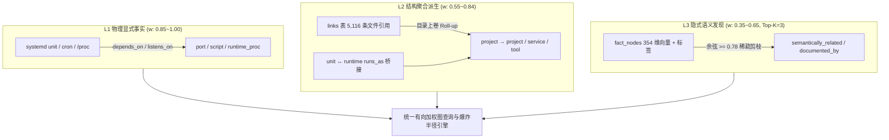

# 14 — 多维证据分层有向加权图谱与联邦网格信封协同协议规格说明书

> **Agent Host Steward 产品设计 · 交付件 14**  
> **版本**: v1.0 · **编制**: Antigravity · **日期**: 2026-11-22  
> **对齐约束**: [README.md 规约 #2, #5, #15, #16, #19, #23, #24](../../README.md) · [ISSUE #23, #24](../../ISSUE.md#L111-L118) · [roadmap-phase40-41.md](../src_doc/roadmap-phase40-41.md)

---

## 一、现网第一性原理实证诊断

对本机现网数据库 `/root/.steward/steward.db` 与相关源码（[src/fact/property_graph.rs](../../src/fact/property_graph.rs)、[src/links/impact.rs](../../src/links/impact.rs)、[src/web/topology.rs](../../src/web/topology.rs)、[src/mesh/mod.rs](../../src/mesh/mod.rs)、[src/web/server.rs](../../src/web/server.rs)）开展穿透核验，暴露出以下两类结构性断层：

### 1.1 宿主事实图谱“重节点、轻关系、零隐式”断层（对应 ISSUE #23）

| 现网实测维度 | 真实库/源码事实 | 根因剖析 | 影响范围 |
|---|---|---|---|
| **工程节点 99.5% 孤立** | `fact_nodes` 共 `355` 节点，其中 `project = 215` 仅 `1` 个连边（`214` 孤立，孤立率 **99.5%**）；`tool = 16` 全部孤立（**100%**）；`file = 72` 中 `46` 个孤立 | `build_host_graph()` 仅从进程 `cwd` 与 systemd `WorkingDirectory` 反推项目边；全量 28 个 `service` 的 `associated_project` 为 `NULL` | Agent 无法从工程出发感知关联服务、依赖项目与共享工具链 |
| **关系稀疏且无显隐分层** | `fact_edges` 仅 **`49`** 条（`depends_on: 25`, `listens_on: 17`, `scheduled_by: 7`），平均置信度 `0.996`；而文件级 `links` 表已有 **`5,116`** 条（`1,019 ast_import` + `4,078 path_regex` + `19 port_detect`）却从未上卷至项目级 | `fact_edges` 与 `links` 双表割裂；`PropertyGraphOrganizer` 未将文件引用聚合成项目级强弱有向边，亦未引入跨节点向量语义连边 | 两个强相关工程（如 `agentfs` 与 `agentfs_articles`、业务工程与 `shared_proj` 工具库）在图上完全断连 |
| **服务节点“同体分裂”与幽灵残留** | 库内同时存在 `service:agent-steward.service`（Systemd）与 `service:agent-steward`（`/proc` 运行时），以及测试残余 `service:test_web_dashbo` | 缺乏规范化服务身份桥接边（`aliases` / `manages`）与 `service`/`cron` 幽灵节点剪枝 | 运行时端口与 Systemd 配置单元无法打通多跳爆炸半径 |
| **向量能力闲置 & 推演无权无向** | `fact_nodes` 中 `354/355` 个节点已拥有本地 Ollama Embedding 向量（`project 215/215` 就绪），但仅用于文本检索；`ImpactAnalyzer` 仅做无权重、无跳数衰减 BFS | 已有高质量语义向量未参与“隐式关系挖掘”；多跳推演中直接强依赖与间接弱语义混为一谈 | 缺少关系强度排序、方向语义标注与显式/隐式证据分层 |

### 1.2 Peer Mesh“裸 HTTP、缺协议、零协作原语”断层（对应 ISSUE #24）

| 现网实测维度 | 源码实证定位 | 风险与能力缺口 |
|---|---|---|
| **无正式通信信封协议** | [src/mesh/mod.rs](../../src/mesh/mod.rs#L194-L231) 直接发送裸 JSON 或空 GET，返回 `{ "data": ... }` 包装 | 缺协议版本、消息 ID、发送者节点身份、意图类型、TTL 与结构化回执 `MeshAck` |
| **鉴权粗放且缺防重放** | [src/mesh/mod.rs](../../src/mesh/mod.rs#L84-L100) 仅全局静态对比 `Bearer [web].auth_token`，无时间戳与 Nonce | 仅有一把全局共享秘钥，无法区分节点身份与细粒度权限，且易受历史请求重放攻击 |
| **HTTP Body 上限写死 64KB** | [src/web/server.rs](../../src/web/server.rs#L192) `.min(65536)` 截断所有请求体 | 无法承载受控小体积交付物（如脚本/配置/补丁包的跨机投递） |
| **仅 4 个基础查询+锁动作** | `steward_mesh_query` 仅支持 `peers/ping/facts/locks/port/acquire/local` | 缺少 **跨机结构化 Agent 对话**（请求上下文/任务交接/共享记忆）、**跨机受控文件沙盒传送** 与 **跨机图谱联邦探查** |

---

## 二、模块一（应对 ISSUE #23）：多维证据分层有向加权图谱架构

### 2.1 三层关系本体与证据分级体系 (`EvidenceTier`)

遵循规约 #5（实事求是、零捏造）与 #23，所有图谱边必须标注所属证据层级与推导出处，严禁将隐式语义相似伪装成物理硬依赖：

| 证据层级 (`evidence_tier`) | 权重区间 ($w$) | 触发来源与数学定义 | 在推理/爆炸半径中的语义 |
|---|:---:|---|---|
| **`L1_EXPLICIT`**（物理显式硬边） | `0.85 ~ 1.00` | Systemd `ExecStart`/`EnvironmentFile`、`Cron` 目标脚本、`/proc` Socket `listen`、确定性 AST `import`、`working_directory` 精准命中 | 确定性物理事实依赖；修改目标极可能触发真实故障 |
| **`L2_STRUCTURAL`**（结构聚合派生边） | `0.55 ~ 0.84` | 文件级 `links` 按目录归属上卷聚合（Project $\to$ Project / Project $\to$ SharedLib）、项目 `README`/脚本文本中的 `service`/端口引用、`Service` unit 与运行时进程同名桥接 | 工程/服务级强耦合或上下游衍生关系，反映真实跨项目引用强度 |
| **`L3_SEMANTIC`**（隐式语义发现边） | `0.35 ~ 0.65` | 跨异构节点（`project↔project`、`service↔project`、`project↔tool`）的本地 Ollama Embedding 余弦相似度与领域标签重合度混合打分 | 跨孤岛灵感联结与相似生态发现（如源码库 ↔ 专栏文章库、同类服务），默认标记为虚线/弱相关，可按阈值过滤 |

### 2.2 标准关系字典与方向语义 (`RelationSemantics`)

图谱边在模型层面明确携带方向语义，避免“谁依赖谁”在反向调度或双向亲和中混淆：

| 关系名 (`relation`) | 典型 `source → target` | 方向语义 | 所属层级 | 说明 |
|---|---|---|---|---|
| `depends_on` | `service/project/file → file/project/service` | 前向依赖 (`source` 依赖 `target`) | `L1` / `L2` | 改动 `target` 将沿入边波及 `source` |
| `listens_on` | `service/proc → port` | 占用绑定 (`source` 监听 `target`) | `L1` | 端口冲突防撞核心边 |
| `scheduled_by` | `cron → file/project` | 调度触发 (`source` 定时执行 `target`) | `L1` | 影响面溯源至定时调度 |
| `calls` / `reads` / `writes` | `service/file → service/file` | 行为流向 (`source` 作用于 `target`) | `L1` / `L2` | 区分只读与写入破坏等级 |
| `part_of` / `contains` | `file → project`, `project → file` | 层级归属 / 包含 | `L1` / `L2` | 支撑文件级向项目级上卷聚合 |
| `uses_tool` | `project/service → tool` | 工具链依赖 (`source` 使用 `target`) | `L2` | 通过脚本/README/配置文件提及常见 CLI 工具连接孤立 `tool` 节点 |
| `runs_as` | `systemd service → runtime service/proc` | 实例映射 (`unit` 对应运行态 `proc`) | `L2` | 消解 Systemd Unit 与 `/proc` 进程同体分裂 |
| `documented_by` | `src project ↔ article/doc project` | 衍生文档流 (`article` 解读 `src`) | `L2` / `L3` | 如 `agentfs` 与 `agentfs_articles` 自动建立高权重衍生关系 |
| `semantically_related` | `project ↔ project / service ↔ project` | 对称语义亲和 | `L3` | 仅限显式/结构未直连的节点对，严格稀疏剪枝 |

### 2.3 权重计算、稀疏剪枝与多跳衰减推演公式

1. **L2 跨项目聚合权重（对数饱和模型，防止单一日志引用刷爆权重）**：
   设项目 $A$ 内文件指向项目/服务 $B$ 的有效去重文件级引用数为 $N$（`ast_import` 计 2.0 票，`port_detect` 计 1.5 票，`path_regex` 计 1.0 票，加权和记为 $N_{\text{eff}}$）：
   $$w_{\text{L2}}(A \to B) = \min\Big(0.84,\ 0.55 + 0.08 \cdot \ln(1 + N_{\text{eff}})\Big)$$
2. **L3 隐式语义混合评分与防稠密剪枝**：
   对尚无 `L1/L2` 直接连边的候选节点对 $(u, v)$，基于节点属性向量 $\mathbf{e}_u, \mathbf{e}_v$ 与归一化标签/名称词袋 $T_u, T_v$ 计算：
   $$S_{\text{sem}}(u, v) = 0.75 \cdot \max\big(0, \cos(\mathbf{e}_u, \mathbf{e}_v)\big) + 0.25 \cdot J(T_u, T_v)$$
   - **硬门禁**：仅当 $\cos(\mathbf{e}_u, \mathbf{e}_v) \ge 0.78$ 且 $S_{\text{sem}}(u, v) \ge 0.62$ 时方具候选资格；
   - **权重映射**：$w_{\text{L3}}(u, v) = \min\big(0.65,\ 0.35 + 0.30 \cdot \frac{S_{\text{sem}} - 0.62}{0.38}\big)$；
   - **Top-$K$ 稀疏剪枝**：每个源节点最多保留 Top-$K = 3$ 条最优隐式边，防止图谱退化为全连接稠密蜘蛛网。
3. **跨跳有效风险/关联强度衰减**：
   对于从起止路径 $P = (e_1, e_2, \dots, e_k)$（$k \le \text{max\_depth}$），设每跳阻尼衰减因子 $\gamma = 0.80$：
   $$\text{PathStrength}(P) = \prod_{i=1}^{k} \big(w_{e_i} \cdot \gamma^{i-1}\big)$$
   `ImpactAnalyzer` 支持参数 `min_weight`（默认 `0.50`）与 `include_semantic`（爆炸半径默认仅计 `L1+L2`，显式开启才展示 `L3` 辅助参考），确保 **物理可靠性与语义灵感兼得而不混淆**。



---

## 三、模块二（应对 ISSUE #24）：联邦网格协议与受控协同架构 (`Mesh Protocol v1.0`)

### 3.1 递弱代偿边界（遵循规约 #2）

- **In-Scope（必须做）**：跨主机节点身份验证与细粒度授权、结构化认知信封（`MeshEnvelope v1.0`）、基于信封的 **跨机结构化 Agent 对话交换**、**受控小体积研发产物沙盒投递**（`<= 10MB`）、**跨机图谱与事实联邦检索**、以及 **跨节点协作租约锁**。
- **Out-of-Scope（明确不做）**：不造 Raft/Paxos 共识状态机、不替代 Rsync/S3 大文件同步、不充当人类通用聊天软件 IM，**严禁跨节点直写覆盖任意系统路径或业务目录**。

### 3.2 `MeshEnvelope v1.0` 线协议与 `MeshAck` 契约

所有跨节点协同写操作、对话与文件传输统一封装为标准 JSON 信封：

```json
{
  "protocol": "steward.mesh/1.0",
  "message_id": "msg-uuid-v4",
  "msg_type": "dialogue | transfer | lock_acquire | graph_query",
  "from_node": "node-beijing-01",
  "from_agent": "antigravity-session-42",
  "to_node": "node-gpu-02",
  "to_agent": "hermes-worker",
  "timestamp_ms": 1795310400000,
  "nonce": "random-16-hex-or-uuid",
  "ttl_secs": 300,
  "scopes": ["exchange:dialogue"],
  "payload_sha256": "hex-sha256-of-canonical-payload",
  "payload": { "...": "..." },
  "signature": "hex-hmac-sha256-over-canonical-envelope"
}
```

### 3.3 零信任签名认证、防重放与最小权限设计

1. **HMAC-SHA256 规范签名（不依赖 TLS 即可独立抗篡改，叠加 HTTPS 更佳）**：
   签名原文按固定顺序以 `\n` 拼接：
   `canonical = "{protocol}\n{message_id}\n{msg_type}\n{from_node}\n{to_node}\n{timestamp_ms}\n{nonce}\n{payload_sha256}"`
   密钥优先取 `[mesh.peer_keys]` 中对应 `from_node` 的独立对等秘钥，若未单配则回退至 `[mesh].shared_secret` / `[web].auth_token`；服务端缺失任何有效密钥时，**写与协同端点一律拒绝（`403 Forbidden`）**。
2. **双因子防重放门禁**：
   - 时间窗校验：$|T_{\text{server}} - \text{timestamp\_ms}| \le 300{,}000\text{ ms}$（可配置 `replay_window_secs`）；
   - Nonce 防重放缓存：服务端维护线程安全并发 `NonceCache`（记录 `(from_node, nonce) -> expires_at`，自动按时间窗清理），重复 `nonce` 立即返回 `409 Conflict`。
3. **对等节点作用域授权矩阵（Peer Scopes）**：
   支持 4 个细粒度作用域：`read:facts`、`write:locks`、`exchange:dialogue`、`transfer:artifact`，默认最小权限（显式配置才放行高权限写与文件投递）。

### 3.4 三大核心协同功能点

| 功能点 | API 端点 | 安全与边界约束 | 落库与沙盒机制 |
|---|---|---|---|
| **1. 跨机图谱联邦探查** | `GET /api/v1/mesh/graph?q=...&hops=2` | 受 `auth_token` + `read:facts` 校验，仅只读返回 `L1/L2/L3` 子图与跨节点引用提示 | 无落盘写入，汇总各节点关联度与端口服务视图 |
| **2. 跨机结构化 Agent 对话** | `POST /api/v1/mesh/dialogue` | 仅支持 `ASK_CONTEXT` / `HANDOFF_TASK` / `SHARE_MEMORY` / `REPLY` 四类意图；入出双向强制经过 **`SecretRedactor`** 脱敏与 **`PromptInjectionScanner`** 抗投毒检查 | 持久化至 `mesh_dialogues` 表（带 `thread_id`, `verified_signature`, `status`），支持 `ack` / `reply` / `inbox` 消费 |
| **3. 受控沙盒文件投递** | `POST /api/v1/mesh/transfer` | **硬体上限 `<= 10 MB`**（Web 服务仅对该路径按配置流式接收，其它路径保持 `64 KB` 防爆）；校验 `payload_sha256` 与文件名安全（禁止 `..`、绝对路径、`.env`/`.ssh`/`*.pem`/`*.key` 等敏感文件名）；内容走 `SecretRedactor` 扫警 | 严格隔离落盘至 **`~/.steward/mesh_inbox/<from_node>/<transfer_id>_<safe_name>`**（`0600` 权限），并在 `mesh_transfers` 表登记待人类或本机 Agent 显式 `accept`/`reject` |

```mermaid
sequenceDiagram
    participant A as Node-A (Client Agent)
    participant S as SecretRedactor & InjectionGuard
    participant B as Node-B (Mesh Receiver)
    participant Box as ~/.steward/mesh_inbox/

    A->>S: 构造对话/文件载荷 (<=10MB)
    S-->>A: 凭据脱敏 + 计算 payload_sha256
    A->>B: POST /api/v1/mesh/{dialogue|transfer}<br/>MeshEnvelope v1.0 (ts, nonce, HMAC)
    B->>B: 1. 校验时间窗 (±300s) & Nonce 未重放<br/>2. 校验 HMAC-SHA256 & Peer Scope<br/>3. 校验敏感文件名/SHA-256 & 抗投毒扫描
    alt 校验通过 (transfer)
        B->>Box: 隔离写入 staging 收件箱 (0600)
        B->>B: 写入 mesh_transfers(status='quarantined')
        B-->>A: 200 OK MeshAck (transfer_id, sha256)
    else 签名非法 / 重放 / 敏感文件 / 超限
        B-->>A: 401 / 403 / 409 / 413 确定性拒收
    end
```

---

## 四、存储扩展、黑白屏 Parity 与 Benchmark `v3.4` 验收口径

1. **存储层增量演进（保持 SQLite / PG / DuckDB 三引擎同步）**：
   - `fact_edges` 新增 `evidence_tier` (`L1_EXPLICIT` / `L2_STRUCTURAL` / `L3_SEMANTIC`)、`weight` (`REAL`) 与 `direction_kind`；
   - 新增 `mesh_dialogues`（跨机对话收发账本）与 `mesh_transfers`（跨机文件投递收件箱账本）两张表（总表数 `23 → 25`）。
2. **黑白屏 1:1 聚合演进（严守规约 #16）**：
   - 遵循 Context 防爆原则，优先扩展既有工具 `steward_links_query`、`steward_links_impact`、`steward_links_visualize`（支持 `include_semantic`、`min_weight`、`evidence_tier`、`discover_semantic` 参数）及 `steward_mesh_query`（扩展 `graph` / `dialogue_send` / `dialogue_inbox` / `dialogue_reply` / `transfer_send` / `transfer_inbox` / `transfer_accept` / `transfer_reject` 子动作），对应 CLI 子命令与 Web REST API/工作台 1:1 双向同步。
3. **Benchmark `v3.4` 闭环验证门禁**：
   - 新增 **`W13 (semantic_and_weighted_graph_discovery)`**：检验隐式跨项目关联发现率、物理 vs 语义区分度与零假阳性剪枝；
   - 新增 **`W14 (mesh_protocol_security_and_collab)`**：检验 HMAC 合法通信放行率 100%、篡改/重放/敏感文件投递拦截率 100%、跨机对话双向脱敏抗投毒；
   - 新增 **`DQ6 (graph_connectivity_and_tier_hygiene)`**：检验现网 `fact_nodes` 项目孤立率由 `99.5%` 显著压降（目标 `<= 40%` 孤立或连通度提升 `>= 10x`）、全量 `fact_edges` `evidence_tier` 100% 合法非空。
