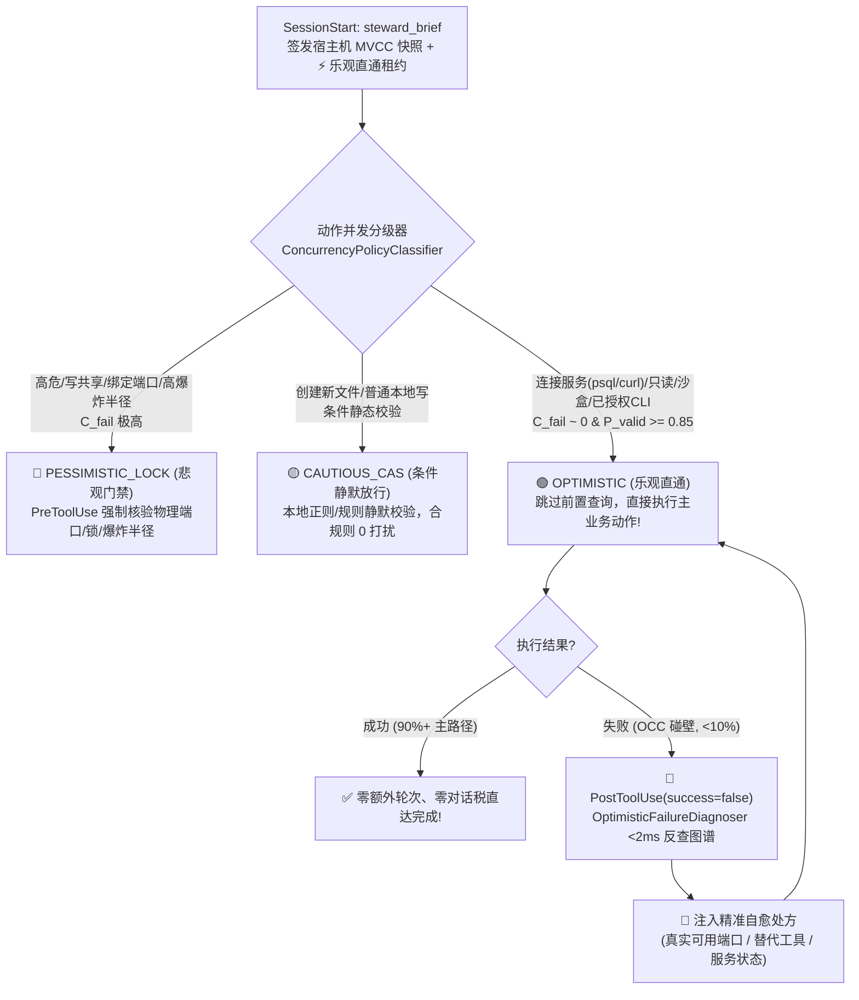

# 15 — 乐观-悲观自适应并发控制（AOPCC）与失败早回退规格说明书

> **Agent Host Steward 产品设计 · 交付件 15**  
> **版本**: v1.0 · **编制**: Antigravity · **日期**: 2026-11-22  
> **对齐约束**: [README.md 规约 #8, #18, #22, #25](../../README.md) · [ISSUE #25](../../ISSUE.md#L120) · [roadmap-phase42.md](../src_doc/archive/roadmap-phase42.md)

---

## 一、第一性原理诊断：从数据库 PCC vs OCC 到 LLM Agent 回路的「整轮对话税」

### 1.1 现网实测与代码根因

结合数据库 **悲观并发控制 (PCC)** 与 **乐观并发控制 (OCC)** 的理论模型，审视当前 `agent-steward` 在执行回路中的介入方式（[src/brief/assembler.rs](../../src/brief/assembler.rs)、[src/api/hooks.rs](../../src/api/hooks.rs)、[src/hooks/client_gen.rs](../../src/hooks/client_gen.rs)），存在以下三项核心问题：

| 现网/源码位置 | 现状事实 | 本质问题剖析 |
|---|---|---|
| **执行回路中的前置查询** | 若 Agent 每次执行验证（如连本机 PostgreSQL `:5432`、调 `pdftotext`）前均先调一次 `steward_fact_query` / `steward_port_check` | 虽单次 MCP 本地仅耗时 `~1 ms`、返回 `~30 tok`，但强制 LLM **多跑 1 轮完整推理（Turn）**——需将当前整个上下文（`5k ~ 30k` input tokens）重发预填充并付出 `1.5s ~ 4.0s` 等待延迟，即 **整轮对话税 $C_{\text{turn}}$**！ |
| **[src/brief/assembler.rs](../../src/brief/assembler.rs#L240-L280)** | 开工简报仅输出 `:5432 (postgres)` 等纯列表，未标注稳定服务的可乐观假设置信度、纪元指纹与免查询直行授权 | Agent 无法区分“稳定免密可直连服务”与“临时测试不稳定端口”，只能保守选择每步先查（全悲观）或盲猜试错 |
| **[src/api/hooks.rs](../../src/api/hooks.rs#L247-L254)** & **[src/hooks/client_gen.rs](../../src/hooks/client_gen.rs#L298-L300)** | `post_tool_call` 第一行即写死 `if !success { return ... "工具执行失败，忽略后置事实图同步" }`，`steward_bridge.py` 也写死 `if payload.get("error"): emit({}); return` | 彻底丢弃了乐观锁最核心的 **「冲突失败后回滚与恢复 (OCC Abort Recovery)」** 机制——一旦乐观直连碰壁（如 `:5432` 没启、`command not found`、`Address already in use`），Agent 得不到管家秒级注入的替代处方，只能重新多轮摸黑排查 |

### 1.2 期望代价边界公式（什么时候用 OCC，什么时候用 PCC？）

设：
- $C_{\text{turn}}$：多跑一轮 LLM MCP 工具调用的上下文重发与等待综合代价；
- $C_{\text{exec}}$：实际执行动作的代价（如直接 `psql -p 5432` 验证）；
- $p_{\text{valid}}$：宿主机该事实先验未漂移的概率（置信度）；
- $C_{\text{fail}}$：乐观假设失效引发的失败清理代价（对只读验证/连接/幂等命令，$C_{\text{fail}} \approx 0$；对破坏生产/覆盖文件/删库操作，$C_{\text{fail}} \to \infty$）。

则两类策略的期望代价分别为：
$$E[\text{Cost}_{\text{PCC}}] = C_{\text{turn}} + C_{\text{exec}}$$
$$E[\text{Cost}_{\text{OCC}}] = C_{\text{exec}} + (1 - p_{\text{valid}}) \cdot (C_{\text{fail}} + C_{\text{turn\_recovery}})$$

由此得出 **AOPCC 自适应并发切换不等式**：
$$\text{选用 OCC 的充分必要条件：} \quad (1 - p_{\text{valid}}) \cdot C_{\text{fail}} + (1 - p_{\text{valid}}) \cdot C_{\text{turn\_recovery}} < C_{\text{turn}}$$

**结论**：
1. 当操作**低风险/可逆**（$C_{\text{fail}}$ 极小）且先验稳定度高（$p_{\text{valid}} \ge 0.85$）时，**OCC（直接乐观假设执行 + 仅在报错时触发 `PostToolUse` 秒级自愈）严格优于 PCC**，可直接消除 `85%+` 的回路前置查询轮次！
2. 当操作**不可逆 / 破坏面大 / 涉及多 Agent 写共享资源**（端口 bind 冲突、高爆炸半径文件写、`/etc/shadow` 等敏感路径、跨 Agent 协作锁资源）时，$C_{\text{fail}}$ 远大于 $C_{\text{turn}}$，必须坚守 **PCC（悲观前置门禁 `PreToolUse` / 锁检查）**！

---

## 二、AOPCC 三态自适应架构设计 (`MVCC Lease + OCC Recovery + PCC Guard`)



### 2.1 三态并发模式枚举 (`ActionConcurrencyMode`)

| 模式 | 英文枚举 | Pre-Hook 行为 | Post-Hook 行为 | 典型适用场景 |
|---|---|---|---|---|
| **乐观直通** | `Optimistic` | **0 查询放行**：不调用 `/proc` 扫描、不查图谱、不弹提示 | 仅在 `success=false` 时触发 `OptimisticFailureDiagnoser`，反查宿主机真实替代方案 | 客户端连接本机服务（`psql -h 127.0.0.1 -p 5432`、`curl localhost:11434`、`redis-cli`）、调用租约已确认工具（`pdftotext`/`duckdb`/`cargo`）、`/root/new/tmp/` 临时验证、只读查看 |
| **条件 CAS** | `CautiousCas` | 走毫秒级内存/本地规则检查（检查是否落在规范目录），合规时静默 `allow` | 正常 `AutoSync` 增量入库；失败时提供路径/命名建议 | 在 `/root/new/work/` 或 `/root/new/shared_proj/` 内新建常规脚本或文档 |
| **悲观强门禁** | `PessimisticLock` | **强前置核验**：实测端口占用、父子目录与资源协作锁、`Links` 爆炸半径、高危路径红线 | 变更入库、刷新链接并通知依赖服务需重启 | 启动服务监听端口（`uvicorn --port` / `pg_ctl -p` / `docker -p`）、修改被 Systemd/Cron 依赖的文件、修改系统敏感路径、申请/修改共享锁资源 |

### 2.2 开工乐观直通租约 (`OptimisticAssumptionLease`)

在 `steward_brief` 的输出中新增精简区块（上限 `~120 tokens`，严守预算控制）：`## ⚡ 乐观直通契约 (Optimistic Leases)`，让 Agent 在开工瞬间获得类似数据库 **MVCC Read-Snapshot** 的确定性授权：

```rust
pub struct OptimisticLease {
    pub lease_id: String,          // e.g. "lease-pg-5432"
    pub category: String,          // db_service | ai_runtime | cli_toolchain | temp_sandbox | codegraph_index
    pub target: String,            // e.g. "postgresql:5432"
    pub confidence: f32,           // 先验有效概率 p_valid (0.00 ~ 1.00)
    pub epoch_hash: String,        // 基于 active_processes / fact_nodes 刷新的短纪元指纹
    pub direct_hint: String,       // 一句话乐观直连建议 (如 "默认本机免密/本地可用，直接 psql -p 5432，免前置查询")
    pub fallback_hint: String,     // 若失败时的早回退线索
}
```

### 2.3 乐观碰壁诊断与秒级自愈引擎 (`OptimisticFailureDiagnoser`)

彻底改造 `AgentHookEngine::post_tool_call`（不再在 `!success` 时丢弃！）及 `steward_bridge.py`（在 `run_command` 失败时主动唤醒诊断），支持四类高频碰壁模式的 `< 2 ms` 确定性诊断：

1. **服务连接拒绝 (`Connection refused` / `could not connect to server` / `ECONNREFUSED`)**：
   - 从报错文本提取目标端口（如 `5432`, `11434`, `6379`）与服务关键词；
   - 实时调用 `ProcessNetTopology::scan_listening_ports()` + `AutomationTopology::scan_systemd_services()` 核实该端口当前是否真正处于离线状态；
   - 若离线：立即返回真实在听的同类服务端口或对应 `systemctl status/start <unit>` 启停命令，并**同步通知后台将该服务的乐观租约置信度降级**！
2. **认证/权限假设失败 (`password authentication failed` / `FATAL: role ... does not exist`)**：
   - 若 Agent 乐观假设“免密直连”失败：立即返回当前本地服务配置文件提示与认证方式说明（如提醒走 `sudo -u postgres psql` 或指定用户），避免 Agent 反复猜密码试错。
3. **命令/工具未找到 (`command not found` / `No such file or directory` / `exit code 127`)**：
   - 抽取缺失命令名，调用 `CapabilityEngine::query` 从宿主能力字典检索已安装的真实替代二进制与最佳实践参数（例如 `wkhtmltopdf` 缺失 → 推荐已安装的 `pdftoppm` / `google-chrome --headless`）。
4. **端口占用冲突 (`Address already in use` / `EADDRINUSE`)**：
   - 抽取冲突端口，调用 `ProcessNetTopology::check_port(port, 3)` 直接返回占用进程 PID/名称 与 **3 个实时空闲可用端口**，1 步换端口重试成功。

---

## 三、Benchmark `v3.5` (`W15`) 与闭环自演化探针集成

- **新增基准负载 `W15 (optimistic_vs_pessimistic_execution_loop)`**：
  - 同台模拟 10 项混合任务（8 项本地 PG/Ollama/工具验证 + 2 项端口已被占/工具缺失的漂移场景）；
  - 对比三组：
    1. **全悲观模式 (Full PCC)**：10 次执行全部前置调用 `steward_fact_query` / `steward_port_check`，累计产生 `10` 次额外回路轮次（计入整轮对话税 `rounds = 20`）；
    2. **无大管家盲猜模式**：在 2 个漂移场景下反复瞎猜试错 `3+` 轮；
    3. **AOPCC 自适应模式**：8 项命中租约 **0 前置查询直接成功** + 2 项碰壁由 `PostToolUse` 一次注入真实处方自愈（总轮次从 `20` 压降至 `12`，整轮对话税节省 `40%+` 且 100% 命中真实事实）。
- **新增效能存证规则 `PR-11` (`OptimisticLeaseAndRecovery`)**：
  - 每次 `BriefAssembler` 签发乐观租约并消除回路内查询，或 `post_tool_call` 成功在碰壁时自愈，均带出处记入 `effectiveness_ledger`。
