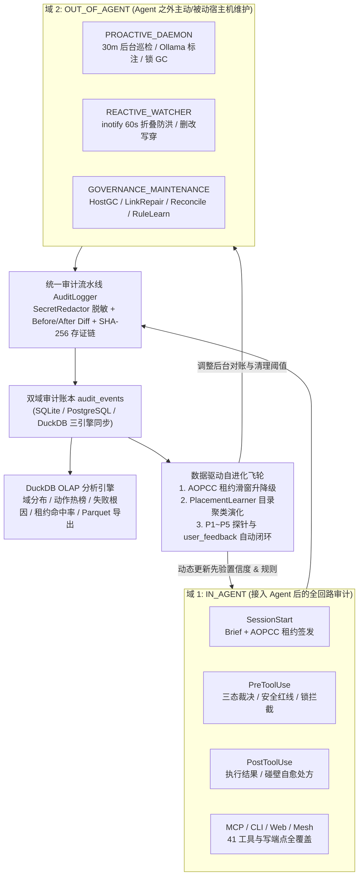

# 16 — 双域全链路行为审计、因果溯源与数据驱动自进化规格说明书

> **Agent Host Steward 产品设计 · 交付件 16**  
> **版本**: v1.0 · **编制**: Antigravity · **日期**: 2026-11-22  
> **对齐约束**: [README.md 规约 #4, #8, #18, #22, #26](../../README.md) · [ISSUE #26](../../ISSUE.md#L126) · [roadmap-phase43.md](../src_doc/archive/roadmap-phase43.md)

---

## 一、第一性原理与现网实证诊断：为什么现有的 `changes` + `effectiveness_ledger` 远远不够？

结合 ISSUE #26 的两个核心诉求——**“接入 Agent 后的行为审计与自进化数据分析”** 与 **“Agent 之外的主动/被动宿主机维护行为审计与有据可查”**，对本机现网数据库 `/root/.steward/steward.db` 与源码执行一轮实证盘点，暴露出三类结构性断层：

### 1.1 现网数据分布实证（2026-11-22 实测）

| 数据表 | 分布明细（实测 SQLite 查询） | 暴露的架构盲区 |
|---|---|---|
| **`changes` (共 `10,727` 条)** | `watcher:file_modified = 10,159` (**94.7%**)<br/>`agent_hook:agent_tool:edit_file = 409`<br/>`watcher:file_deleted = 101`<br/>`watcher:file_created = 39`<br/>`agent_hook:agent_tool:write_file = 18`<br/>`hook_post:optimistic_miss = 1` | ① **底层 I/O 噪声淹没治理语义**：`watcher` 对同文件连续保存未做时间窗折叠，1 万余条 `file_modified` 掩盖真正的高价值治理行为；<br/>② **In-Agent 域严重残缺**：仅捕获了含 `path` 参数的 `edit_file`/`write_file`，所有 `run_command`、端口检查、锁申请、服务操作、`pre_tool_call` 裁决、及非路径 MCP 工具调用均无记录；<br/>③ **Out-of-Agent 域完全黑盒**：后台巡检、GC 删除、断链改写代码、新鲜度剪枝 **0 条审计记录**。 |
| **`effectiveness_ledger` (共 `74` 条)** | `cli = 49` · `mcp = 13` · `web = 6` · `hook = 3` · `scanner = 2` | ① 仅记录含 ROI 推导规则（`PR-01~11`）的工具，[src/benchmark/ledger.rs](../../src/benchmark/ledger.rs#L298) 中 19 个工具命中 `_ => return` 静默丢弃；<br/>② `session_id` 硬编码为 `mcp-live` / `cli-live`，缺少因果 `trace_id`、`actor`、动作结果 `outcome` 与 `before_after_delta` 状态前后对比。 |

### 1.2 源码审计三大盲区 (`CON-19`)

1. **In-Agent 接入域碎片化与静默丢失**：
   - [src/api/hooks.rs](../../src/api/hooks.rs#L43-L191) `pre_tool_call()` 执行了端口占用、协锁、安全红线、AOPCC 分级等关键裁决，但**零落盘留痕**；
   - [src/api/hooks.rs](../../src/api/hooks.rs#L310) `post_tool_call_with_error()` 仅在 `path_opt` 为 `Some(...)` 时记入 `changes`，直接丢弃命令执行（`run_command`）、服务启停、协作锁等全量调用；
   - [src/api/mcp_tools/mod.rs](../../src/api/mcp_tools/mod.rs) 41 个原生 MCP 工具、CLI 子命令及 Web 写操作缺少统一、脱敏、防注入的行为审计汇流管道。
2. **Out-of-Agent 管家自治与被动维护域零审计（最高风险黑盒）**：
   - 大管家在 Agent 对话回路之外**直接变更或清理宿主机对象与知识库状态**的 7 条关键链路当前均未落盘审计：
     1. [src/daemon/scheduler.rs](../../src/daemon/scheduler.rs#L31-L101) `BackgroundScheduler::run_inspection_cycle()`（每 30 分钟执行进程同步、属性图更新、记忆冲突审计、断点扫描恢复、过期锁清理、生态刷新、新鲜度对账、Ollama 精炼）；
     2. [src/feedback/probes.rs](../../src/feedback/probes.rs#L61-L224) `FreshnessReconciler::reconcile()`（将资产标 `missing`、写穿清空旧向量、剪枝幽灵 `fact_nodes`、归档重复 `memories`）；
     3. [src/env/gc.rs](../../src/env/gc.rs#L52-L137) `HostGarbageCollector::run_gc()`（当 `dry_run=false` 时直接 `fs::remove_file` / `fs::remove_dir` 物理删除临时文件）；
     4. [src/links/repair.rs](../../src/links/repair.rs#L159-L189) `LinkRepairer::repair_links(apply=true)`（直接 `fs::write` 修改宿主机源码文件并替换 `links` 目标）；
     5. [src/placement/learner.rs](../../src/placement/learner.rs#L144-L161) `PlacementLearner::apply_candidate()`（向 `placement_rules` 写入自演化新规约）；
     6. `MemoryLifecycleManager::audit_memories()` 与 `CoordinationEngine::gc_expired_locks()`（记忆生命周期归档与超时锁回收）；
     7. `SessionManager::close_session_with_dry_run()` 临时文件删除清单（[src/session/mod.rs](../../src/session/mod.rs#L49-L72) 仅拼进记忆文本，未结构化入审计账本）。
3. **审计数据与自进化、OLAP 数据分析脱节**：
   - 现有 `SelfEvolutionProbeEngine` (`P1~P5`) 仅抽样当下静态截面，尚未利用历史行为流进行**滑窗经验收敛**（如某工具/端口连续碰壁次数自动触发租约置信度降级，或后台连续 3 次健康巡检后自动康复升级）；
   - [src/storage/duckdb_analytics.rs](../../src/storage/duckdb_analytics.rs#L240) 的 `export_to_parquet` 白名单仅包含 7 张旧表，无法对双域审计事件流、效能账本做多维 OLAP 聚合与趋势导出。

---

## 二、双域全链路行为审计架构 (`Dual-Domain Behavioral Audit`)

严格恪守 **规约 #2 递弱代偿原则**：不重造通用 SIEM / ELK / OpenTelemetry 全量追踪引擎，仅聚焦宿主机大管家双域关键动作的**因果可溯、修改可逆核对、脱敏零泄露与自进化闭环**。



### 2.1 双域正交分类体系 (`AuditDomain` & `ActorKind`)

| 审计域 (`domain`) | 行为主体 (`actor_kind`) | 典型行为分类 (`category`) | 必须留痕的关键载体 (`before_after_delta`) |
|---|---|---|---|
| **`IN_AGENT`** | `agent_session` / `mcp_client` / `cli_user` / `web_user` / `mesh_peer` | `brief_lease`、`hook_pre_guard`、`hook_post_recovery`、`tool_call`、`lock_lifecycle`、`memory_op`、`mesh_collab`、`session_close` | 触发工具与脱敏参数摘要、AOPCC 模式、风险告警条数、碰壁处方与 `session_id` / `trace_id` |
| **`OUT_OF_AGENT`** | `daemon_scheduler` | `daemon_cycle`、`freshness_reconcile`、`lock_gc`、`memory_audit`、`ollama_enrich`、`vector_backfill` | 各阶段变更计数、标记失踪/刷新/剪枝对象列表、耗时毫秒数 |
| **`OUT_OF_AGENT`** | `watcher_inotify` | `fs_watch_sync`、`fs_watch_delete` | **60 秒时间窗防抖折叠**：`folded_events` 折叠次数、路径、写穿失效标记 |
| **`OUT_OF_AGENT`** | `governance_engine` | `host_gc`、`link_repair`、`placement_learn`、`rule_apply` | **可逆核对清单**：删除文件清单与字节数、文件替换 `patch_diff`、新增/变更规则前后对比 |

### 2.2 核心存储 Schema (`audit_events` — 第 26 张表)

在 `src/storage/{schema,pg_schema,duckdb_schema}.sql` 三端同步新增 `audit_events` 表：

```sql
CREATE TABLE IF NOT EXISTS audit_events (
    event_id           TEXT PRIMARY KEY,
    trace_id           TEXT NOT NULL,
    session_id         TEXT NOT NULL DEFAULT 'system',
    domain             TEXT NOT NULL CHECK (domain IN ('IN_AGENT', 'OUT_OF_AGENT')),
    actor_kind         TEXT NOT NULL,
    actor_id           TEXT NOT NULL DEFAULT 'steward',
    source_channel     TEXT NOT NULL, -- mcp | cli | web | hook | daemon | watcher | mesh | system
    category           TEXT NOT NULL,
    action             TEXT NOT NULL,
    target_type        TEXT NOT NULL DEFAULT 'none',
    target_id          TEXT NOT NULL DEFAULT '',
    concurrency_mode   TEXT DEFAULT NULL,
    outcome            TEXT NOT NULL CHECK (outcome IN ('success', 'warn', 'blocked', 'failed', 'recovered', 'dry_run')),
    before_after_delta TEXT NOT NULL DEFAULT '{}', -- 强制经 SecretRedactor 脱敏的 JSON 变化前后快照
    elapsed_us         INTEGER NOT NULL DEFAULT 0,
    evidence_sha256    TEXT NOT NULL, -- 规范化防篡改证据指纹 (sha256_hex)
    created_at         TEXT NOT NULL
);
```

### 2.3 安全、防洪与零阻塞门禁

1. **全链路脱敏与防污染（规约 #19）**：`AuditLogger::record()` 在序列化 `target_id` 与 `before_after_delta` JSON 时，强制调用 `SecretRedactor::redact()` 过滤令牌/口令/私钥；单条 `before_after_delta` 限制在 `4 KB` 内，防止大文件 Diff 撑爆数据库。
2. **被动 Watcher 60 秒折叠防洪（规约 #4）**：对 `OUT_OF_AGENT` 的 `watcher_inotify` 连续修改同一路径事件，使用内存滑动窗（60s 内同路径合并折叠 `folded_count` 并更新最新时间戳），从源头消除类似现网 `10,159` 条 `file_modified` 淹没核心治理日志的问题。
3. **非阻塞异步容错写（规约 #9 & #12）**：`AuditLogger` 插入单条审计耗时控制在 `< 80 μs`；若遇到测试内存库只读或瞬时锁争用，安全降级记录至 stderr，绝不阻塞主业务路径或触发 Panic。

---

## 三、审计驱动自进化与 OLAP 分析飞轮 (`Audit-Driven Self-Evolution`)

让审计数据不再“只存不用”，直接服务于 **产品自进化** 与 **数据分析**：

1. **AOPCC 乐观租约动态校准（替换静态硬编码先验）**：
   - 新增 `AuditEvolutionAnalyzer::evaluate_lease_health(storage, target, window_hours=24)`；
   - 统计过去 24 小时 `audit_events` 中针对同一 `target`（如 `port:5432`、`tool:pdftotext`）的 `hook_post_recovery`（`optimistic_miss`）与 `outcome='success'/'recovered'` 比例，计算滑动窗口经验有效率 $\hat{p}_{\text{valid}}$；
   - 若近 24h 内连续失败 $\ge 2$ 次且未经过成功的 `daemon` / `reconcile` 康复，自动将 `OptimisticLeaseEngine` 下发的该条租约置信度压低至 `< 0.70` 并移除直通授权（自动切回悲观核验）；当后台巡检或 `post_tool_call` 连续恢复成功并稳定后，平滑恢复置信度。
2. **违规模式与摩擦热点自动沉淀 (`Audit → Placement / Feedback`)**：
   - 自动聚类近 7 天 `audit_events` 中 `hook_pre_guard` 触发 `💡 规范放置建议` 或 `warn/blocked` 高频出现的路径前缀，向 `PlacementLearner` 输出高置信度候选项，或自动通过 `FeedbackEngine::add_item_deduped` 写入 `user_feedback.md` 驱动修复。
3. **DuckDB 双域 OLAP 洞察与导出**：
   - 在 `AnalyticsProvider` 与 `DuckDbAnalyticsEngine` 新增 `audit_summary(days)`（按 `domain` × `actor_kind` × `outcome` 多维汇总、Top 高频操作、Top 失败/拦截热点、自愈率与平均延迟 P50/P95）；
   - 将 `audit_events` 与 `effectiveness_ledger` 纳入 `SyncPipeline` 与 `export_to_parquet` 支持表白名单，支持一键导出至 `/root/new/tmp/` 进行离线精细分析。

---

## 四、黑白屏 1:1 同步与 Benchmark `v3.6` 规划

- **MCP / CLI / Web 1:1:1 内聚同步（规约 #16）**：
  - 遵循“防止 MCP 工具数膨胀打爆上下文”原则，将审计查询、详情回溯、OLAP 洞察与自进化触发内聚到现有 `steward_analytics_export` / `steward_changes_since` / `steward_feedback` 或通过新增 **`steward_audit_query`**（支持 `action: query | summary | trace | evolve | export` 单工具多动作聚合）暴露，并在 CLI (`agent-steward audit ...`)、Web REST API (`/api/v1/audit/...`) 与前端工作台新增/升级 **「📜 双域行为审计与自进化中心」** 面板保持 1:1:1 同步。
- **Benchmark `v3.6` 新增门禁（规约 #18 & #26）**：
  - **`W16 (dual_domain_audit_and_lease_self_evolution)`**：同场验证 ① Agent 工具全链路 `IN_AGENT` 审计留痕 + 脱敏零泄露 + `trace_id` 串联；② 模拟 `OUT_OF_AGENT`（`HostGC` + `LinkRepair` + `Reconcile`）审计 `before_after_delta` 留痕；③ 审计流驱动 AOPCC 租约动态降级与康复自进化；
  - **`DQ7 (audit_completeness_and_redaction_hygiene)`**：巡检现网数据库校验双域覆盖率、敏感字段 0 明文泄露、`evidence_sha256` 完整率 `100%` 及 `Watcher` 折叠信噪比；
  - **`PR-12` (`AuditDrivenSelfEvolution`)**：记录每次通过行为审计自动阻止重复试错、降低失效租约误击率的真实量化收益。
