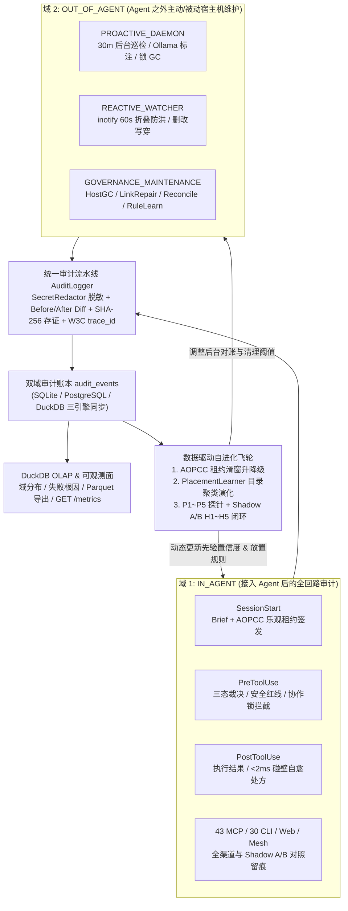

# 16 — 双域全链路行为审计、因果溯源与数据驱动自进化规格说明书

> **Agent Body 产品设计 · 交付件 16**  
> **版本**: v1.1（对齐 `v1.1.0` · 43 工具 · 27 表 · Benchmark `v3.9` · W3C Trace 贯通） · **编制**: Antigravity · **更新日期**: 2026-11-28  
> **对齐约束**: [README.md 规约 #4, #8, #18, #22, #26](../../README.md) · [ISSUE #26](../../ISSUE.md#L126) · [EVOLUTION_GUIDE.md](../../EVOLUTION_GUIDE.md) · [21-observability-and-telemetry-spec.md](21-observability-and-telemetry-spec.md)

---

## 一、第一性原理与立项基线诊断：为什么仅有 `changes` + `effectiveness_ledger` 远远不够？

结合 ISSUE #26 的两大核心诉求——**“接入 Agent 后的行为审计与自进化数据分析”** 与 **“Agent 之外的主动/被动宿主机维护行为审计与有据可查”**，在 Phase 43 立项前对现网数据库与源码做过一次完整实证盘点，暴露出三类结构性盲区：

### 1.1 Phase 43 立项前现网基线实证（2026-11-22 历史诊断快照）

| 数据表 | 立项前分布明细（历史实测） | 暴露的架构盲区 |
|---|---|---|
| **`changes` (共 `10,727` 条)** | `watcher:file_modified = 10,159` (**94.7%**)<br/>`agent_hook:agent_tool:edit_file = 409`<br/>`watcher:file_deleted = 101` · `file_created = 39` | ① **底层 I/O 噪声淹没治理语义**：同文件连续保存未做时间窗折叠；<br/>② **In-Agent 域严重残缺**：仅捕获含 `path` 的写文件调用，丢失命令执行、端口检查、锁操作、`pre_tool_call` 裁决及非路径工具；<br/>③ **Out-of-Agent 域完全黑盒**：后台巡检、GC 删除、断链改写源码、新鲜度剪枝 **0 条留痕**。 |
| **`effectiveness_ledger` (共 `74` 条)** | `cli = 49` · `mcp = 13` · `web = 6` · `hook = 3` · `scanner = 2` | ① 仅记录带 ROI 推导规则的工具，其余工具静默丢弃；<br/>② 缺少因果 `trace_id`、`actor_kind`、`outcome` 与 `before_after_delta` 前后变化对比。 |

### 1.2 审计体系需根治的三大核心盲区 (`CON-19` · 已在 Phase 43~74 全量闭环)

1. **`IN_AGENT` 接入域全口径留痕**：完整捕获 `Brief` 租约签发、`pre_tool_call` 裁决、`post_tool_call` 执行与碰壁自愈、全量 **43 个原生 MCP 工具**、30 组 CLI 子命令、Web 写端点及 Mesh 跨机协同请求；
2. **`OUT_OF_AGENT` 自治与被动维护域零黑盒**：强制纳管 7 条宿主变更链路——`BackgroundScheduler::run_inspection_cycle`（30min 巡检）、`FreshnessReconciler::reconcile`（写穿失效与幽灵剪枝）、`HostGarbageCollector::run_gc`（物理清理清单）、`LinkRepairer::repair_links(apply=true)`（源码替换 Diff）、`PlacementLearner::apply_candidate`（规则演化）、`MemoryLifecycleManager` / `CoordinationEngine`（记忆归档与过期锁 GC）以及 `SessionManager::close_session`（结项清理清单）；
3. **审计流、OLAP 分析与运行时自进化深度打通**：打通 `audit_events` → DuckDB 列存聚合/安全导出 → AOPCC 租约滑窗校准 / `PlacementLearner` 目录聚类 / `ShadowAbEngine` `ab_shadow` 帮倒忙率追踪 / `user_feedback.md` 自动闭环。

---

## 二、双域全链路行为审计架构 (`Dual-Domain Behavioral Audit`)

严格恪守 **规约 #2 递弱代偿原则**：不重造通用 SIEM / ELK，仅聚焦宿主机 Agent 本体双域关键动作的**因果可溯、修改可逆核对、脱敏零泄露与自进化闭环**（如需对接外部企业级 SIEM，通过独立周边插件 `contrib/hook_audit_siem` 按需外发）。



### 2.1 双域正交分类体系 (`AuditDomain` & `ActorKind`)

| 审计域 (`domain`) | 行为主体 (`actor_kind`) | 典型行为分类 (`category`) | 必须留痕的关键载体 (`before_after_delta`) |
|---|---|---|---|
| **`IN_AGENT`** | `agent_session` / `mcp_client` / `cli_user` / `web_user` / `mesh_peer` | `brief_lease`、`hook_pre_guard`、`hook_post_recovery`、`tool_call`、`lock_lifecycle`、`memory_op`、`mesh_collab`、`ab_shadow`、`perf_awr`、`session_close` | 触发工具与脱敏参数摘要、AOPCC 模式、风险告警条数、碰壁处方与 `session_id` / `trace_id` |
| **`OUT_OF_AGENT`** | `daemon_scheduler` | `daemon_cycle`、`freshness_reconcile`、`lock_gc`、`memory_audit`、`ollama_enrich`、`vector_backfill` | 各阶段变更计数、标记失踪/刷新/剪枝对象列表、耗时微秒数 |
| **`OUT_OF_AGENT`** | `watcher_inotify` | `fs_watch_sync`、`fs_watch_delete` | **60 秒时间窗防抖折叠**：`folded_events` 折叠次数、路径、写穿失效标记 |
| **`OUT_OF_AGENT`** | `governance_engine` | `host_gc`、`link_repair`、`placement_learn`、`rule_apply` | **可逆核对清单**：删除文件清单与字节数、文件替换 `patch_diff`、新增/变更规则前后对比 |

### 2.2 核心存储 Schema (`audit_events` — 全库 27 表核心成员)

在 `src/storage/{schema,pg_schema,duckdb_schema}.sql` 三端保持 100% 语义对齐：

```sql
CREATE TABLE IF NOT EXISTS audit_events (
    event_id           TEXT PRIMARY KEY,
    trace_id           TEXT NOT NULL,
    session_id         TEXT NOT NULL DEFAULT 'system',
    domain             TEXT NOT NULL CHECK (domain IN ('IN_AGENT', 'OUT_OF_AGENT')),
    actor_kind         TEXT NOT NULL,
    actor_id           TEXT NOT NULL DEFAULT 'agent-body',
    source_channel     TEXT NOT NULL, -- mcp | cli | web | hook | daemon | watcher | mesh | system
    category           TEXT NOT NULL,
    action             TEXT NOT NULL,
    target_type        TEXT NOT NULL DEFAULT 'none',
    target_id          TEXT NOT NULL DEFAULT '',
    concurrency_mode   TEXT DEFAULT NULL,
    outcome            TEXT NOT NULL CHECK (outcome IN ('success', 'warn', 'blocked', 'failed', 'recovered', 'dry_run')),
    before_after_delta TEXT NOT NULL DEFAULT '{}', -- 强制经 SecretRedactor 脱敏的 JSON 变化前后快照 (<= 4KB)
    elapsed_us         INTEGER NOT NULL DEFAULT 0,
    evidence_sha256    TEXT NOT NULL, -- 规范化防篡改证据指纹 (sha256_hex)
    created_at         TEXT NOT NULL
);
```

### 2.3 安全、防洪与零阻塞门禁

1. **全链路脱敏与载荷上限（规约 #19）**：`AuditLogger::record()` 在序列化 `target_id` 与 `before_after_delta` 时强制经 `SecretRedactor::redact()` 过滤令牌/口令/私钥；单条 `before_after_delta` 严格限制在 `4 KB` 以内；
2. **被动 Watcher 60 秒折叠防洪（规约 #4）**：对 `OUT_OF_AGENT` 同路径高频保存执行 60s 内存滑动窗合并折叠，避免编辑器高频写盘噪音淹没治理审计流；
3. **非阻塞容错写（规约 #9 & #12）**：单条审计落库耗时 `< 80 μs`；遇到只读测试库或瞬时锁争用时记录结构化降级告警至 stderr，严禁阻塞主路径或 Panic。

---

## 三、审计驱动自进化、全链路追踪与 OLAP 飞轮

1. **AOPCC 乐观租约动态校准（替换静态硬编码先验）**：
   - `AuditEvolutionAnalyzer::evaluate_lease_health(storage, target, window_hours=24)` 统计近 24 小时内同一 `target`（如 `port:5432`、`tool:pdftotext`）的 `hook_post_recovery`（`optimistic_miss`）与成功比例，计算滑动窗口经验有效率 `p_valid_hat`；
   - 若近 24h 连续失败 `>= 2` 次且未经 `daemon`/`reconcile` 康复，自动将该条租约置信度压低至 `< 0.70` 并撤回直通授权（自动切回悲观核验）；稳定恢复后再平滑升级。
2. **违规模式沉淀与 Shadow A/B 帮倒忙率监控**：
   - 聚类近 7 天 `hook_pre_guard` 中高频触发 `warn`/`blocked` 或规范放置纠偏的路径前缀，输出给 `PlacementLearner` 生成规则候选或经 `FeedbackEngine::add_item_deduped` 写入 `user_feedback.md`；
   - `ShadowAbEngine` 将真实检索对照事件以 `category="ab_shadow"` 写入 `audit_events`，量化追踪帮倒忙率并触发 `H1~H5` 自动写穿自愈。
3. **全链路 `trace_id` 贯通与 DuckDB OLAP 导出（Phase 74 升级）**：
   - Web 请求透传 `X-Trace-Id` 与 W3C `traceparent` 响应头，微内核 `pipeline.rs` 贯通单次调用 `trace_id`（消除断链），同时将 24h 双域审计汇总指标暴露至 `GET /metrics` 与 `agent-body body metrics`；
   - `SyncPipeline` 单事务批量同步 `audit_events` 至受限 DuckDB（`threads=2, memory_limit=256MB`），支持 `audit_summary(days)` 多维聚合与白名单目录（`<workspace>/tmp/`）Parquet/CSV 安全导出。

---

## 四、三端 1:1:1 契约、现网实测与 Benchmark `v3.9` 验收

### 4.1 CLI / MCP / Web 对齐映射

| 动作能力 | CLI 子命令 | 原生 MCP 调用 (`body_audit_query`) | Web REST API |
|---|---|---|---|
| **多条件检索事件流** | `agent-body audit query [--domain ...] [--limit N]` | `{"action": "query", "domain": "...", "limit": 50}` | `GET /api/v1/audit/events` |
| **多维 OLAP 汇总分析** | `agent-body audit summary --days 7` | `{"action": "summary", "days": 7}` | `GET /api/v1/audit/summary?days=7` |
| **按 `trace_id` 因果钻取** | `agent-body audit trace <TRACE_ID>` | `{"action": "trace", "trace_id": "..."}` | `GET /api/v1/audit/events?trace_id=...` |
| **触发滑窗自进化评估** | `agent-body audit evolve [--apply]` | `{"action": "evolve", "apply": false}` | `POST /api/v1/audit/evolve` |
| **导出离线分析集** | `agent-body audit export --format parquet` | `{"action": "export", "format": "parquet"}` | `POST /api/v1/audit/export` |

### 4.2 现网 7 日双域审计实测样本（`v1.1.0` 真机实跑捕获）

```text
$ agent-body audit summary --days 7
📊 双域行为审计汇总 (7d): 总计 9431 条 | IN_AGENT=6236 | OUT_OF_AGENT=3195 | 异常拦截=72 | 自愈=0
  - [IN_AGENT]     cli_command.hooks (success)                 -> 2821 次
  - [OUT_OF_AGENT] fs_watch_sync.file_modified (success)       -> 1812 次 (60s 防洪折叠后)
  - [IN_AGENT]     hook_pre_guard.edit_file (success)          -> 1305 次
  - [IN_AGENT]     hook_post_exec.edit_file (success)          -> 1250 次
  - [OUT_OF_AGENT] freshness_reconcile.reconcile (success)     ->  319 次
  - [OUT_OF_AGENT] daemon_cycle.run_inspection_cycle (success) ->  300 次
```

### 4.3 验收门禁（Benchmark `v3.9` + 集成测试）

- **`W16 (dual_domain_audit_and_lease_self_evolution)`**：验证 `IN_AGENT` 全链路脱敏留痕与 `trace_id` 串联、`OUT_OF_AGENT`（`HostGC` + `LinkRepair` + `Reconcile`）`before_after_delta` 留痕，以及审计流驱动 AOPCC 租约降级与康复闭环；
- **`DQ7 (audit_completeness_and_redaction_hygiene)`**：巡检双域覆盖率、敏感字段 `0` 明文泄露、`evidence_sha256` 完整率 `100%` 及 Watcher 折叠信噪比；
- **`PR-12 (AuditDrivenSelfEvolution)`** 与 [tests/audit_integration.rs](../../tests/audit_integration.rs)：持续验证审计驱动减少重复试错的真实量化收益与零 Panic 写入契约。
