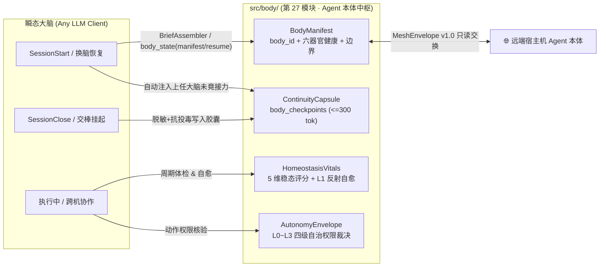

# 17 — Agent 本体（宿主机具身底座）、跨大脑连续性与五维稳态规格说明书

> **Agent Embodiment Substrate (Agent Body) 产品设计 · 交付件 17**  
> **版本**: v1.0 · **编制**: Antigravity · **日期**: 2026-11-22 (Asia/Shanghai)  
> **对齐约束**: [README.md 规约 #1, #2, #3, #8, #11, #13, #17, #27](../../README.md) · [ISSUE #27](../../ISSUE.md#L132) · [04-from-steward-to-agent-body.md](../idea_doc/04-from-steward-to-agent-body.md) · [roadmap-phase44-45.md](../src_doc/roadmap-phase44-45.md)

---

## 一、定位升维与三层命名兼容契约（Three-Tier Naming Contract）

### 1.1 为什么必须分层命名，而不能随意破坏工程契约？

基于 **脑体分离（Brain-Body Separation）** 架构，本项目的本质定位是：**驻留在宿主机上的 Agent 本体（Agent Embodiment Substrate）**——大语言模型与各类客户端（Antigravity / Claude Code / Cursor / Codex / Cron Worker）是可随时切换的**瞬态大脑皮层（Ephemeral Cortex）**，而本系统是永驻物理主机、零云端推理税的**数字躯干与具身底座**；过去的“大管家 / 小秘书”则是本体对外的两大功能侧面。

本仓库在 Phase 44~45 先行采用平滑兼容过渡，并于 Phase 48 完成全仓工程硬切，将现网部署契约统一稳定为 `~/.agent-body/`、`agent-body.service`、全局 `hooks.json` 与 `43` 个 `body_*` MCP 工具。因此本规格书确立 **三层命名兼容契约（严禁违背）**：

| 命名层级 | 覆盖范围 | 命名策略 | 约束红线 |
|---|---|---|---|
| **Tier-1：品牌与产品心智层** | README 标题、项目愿景、架构文档、`docs/idea_doc/`、对外演讲/路演 PPT、公众号文章 | 统一升维为 **「Agent 本体（宿主机具身底座）」 / Agent Embodiment Substrate (`agent-body`)** | 明确点破「脑体分离」，将“大管家/小秘书”定位为本体侧面与比较优势类比，**严禁再写容易让人误解为“多 Agent 编排器”或“人类私人助理”的表述**。 |
| **Tier-2：交互文案、代码注释、WebUI 与 SKILL 层** | Web 控制台文案、路演剧场、CLI `--about`/Help 文本、`src/` 模块注释、`skills/*.md`、`docs/manual/*.md`、`docs/arch/*.md` | 以「Agent 本体 · 六大器官」为主体语义刷新 | 保持清晰术语映射（例如：*Agent 本体事实感官 / 本体记忆海马体 / 本体反射门禁*），不破坏任何代码标识符与既有行为语义。 |
| **Tier-3：工程与协议稳定层（零破坏红线）** | Cargo package (`agent-body`)、二进制名、配置目录 (`~/.agent-body/`)、全部 `43` 个 MCP 工具名 (`body_*`)、CLI 命令 (`agent-body ...`)、SQLite/PG/DuckDB 既有表名与 REST 路由 | **100% 冻结稳定，向后完全兼容** | **严禁再随意改名破坏既有客户端 MCP 配置、Hooks 集成、Systemd 服务脚本或外部自动化调用**。新本体能力统一在 `src/body/` 与第 43 工具 `body_state` 内聚扩展。 |

---

## 二、五大本体原生新能力详细技术规格

Phase 44 在 `src/` 下新增第 27 个顶层模块 **`src/body/`**，下设 `manifest.rs`、`continuity.rs`、`vitals.rs`、`envelope.rs`，并于 Phase 50 增补第 5 个子模块 `perf_awr.rs`（内生 Wait Events / `/proc/self` / AWR / ADDM），把本体能力收敛为清晰的「Agent 本体中枢」。



### 2.1 能力一：`BodyManifest` — 本体身份证与六器官能力自省 (`src/body/manifest.rs`)

让任何新接入的瞬态大脑在 `< 10 ms` 内看清“自己现在附着在哪个身体上、身体有哪些器官、处于什么状态、边界在哪”：

1. **确定性 `body_id` 生成**：
   - 取宿主机 `hostname` + `/etc/machine-id`（不存在时退化为 `data_dir` 规范路径），经 SHA-256 截断生成稳定 16 位十六进制指纹（如 `body-8f3a91c04d2e7b10`），确保重启/跨客户端接入身份恒定。
2. **六大器官自省结构 (`OrganStatus`)**：
   - `sensory`（感官与图谱：`fact_nodes`、`fact_edges`、`assets`、CodeGraph 仓库数）；
   - `cerebellum`（小脑反射与并发：AOPCC 活跃租约数、最近租约有效率 $\hat{p}_{\text{valid}}$）；
   - `hippocampus`（海马体记忆：`memories` 活跃条数、向量覆盖度、当前活跃接力胶囊数）；
   - `spine`（规约脊柱：`placement_rules` 规则数、`AutonomyEnvelope` 启用级别）；
   - `metabolism`（代谢免疫：`audit_events` 双域覆盖、`FreshnessReconciler` 最近对账状态）；
   - `social`（社会协同：活跃 `coordination_locks`、已发现 Mesh 对等体数）。
3. **内置边界声明**：随清单附带紧凑的 `non_goals` 摘要，向刚着陆的大脑声明“本体不替代你的思考规划，只提供真实物理世界底座”。

### 2.2 能力二：`ContinuityCapsule` — 跨大脑连续性接力胶囊 (`src/body/continuity.rs`)

解决 **“换大脑不失忆、换壳不换魂”** 的第一痛点（如白天用 Antigravity 调研到一半，夜晚由 Cron Worker 或 Claude Code 接着改）。

1. **第 27 张核心存储表 `body_checkpoints`（三后端同步）**：
   ```sql
   CREATE TABLE IF NOT EXISTS body_checkpoints (
       checkpoint_id       TEXT PRIMARY KEY,
       body_id             TEXT NOT NULL,
       from_brain          TEXT NOT NULL DEFAULT 'unknown',
       session_id          TEXT NOT NULL DEFAULT '',
       goal_summary        TEXT NOT NULL,
       active_files_json   TEXT NOT NULL DEFAULT '[]',
       active_locks_json   TEXT NOT NULL DEFAULT '[]',
       verified_facts_json TEXT NOT NULL DEFAULT '[]',
       open_blockers_json  TEXT NOT NULL DEFAULT '[]',
       next_step_hint      TEXT NOT NULL DEFAULT '',
       token_budget        INTEGER NOT NULL DEFAULT 300,
       status              TEXT NOT NULL DEFAULT 'active'
                           CHECK (status IN ('active', 'resumed', 'expired', 'archived')),
       evidence_sha256     TEXT NOT NULL,
       created_at          TEXT NOT NULL,
       resumed_by_brain    TEXT DEFAULT NULL,
       resumed_at          TEXT DEFAULT NULL
   );
   CREATE INDEX IF NOT EXISTS idx_body_checkpoints_status_time
       ON body_checkpoints(status, created_at DESC);
   ```
2. **新增 4 个 `StorageProvider` SPI 方法**（SQLite / PG / DuckDB 三后端同步实现）：
   - `insert_body_checkpoint(&self, cp: &BodyCheckpointRecord) -> Result<()>`
   - `get_latest_active_body_checkpoint(&self, body_id: &str) -> Result<Option<BodyCheckpointRecord>>`
   - `list_body_checkpoints(&self, status_filter: Option<&str>, limit: usize) -> Result<Vec<BodyCheckpointRecord>>`
   - `mark_body_checkpoint_resumed(&self, checkpoint_id: &str, by_brain: &str, resumed_at: &str) -> Result<bool>`
3. **安全、防膨胀与 `BriefAssembler` 融合规则**：
   - **双重净化红线（规约 #19）**：保存胶囊前，所有文本字段强制经过 `SecretRedactor::redact()` 脱敏与 `PromptInjectionScanner::sanitize()` 抗投毒清洗，并计算 `evidence_sha256` 写入 `audit_events`（`IN_AGENT` 域）；
   - **防爆预算上限**：每个激活胶囊硬限制 `<= 300 tok`，`BriefAssembler` 在存在 `active` 胶囊且 `budget_tokens >= 800` 时自动用 `<= 150 tok` 紧凑摘要注入「🧬 跨大脑接力上下文」段落，不挤压既有事实/偏好/记忆 SLA；
   - **幂等生命周期**：新大脑显式调用 `handoff_resume` 后将旧胶囊标为 `resumed` 并记录 `resumed_by_brain`；连续写入新胶囊时可自动归档同 `session_id` 的旧 `active` 胶囊。

### 2.3 能力三：`HomeostasisVitals` — 五维本体生命体征与稳态自愈 (`src/body/vitals.rs`)

将散落在 `DQ1~DQ7`、`P1~P5`、磁盘水位与 AOPCC 审计里的健康信号聚合成可量化、可自愈的五维生命体征：

| 生命体征维度 | 权重 | 核心物理采集来源（复用既有引擎，零重扫） | 健康阈值与低分反射自愈 (`L1_AUTONOMIC`) |
|---|:---:|---|---|
| **1. 感官清晰度 (`sensory_clarity`)** | 25% | `DQ1`（描述完整率）、`DQ2`（向量回填率）、`DQ6`（项目图谱连通率） | `< 75` → 建议/调度增量向量回填与结构上卷 |
| **2. 反射灵敏度 (`reflex_accuracy`)** | 20% | `audit_events` 近 24h AOPCC 租约命中率 $\hat{p}_{\text{valid}}$、`P2` 探针命中率 | `< 75` → 自动收紧低置信度乐观租约（降级为 `CAUTIOUS_CAS`） |
| **3. 海马体纯净度 (`memory_purity`)** | 20% | `DQ4`（零明文凭据残留）、`DQ5`（信息新鲜度/无僵尸记忆）、矛盾记忆比率 | `< 80` → 触发 `FreshnessReconciler::reconcile()` 与记忆生命周期审计 |
| **4. 代谢健康度 (`metabolic_health`)** | 20% | 磁盘空闲率、`DQ3` 断链健康分、过期锁数量、`/root/new/tmp/` 滞留体积 | `< 75` → 触发过期锁 GC、写穿失效与 `HostGC` `dry-run` 预检告警 |
| **5. 免疫可溯度 (`immune_traceability`)** | 15% | `DQ7`（双域审计完整率 + Watcher 折叠效率）、`~/.agent-body/` `0600/0700` 权限合规 | `< 85` → 写入 `user_feedback.md` 自告警并提醒修正权限/漏埋点 |

- 综合稳态分：`overall_score = 0.25*S + 0.20*R + 0.20*M_p + 0.20*M_h + 0.15*I`（`0..=100`）；
- 状态分档：`healthy (>= 85)`、`degraded (65..84)`、`critical (< 65)`；
- 当出现 `degraded`/`critical` 时，仅允许自动触发 **`L1_AUTONOMIC`** 级别可逆自愈动作，**绝不越界执行物理删除或源码改写**。

### 2.4 能力四：`AutonomyEnvelope` — 四级本体自治权限包络 (`src/body/envelope.rs`)

把散落在 `HostGC`、`LinkRepair`、`FreshnessReconciler`、`Hooks` 和 `Mesh` 里的安全规则收敛为显式、可查询、可被客户端校验的四级自治边界矩阵：

| 自治等级 | 英文标识 | 授权方式 | 涵盖典型动作 | 审计要求 |
|---|---|---|---|---|
| **L0 只读感知** | `L0_OBSERVE` | 永远允许（零副作用） | `brief`、`fact_query`、`asset_search`、`links_impact`、`vitals`、`mesh/body_manifest` | 查询入 `audit_events` (`IN_AGENT`) |
| **L1 自主稳态** | `L1_AUTONOMIC` | 本体可后台自主执行（可逆/零业务破坏） | `Watcher` 60s 折叠、写穿向量失效、幽灵端口剪枝、过期锁 GC、AOPCC 租约降级/康复、重复记忆归档 | 100% 记录 `OUT_OF_AGENT` + `before_after_delta` |
| **L2 受控监督** | `L2_SUPERVISED` | 默认 `dry-run`；真实写入需大脑确认或 Web `auth_token` | `HostGC` 物理删文件、`LinkRepair --apply` 改写源码、`Mesh` 收件箱 `accept`、`PlacementLearner` 规则落盘 | 强制 `before_after_delta` Diff + `evidence_sha256` |
| **L3 绝对禁区** | `L3_FORBIDDEN` | 物理/策略永久阻断（`blocked`） | 写 `/etc/shadow`・`/etc/sudoers`・`~/.ssh/`、明文密钥入库或跨 Mesh 传输、黑名单目录递归扫盘、跨机直写系统目录 | 强制拦截告警 + `CRITICAL` 审计事件 |

### 2.5 能力五：`Body-to-Body` 多本体联邦名片发现 (`src/mesh/`)

- 在 `src/mesh/` 扩展只读联邦发现接口 `/api/v1/mesh/body_manifest`（受既有 `MeshEnvelope v1.0` 时间窗 + Scope `read:facts` 校验保护）；
- 远程大脑或宿主在跨机托付任务（`HANDOFF_TASK`）前，先拉取对端本体的 `BodyManifest`（核验可用工具、GPU/CPU、稳态分 `overall_score` 与目录白名单能力），拒绝盲目跨机投递，同时严守“不做多 Agent 编排引擎”红线。

---

## 三、黑白屏 1:1:1 双向同步契约（第 43 原生工具）

恪守规约 #16「高内聚防工具膨胀」，仅新增 **1 个**多动作聚合 MCP 工具 `body_state`（工具总数由 `42 → 43`，CLI 顶层命令由 `29 → 30`）：

| 端侧 | 接口签名 / 入口 | 覆盖动作（1:1:1 Action Parity） |
|---|---|---|
| **MCP 工具 (`src/api/mcp_tools.rs`)** | `body_state` | `action`: `manifest` \| `vitals` \| `envelope` \| `handoff_save` \| `handoff_resume` \| `heal` \| `peers` \| `perf_snapshot` \| `perf_awr` \| `perf_tune` |
| **CLI (`src/cli_args.rs` / `src/main.rs`)** | `agent-body body <subcmd>` | `manifest` \| `vitals` \| `envelope` \| `handoff` \| `resume` \| `heal` \| `peers` \| `perf-snapshot` \| `perf-awr` \| `perf-tune` |
| **Web REST (`src/web/server.rs` & `parity_api.rs`)** | `GET /api/v1/body/{manifest,vitals,envelope,checkpoints,peers,perf/awr}`<br/>`POST /api/v1/body/{handoff,resume,heal,perf/snapshot,perf/awr,perf/tune}` | 写端点强制校验 `check_auth`；`parity/matrix` 升级为 `43/43 (100%)` |
| **Web UI (`src/web/assets/mod.rs`)** | 顶栏品牌升维 + 第 9 工作台「🧬 本体中枢与生命体征」 | 展示脑体分离拓扑、六器官卡片、五维稳态雷达、跨大脑接力胶囊时间线、L0~L3 权限包络表 + CLI/MCP 镜像器 |

---

## 四、Benchmark `v3.7` 实证门禁设计

沿用 `10-benchmark-spec.md` 的「既省 Token × 质量不降反升」帕累托双门禁，在 Phase 44.6 升级至 `BENCHMARK_SPEC_VERSION = "3.7"`：

1. **`W17 (cross_brain_continuity_and_body_proprioception)`**：
   - **对照场景**：模拟「大脑 A 完成 PostgreSQL 源码定位与故障排查后挂起 → 新大脑 B 接手继续任务」；
   - **Baseline（裸奔换脑）**：大脑 B 毫无接力感知，被迫重新 `ls/find/ps/git log` 盘点环境、重新定位文件与阻塞点（高 Token + 多轮延迟）；
   - **Steward Body（具身接力）**：通过 `BodyManifest + ContinuityCapsule` 注入 `<300 tok` 脱敏接力摘要，一次直达正在修改的文件、已验证事实、未解阻塞项与下一步提示；
   - **门禁要求**：$Q_{\text{steward}} > Q_{\text{baseline}}$，必含接力事实 `100%` 命中，`rounds_saved >= 2`，Token 显著缩减且 `SecretRedactor` 明文泄露 `== 0`。
2. **`DQ8 (body_homeostasis_and_envelope_hygiene)`**：
   - 验证现网本体的五维生命体征计算完整（全维度 `[0, 100]` 合法值）、`AutonomyEnvelope` 对 `L3_FORBIDDEN` 越权动作拦截率 `100%`，以及 `body_checkpoints` 表内 `0` 明文密钥与 `<= 300 tok` 预算合规率 `100%`。
3. **`PR-13 (CrossBrainContinuitySaved)`**：
   - 在 `effectiveness_ledger` 中为跨大脑接力与本体自省操作提供确定性效能存证规则（记录节省的重新探查 Token 与整轮对话税 `rounds_saved`）。

---

## 五、与 ISSUE #28 / #29 的零返工协同顺序

为避免先整理目录或重做全套 PPT、随后又因 Phase 44~45 本体升维而全部推倒返工，整体演进按以下依赖拓扑推进：

1. **Phase 44（本规格核心实现）**：落地 `src/body/`、`body_checkpoints`、五维稳态、四级包络、`43/43` 黑白屏同步与 Benchmark `v3.7`（`W17` + `DQ8` + `PR-13`）。
2. **Phase 45（全仓本体化术语刷新，ISSUE #27 收口）**：按三层命名兼容契约刷新代码注释、CLI/MCP 描述、`README.md`、`docs/manual/`、`docs/arch/`、`skills/`（含全局镜像）与 Web 路演剧场（升级主叙事 + 新增第 7 幕「换脑不失忆」），产出体系化演说母版内容清单。
3. **Phase 46（承接 ISSUE #28）**：新建 `presentation/` 目录，`git mv` 移入 `agent-body-deck.html` 与 `presentation.html` 并基于 Phase 44~45 最新实证数据终刷新；同时按“地层剖面 / 工程蓝图”视觉规范拆解生成多份体系化 **30 分钟单点讲透专题演讲 HTML**。
4. **Phase 47（承接 ISSUE #29）**：统筹规划并执行 `git mv` 根目录文档层级规整（清理一级目录散乱文档），全仓扫描刷新（排除 `target/`）所有旧路径引用，同步刷新 `.codegraph/` 与 `scripts/evolution_manifest.py` 门禁。
