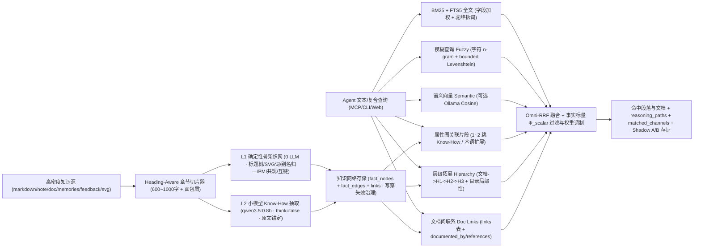

# 19 — 弱向量补偿、行业 Know-How 知识网络与全信号 Omni-RRF 多路融合召回设计规格说明书

> **版本**: v1.4 (Phase 61 ~ Phase 62 · ISSUE #44)  
> **作者**: digoal 德哥 & Agent Body Architecture Team  
> **状态**: 已评审通过（含 Omni-RRF 8 维文本融合补充规格），待按 Phase 61 → 62 分步落地  
> **对齐规约**: 规约 #2 (递弱代偿与零依赖), #5 (图谱优先), #9 (极速轻量化), #15 (写穿新鲜度), #16 (黑白屏 1:1:1 同步), #18 (实证基准), #19 (全链路脱敏与抗投毒)

---

## 一、设计动机与第一性原理

> **原始问题 (`ISSUE #44`)**：本地小参数 LLM 生成的 Embedding 表征能力有限、召回率不够高；同时小模型支持的上下文长度受限，长文本无论直接硬截断还是盲目切片都容易丢失前提条件与因果语义。因此不能单靠 Embedding，必须依赖更多**图（Graph）**的支撑，把离散文档和碎片记忆织成**行业 Know-How 知识网络**。
>
> **文本检索补充要求**：如果是文本对象，检索链路应统筹结合 **语义、模糊查询、事实标量、BM25、全文检索、属性图关联片段、层级、文档之间的联系** 等多维信号的 RRF 融合查询（Omni-RRF）。

### 1.1 现网源码实证 GAP 盘点

基于对当前仓库（`v1.0.0`, `340135b`）源码的实测审查，现有体系在“行业知识网与弱向量多路融合检索”上存在五处明确断点：

1. **硬截断丢失主体语义**：[src/memory/embedding.rs](../../src/memory/embedding.rs) 的 `EmbeddingClient::embed_text` 对入模文本执行 `chars().take(2000)` 硬截断；[src/scanner/ollama_annotator.rs](../../src/scanner/ollama_annotator.rs) 的文本摘录默认上限仅 `1200` 字符（长篇研报/架构文档后 80% 完全盲区），且缺乏章节感知（Heading-Aware）切分与父/兄上下文回溯。
2. **图谱本体局限于物理与工程拓扑**：[src/storage/schema.sql](../../src/storage/schema.sql) 中 `fact_nodes.node_type` 受 `CHECK` 约束仅允许 7 种物理/工程类节点（`project`/`tool`/`port`/`service`/`cron`/`file`/`authoritative_site`），`fact_edges.relation` 仅限 12 种工程边——缺少「概念、行业术语、原子 Know-How 因果论断、适用边界、文档章节」节点及对应的语义关系。
3. **L3 语义边反向强依赖小向量**：[src/fact/semantic_discovery.rs](../../src/fact/semantic_discovery.rs) 的 `L3_SEMANTIC` 挖掘依赖本地 Embedding 余弦相似度 `>= 0.78`。当宿主机无向量模型（如未拉取 `nomic-embed-text`）或小模型发生语义塌缩时，隐式语义网直接归零。
4. **检索引擎检索维度单一且 0-Hop**：[src/memory/hybrid.rs](../../src/memory/hybrid.rs) (`HybridSearchEngine`) 与 [src/scanner/asset_search.rs](../../src/scanner/asset_search.rs) (`AssetSearchEngine`) 当前仅做 **FTS5 默认排序 + 单向量余弦 2 路 RRF**：
   - 未启用 FTS5 字段加权 `bm25(...)` 与驼峰/蛇形拆词（本机 `shadow_ab` 实测已暴露 `ShadowAbEngine` 0 命中回退）；
   - 缺少 **模糊查询**（错别字/短语碎片/中文未分词子串 n-gram）；
   - 事实标量（时效 `mtime_secs`、重要度 `importance_score`、权威清单权重、`domain`/`modality`）尚未参与排序调制；
   - 未消费 **属性图关联片段（`fact_edges` 1~2 跳）**、**章节/目录层级（Hierarchy）** 与 **`links` 表文档间显式联系（`doc_links`）**。

### 1.2 第一性原理架构决策

1. **弱向量压缩 vs 结构化原子网络**：小参数模型不擅长将万字长文无损压进 768 维单向量，但擅长对 **600~1000 字符的完整单章节** 执行强 JSON Schema 约束的信息抽取（`主概念 → 关系 → 客概念 + 边界条件`）。
2. **多维正交信号替代单点赌注**：没有任何单一检索引擎能通吃所有查询——字面精确词靠 **BM25/FTS5**，错别字/未分词缩写/驼峰片断靠 **Fuzzy n-gram**，近义表述靠 **可选 Semantic Vector**，时空/权威度/过滤靠 **Fact Scalar**，多跳因果与行业经验靠 **Property Graph + Know-How**，切分防失真靠 **Hierarchy 父/兄章节扩展**，跨篇脉络靠 **Doc-to-Doc Links**。
3. **权重重归一化（Adaptive Weight Renormalization）**：当本地未配置或离线关闭向量（或某些文件无矢量/图像段）时，剩余确定性通道的 RRF 权重自动重归一化，保证召回质量稳健不塌缩。

---

## 二、总体架构与双层知识网络模型

### 适用范围边界（防噪音硬规约）

- **纳管白名单（知识域）**：`document`（`.md`/`.org`/`.rst`/`.pdf`/`.docx`/`.pptx`）、高语义信息 SVG 图（含 `svg_text_snippets`）、持久化 `memories` 与 `user_feedback.md`。
- **代码协同边界**：`script`/源码文件的驼峰拆词同时增强 FTS5 + Fuzzy 代码符号检索，但源码局部变量与函数 AST 调用链仍归 `.codegraph/` 与微观 `links` 管理，不污染概念/Know-How 知识网。

---

## 三、数据模型与三后端存储演进

严格守住 **27 张核心表 / 零新增外部存储** 架构不变量，直接扩展现有 `fact_nodes`、`fact_edges` 与 `links` 表。

### 3.1 核查结论与三后端 Schema 对齐

已核查三后端建表文件：
- **PostgreSQL** ([pg_schema.sql](../../src/storage/pg_schema.sql#L157-L182)) 与 **DuckDB** ([duckdb_schema.sql](../../src/storage/duckdb_schema.sql#L132-L153)) 的 `fact_nodes.node_type` 与 `fact_edges.relation` 均为开放 `TEXT`/`VARCHAR`，无 `CHECK` 约束阻断；
- **SQLite** ([schema.sql](../../src/storage/schema.sql#L230-L257)) 当前存在静态 `CHECK` 枚举约束，因此需在 [schema.sql](../../src/storage/schema.sql) 扩展允许值，并在迁移模块中提供幂等重建迁移（`BEGIN IMMEDIATE` 原子重建 `fact_nodes` / `fact_edges` 保留已有行）。

### 3.2 新增节点类型 (`fact_nodes.node_type`)

| `node_type` | 语义定位 | `id` 命名规约 | `properties` 关键字段 |
|---|---|---|---|
| `section` | 文档结构章节（Heading Chunk） | `sec:<sha256_prefix>` | `source_path`, `parent_section_id`, `depth` (`1\|2\|3`), `heading_path`（面包屑）, `line_range`, `snippet_preview`, `content_hash` |
| `domain_term` | 标准化行业术语 / 实体概念 | `term:<canonical_slug>` | `canonical_name`, `aliases`, `domain`, `doc_freq`, `source_sample_paths` |
| `knowhow` | 原子行业经验 / 因果规律胶囊 | `kh:<sha256_prefix>` | `claim`, `boundary_condition`, `confidence`, `source_path`, `section_heading`, `content_hash`, `extractor` |

### 3.3 新增有向关系与权重 (`fact_edges.relation`)

| `relation` | `evidence_tier` | 默认边权 (`weight`) | `direction_kind` | 语义与行业 Know-How / 层级作用 |
|---|---:|---:|---|---|
| `contains` (已有扩展) | `L1_EXPLICIT` | `0.90` | `structural_containment` | 文档 `file` → 一级 `section`，及父 `section` → 子 `section`（层级树） |
| `mentions` | `L1_EXPLICIT` | `0.75` | `concept_reference` | 章节 `section` / SVG / `memory` → 术语 `domain_term` |
| `co_occurs_with` | `L2_STRUCTURAL` | `0.45 ~ 0.70` | `statistical_association` | 基于跨章节 **PMI** 的强相关术语共现边（严格 `Top-K=5` 剪枝） |
| `causes` | `L2_KNOWHOW` | `0.85` | `causal_mechanism` | 诱因/机制传导（例：`高频Checkpoint → WAL写放大`） |
| `mitigates` | `L2_KNOWHOW` | `0.88` | `remediation_action` | 症状/瓶颈的对策解法（例：`调大max_wal_size → WAL写放大`） |
| `depends_on` (已有扩展) | `L2_KNOWHOW` | `0.80` | `prerequisite_rule` | 前提条件依赖 |
| `contrasts_with` | `L2_KNOWHOW` | `0.72` | `tradeoff_comparison` | 方案权衡/选型对立（例：`OptimisticLease ↔ PessimisticLock`） |
| `applies_when` | `L2_KNOWHOW` | `0.82` | `applicability_boundary` | `knowhow` → 适用条件约束节点 |
| `supersedes` | `L2_KNOWHOW` | `0.95` | `knowledge_evolution` | 新结论覆盖陈旧经验（防旧知识误导检索） |

---

## 四、核心算法规格

### 4.1 Heading-Aware 章节语义切分与父子回溯

替代硬截断 `chars().take(2000)`，构建统一 `HeadingChunker`：
1. 按 Markdown 标题层级（`#` / `##` / `###`）切分为结构化段落，每个切片目标窗口 **`600 ~ 1000` 字符**，相邻长段保留 **`100` 字符重叠**；
2. 每个 `section` 节点记录 `parent_section_id` 与**祖先标题面包屑**（例：`文档名 > 二、并发控制 > 2.2 乐观锁适用边界`），保证孤立切片不失真；
3. 检索命中任意子章节时，**层级拓展（Hierarchy Expansion）** 自动附带父章节摘要及直接前/后兄弟章节提示，避免上下文断章取义。

### 4.2 零向量 L1 确定性知识织网（Pure Rust）

不依赖任何 LLM 或向量服务即可在扫盘/入库期构建核心骨架：
1. **实体别名归一化（Alias Canonicalizer）**：内置轻量可配置同义词映射表（如 `PG` / `Postgres` / `PostgreSQL` → `postgresql`；`FTS` / `FTS5` → `fts5`；`向量` / `Embedding` → `embedding`），彻底消灭一词多写导致的图断链；
2. **多源概念提取**：从文章标题/章节名、`desc_kv["headings"]`、`desc_kv["svg_text_snippets"]`、`desc_kv["table_names"]`/`columns` 中提取候选术语（支持中文词组、英文技术词及驼峰/下划线拆词）；
3. **跨章节 PMI（点互信息）共现剪枝**：
   $$\text{PMI}(x, y) = \log_2 \frac{P(x, y)}{P(x) P(y)}, \quad \text{co\_count}(x, y) \ge 2$$
   仅保留归一化后 $\text{PMI} > 1.2$ 的高质量共现对，每个 `domain_term` 最多保留 `Top-5` 邻边，杜绝高频停用词把全网连成一团；
4. **文档间互链 (`doc_links`)**：结合 [src/links/](../../src/links/mod.rs) 已提取的 Markdown 内部互链引用、`documented_by` 与同目录/同 `domain` 关联边建立跨文档导航骨架。

### 4.3 小模型 L2 原子 Know-How 抽取协议（适配 `qwen3.5:0.8b`）

针对本机已验证的 `qwen3.5:0.8b` 特性定制强约束短窗抽取器：
1. **短上下文输入**：只向模型喂入 **单个经 `SecretRedactor` 脱敏且 `PromptInjectionScanner` 清洗的 `section` 切片（<= 1000 字符）+ 面包屑路径**，彻底避开长文本注意力溃散；
2. **模型兼容性约束**：请求 `/api/generate` 强制携带 **`"think": false`** 与 `temperature: 0.0` 及严格 JSON Schema（规避推理 token 耗尽返回空串问题），输出最多 `3` 条原子三元组（`subject`, `relation`, `object`, `boundary`, `evidence_quote`）；
3. **原文锚点防幻觉校验（Grounding Check）**：`evidence_quote` 必须在原切片（归一化空白后）命中至少 `8` 个连续字符（或关键双词同时出现）才允许写入 `fact_edges`，否则直接丢弃；同一路径同时记录 `content_hash`。

### 4.4 防“毛线球 (Hairball)”治理与写穿失效

- **度数与权重双门禁**：单 `domain_term` 总度数上限为 `32`（超限时保留最高 `weight × confidence` 边）；低置信度（`< 0.55`）边不参与默认推理传播；
- **写穿级联失效（对齐规约 #15）**：当源文件修改（`content_hash` 变化）或被删除时，按 `properties.source_path` 精确清除该文件派生出的旧 `section`、`knowhow` 节点及所有关联 `fact_edges`，再按需重算；严禁幽灵旧知识长期污染图谱。

### 4.5 Omni-RRF 全信号多路融合召回规格（8 维文本融合）

在 `AssetSearchEngine` 与 `HybridSearchEngine` 中将现有 2 路升级为覆盖 **8 大信号维度** 的 **Omni-RRF** 统一评分管线：

$$\text{Score}(d) = \left( \sum_{c \in \mathcal{C}_{\text{active}}} \frac{\tilde{w}_c}{k_c + \text{rank}_c(d)} \right) \cdot \Phi_{\text{scalar}}(d)$$

其中对激活通道权重自动归一化 $\tilde{w}_c = \frac{w_c}{\sum_{j \in \mathcal{C}_{\text{active}}} w_j}$，$k_c$ 为平滑常数（默认 `60`）。

| 通道标识 (`matched_channels`) | 覆盖信号 | 算法与实现要点 | 默认权重 $w_c$ | 预算SLA |
|---|---|---|---:|---:|
| **`bm25_fts`** | **BM25 + 全文检索** | SQLite FTS5 加权 `bm25(assets_fts, ...)`（路径/标题 `3.0`、章节/KV `2.0`、正文 `1.0`），配合 Query 驼峰/蛇形标识符自动拆词（如 `ShadowAbEngine` → `"ShadowAbEngine" OR (Shadow AND Ab AND Engine)`） | `1.20` | `< 3ms` |
| **`fuzzy`** | **模糊查询** | 纯 Rust 零依赖：**字符 Bigram/Trigram Jaccard 相似度 + 子串/前缀匹配 + 有界 Levenshtein 编辑距离（仅当词长 >= 4 且容差 <= 2）**，兜底拼写误差、未分词中文短语与代码标识符片段 | `0.75` | `< 4ms` |
| **`semantic_vec`** | **语义向量** | 本地 `EmbeddingClient` 余弦相似度（若模型离线/未拉取 `nomic-embed-text` 或跳过向量时自动从 $\mathcal{C}_{\text{active}}$ 摘除并重归一化） | `1.00` | 可选 |
| **`graph_knowhow`** | **属性图关联片段** | Query 分词+别名归一命中 `domain_term`/`knowhow`/`section` 种子节点后，沿 `fact_edges` 做 **1~2 跳加权扩散**（衰减 $\gamma=0.65$，`supersedes` 旧边降权 `0.15`），同步返回 `reasoning_paths` | `1.10` | `< 6ms` |
| **`hierarchy`** | **层级结构** | **文档内层级**（子 `section` 命中 → 提升父章节与同级连续片段聚集分，防碎片化失真）+ **目录层级局部性**（同项目根/子目录高频命中聚合加权） | `0.60` | `< 2ms` |
| **`doc_links`** | **文档间联系** | 若高分锚点文档通过 `links` 表（`references`/`depends_on`）或 `fact_edges`（`documented_by`/`part_of`）显式指向或被指向关联文档（如架构图 SVG ↔ 长文 MD ↔ 源码文件），向关联文档传递 1-hop 邻接分 | `0.65` | `< 2ms` |
| **$\Phi_{\text{scalar}}(d)$** | **事实标量（过滤 + 调制）** | **硬过滤**：`modality` / `domain` / `asset_type` / `kv_key` / `kv_value` / `security_level` / `status='active'`； **软调制**：$\Phi_{\text{scalar}}(d) = \text{clip}(0.75 + 0.25 \cdot \text{importance\_score} + 0.12 \cdot e^{-\Delta t / 30d} + \text{authority\_bonus} - \text{stale\_penalty},\ 0.4,\ 1.4)$ | 乘法调制因子 | `< 1ms` |

#### 运行预算与可解释回执
- **总延迟 SLA**：标准全量 Omni-RRF 查询在离线无向量模式下 `< 20ms`；`BriefAssembler`（开工简报 `< 10ms` SLA）默认使用快速子集（`bm25_fts` + `fact_scalar` + `hierarchy` + 1-hop `graph_knowhow`，关闭慢 I/O）。
- **每条命中统一回执**：包含 `matched_channels`（标明由哪几路信号协同命中，例如 `["bm25_fts", "graph_knowhow", "doc_links"]`）、匹配的最佳 `matched_sections`（章节片段 + 祖先面包屑）及最多 `2` 条紧凑 `reasoning_paths`（`<= 40 tok`）。

---

## 五、接口设计与黑白屏 1:1:1 对齐（严守 43 工具零膨胀）

不新增第 44 个 MCP 工具，全能力收口进既有接口并保持 CLI / MCP / Web 1:1:1 对等：

| 入口面 | 涉及工具 / 接口 / 配置 | 新增参数或能力扩展 |
|---|---|---|
| **MCP / CLI / Web 资产搜索** | `body_asset_search` / `agent-body asset search` / `GET /api/v1/assets/search` | 新增可选参数 `graph_hops: 0\|1\|2`（默认 `1`）、`fuzzy: bool`（默认 `true`）、`include_links: bool`（默认 `true`），输出带 `matched_channels`、`matched_sections` 与 `reasoning_paths` |
| **MCP / CLI / Web 记忆检索** | `body_memory_search` / `agent-body memory search` / `GET /api/v1/memories/search` | 接入 Omni-RRF（BM25 + Fuzzy + `domain_term`/`knowhow` 图扩散 + `Phi_scalar` 时效调制） |
| **图谱构建与探查** | `body_fact_query` / `agent-body fact` & `body_links_impact` | 支持按 `domain_term` / `knowhow` / `section` 节点查询上下游因果链与 `mine-knowledge` 触发知识织网 |
| **配置文件** | [src/config/mod.rs](../../src/config/mod.rs) & [config.example.toml](../../config.example.toml) | 新增 `[knowledge_graph]` 段：`enabled`、`max_section_chars` (`900`)、`pmi_threshold` (`1.2`)、`fuzzy_enabled` (`true`)、`hierarchy_boost` (`0.60`)、`doc_link_boost` (`0.65`)、`l2_extract_enabled` (`false`)、`default_search_hops` (`1`)、`aliases` |

---

## 六、分阶段演进路线与量化验收标准

### Stage 1（Phase 61）：L1 章节切片 + 确定性概念/PMI 图网 + Omni-RRF 多路融合召回 + 驼峰符号修复
- **交付内容**：
  1. `HeadingChunker` 章节切片（带父子 ID 与面包屑）+ SQLite `fact_nodes`/`fact_edges` 幂等迁移（27 表不变）；
  2. Alias + PMI L1 确定性知识网络与 SVG/文档互链融合；
  3. FTS5 加权 `bm25(...)` + 驼峰拆词优化 + Pure-Rust `Fuzzy` n-gram/Levenshtein + `Fact Scalar` 乘法调制 + `Hierarchy` + `Doc Links` + 1~2 跳 `Graph` 的完整 **Omni-RRF** 引擎；
  4. CLI / MCP / Web 1:1:1 透出 `matched_channels` / `matched_sections` / `reasoning_paths`。
- **验收标准**：
  1. 在**无 Embedding 模型离线模式**下，构建跨词/错别字/隐式因果检索测试集，Omni-RRF `Recall@5` 相比当前纯 FTS5 基线提升 **`>= +30%`**；
  2. 本机此前 `shadow_ab` 暴露的 `ShadowAbEngine` 0 命中回退彻底清零（`recall > 0` 且 7d `ab-report` 不再触发 `body_regression`）；
  3. 离线全信号 Omni-RRF 查询 `P95 < 20ms`（`BriefAssembler` 维持 `< 10ms`）；
  4. 通过 `make quality-gate`、`cargo clippy --all-targets -- -D warnings` 及全平台测试。

### Stage 2（Phase 62）：小模型 `qwen3.5:0.8b` 章节级 Know-How 因果三元组抽取 + 行业基准 `W19`/`DQ10`
- **交付内容**：`OllamaAnnotator` 新增章节级 Know-How 抽取流水线（`"think": false` + 原文锚点防幻觉校验）、`supersedes` 冲突覆盖与源文档修改/删除写穿级联清理、Web UI 知识图谱概念/Know-How 与多路通道解释可视化，以及 Benchmark `W19`（弱向量下 Omni-RRF vs 单向量对比）与 `DQ10`（知识图零毛线球度数与幻觉率门禁）。
- **验收标准**：
  1. `qwen3.5:0.8b` 实抽 Know-How 三元组在 `evidence_quote` 原文锚点门禁下**幻觉边入库率 = 0%**；
  2. 原文修改/删除后关联 `section`/`knowhow` 节点及派生边 **100% 写穿失效清理**；
  3. 同步更新 `Benchmark v3.9`（`W19` + `DQ10`）、`CLI/MCP/Web` 1:1:1 及全平台 `0` 失败验收。
