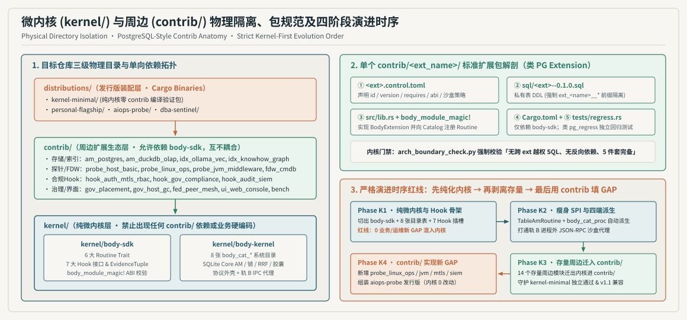
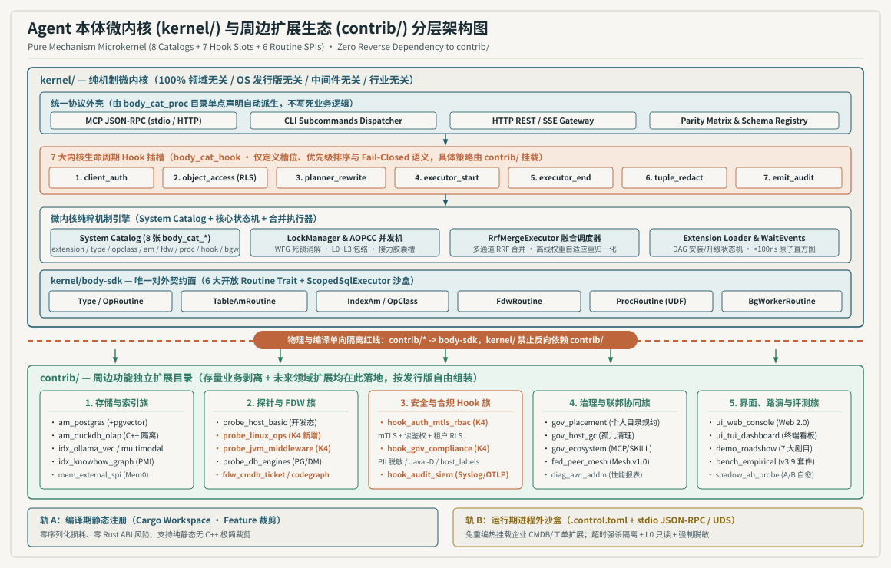
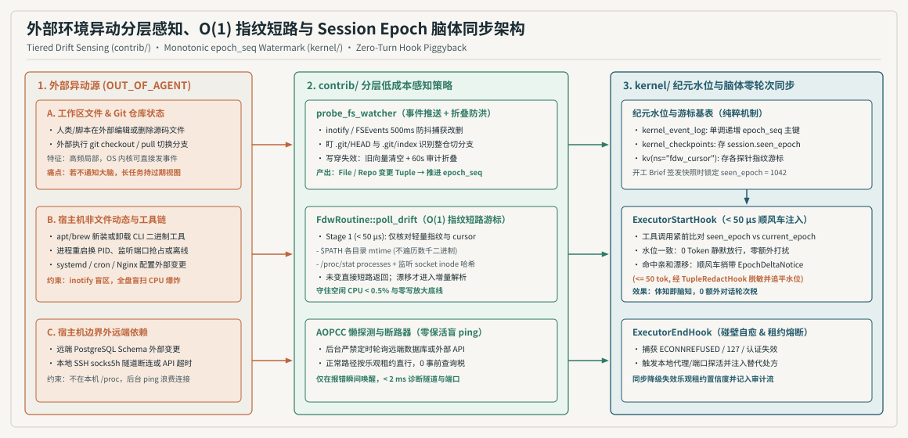
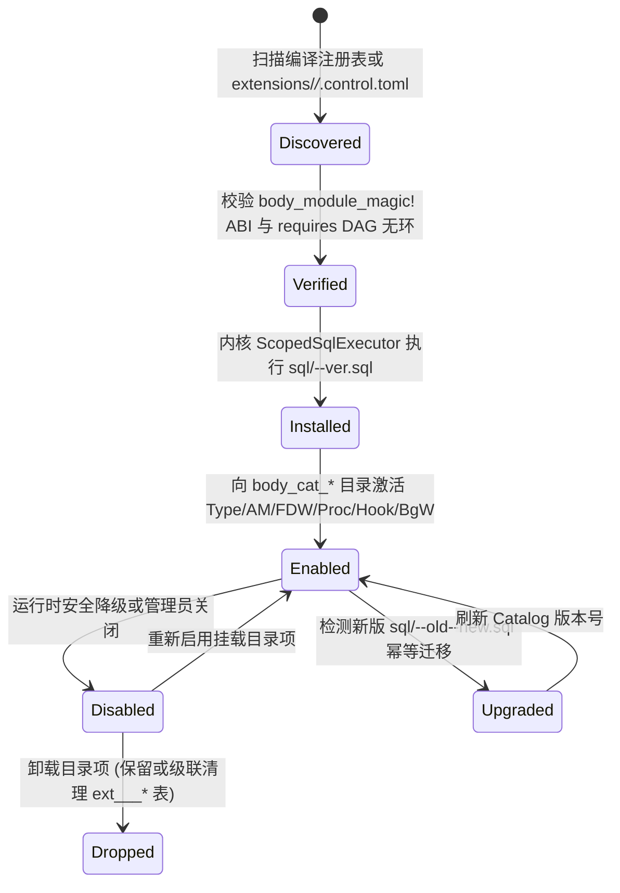
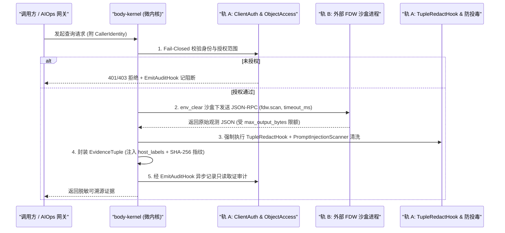
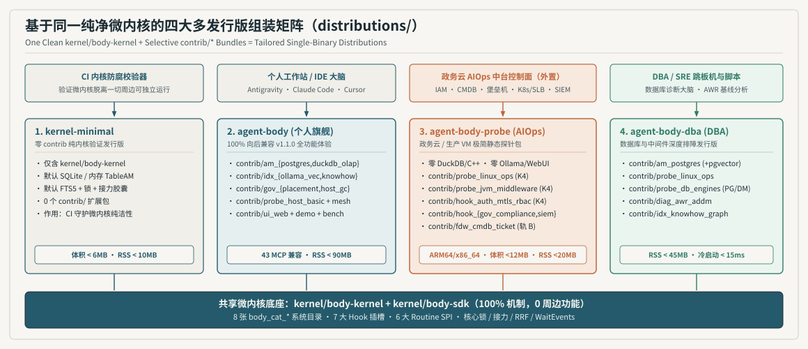
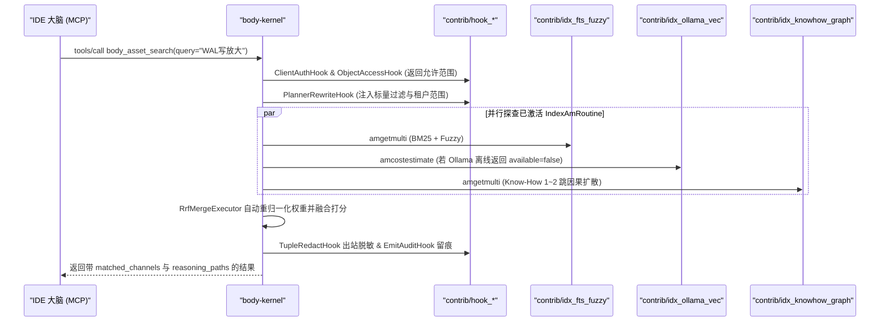
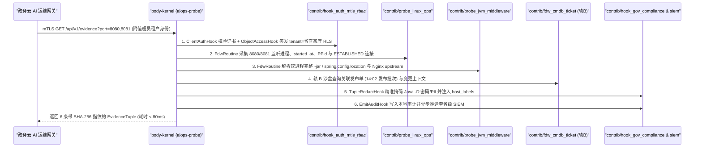
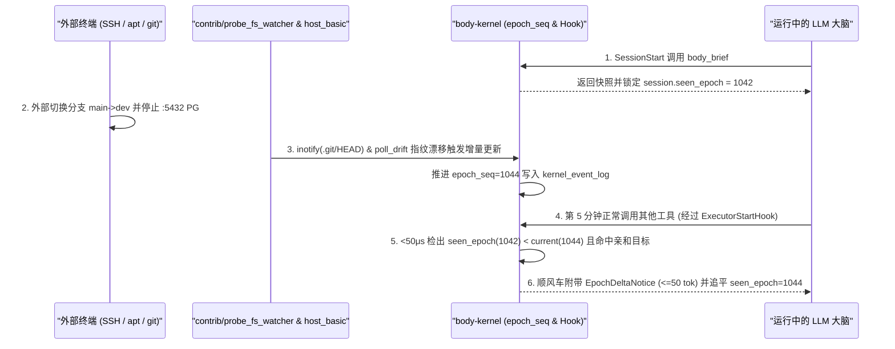

# 20 — 借鉴 PostgreSQL 插件体系的 Agent 本体微内核与 `contrib/` 周边分离架构设计规格说明书

> **版本**: v2.0 (`ISSUE #52`)  
> **作者**: digoal 德哥 & Agent Body Architecture Team  
> **状态**: 已全量落地（`Phase 70~73` 完成 `kernel/` 3 crates、`contrib/` 前 9 扩展与 3 精简发行版；`Phase 74` 扩展只读 `ObservabilityProvider` 与第 10 个 `contrib/obs_telemetry` 扩展，详见 [21-observability-and-telemetry-spec.md](21-observability-and-telemetry-spec.md)）  
> **对齐规约**: 规约 #1 (脑体分离), #2 (递弱代偿与边界防膨胀), #5 (零幻觉物理实证), #8 (四级自治与留痕), #9 (极速轻量化), #11 (向后兼容), #13 (测试与门禁), #15 (宏微联邦), #16 (黑白屏 1:1:1 同步), #18 (实证基准), #19 (纵深防御与全链路脱敏), #20 (零重扫演进), #21 (写穿失效与现实对账), #25 (AOPCC 乐观-悲观并发控制), #28 (模块化复杂度)

---

## 一、设计哲学、内核洁癖红线与现网源码耦合审计

### 1.1 第一性原理：PostgreSQL `src/backend/` + `contrib/` 生态长青的秘密

PostgreSQL 之所以能在保持相对克制、稳健内核的同时，孕育出空间地理（PostGIS）、向量检索（pgvector）、时序（TimescaleDB）、分布式（Citus）、图计算（Apache AGE）乃至大量政企商业发行版，**绝非靠把各种行业功能塞进内核，也不是靠粗糙的脚本回调**，而是依靠两项铁律：

1. **机制（Mechanism）与策略（Policy）物理级彻底分离**：`src/backend/` 只维护目录（Catalog）、类型系统、访问方法（TableAM / IndexAM）、外部包装器（FDW）、算子派发（UDF）、生命周期拦截钩子（`*_hook`）与后台工作进程（BGWorker）调度骨架；任何特定领域、特定存储、特定索引或特定业务算法，全部落在独立目录 `contrib/` 中以扩展包形式交付。
2. **先立开放底座，再用扩展解决场景 GAP**：新需求出现时，优先审视内核开放的 `type` / `ops` / `index` / `table method` / `fdw` / `udf` / `hook` 是否足够支撑，然后把新能力做成一个独立 `contrib` 插件，**而不是直接在内核源码里打补丁**。

### 1.2 五条「进内核 vs 进 `contrib/`」硬性准入试金石

为彻底杜绝周边功能回流污染微内核，确立以下 5 条不可妥协的准入判断准则（凡命中任何一条“否”，**必须放入 `contrib/` 或留在外部控制面**）：

| 试金石问题 | 留在 `kernel/`（必须满足全部） | 放入 `contrib/`（周边模块） | 留在企业/云平台控制面（不做进本仓） |
|---|---|---|---|
| **1. 是否依赖特定 OS 发行版或运维栈？** | 仅抽象通用系统接口与进程沙盒（OS 无关） | `/proc` 深度进程解析、RHEL/麒麟 cron、`systemd` 实时态、JVM/Nginx/达梦/人大金仓探针 | K8s API、云 SLB/RDS、跨租户 SDN 网络状态 |
| **2. 是否包含特定安全合规或组织身份模型？** | 只提供 `ClientAuthHook` / `ObjectAccessHook` / `TupleRedactHook` / `EmitAuditHook` 空槽与默认回环基线 | mTLS 双向认证、租户/环境 RLS 过滤策略、政务 PII 掩码正则、Syslog/OTLP SIEM 外发器 | 省级/企业级统一 IAM、多租户审批流、堡垒机执行引擎 |
| **3. 是否依赖重型外部运行时或大模型服务？** | 零 C++ 运行时、零 HTTP 推理依赖、仅默认嵌入式 SQLite 或纯内存存储 | DuckDB OLAP（`libstdc++6`）、PostgreSQL `pgvector`、Ollama 向量/L2 标注、多模态解析 | 大规模云端推理集群与统一向量平台 |
| **4. 是否承载特定用户的目录偏好或业务规则？** | 仅提供通用实体/边/事件/锁/胶囊/RRF 数学骨架 | 个人工作区 8 大放置规约（Placement）、Host GC、MCP/SKILL 目录路由、Peer Mesh | 跨机构运维 SOP 编排引擎 |
| **5. 是否属于展示层、路演或评测套件？** | 仅暴露纯协议帧（MCP/CLI/HTTP 路由派发内核） | Web UI 控制台、终端 TUI、路演演示剧场（Demo）、Benchmark `v3.9`、Shadow A/B 评估器 | 集团级监控与运维运营大屏 |

### 1.3 现网 `v1.1.0` 源码耦合审计与 27 模块去向映射总表

对照当前源码库（`27` 模块、`43` 原生 MCP 工具、`88` SPI 方法、`27` SQLite 表），除此前已识别的 6 大耦合痛点外——包括 [src/storage/spi.rs](../../src/storage/spi.rs#L6-L160) 88 方法胖 SPI、[src/storage/schema.sql](../../src/storage/schema.sql#L230-L257) 静态 `CHECK` 枚举、[src/hooks/mod.rs](../../src/hooks/mod.rs#L34-L127) 封闭 `BodyEvent`、[src/api/mcp_tools/mod.rs](../../src/api/mcp_tools/mod.rs#L70-L81) 静态工具路由、[src/web/server.rs](../../src/web/server.rs#L53-L89) 只读免鉴权且无 Hook、[src/scanner/redactor.rs](../../src/scanner/redactor.rs#L98-L325) 硬编码脱敏与 [src/fact/automation.rs](../../src/fact/automation.rs#L62-L271) 探针盲区及 [Cargo.toml](../../Cargo.toml#L9-L47) 强绑 `duckdb`——现将现网 **27 个顶层模块** 的重构去向逐一拆解锁定：

| 现网 `src/` 模块 | 留在 `kernel/` 的纯粹机制（领域无关） | 剥离至 `contrib/` 的周边实现（策略/业务/外部依赖） |
|---|---|---|
| `src/config/` | 内核基础配置加载、校验与目录权限收敛 | 各 `contrib` 自持独立配置节（由 `.control.toml` 与配置反序列化器加载） |
| `src/storage/` | `TableAmRoutine`、8 张 `body_cat_*` 目录、核心基表与 `storage-sqlite` / `storage-memory` | `contrib/am_postgres`（PG + pgvector）、`contrib/am_duckdb_olap`（DuckDB 列存与同步） |
| `src/body/` | `BodyManifest` 骨架（含 `host_labels`）、`ContinuityCapsule` 槽位、`AutonomyEnvelope`、`WaitEventRegistry` | `contrib/diag_awr_addm`（AWR 报表库/ADDM 诊断）、`contrib/shadow_ab_probe`（Shadow A/B 对照） |
| `src/coordination/` | `CoordinationEngine`（租约锁 CAS + 层次互斥 + WFG 死锁消解 + WaitQueue） | 跨机锁协调透传迁移至 `contrib/fed_peer_mesh` |
| `src/brief/` | 预算裁剪组装骨架与 `AOPCC` 乐观租约数学判定引擎 | 具体简报块数据源由已挂载的 `contrib` 探针与索引通道提供 |
| `src/hooks/` | 7 大 Hook 插槽调度链、`EventBus` 开放事件总线、规则/Pipeline 执行器 | `contrib/hooks_client_gen`（Claude/Cursor/Codex 客户端配置生成）、`contrib/hook_*` |
| `src/api/` | 协议外壳（MCP JSON-RPC / CLI / HTTP 路由框架）从 `body_cat_proc` 自动派发 | 具体工具算子（`ProcRoutine`）分散归属各自 `contrib/*` 扩展包 |
| `src/daemon/` | `BgWorker` 调度宿主机（优雅停机、周期/事件触发、内存/耗时熔断） | 具体后台巡检任务作为 `BgWorkerRoutine` 下沉至 `contrib/*` |
| `src/audit/` | `EmitAuditHook` 槽位、不可篡改 `evidence_sha256` 信封与本地事件流写入 | `contrib/hook_audit_siem`（SIEM 外发）、`contrib/audit_evolution`（滑窗分析） |
| `src/scanner/` | 仅保留内核级“扫描作业状态机与敏感路径红线判定接口” | `contrib/idx_fts_fuzzy`、`contrib/idx_ollama_vec`、`contrib/idx_multimodal`、`contrib/hook_gov_compliance` |
| `src/memory/` | 仅保留通用记忆元组模型与生命周期状态机 | `contrib/mem_external_spi`（Mem0 / Letta / PowerContext 适配桥接） |
| `src/fact/` | 仅保留 `TypeRegistry`、`RrfMergeExecutor` 与 `FdwRoutine` 调度器 | `contrib/probe_host_basic`、`contrib/idx_knowhow_graph`（PMI/Ollama Know-How）、`contrib/probe_*` |
| `src/env/` | 无（全部外提） | `contrib/probe_host_basic`、`contrib/probe_linux_ops`、`contrib/gov_host_gc` |
| `src/platform/` | 仅保留 `FdwRoutine` 抽象 | `contrib/probe_host_basic`（macOS/Windows/基础 Linux 探针） |
| `src/links/` | 仅保留图谱边读写原语 | `contrib/links_impact`（Markdown/源码互链解析、断链修复）与 `contrib/fdw_codegraph` |
| `src/changes/` | 仅保留 `kernel_event_log` 通用时间窗查询 | `contrib/probe_fs_watcher`（inotify/FSEvents 变更转换器） |
| `src/watcher/` | 仅保留防抖事件入口槽位 | `contrib/probe_fs_watcher` |
| `src/session/` | 通用会话生命周期状态机（开工/结清事件触发） | 临时文件清理与工单摘要逻辑下沉至 `contrib/gov_host_gc` / `contrib/aiops_handover` |
| `src/placement/` | 无（全部外提） | `contrib/gov_placement`（个人工作区 8 大放置规约与规则自学习） |
| `src/ecosystem/` | 无（全部外提） | `contrib/gov_ecosystem`（MCP/SKILL 通讯录与 Context 防爆路由） |
| `src/mesh/` | 无（全部外提） | `contrib/fed_peer_mesh`（MeshEnvelope v1.0、跨机对话与收件箱投递） |
| `src/preflight/` | 内核基础自检（Catalog / Storage / 权限收敛） | 扩展各自实现 `FdwRoutine::explain_source` 或自检回调 |
| `src/feedback/` | 无（全部外提） | `contrib/gov_feedback`（`user_feedback.md` 双向同步与 `P1~P5` 探针） |
| `src/web/` | 仅保留轻量 HTTP/SSE Core 路由引擎与 `ClientAuthHook` 门禁 | `contrib/ui_web_console`（Web UI 2.0 静态前端、拓扑大屏与路演接口） |
| `src/tui/` | 无（全部外提） | `contrib/ui_tui_dashboard`（终端实时看板） |
| `src/demo/` | 无（全部外提） | `contrib/demo_roadshow`（7 大路演剧场沙盒） |
| `src/benchmark/` | 内核仅保留 `EffectivenessLedger` 原始事件钩子 | `contrib/bench_empirical`（`W1~W19`、`M1~M6`、`DQ1~DQ10`、`COMP-C1~C4` 评测套件） |

---

## 二、目标仓库物理目录结构、单向依赖拓扑与 `contrib` 标准包规范



### 2.1 三级物理目录树（Cargo Workspace 规划）

```text
agent-body/
├── Cargo.toml                         # Workspace 根清单 (严格隔离 kernel / contrib / distributions)
├── kernel/                            # 【纯机制微内核 · 严禁引入任何业务/行业/重型外部依赖】
│   ├── body-sdk/                      # 唯一稳定扩展契约 Crate (6 大 Routine + 7 大 Hook + EvidenceTuple + 宏)
│   ├── body-protocol/                 # 轨 B 进程外 JSON-RPC 2.0 / UDS 线协议与沙盒帧定义
│   └── body-kernel/                   # 微内核实现 (8 张 body_cat_*、SQLite/Memory AM、锁、RRF、派发器、BgW 宿主机)
├── contrib/                           # 【周边扩展模块目录 · 对标 PostgreSQL contrib/ · 仅允许单向依赖 body-sdk】
│   ├── am_postgres/                   # TableAM 扩展：PostgreSQL + pgvector 后端
│   ├── am_duckdb_olap/                # TableAM/Worker 扩展：DuckDB 列存 OLAP（隔离 libstdc++6）
│   ├── idx_fts_fuzzy/                 # IndexAM 扩展：FTS5 BM25 + 驼峰拆词 + Pure-Rust Fuzzy
│   ├── idx_ollama_vec/                # IndexAM 扩展：Ollama Embedding + L2 语义标注 + 多模态理解
│   ├── idx_knowhow_graph/             # IndexAM 扩展：HeadingChunker + 术语归一 + PMI + Know-How 图扩散
│   ├── mem_external_spi/              # Memory 适配器：Mem0 / Letta / PowerContext
│   ├── probe_host_basic/              # FDW/Probe 扩展：开发工作站基础端口/服务/仓库编目
│   ├── probe_fs_watcher/              # BgWorker 扩展：inotify / FSEvents 60s 折叠文件监听
│   ├── probe_linux_ops/               # 【Phase K4 新增】Linux/信创运维深度探针（started_at/长命令/RHEL Cron/Systemd 实时态）
│   ├── probe_jvm_middleware/          # 【Phase K4 新增】Java/SpringBoot/Tomcat/东方通/Nginx 配置与后端拓扑探针
│   ├── probe_db_engines/              # 【Phase K4 新增】PG / 达梦 / 人大金仓 / Redis 实例配置与参数漂移探针
│   ├── fdw_codegraph/                 # FDW 扩展：CodeGraph 符号地图只读外部包装器
│   ├── fdw_cmdb_ticket/               # 【Phase K4 新增】轨 B 外部扩展模板：CMDB 台账 / 发布单 / 工单只读连接器
│   ├── hook_auth_mtls_rbac/           # 【Phase K4 新增】ClientAuthHook + ObjectAccessHook (mTLS + 读鉴权 + 租户 RLS)
│   ├── hook_gov_compliance/           # 【Phase K4 新增】TupleRedactHook（政务 PII/Java -D 精准脱敏 + host_labels）
│   ├── hook_audit_siem/               # 【Phase K4 新增】EmitAuditHook（只读取证审计 + Syslog/OTLP/Webhook SIEM 外发）
│   ├── gov_placement/                 # UDF/Hook 扩展：个人目录 8 大放置规约与规则自学习
│   ├── gov_host_gc/                   # UDF/BgWorker 扩展：宿主垃圾清理与过期资产代谢
│   ├── gov_ecosystem/                 # UDF 扩展：MCP/SKILL 通讯录与 Context 防爆路由
│   ├── fed_peer_mesh/                 # UDF/HTTP 扩展：MeshEnvelope v1.0 跨机对话与沙盒投递
│   ├── diag_awr_addm/                 # UDF/BgWorker 扩展：AWR 黄金基线、快照差分与 ADDM 诊断
│   ├── ui_web_console/                # HTTP 扩展：Web UI 2.0 控制台与可视化拓扑大屏
│   ├── demo_roadshow/                 # UDF 扩展：7 大路演演示剧场沙盒
│   └── bench_empirical/               # UDF 扩展：Benchmark v3.9 全套评测负载
└── distributions/                     # 【多发行版组装清单 · 按场景组合 kernel + contrib 子集】
    ├── kernel-minimal/                # 0 contrib 纯内核（CI 防腐门禁专用）
    ├── personal-flagship/             # 个人旗舰全功能版（等价现网 agent-body v1.1.0）
    ├── aiops-probe/                   # 政务云/生产 VM 极简静态探针版（<12MB / <20MB RSS / 0 C++）
    └── dba-sentinel/                  # DBA/SRE 跳板机与数据库诊断版
```

### 2.2 单个 `contrib/<ext_name>/` 标准五件套规范

每个周边扩展包在物理上自成一体，严禁私自跨包调用另一个 `contrib/*` 内部私有模块，必须遵循统一五件套结构：

1. **`Cargo.toml`**：只允许声明 `agent-body-sdk = { path = "../../kernel/body-sdk" }` 及该扩展自用的第三方库（例如只有 `am_duckdb_olap` 才引入 `duckdb`），**绝对禁止依赖 `body-kernel` 或其他 `contrib/*`**。
2. **`<ext_name>.control.toml`**（对标 PostgreSQL `.control` 文件）：声明扩展元数据、依赖与运行时限制：
   ```toml
   [extension]
   id = "probe_linux_ops"
   version = "0.1.0"
   kind = "compiled_crate"          # "compiled_crate" (轨 A) | "out_of_process" (轨 B)
   min_sdk_version = "1.0"
   requires = ["probe_host_basic"]  # 拓扑安装依赖
   relocatable = true

   [schema]
   migration_dir = "sql/"
   table_prefix = "ext_probe_linux_ops__" # 内核 ScopedSqlExecutor 强制校验该前缀
   default_autonomy = "L0_OBSERVE"

   [capabilities]
   provides_types = ["linux_process_ext", "systemd_unit_runtime", "socket_peer"]
   provides_fdws = ["linux_ops_probe"]
   provides_workers = ["proc_port_drift_worker"]
   ```
3. **`sql/<ext_name>--<version>.sql` 与升级脚本 `sql/<ext_name>--0.1.0--0.2.0.sql`**：仅定义该扩展私有物理表与索引；内核安装器按版本拓扑执行并登记至 `body_cat_extension`。
4. **`src/lib.rs` 与 `body_module_magic!` 宏**：对标 PostgreSQL `PG_MODULE_MAGIC`，在编译期注入 SDK 主版本指纹与 `register_extension(reg: &mut ExtensionRegistrar)` 入口，杜绝版本错配注册。
5. **`tests/regress.rs`**：对标 `pg_regress`，仅依赖 `body-kernel`（测试沙盒模式）验证该扩展安装、卸载、升级与业务行为，确保每个 `contrib` 可独立回归测试。

---

## 三、微内核系统目录（System Catalog）详细设计（对标 `pg_catalog`）

内核不再为任何具体业务建表（如 `benchmark_runs`、`placement_rules` 等全部下沉为对应 `contrib` 的私有迁移表），微内核自身**仅维护 8 张核心系统目录表（`body_cat_*`）+ 5 张通用数据基表**。

### 3.1 八张核心系统目录表 DDL（SQLite 基线 / PG 对等）

```sql
-- 1. body_cat_extension: 已安装扩展总账与版本状态 (对标 pg_extension)
CREATE TABLE IF NOT EXISTS body_cat_extension (
    ext_id          TEXT PRIMARY KEY,
    version         TEXT NOT NULL,
    kind            TEXT NOT NULL CHECK (kind IN ('builtin_core','compiled_crate','out_of_process')),
    state           TEXT NOT NULL CHECK (state IN ('discovered','verified','installed','enabled','disabled','failed')),
    table_prefix    TEXT NOT NULL UNIQUE,
    requires_json   TEXT NOT NULL DEFAULT '[]',
    control_hash    TEXT NOT NULL,
    installed_at    TEXT NOT NULL,
    updated_at      TEXT NOT NULL
);

-- 2. body_cat_type: 开放实体与关系类型目录 (对标 pg_type，彻底替代静态 CHECK)
CREATE TABLE IF NOT EXISTS body_cat_type (
    type_id         TEXT PRIMARY KEY,              -- 例: 'entity:jvm_app' | 'edge:routes_to'
    type_kind       TEXT NOT NULL CHECK (type_kind IN ('entity','edge')),
    owner_ext_id    TEXT NOT NULL REFERENCES body_cat_extension(ext_id) ON DELETE CASCADE,
    schema_json     TEXT NOT NULL DEFAULT '{}',    -- JSON Schema 校验描述
    default_ttl_sec INTEGER NOT NULL DEFAULT 0,    -- 0 表示永不自动过期
    default_tier    TEXT NOT NULL DEFAULT 'L1_EXPLICIT'
);

-- 3. body_cat_opclass: 操作符族与检索算子映射 (对标 pg_opclass + pg_operator)
CREATE TABLE IF NOT EXISTS body_cat_opclass (
    opclass_id      TEXT PRIMARY KEY,              -- 例: 'op:bm25_match' | 'op:cos_sim'
    am_id           TEXT NOT NULL,
    target_type_id  TEXT NOT NULL,
    strategy_num    INTEGER NOT NULL,              -- 策略号 (1=Exact, 2=Prefix, 3=Fuzzy, 4=Vector, 5=GraphHop)
    operator_symbol TEXT NOT NULL,                 -- 例: '=', '@@', '<=>', '~>2'
    owner_ext_id    TEXT NOT NULL REFERENCES body_cat_extension(ext_id) ON DELETE CASCADE,
    UNIQUE(am_id, target_type_id, strategy_num)
);

-- 4. body_cat_am: 表与索引访问方法目录 (对标 pg_am)
CREATE TABLE IF NOT EXISTS body_cat_am (
    am_id           TEXT PRIMARY KEY,              -- 例: 'am:sqlite_core' | 'am:duckdb_olap' | 'idx:ollama_vec'
    am_kind         TEXT NOT NULL CHECK (am_kind IN ('table','index')),
    owner_ext_id    TEXT NOT NULL REFERENCES body_cat_extension(ext_id) ON DELETE CASCADE,
    default_weight  REAL NOT NULL DEFAULT 1.0,
    capabilities    TEXT NOT NULL DEFAULT '{}'     -- {"supports_vector":true,"supports_mvcc":true}
);

-- 5. body_cat_fdw: 外部数据包装器与探针目录 (对标 pg_foreign_data_wrapper)
CREATE TABLE IF NOT EXISTS body_cat_fdw (
    fdw_id          TEXT PRIMARY KEY,
    owner_ext_id    TEXT NOT NULL REFERENCES body_cat_extension(ext_id) ON DELETE CASCADE,
    transport       TEXT NOT NULL CHECK (transport IN ('in_process','stdio_jsonrpc','unix_socket')),
    autonomy_level  TEXT NOT NULL CHECK (autonomy_level IN ('L0_OBSERVE','L1_AUTONOMIC')),
    timeout_ms      INTEGER NOT NULL DEFAULT 1500,
    ttl_sec         INTEGER NOT NULL DEFAULT 5
);

-- 6. body_cat_proc: 工具与算子单点目录 (对标 pg_proc，四端自动派发唯一事实源)
CREATE TABLE IF NOT EXISTS body_cat_proc (
    proc_name       TEXT PRIMARY KEY,              -- 例: 'body_port_check'
    owner_ext_id    TEXT NOT NULL REFERENCES body_cat_extension(ext_id) ON DELETE CASCADE,
    cli_path_json   TEXT NOT NULL,                 -- ["env","port"]
    rest_method     TEXT NOT NULL,                 -- 'GET' | 'POST' | 'DELETE'
    rest_path       TEXT NOT NULL UNIQUE,          -- '/api/v1/facts/port-check'
    profiles_json   TEXT NOT NULL DEFAULT '["full"]',
    volatility      TEXT NOT NULL CHECK (volatility IN ('immutable','stable','volatile')),
    autonomy_level  TEXT NOT NULL CHECK (autonomy_level IN ('L0_OBSERVE','L1_AUTONOMIC','L2_SUPERVISED','L3_FORBIDDEN')),
    input_schema    TEXT NOT NULL,
    provenance_rule TEXT
);

-- 7. body_cat_hook: 内核生命周期 Hook 注册表 (7 大固定插槽)
CREATE TABLE IF NOT EXISTS body_cat_hook (
    hook_id         TEXT PRIMARY KEY,
    hook_point      TEXT NOT NULL CHECK (hook_point IN (
        'client_auth','object_access','planner_rewrite',
        'executor_start','executor_end','tuple_redact','emit_audit'
    )),
    owner_ext_id    TEXT NOT NULL REFERENCES body_cat_extension(ext_id) ON DELETE CASCADE,
    priority        INTEGER NOT NULL DEFAULT 100,  -- 数值越小越先执行
    fail_policy     TEXT NOT NULL CHECK (fail_policy IN ('fail_closed','fail_open'))
);

-- 8. body_cat_bgworker: 后台自治协程登记表 (对标 pg_stat_activity 后台工作进程视图)
CREATE TABLE IF NOT EXISTS body_cat_bgworker (
    worker_id       TEXT PRIMARY KEY,
    owner_ext_id    TEXT NOT NULL REFERENCES body_cat_extension(ext_id) ON DELETE CASCADE,
    trigger_kind    TEXT NOT NULL CHECK (trigger_kind IN ('interval','event')),
    interval_sec    INTEGER NOT NULL DEFAULT 60,
    autonomy_level  TEXT NOT NULL CHECK (autonomy_level IN ('L0_OBSERVE','L1_AUTONOMIC')),
    mem_budget_mb   INTEGER NOT NULL DEFAULT 16
);
```

### 3.2 内核 5 张通用基表与扩展私有物理表命名空间沙盒

- **内核通用基表（5 张）**：
  - `kernel_entities`：统一存储任何注册在 `body_cat_type` 的实体元组 + JSONB/TEXT payload + `tenant_id/env` 标签列 + `evidence_sha256`；
  - `kernel_edges`：通用有向加权边 + `evidence_tier`；
  - `kernel_event_log`：Append-Only 通用事件与本地审计流，以**单调递增整数 `epoch_seq`** 作为全局外部变更水位线主键（凡 `OUT_OF_AGENT` 高价值状态跃迁入账即原子推进 `current_epoch`）；
  - `kernel_leases`：协作锁与等待队列；
  - `kernel_checkpoints`：除承载 `<=300 tok` 跨大脑接力胶囊外，统一存储各 `FdwRoutine` 的增量漂移指纹游标（`namespace = "fdw_cursor"`）与活跃会话已读纪元水位（`session.seen_epoch`）。
- **私有物理表沙盒（Namespace Isolation）**：若某 `contrib` 扩展需要专用列存、FTS 或关系表（如 `ext_bench_empirical__runs`、`ext_gov_placement__rules`），必须使用 `ext_<ext_id>__` 作为表名前缀。内核通过 `ScopedSqlExecutor` 解析并校验 DDL/DML 目标表名：**扩展 A 绝不允许直接写入扩展 B 的私有表**，跨扩展数据流转必须经由内核实体图或 `ProcRoutine` 公开接口。

---

## 四、微内核七大底层开放 SPI 详细契约（`kernel/body-sdk` 接口规格）



### 4.1 类型、证据元组与操作符（`TypeRoutine` + `OperatorRoutine` + `EvidenceTuple`）

```rust
/// 统一物理与外部证据元组（所有 FactProbe / FdwRoutine / 检索结果的通用信封）
#[derive(Debug, Clone, Serialize, Deserialize)]
pub struct EvidenceTuple {
    pub evidence_id: String,
    pub host_id: String,                       // 确定性 body_id 或显式节点标识
    pub host_labels: BTreeMap<String, String>, // 例: cmdb_id, tenant_id, app_id, env
    pub entity_type: String,                   // 必须在 body_cat_type 注册
    pub entity_id: String,
    pub source_ext: String,                    // 产出扩展 ID
    pub evidence_tier: String,                 // "L1_EXPLICIT" | "L2_STRUCTURAL" | "L3_SEMANTIC"
    pub collected_at: String,                  // RFC3339 (+08:00)
    pub ttl_sec: u64,
    pub payload: serde_json::Value,
    pub redacted: bool,                        // 经 TupleRedactHook 处理后由内核置 true
    pub evidence_sha256: String,
}

pub trait TypeRoutine: Send + Sync {
    fn type_id(&self) -> &'static str;
    fn validate_in(&self, raw: &serde_json::Value) -> anyhow::Result<serde_json::Value>;
    fn render_compact_summary(&self, val: &serde_json::Value) -> String;
}

pub trait OperatorRoutine: Send + Sync {
    fn op_id(&self) -> &'static str;
    fn strategy_num(&self) -> u16;             // 对标 PG Operator Strategy Number
    fn evaluate(&self, lhs: &serde_json::Value, rhs: &serde_json::Value) -> anyhow::Result<bool>;
}
```

### 4.2 表存储访问方法（`TableAmRoutine`，对标 PG `TableAmRoutine`）

彻底取代原 `src/storage/spi.rs` 88 个业务耦合方法，收敛为结构化核心存储原语：

```rust
pub trait TableAmRoutine: Send + Sync {
    fn am_id(&self) -> &'static str;           // 例: "am:sqlite_core" | "am:postgres"
    fn init_catalog_and_base_tables(&self) -> anyhow::Result<()>;

    // 1. 通用实体与关系图原语（支持 RLS 行级过滤谓词下推）
    fn entity_upsert(&self, tuple: &EvidenceTuple) -> anyhow::Result<()>;
    fn entity_get(&self, entity_type: &str, entity_id: &str, rls: Option<&RowFilterPredicate>) -> anyhow::Result<Option<EvidenceTuple>>;
    fn entity_scan(&self, filter: &EntityScanFilter, rls: Option<&RowFilterPredicate>) -> anyhow::Result<Vec<EvidenceTuple>>;
    fn entity_delete_by_source(&self, source_ext: &str, path_or_key: &str) -> anyhow::Result<usize>;

    fn edge_upsert(&self, edge: &KernelEdge) -> anyhow::Result<()>;
    fn edge_traverse(&self, root_id: &str, max_hops: usize, min_weight: f32, rls: Option<&RowFilterPredicate>) -> anyhow::Result<KernelSubGraph>;

    // 2. Append-Only 事件/审计流原语
    fn event_append(&self, stream: &str, event: &KernelEventRecord) -> anyhow::Result<()>;
    fn event_query(&self, filter: &EventQueryFilter, rls: Option<&RowFilterPredicate>) -> anyhow::Result<Vec<KernelEventRecord>>;
    fn event_prune_before(&self, stream: &str, before_iso: &str) -> anyhow::Result<usize>;

    // 3. 协作租约 CAS 原语
    fn lease_try_acquire(&self, req: &LeaseAcquireReq) -> anyhow::Result<LeaseOutcome>;
    fn lease_release(&self, lock_id: &str) -> anyhow::Result<bool>;
    fn lease_list(&self, resource_type: Option<&str>) -> anyhow::Result<Vec<KernelLease>>;
    fn lease_gc_expired(&self) -> anyhow::Result<usize>;

    // 4. 胶囊/游标 KV 与扩展私有 DDL 沙盒执行
    fn kv_put(&self, namespace: &str, key: &str, val: &serde_json::Value) -> anyhow::Result<()>;
    fn kv_get(&self, namespace: &str, key: &str) -> anyhow::Result<Option<serde_json::Value>>;
    fn exec_scoped_migration(&self, ext_id: &str, table_prefix: &str, version: &str, sql: &str) -> anyhow::Result<()>;
}
```

> **平滑过渡设计 (`LegacyStorageBridge`)**：在重构 `Phase K2 ~ K3` 过渡期内，提供一个薄桥接结构实现原 88 方法视图，按 `kv` 与通用实体/私有表转发至 `TableAmRoutine`，保障现有模块逐一迁移时不中断测试。

### 4.3 索引访问方法、操作符族与 RRF 融合执行器（`IndexAmRoutine` + `OpClass`）

```rust
pub struct IndexCostEstimate {
    pub available: bool,               // 例如 Ollama 离线时返回 false，触发权重自动重归一化
    pub est_latency_us: u64,
    pub est_selectivity: f64,
}

pub struct IndexScanDesc {
    pub query_text: String,
    pub strategy_num: u16,             // 由 body_cat_opclass 解析决定 (1=Exact, 3=Fuzzy, 4=Vector, 5=Graph)
    pub scalar_filters: BTreeMap<String, String>,
    pub rls_filter: Option<RowFilterPredicate>,
    pub limit: usize,
}

pub trait IndexAmRoutine: Send + Sync {
    fn am_id(&self) -> &'static str;
    fn default_weight(&self) -> f64;
    fn amcostestimate(&self, scan: &IndexScanDesc) -> IndexCostEstimate;
    fn amgetmulti(&self, scan: &IndexScanDesc, am: &dyn TableAmRoutine) -> anyhow::Result<Vec<IndexHit>>;
    fn aminsert(&self, entity: &EvidenceTuple) -> anyhow::Result<()>;
    fn amdelete_by_source(&self, source_key: &str) -> anyhow::Result<usize>; // 写穿级联失效
    fn amvacuum(&self) -> anyhow::Result<usize>;
}
```

- **内核 `RrfMergeExecutor`**：先并行/串行调用各已激活 `IndexAmRoutine::amcostestimate`；对于 `available == false` 的通道直接摘除，并按剩余激活通道重归一化权重 $\tilde{w}_c = w_c / \sum w_j$；汇总结果后按核心公式融合，并强制附加 `RowFilterPredicate` 二次防越权兜底。

### 4.4 外部数据与探针访问方法（`FdwRoutine`，对标 PG `FdwRoutine`）

```rust
pub struct FdwSourceHealth {
    pub healthy: bool,
    pub degraded_reason: Option<String>, // 如 "CAP_DAC_READ_SEARCH missing: /proc/[pid]/fd redacted"
    pub missing_deps: Vec<String>,
}

pub trait FdwRoutine: Send + Sync {
    fn fdw_id(&self) -> &'static str;
    fn supported_types(&self) -> &'static [&'static str];
    fn explain_source(&self, ctx: &ProbeContext) -> FdwSourceHealth;
    fn begin_scan(&self, target: Option<&str>, ctx: &ProbeContext) -> anyhow::Result<Box<dyn FdwScanState>>;
    /// 游标式增量漂移采集（由 BgWorker 周期拉取端口/进程/配置变动，产出增量证据）
    fn poll_drift(&self, cursor: Option<&str>, ctx: &ProbeContext) -> anyhow::Result<(Vec<EvidenceTuple>, Option<String>)>;
}

pub trait FdwScanState: Send {
    fn iterate_scan(&mut self, batch_limit: usize) -> anyhow::Result<Vec<EvidenceTuple>>;
    fn end_scan(&mut self) -> anyhow::Result<()>;
}
```

- **`poll_drift` 的 O(1) 指纹短路契约（消灭周期全量盲扫）**：为彻底规避“扫慢了陈旧窗口大、扫快了 CPU/I/O 爆炸”的轮询悖论，所有 `contrib/probe_*` 在实现 `poll_drift(cursor, ctx)` 时必须遵循**两阶段分级探测**：
  1. **Stage 1 · O(1) 轻量指纹校验（目标 `< 50 μs`）**：仅提取极低开销的宿主机物理变动指纹并与 `cursor` 比对——例如对 `$PATH` 下 `8~10` 个目录仅执行目录级 `stat(mtime)` 感知软件装卸（严禁周期遍历数千个二进制）；对 Git 仓库仅比对 `.git/HEAD` 与 `.git/index` 指纹识别外部切分支与提交跳变；对进程与端口仅核对 `/proc/stat` 累计 `processes` 计数与 `/proc/net/tcp*` 监听 socket inode 集合哈希。若指纹一致，**零写放大直接短路返回 `(vec![], Some(cursor))`**；
  2. **Stage 2 · 差集增量解析与水位推进**：仅当指纹漂移时，才下钻解析受影响的局部对象差集，产出脱敏 `EvidenceTuple` 并递增全局 `epoch_seq`。

### 4.5 函数/工具算子与四端自动派生引擎（`ProcRoutine` + `ProcVolatility`）

借鉴 PostgreSQL 函数波动性（`IMMUTABLE` / `STABLE` / `VOLATILE`）与 `agent-body` 四级自治边界的**二维正交矩阵**，内核无需硬编码任何工具名字即可自动运行 `AOPCC` 并发策略：

| `ProcVolatility` | `L0_OBSERVE`（纯只读） | `L1_AUTONOMIC`（可逆自治） | `L2_SUPERVISED`（宿主写操作） | `L3_FORBIDDEN`（红线禁区） |
|---|---|---|---|---|
| **`Immutable`**（纯函数/确定性计算） | `OPTIMISTIC` 直通（0 前置拦截） | `OPTIMISTIC` 直通 | `CAUTIOUS_CAS`（轻量校验） | 物理阻断 (`DENY`) |
| **`Stable`**（单次作业内快照稳定） | `OPTIMISTIC` + 乐观租约 | `CAUTIOUS_CAS` | `PESSIMISTIC_LOCK` | 物理阻断 (`DENY`) |
| **`Volatile`**（含副作用或瞬变状态） | `CAUTIOUS_CAS`（强制实时探针） | `PESSIMISTIC_LOCK` | `PESSIMISTIC_LOCK` + 需鉴权/确认 | 物理阻断 (`DENY`) |

```rust
pub struct ProcSpec {
    pub proc_name: &'static str,
    pub cli_path: &'static [&'static str],
    pub rest_route: (&'static str, &'static str),
    pub profiles: &'static [&'static str],
    pub volatility: ProcVolatility,
    pub autonomy_level: AutonomyLevel,
    pub input_schema: serde_json::Value,
    pub provenance_rule: Option<&'static str>,
}

pub trait ProcRoutine: Send + Sync {
    fn spec(&self) -> ProcSpec;
    fn invoke(&self, fcinfo: FunctionCallInfo, ctx: &KernelServices) -> anyhow::Result<serde_json::Value>;
}
```

只要任意 `contrib` 向 `body_cat_proc` 注册一个 `ProcRoutine`，内核协议外壳自动生成：① MCP `tools/list` Schema 与 `tools/call` 派发；② CLI 动态参数解析与 `--help`；③ HTTP REST 端点；④ `parity/matrix` 100% 自动对齐条目。

### 4.6 内核七大生命周期 Hook 插槽规格（对标 PG `*_hook`）

为支持严谨的切面拦截与零侵入安全合规，微内核定义 7 个顺序精确、契约严格的 Hook Trait：

| 序号 | Hook 插槽 | 执行顺序与精确介入点 | 关键入参 / 返回裁决 | 异常策略 |
|---:|---|---|---|---|
| **1** | **`ClientAuthHook`** | 协议外壳解析出请求后、进入任何路由前（**覆盖读与写全量端点**） | 入参：`TransportKind`, `ClientCertInfo`, `BearerToken`, `Method/Path`<br>返回：`Allow(CallerIdentity)` / `Next` / `Deny(401\|403, reason)` | **`fail_closed`**（任意异常或无一放行即拒绝） |
| **2** | **`ObjectAccessHook`** | 进入实体查询、FDW 扫描或 `ProcRoutine` 前（对标 PG `object_access_hook`） | 入参：`CallerIdentity`, `AccessOp(Read\|Write\|Exec)`, `EntityType`<br>返回：`Allow` / `AllowWithRls(RowFilterPredicate)` / `Deny` | **`fail_closed`** |
| **3** | **`PlannerRewriteHook`** | `RrfMergeExecutor` 或 `FdwRoutine` 执行计划构造期 | 入参：`&mut SearchPlan` / `&mut ProbeContext`（可注入租户/环境强制过滤、改写超时预算或禁用未授权通道） | **`fail_closed`** |
| **4** | **`ExecutorStartHook`** | `ProcRoutine::invoke` 紧前（取代原静态 `PreToolUse`） | 入参：`&ProcSpec`, `&Args`, `&CallerIdentity`, `AutonomyEnvelope` 裁决<br>返回：`Proceed { delta_notice: Option<EpochDeltaNotice> }` / `Block(reason)` / `RequireConfirm` | **`fail_closed`** |
| **5** | **`ExecutorEndHook`** | `ProcRoutine::invoke` 报错或 `PostToolUse(success=false)` 紧后 | 入参：`&ProcSpec`, `&Result`, `&KernelServices`<br>返回：可选注入 `RecoveryPrescription`（含远端 DB/代理隧道懒断路探活、AOPCC 碰壁自愈与租约降级） | **`fail_open`**（记错误不掩盖主错） |
| **6** | **`TupleRedactHook`** | 数据写入内核存储**前**，及任何 `EvidenceTuple` / 响应出站**前** | 入参：`&mut serde_json::Value`, `FieldPathContext`, `CallerIdentity`<br>契约：字段路径感知（如仅掩码 `args.password` 值，不破坏后续参数），幂等置位 `redacted = true` | **`fail_closed`**（脱敏异常即阻断输出防泄密） |
| **7** | **`EmitAuditHook`** | 任何读/写操作、Hook 拦截或 `BgWorker` 自治变更完成后 | 入参：`AuditEnvelope`（含 `trace_id`, `caller`, `domain`, `before_after_delta`, `evidence_sha256`）<br>契约：经内存有界通道异步扇出（本地落盘 / SIEM 外发） | **`fail_open`**（降级记告警与 WaitEvent，不阻塞业务） |

### 4.7 后台自治进程契约（`BgWorkerRoutine`，对标 PG `BackgroundWorker`）

```rust
pub trait BgWorkerRoutine: Send + Sync {
    fn worker_id(&self) -> &'static str;
    fn trigger(&self) -> WorkerTrigger;       // Interval(Duration) | EventTopics(&[&str])
    fn autonomy_level(&self) -> AutonomyLevel; // 强制仅 L0_OBSERVE / L1_AUTONOMIC
    fn run_tick(&self, ctx: &KernelServices, cancel: &CancellationToken) -> anyhow::Result<WorkerTickOutcome>;
}
```

内核统一为每个 `BgWorkerRoutine` 注入 `WaitEventGuard` 计时、RSS 内存水线检查与 `EmitAuditHook`（`OUT_OF_AGENT` 域）自动存证。

### 4.8 外部环境异动分层感知与 Session Epoch 顺风车脑体同步契约

仅有宿主机 `Watcher` 与后台对账并不够：当瞬态大脑在执行长任务中途、外部终端修改了文件、切换了 Git 分支或启停了端口服务时，往往会出现 **「体已知、脑不知」的上下文断层**（大脑不主动重调 `body_brief` 就仍持过期世界观）。为此，微内核建立跨感知通道的统一增量水位线同步机制：



1. **三层正交异动感知分工（全部策略落在 `contrib/`）**：
   - **工作区文件与 Git 分支**：由 `contrib/probe_fs_watcher` 通过 OS 内核事件（`inotify`/`FSEvents` 500ms 防抖）+ `.git/HEAD`/`.git/index` 仓库级跳变识别实时捕获，触发写穿失效与 60s 审计折叠，并推进 `epoch_seq`；
   - **宿主机非文件动态与工具链**：由 `BgWorkerRoutine` 周期调度各 `contrib/probe_*` 的 `FdwRoutine::poll_drift(cursor)`，严格执行 **O(1) 指纹短路**（`$PATH` 目录 `mtime`、`/proc/stat` `processes` + 监听 inode 哈希），零全量盲扫即可秒级发现软件装卸、进程换 PID 与端口抢占；
   - **宿主机边界外依赖（远端 DB Schema / 本地 SSH `socks5h` 隧道 / 外部 API）**：**严禁后台定时保活盲 ping**，完全遵循 `AOPCC` 懒探测与断路器原则——正常请求零事前税直通，仅在报错瞬间由 `ExecutorEndHook`（`< 2 ms`）探测本地代理端口与连通性，熔断降级对应乐观租约并注入重连处方。
2. **纪元水位线（`epoch_seq`）与 Hook 顺风车脑体传导（纯粹机制留在 `kernel/`）**：
   - 每次大脑开工调用 `body_brief`，内核向 `kernel_checkpoints` 写入该会话已确认的 `session.seen_epoch = current_epoch`；
   - 后续任意工具调用进入 `ExecutorStartHook` 时，内核在 `< 50 μs` 内比对 `session.seen_epoch < current_epoch`：若水位未变则 **0 Token 静默直通**；若发现水位推进且 `kernel_event_log` 中 `(seen_epoch, current_epoch]` 区间存在命中当前会话工作区路径、关联端口或协作锁亲和范围的高价值事件，则通过本次工具回执顺风车附带紧凑增量提醒并自动追平 `session.seen_epoch`：
   ```rust
   /// 会话期外部环境漂移增量提醒（经 TupleRedactHook 脱敏，硬限 <= 50 tokens）
   #[derive(Debug, Clone, Serialize, Deserialize)]
   pub struct EpochDeltaNotice {
       pub from_epoch: u64,
       pub to_epoch: u64,
       pub changed_targets: Vec<String>,   // 例: ["git:branch=dev", "port:5432(down)"]
       pub compact_summary: String,        // 单行高密度提示，严禁挤占上下文预算
   }
   ```
   - **收益边界**：既避免后台高频全盘扫描打爆 CPU（守住 `< 0.5%` 空闲预算），又让运行中的大脑在不额外付出整轮 `body_brief` 对话税的前提下，获得近乎实时的外部变更痛觉。

---

## 五、扩展生命周期管理与双轨加载引擎（轨 A 静态 Crate + 轨 B 进程外沙盒）

### 5.1 Rust 下插件选型对比与双轨定型

| 方案 | 技术机理 | 优点 | 缺陷与否决原因 | 决策 |
|---|---|---|---|---|
| **方案 A：纯编译期 Crate** | Cargo Workspace + Features | 单二进制、无序列化损耗、无 ABI 崩溃 | 现场接入私有 CMDB/工单必须重编主二进制 | 仅作轨 A |
| **方案 B：`.so` (`cdylib`) / Wasmtime** | 动态链接或内嵌 Wasm 引擎 | 免重编加载 | Rust 无稳定原生 ABI 易触发 UB；Wasm 让单二进制膨胀 15~30MB 且 `/proc` 仍须穿透宿主桥接 | ❌ **否决** |
| **方案 C：双轨混合模型** | **轨 A（编译期 Crate）**：存储、高频 `/proc`、索引、Hook 静态编译进发行版<br>**轨 B（进程外 IPC）**：`<ext>.control.toml` + `stdio` JSON-RPC / UDS 运行外部进程 | 兼顾 `<15ms` 极速单二进制安全可信 + 现场免重编扩展私有 FDW/SIEM；进程崩溃完全隔离 | 轨 B 有 ~1~5ms IPC 开销，**明确禁止轨 B 挂载同步热路径安全 Hook（`ClientAuthHook`/`TupleRedactHook` 必须轨 A）** | ✅ **采纳** |

### 5.2 扩展生命周期状态机（对标 `CREATE/ALTER/DROP EXTENSION`）



### 5.3 轨 B 进程外扩展线协议与安全沙盒闭环（`body-protocol`）

1. **目录与发现**：扫描 `~/.agent-body/extensions/<ext_id>/<ext_id>.control.toml`（文件与目录权限强制 `0700/0600`）。
2. **进程隔离**：子进程启动前强制 `env_clear()`（仅透传明确白名单环境变量），限制 `max_output_bytes`（默认 256KB）与 `timeout_ms`（默认 1500ms，超时立即 `SIGKILL` 回收）。
3. **JSON-RPC 2.0 标准方法集**：
   - `ext.handshake` → 校验扩展 ID、版本、`min_sdk_version` 与允许的能力（仅限 `FdwRoutine` 与异步 `EmitAuditHook`）；
   - `fdw.explain_source` → 返回探测前提与缺失能力提示；
   - `fdw.scan` / `fdw.poll_drift` → 返回原始观测数组，**必须经内核强制重跑 `TupleRedactHook` + `PromptInjectionScanner` 清洗后，再签发 `EvidenceTuple` 返回**。



---

## 六、`contrib/` 官方周边扩展模块全景设计（存量剥离 + 重构后新增 GAP）

> **核心纪律**：必须等待 `Phase K1~K2` 微内核底座就绪与 `Phase K3` 存量周边剥离完成后，才在 `Phase K4` 于 `contrib/` 下开发新场景 GAP 模块；绝不允许在重构前把运维/政务特性往内核里硬塞。

### 6.1 存量周边模块剥离矩阵（`Phase K3`：14 个存量模块移入 `contrib/`）

| `contrib/` 模块 | 原 `src/` 对应源码 | 挂载的内核 SPI 原语 | 私有表 (`ext_<name>__*`) 与隔离的外部依赖 |
|---|---|---|---|
| `contrib/am_postgres` | `src/storage/pg_provider/` | `TableAmRoutine` | 隔离 `postgres` Crate、`pgvector` 连接与迁移 |
| `contrib/am_duckdb_olap` | `src/storage/duckdb_provider/`, `duckdb_analytics.rs` | `TableAmRoutine` + `ProcRoutine` + `BgWorker` | `ext_am_duckdb__sync_cursor`；**彻底把 `duckdb` 与 C++ `libstdc++6` 隔离出内核** |
| `contrib/idx_fts_fuzzy` | `src/scanner/asset_search.rs` (FTS/Fuzzy 部分) | `IndexAmRoutine` + `OpClass` | 驼峰拆词 FTS5 与 Pure-Rust Fuzzy 通道 |
| `contrib/idx_ollama_vec` | `src/memory/embedding.rs`, `src/scanner/ollama_annotator.rs`, `multimodal*` | `IndexAmRoutine` + `BgWorker` + `TypeRoutine` | 隔离 `reqwest` 调 Ollama `/api/embeddings`、L2 标注与多模态解析 |
| `contrib/idx_knowhow_graph` | `src/fact/{knowledge_graph,knowhow_extractor,semantic_discovery}.rs` | `IndexAmRoutine` + `TypeRoutine` + `ProcRoutine` | 注册 `section`、`domain_term`、`knowhow` 类型与 PMI/因果图通道 |
| `contrib/mem_external_spi` | `src/memory/{mem0,letta,powercontext}.rs` | `FdwRoutine` + `IndexAmRoutine` | 外部长期记忆系统只读/写入桥接 |
| `contrib/probe_host_basic` | `src/fact/{capability,process_net,automation,assets_catalog}.rs`, `src/platform/` | `FdwRoutine` + `TypeRoutine` | 开发工作站基础工具/端口/仓库编目（无业务硬编码留在内核） |
| `contrib/probe_fs_watcher` | `src/watcher/`, `src/changes/` | `BgWorkerRoutine` + `FdwRoutine` | 隔离 `notify` 跨平台监听与 60s 折叠防洪转换 |
| `contrib/links_impact` & `contrib/fdw_codegraph` | `src/links/` | `ProcRoutine` + `FdwRoutine` | Markdown/源码互链抽取、断链修复与 `.codegraph/` 只读 FDW |
| `contrib/gov_placement` | `src/placement/` | `ProcRoutine` + `ExecutorStartHook` + `BgWorker` | `ext_gov_placement__rules`；个人工作区 8 大放置规范 |
| `contrib/gov_host_gc` & `gov_ecosystem` & `gov_feedback` | `src/env/gc.rs`, `src/ecosystem/`, `src/feedback/` | `ProcRoutine` + `BgWorker` | `ext_gov_eco__*`；宿主清理、MCP/SKILL 通讯录与反馈同步 |
| `contrib/fed_peer_mesh` | `src/mesh/` | `ProcRoutine` + HTTP 扩展路由 | `ext_fed_mesh__dialogues`, `ext_fed_mesh__transfers` |
| `contrib/diag_awr_addm` | `src/body/perf_awr/` (报表与调优部分) | `ProcRoutine` + `BgWorker` | `ext_diag_awr__snapshots`；消费内核 `WaitEventRegistry` 原子计数生成 AWR 报告 |
| `contrib/ui_web_console` & `demo_roadshow` & `bench_empirical` | `src/web/assets/`, `src/demo/`, `src/benchmark/` | HTTP 静态挂载 + `ProcRoutine` | `ext_bench__runs`；Web 2.0 工作台、7 大路演与 Benchmark `v3.9` 全部外置 |

### 6.2 重构完成后在 `contrib/` 新增的场景 GAP 模块（`Phase K4`：内核 0 行改动）

完成 `K1~K3` 后，针对此前盘点的生产运维与省级政务云 AIOps 场景 GAP，全部在 `contrib/` 下通过标准扩展插件实现：

1. **`contrib/probe_linux_ops`（Linux / 信创生产主机现场深度探针）**：
   - **挂载接口**：`TypeRoutine` + `FdwRoutine` + `BgWorkerRoutine`。
   - **解决的 GAP**：
     - 读取 `/proc/[pid]/stat`（`starttime` + `/proc/stat` `btime`）与 `PPid`，精确输出进程 **`started_at`** 与进程树血缘，解决“上线后无法区分新旧双进程”痛点；
     - 取消 `(port, protocol)` 粗暴去重，按 `(port, protocol, bind_ip, pid)` 完整保留多实例与 `SO_REUSEPORT` 监听；按需探测 `ESTABLISHED` 套接字关联、UDP 与 Unix Socket；
     - 放弃 180 字符硬截断，保留完整或结构化关键参数（`-jar`、`--spring.config.*`、`--config`、`--port`）；
     - `systemd` 补齐扫描 `/usr/lib/systemd/system`、`/lib/systemd/system`、`*.service.d/*.conf` 及通过只读接口获取实时状态（`ActiveState`、`SubState`、`MainPID`、OOM 计数）；
     - `cron` 补齐麒麟/统信/openEuler/RHEL 通用的 `/var/spool/cron/*` 及 `systemd-timers`，修复 `contains('=')` 对 `--opt=val` 命令行误杀（改用正则匹配纯环境变量定义）；
     - 内置非 root 最小权限自检（`CAP_DAC_READ_SEARCH` / `SOCK_DIAG` 检测与 `DegradedReason` 明确回执）及进程/端口漂移 `BgWorker`，持续产生状态跃迁时间线。
2. **`contrib/probe_jvm_middleware`（传统中间件深度探针）**：
   - **挂载接口**：`TypeRoutine`（注册 `entity:jvm_app`、`entity:nginx_upstream`、`edge:proxies_to`）+ `FdwRoutine`。
   - **解决的 GAP**：深度解析 JVM 启动参数、`application*.yml` 配置依赖、Tomcat/东方通端口与 Nginx `include` / `upstream` 后端转发映射，直接支撑“网关到底转给 8080 还是 8081”的现场取证。
3. **`contrib/hook_auth_mtls_rbac`（企业安全认证与多租户 RLS 拦截器）**：
   - **挂载接口**：`ClientAuthHook` + `ObjectAccessHook` + `PlannerRewriteHook`。
   - **解决的 GAP**：为全量读/写端点提供 TLS/mTLS 双向身份校验（解决只读接口免鉴权漏洞）；结合调用方 `tenant_id / project_id / env` 身份签发 `RowFilterPredicate`，在内核扫描/查询期强制执行行级隔离，杜绝跨委办局越权查询。
4. **`contrib/hook_gov_compliance`（政务数据出站脱敏与统一台账对齐）**：
   - **挂载接口**：`TupleRedactHook` + `PlannerRewriteHook`。
   - **解决的 GAP**：统一拦截所有进程命令行、`systemd ExecStart`、`cron command` 与文件摘要（彻底堵住 `automation.rs` 漏脱敏漏洞）；支持按字段路径精准掩码（修复 Java `-Dspring.datasource.password=xxx` 截断整行缺陷）；支持热加载政务 PII（身份证、手机号、内部网段）脱敏正则，并向 `EvidenceTuple` 注入可配置 `host_labels`（`cmdb_asset_id`、`tenant_id`、`env`）。
5. **`contrib/hook_audit_siem`（只读取证全量审计与 SIEM 外发）**：
   - **挂载接口**：`EmitAuditHook` + `BgWorkerRoutine`。
   - **解决的 GAP**：开启对只读 `GET/tools/call` 取证操作的审计捕获（记录“谁在何时查了哪台机器的什么证据”）；通过有界内存队列 + 本地溢写保护异步扇出 Syslog RFC5424 / OTLP / HTTPS Webhook 接入省级集中审计平台。
6. **`contrib/fdw_cmdb_ticket`（外部台账/发布/工单连接器与交接算子）**：
   - **挂载接口**：轨 B `FdwRoutine`（`.control.toml` + JSON-RPC）+ `ProcRoutine`。
   - **解决的 GAP**：以只读方式映射外部 CMDB 资产标签、发布时间线与变更工单，并提供面向跨班/跨厂商协作的结构化运维交接算子（关联故障单号、已核实证据指纹与待确认假设）。

### 6.3 平台外置边界重申（严守规约 #2）

以下能力**既不进入 `kernel/`，也不放入宿主机 `contrib/`**，严格留在企业/政务云中心控制面：
- 多租户统一 IAM 用户体系与审批工作流；
- 千台级节点集中路由网关与证书签发（CA）中心；
- 堡垒机或自动化发布平台的有状态变更执行引擎；
- Kubernetes 工作负载、云负载均衡（SLB）、托管 RDS 与跨租户 SDN 指标采集。

---

## 七、多发行版组装谱系（`distributions/`）与资源预算



通过顶层 `distributions/<name>/distribution.toml` 声明与 Cargo Feature 组合，同一颗纯净内核编译输出 4 种标准化单二进制产物：

```toml
# distributions/aiops-probe/distribution.toml 示例
[distribution]
name = "agent-body-probe"
binary_name = "agent-body-probe"
targets = ["x86_64-unknown-linux-musl", "aarch64-unknown-linux-gnu"] # 海光/兆芯 + 鲲鹏/飞腾

[kernel]
storage_am = "sqlite"              # 或 "memory" (纯无盘模式)
allow_out_of_process_fdw = true    # 允许轨 B extension.toml 只读扩展
require_auth_for_reads = true      # 默认强制全量只读接口鉴权

[contrib]
enable = [
    "idx_fts_fuzzy",
    "probe_linux_ops",
    "probe_jvm_middleware",
    "hook_auth_mtls_rbac",
    "hook_gov_compliance",
    "hook_audit_siem",
    "fdw_cmdb_ticket",
]
```

| 比较维度 | `kernel-minimal`（CI 验证版） | `agent-body`（个人旗舰版） | `agent-body-probe`（政务云探针版） | `agent-body-dba`（数据库诊断版） |
|---|---|---|---|---|
| **目标消费方** | 内核防腐 CI 流水线 | 个人开发者 / 技术博主工作站 | 政务云 / 生产 Linux VM 业务节点 | DBA / SRE 跳板机与数据库节点 |
| **包含 `contrib/`** | **0 个**（零周边依赖验证） | 全量个人/开发/Web/Bench 14 模块 | `probe_linux_ops` + `jvm` + 3 安全审计 Hook + `fdw_cmdb_ticket` | `am_postgres` + `probe_linux_ops` + `probe_db_engines` + `diag_awr_addm` + `idx_knowhow_graph` |
| **外部运行时依赖** | 零（纯静态） | 含 `duckdb` (`libstdc++6`)、可选 Ollama | **零 C++ / 零 DuckDB / 零 Ollama / 零 WebUI** | 零 DuckDB，可选 PG / Ollama |
| **体积 & 内存预算** | 二进制 `< 6 MB` · RSS `< 10 MB` | 二进制 `~45 MB` · RSS `< 90 MB` | **二进制 `< 12 MB` · RSS `< 20 MB` · CPU `< 0.5%`** | 二进制 `< 22 MB` · RSS `< 45 MB` |
| **冷启动 SLA** | `< 8 ms` | `< 15 ms` | `< 10 ms` | `< 15 ms` |

---

## 八、全链路交互推演：纯微内核 + `contrib/` 协同场景

### 8.1 场景一：个人旗舰版多路混合检索（`RLS + 多通道 IndexAM + RrfMergeExecutor`）



### 8.2 场景二：政务云“14:02 发布后接口变慢（8080/8081 双 Java 进程）”只读取证闭环

展示在**微内核一行代码不改**的前提下，如何完全由 `contrib/` 模块联合输出完整时间线证据：



### 8.3 场景三：长任务中途外部环境异动（切分支 / 停服务 / 装工具）的零轮次脑体同步

展示在**不增加后台全盘扫描压力、也不强迫 LLM 多跑一轮 `body_brief` 查询**的前提下，外部变化如何从 `contrib/` 实时传导至运行中的大脑：



---

## 九、四阶段严格演进路线图（`Phase K1 → K4`）

为绝对守护“**先纯化微内核、再剥离存量周边、最后用周边模块解决 GAP**”的工程秩序，严禁跨阶段抢跑：

| 阶段 | 核心任务与工程动作 | 严格禁止事项（红线） | 阶段里程碑验收标准 |
|---|---|---|---|
| **Phase K1：纯微内核骨架与 `body-sdk` 定型** | 1. 建立 Workspace：`kernel/body-sdk`、`kernel/body-protocol`、`kernel/body-kernel`；<br>2. 落地 8 张 `body_cat_*` 系统目录表 DDL 与 5 张通用基表（含 `kernel_event_log.epoch_seq` 与 `kernel_checkpoints` 会话水位/游标）；<br>3. 定义 6 大 Routine Trait 与 7 大 Hook 插槽（含 `EpochDeltaNotice` 顺风车契约）及调用顺序。 | **严禁在此阶段把任何业务/运维新 GAP（如 Java 探针、RHEL cron、政务脱敏）写进 `kernel/`** | `cargo check` 通过且 `kernel/` 零外部重依赖；`arch_boundary_check` 验证 `kernel` 可无外部周边独立编译 |
| **Phase K2：SPI 瘦身、四端派生与轨 B 沙盒代理** | 1. 落地 `TableAmRoutine`（~18 原语）+ `ScopedSqlExecutor` 前缀隔离 + `LegacyStorageBridge`；<br>2. 实现 `body_cat_proc` 单点声明自动派生 MCP/CLI/Web/Parity；<br>3. 实现轨 B `.control.toml` 解析与 `stdio`/UDS JSON-RPC 沙盒调度器。 | 严禁在此阶段直接删除既有 43 工具外部契约或破坏 `~/.agent-body/body.db` 兼容 | 单点注册测试算子后，MCP/CLI/Web/Parity 自动出现且通过 1:1:1 校验；轨 B 超时/异常插件被强杀且内核零波动 |
| **Phase K3：存量 14 个周边模块迁入 `contrib/`** | 1. 创建顶层 `contrib/` 目录与各包五件套（`.control.toml`、`sql/`、`regress`）；<br>2. 按第六节 6.1 矩阵将 `duckdb`、`ollama`、`placement`、`mesh`、`web`、`demo`、`benchmark` 等逐批剥离出 `kernel/`（`probe_host_basic` 补齐 `$PATH` `mtime` 与 `.git/HEAD` O(1) 指纹短路游标）；<br>3. 组装 `kernel-minimal` 与 `personal-flagship` 两个发行版。 | 严禁以任何理由把 `duckdb`/`ollama`/`placement` 代码残留在 `kernel/` 内 | `kernel-minimal` 零 `contrib` 通过核心测试；`personal-flagship` 100% 通过 347+ 自动化测试、43 工具契约与 Benchmark `v3.9` 无退化 |
| **Phase K4：在 `contrib/` 全新落地运维/政务云 GAP 模块** | 1. 在 `contrib/` 下开发 `probe_linux_ops`（含 `/proc` + socket inode 集合 O(1) 漂移指纹）、`probe_jvm_middleware`、`hook_auth_mtls_rbac`、`hook_gov_compliance`、`hook_audit_siem`、`fdw_cmdb_ticket`（以及 `probe_db_engines`）；<br>2. 组装 `aiops-probe` 与 `dba-sentinel` 发行版并补齐 ARM64/x86_64 构建脚本、外部异动顺风车回归用例与文档索引。 | **整个 Phase K4 期间 `kernel/` 业务代码改动目标 = 0 行**（若发现原语不足，仅允许补充通用机制接口） | `aiops-probe` 静态二进制 `<12MB`、RSS `<20MB`、零 `libstdc++6`；模拟双进程变慢、外部切分支与端口冲突取证 `<100ms`，只读未授权 100% 拦截，脱敏漏检率 `0%` |

---

## 十、架构防腐门禁（Architectural Fitness Gates）与量化验收标准

在现有 `make quality-gate` 体系中新增自动化架构边界守护脚本（规划 `scripts/arch_boundary_check.py`），确保架构重构后不会再次腐化为大泥球：

1. **单向依赖红线门禁**：静态扫描 `kernel/*/Cargo.toml` 与源码 `use` 声明，若发现任何指向 `contrib/` 的依赖或符号引用，CI 直接报错失败。
2. **内核业务词污染扫描**：检查 `kernel/` 源码（非注释/非测试）中不得出现 `duckdb`、`ollama`、`systemd`、`crontab`、`jvm`、`nginx`、`cmdb`、`siem`、`placement` 等具体周边/行业专有名词。
3. **跨扩展物理表隔离门禁**：扫描所有 `contrib/*/sql/*.sql` 与 SQL 字符串，确保建表/写表目标严格命中本包 `ext_<extname>__*` 前缀，禁止直接操作其他 `contrib` 私有表。
4. **周边包五件套完备性门禁**：`contrib/` 下每个子目录必须同时存在 `Cargo.toml`、`<ext>.control.toml`、`src/lib.rs`（含 `body_module_magic!`）与 `tests/regress.rs`。
5. **纯内核可独立构建门禁**：CI 每次提交强制执行 `cargo test -p agent-body-kernel --no-default-features`（即 `kernel-minimal` 零周边构建），确保任何时候内核都可以脱离全部 `contrib/` 独立编译与通过基础契约测试。

### 量化验收 SLA 总表

| 验收维度 | `kernel-minimal` | `personal-flagship` (`agent-body`) | `aiops-probe` (`agent-body-probe`) |
|---|---|---|---|
| **冷启动 Brief / 探针耗时** | `< 8 ms` | `< 15 ms` | `< 10 ms`（单次取证 `< 100 ms`） |
| **常驻内存 RSS / 体积** | `< 10 MB` / `< 6 MB` | `< 90 MB` / `~45 MB` | **`< 20 MB` / `< 12 MB`** |
| **C++ / 外部推理依赖** | `0` | 可选 `duckdb` + `ollama` | **严格为 `0`（`ldd` 无 `libstdc++6`）** |
| **安全与审计合规** | Hook 槽位就绪 | 回环默认 + 写鉴权 | **默认全读/写强制 mTLS+RBAC 鉴权 + 全量脱敏 + 100% 只读审计** |
| **向后兼容与门禁** | 内核全绿 | **43 MCP / 347+ 测试 / Bench v3.9 全绿** | 轨 B 故障/超时强杀零波及主进程 |
