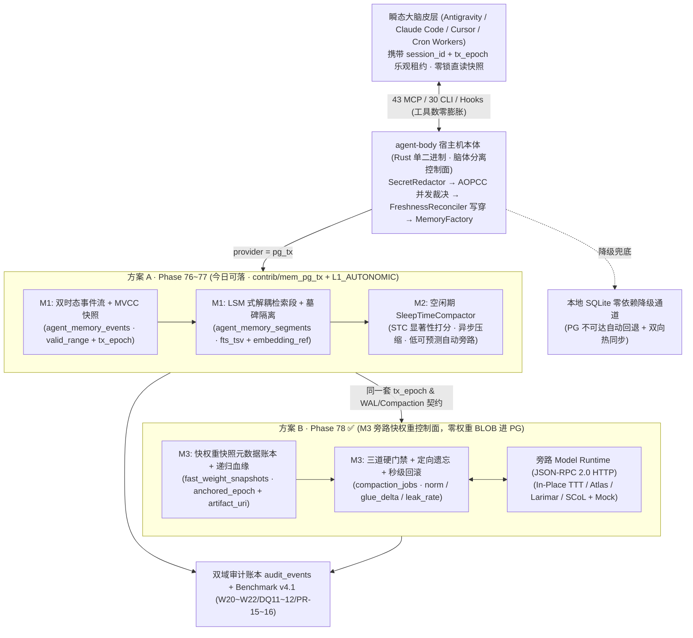

# 22 — 事务级海马体原型：基于 PostgreSQL SPI 从方案 A 演进到方案 B 架构规格说明书

> **Agent Body 产品设计 · 交付件 22 (`ISSUE #55`)**  
> **版本**: v1.2（M1+M2+M3 方案 A→B 全量落地并经 PG 18.6 百万事件实测验收） · **作者**: digoal 德哥 & Agent Body Architecture Team · **日期**: 2026-11-28  
> **思想源流**: `~/new/agent_body_postgresql_spi_a_b.html`（PostgreSQL-V CIDR 2026 · HydraDB · Yang et al. 2026 · Sleep-time Compute · In-Place TTT / Atlas / Larimar · SEAL / SCoL · NeurDB / NeurStore）  
> **对齐规约**: [README.md](../../README.md) 规约 #1 (脑体分离), #2 (递弱代偿防膨胀), #3 (跨大脑连续性), #8 (L0~L3 自治与留痕), #9 (亚毫秒热路径 SLA), #13 (测试驱动与无损自愈), #15 (开放记忆 SPI), #16 (43 工具零膨胀 1:1:1 同步), #18 (帕累托双门禁), #19 (全链路脱敏与抗投毒), #20 (微内核防腐与零重扫), #21 (写穿失效与墓碑净化), #25 (AOPCC 并发控制), #26 (双域全链路审计)

---

## 一、第一性原理与终局推演：为什么要用 PostgreSQL 管住海马体的“秩序、版本与生死”？

当前多智能体系统共享记忆面临两个底层物理矛盾：

1. **六个数量级的时间不对称性（Temporal Asymmetry）**：
   - 宿主机微秒级反射（放置决策 `~30 μs`、3 跳图遍历 `~120 μs`、FTS5 `~250 μs`）与 PostgreSQL WAL 提交 / 碰壁自愈（`1–2 ms`）处于**微秒到毫秒级**；
   - 大模型多步推理 / 快权重矩阵写（`1.7–10 s`）与参数内化评估（如 SEAL `30–45 s`）处于**秒到分钟级**，横跨 **6 个数量级**。
   - **架构铁律**：严禁把 2PL 悲观行锁/表锁横跨在大模型推理或权重整理链路上；必须采用 **MVCC 快照读 + 逻辑纪元（`tx_epoch`）乐观校验 + 后台异步 Compaction** 将热路径与冷整理彻底解耦。
2. **演进终局（从外部事务记忆到分层活权重）与边界红线**：
   - **终局形态**：多 Agent 并发写入零丢写（0% Lost Update）、双时态可回溯与合规精准遗忘、空闲期自动压缩上下文省 `3×–5×` 在线 Token，并在未来通过同一套 WAL/Snapshot/Compaction 契约无缝挂载旁路模型运行时的租户级快权重与后台神经整理。
   - **递弱代偿红线（严禁越界）**：`agent-body` Rust 本体**绝不**内置 LLM 推理/微调/LoRA 训练循环，**绝不**将 GB 级模型权重作为裸 BLOB 塞进 PostgreSQL 堆表；本体只管**秩序（ACID/MVCC）、版本（`tx_epoch`/血缘 URI）、安全（脱敏/抗投毒/审计）与生死（写穿失效/定向遗忘墓碑）**，一切前向快权重计算与神经参数合并留在外部旁路 Model Runtime。

---

## 二、现网代码实证 GAP 审计（基于 `agent-body v1.1.0`）

对照当前代码库实况与本机 PostgreSQL 18 环境（已实装 `btree_gist`、`vector`、`pg_vectorsearch`、`pg_trgm` 扩展），识别出 **8 项核心 GAP**：

| GAP 编号 | 现网 `v1.1.0` 源码事实 | 目标蓝图要求（方案 A → 方案 B） | 优先级 |
|:---:|---|---|:---:|
| **`GAP-01`** | [src/storage/pg_provider/mod.rs](../../src/storage/pg_provider/mod.rs) 使用单个 `Arc<Mutex<postgres::Client>>` 串行锁，无连接池与显式 `REPEATABLE READ` 事务重试 | 多连接池并发 + `REPEATABLE READ` 原子事务 + `tx_epoch` OCC 冲突重试（零 2PL 长锁） | **P0 (M1)** |
| **`GAP-02`** | [src/storage/pg_schema.sql](../../src/storage/pg_schema.sql) 的 `memories` 为原地 `UPSERT` 扁平表，无 `valid_range` 双时态时间窗、无 `tx_epoch`、无 `evidence_tier`/`evidence_sha256` | 新增不可变追加双时态账本 `agent_memory_events`（`TSTZRANGE` + `tx_epoch` + `salience_score` + `consolidation_st`） | **P0 (M1)** |
| **`GAP-03`** | `embedding TEXT DEFAULT '[]'` 直接存在 PG 主堆表并在应用层做全量扫描余弦，存在堆表写放大与僵尸召回风险 | 解耦检索段表 `agent_memory_segments`（`fts_tsv` GIN + `embedding_ref` 可插拔向量句柄 + `is_deleted` 墓碑过滤） | **P0 (M1)** |
| **`GAP-04`** | [src/memory/spi.rs](../../src/memory/spi.rs) 仅 4 个基础方法，[MemoryFactory](../../src/memory/adapters/mod.rs) 仅支持 `builtin`/`powercontext`/`mem0`/`letta` | 扩展非破坏性 `TxMemoryProvider` & `FastWeightCheckpointSpi` 契约，落地 `provider = "pg_tx"`（PG 不可达自动无损降级 SQLite） | **P0 (M1)** |
| **`GAP-05`** | [OptimisticLeaseEngine](../../src/brief/optimistic.rs) 仅有 8 位字符串 `epoch_hash`，[ContinuityCapsule](../../src/body/continuity.rs) 未锚定单调 `tx_epoch` 与可选快权重快照 ID | 将 PG `tx_epoch` 贯通至开工租约、`body_hook_post` 冲突自愈、`FreshnessReconciler` 与跨大脑接力胶囊 | **P1 (M1/M3)** |
| **`GAP-06`** | [BackgroundScheduler](../../src/daemon/scheduler.rs) 与 [MemoryLifecycleManager](../../src/memory/lifecycle.rs) 仅做简单关键词冲突检查与固定 `×0.85` 衰减，无空闲窗口感知与预整理 | 在 `L1_AUTONOMIC` 落地 `SleepTimeCompactor` + `SalienceScorer`（STC 显著性）+ 低可预测性自动旁路门禁 + `compaction_jobs` | **P1 (M2)** |
| **`GAP-07`** | 无 `fast_weight_snapshots` 血缘账本、无旁路 Model Runtime 控制面接口、无 `selective_unlearn` 定向遗忘三道硬门禁 | M1 一次性预留前后向兼容 4 表 DDL；M3 接入旁路快权重控制面与 `norm_ratio`/`eval_glue_delta`/`unlearn_leak_rate` 原子切换门禁 | **P2 (M3)** |
| **`GAP-08`** | Benchmark `v3.9`（`W1~W19` / `DQ1~DQ10` / `PR-01~14`）缺少多 Agent 事务并发防丢写、睡眠整理降本与墓碑遗忘验证负载 | 升级至 Benchmark `v4.0`（`W20` MVCC 防丢写与写穿零僵尸、`W21` Sleep-time 帕累托、`DQ11` 双时态纯净度、`PR-15` 睡眠省 Token 溯源） | **P1 (M1/M2)** |

---

## 三、多架构路线比选与推荐决策（严守微内核防腐红线）

在动工前，针对“新能力放哪里”对比三种工程路线：

| 方案路线 | 实施形态 | 优势 | 劣势 / 风险 | 结论 |
|---|---|---|---|---|
| **路线 1：仅写入旗舰 `src/` 主干** | 直接修改 `src/storage/pg_provider/` 与 `src/memory/` | 初期改点少、复用现有代码最快 | 违背 Phase 70~73 刚确立的 `kernel/` 与 `contrib/` 分离纪律，加重根包与 PG 强耦合，精简发行版无法按需装配 | ❌ 不推荐 |
| **路线 2：仅建 `contrib/mem_pg_tx/` 孤岛** | 只在 `contrib/` 写新插件，不接入旗舰 MCP/Web/Daemon | 微内核边界极纯净 | 现网旗舰 `agent-body`（43 MCP / Web UI / Benchmark）享受不到事务级海马体红利，形成两张皮 | ❌ 不推荐 |
| **路线 3：契约下沉 + `contrib/mem_pg_tx/` 独立五件套 + 旗舰无侵入集成（推荐）** | ① `kernel/body-sdk` 与 `src/memory/spi.rs` 仅定义零依赖事务/快照契约；<br/>② PostgreSQL 事务底座落地为独立标准五件套 `contrib/mem_pg_tx/`（单向依赖 `body-sdk`）；<br/>③ 旗舰 `MemoryFactory`、`BackgroundScheduler`、`OptimisticLeaseEngine`、`ContinuityManager` 通过适配层接入，PG 不可达自动降级 SQLite；43 工具保持零膨胀 | **100% 守住 `kernel/` 零 PG/零业务词污染**；旗舰版与未来 DBA/集群发行版共用同一套事务级海马体；无 PG 环境零破坏降级 | 需同步维护 `contrib/mem_pg_tx/` 五件套与旗舰适配桥接（工作量可控，边界清晰） | ✅ **推荐拍板** |

---

## 四、整体架构与双向演进接线图（接口不动、地层叠加）



---

## 五、前后向 100% 兼容的四表 PostgreSQL DDL（标准 PG 16/18）

落地于 `contrib/mem_pg_tx/sql/mem_pg_tx--0.1.0.sql`（遵循微内核前缀规范，逻辑名与物理表通过视图或 `ext_mem_pg_tx__` 前缀映射；以下展示核心结构契约）：

### 5.1 方案 A 核心表（Phase 76 落地）

```sql
CREATE EXTENSION IF NOT EXISTS btree_gist;

-- 1) 不可变追加 + 双时态记忆事件主表（对齐三层证据与 AOPCC tx_epoch）
CREATE TABLE IF NOT EXISTS agent_memory_events (
    event_id          BIGINT GENERATED ALWAYS AS IDENTITY PRIMARY KEY,
    body_id           TEXT        NOT NULL,
    tenant_scope      TEXT        NOT NULL,
    fact_key          TEXT        NOT NULL,
    evidence_tier     TEXT        NOT NULL CHECK (evidence_tier IN ('L1_EXPLICIT','L2_STRUCTURAL','L3_SEMANTIC')),
    payload_redacted  JSONB       NOT NULL,
    evidence_sha256   BYTEA       NOT NULL,
    valid_range       TSTZRANGE   NOT NULL DEFAULT tstzrange(clock_timestamp(), NULL, '[)'),
    tx_epoch          BIGINT      NOT NULL,
    embedding_status  TEXT        NOT NULL DEFAULT 'pending'
                                  CHECK (embedding_status IN ('pending','fresh','stale','tombstoned')),
    salience_score    REAL        NOT NULL DEFAULT 0.0,
    consolidation_st  TEXT        NOT NULL DEFAULT 'raw'
                                  CHECK (consolidation_st IN ('raw','sleep_compacted','weight_merged','purged')),
    created_at        TIMESTAMPTZ NOT NULL DEFAULT now()
);

-- 活跃事实唯一性：同一逻辑键在当前有效窗内严禁双写撕裂
CREATE UNIQUE INDEX IF NOT EXISTS idx_mem_active_fact_unique
    ON agent_memory_events (body_id, tenant_scope, fact_key)
    WHERE upper_inf(valid_range) AND embedding_status <> 'tombstoned';

CREATE INDEX IF NOT EXISTS idx_mem_active_epoch
    ON agent_memory_events (body_id, tenant_scope, tx_epoch DESC)
    WHERE upper_inf(valid_range) AND embedding_status <> 'tombstoned';

-- 2) LSM 式解耦检索段：写穿失效后立即可见度隔离，杜绝僵尸向量召回
CREATE TABLE IF NOT EXISTS agent_memory_segments (
    segment_id        BIGINT GENERATED ALWAYS AS IDENTITY PRIMARY KEY,
    event_id          BIGINT NOT NULL REFERENCES agent_memory_events(event_id),
    fts_tsv           TSVECTOR NOT NULL,
    embedding_ref     TEXT,                 -- 外部/pgvector/pg_vectorsearch/LSM 分段句柄
    is_deleted        BOOLEAN NOT NULL DEFAULT FALSE
);

CREATE INDEX IF NOT EXISTS idx_mem_seg_fts
    ON agent_memory_segments USING GIN (fts_tsv) WHERE NOT is_deleted;
```

### 5.2 方案 B 预留与演进表（Phase 76 预建兼容结构，Phase 77~78 激活）

```sql
-- 3) 快权重快照血缘元数据（严禁将 GB 级权重存堆表，仅存 URI/血缘/锚定纪元）
CREATE TABLE IF NOT EXISTS fast_weight_snapshots (
    snapshot_id       UUID        PRIMARY KEY,
    body_id           TEXT        NOT NULL,
    tenant_scope      TEXT        NOT NULL,
    base_model_id     TEXT        NOT NULL,
    parent_snapshot   UUID        REFERENCES fast_weight_snapshots(snapshot_id),
    anchored_epoch    BIGINT      NOT NULL,
    adapter_kind      TEXT        NOT NULL CHECK (adapter_kind IN ('inplace_ttt','atlas_state','larimar_mem','scol_lora')),
    artifact_uri      TEXT        NOT NULL,
    norm_ratio        REAL        NOT NULL,
    status            TEXT        NOT NULL CHECK (status IN ('warming','active','rolled_back','compacted')),
    created_at        TIMESTAMPTZ NOT NULL DEFAULT now()
);

-- 4) L1_AUTONOMIC 空闲期睡眠整理 / 神经 Compaction / 定向遗忘作业队列
CREATE TABLE IF NOT EXISTS compaction_jobs (
    job_id            BIGINT GENERATED ALWAYS AS IDENTITY PRIMARY KEY,
    job_kind          TEXT        NOT NULL CHECK (job_kind IN ('sleep_context','fast_to_warm_lora','selective_unlearn')),
    tenant_scope      TEXT        NOT NULL,
    from_epoch        BIGINT      NOT NULL,
    to_epoch          BIGINT      NOT NULL,
    tombstone_ids     BIGINT[]    NOT NULL DEFAULT '{}',
    eval_glue_delta   REAL,       -- 门禁：通用能力回归差值 >= -0.03
    unlearn_leak_rate REAL,       -- 门禁：墓碑数据诱导召回率 < 0.001
    state             TEXT        NOT NULL DEFAULT 'queued'
                                  CHECK (state IN ('queued','running','verified','committed','aborted')),
    audit_trace_id    TEXT        NOT NULL,
    created_at        TIMESTAMPTZ NOT NULL DEFAULT now()
);
```

---

## 六、热/冷双路径事务契约与三阶段硬验收门禁

1. **热路径事务契约（亚毫秒短事务提交：同键 `pg_advisory_xact_lock` + `READ COMMITTED` 写穿 + `REPEATABLE READ READ ONLY` 快照读）**：
   - 收到新记忆写入或 `FreshnessReconciler` 变更事件时，在亚毫秒级单事务内（**绝不跨推理持锁**）：① 通过 `pg_advisory_xact_lock(hashtextextended(body_id || '|' || tenant_scope || '|' || fact_key, 0))` 对**同一逻辑键**做提交期微序列化（不同 `fact_key` 100% 并行，彻底消除 16+ 并发热点 `40001` 惊群），并 `FOR UPDATE` 校验可选 `expected_epoch`（违例即报 `MVCC_EPOCH_CONFLICT` 供 AOPCC `<2ms` 自愈）；② 截断旧活跃行 `valid_range`（使用 `NULL` 无界上界保证 `upper_inf(valid_range)=TRUE`）并置 `embedding_status='stale'` + 旧检索段 `is_deleted=true`；③ 分配单调新 `tx_epoch`，插入经 `SecretRedactor` 脱敏且带 `evidence_sha256` 的新事件与新检索段，外层保留 `40001`/`23505`/`40P01` OCC 重试兜底；④ 读路径 `search()` 始终以 `REPEATABLE READ READ ONLY` 执行无锁 MVCC 快照读。
2. **冷路径整理契约（`L1_AUTONOMIC` 空闲窗口 + 三道硬门禁与秒级回滚）**：
   - M2 仅在 CPU/会话空闲期拉取 `sleep_context` 作业，写入高密度摘要并归档冗余事件；遇到高不可预测查询自动旁路预整理（`WITH active_e AS MATERIALIZED` 强制局部索引扫瞄，彻底消除 PG 优化器在海量历史行下误选 `Merge Join` 全扫主键的陷阱）；
   - M3 在 `kernel/body-sdk/src/fast_weight.rs` 定义零依赖 `FastWeightCheckpointSpi` 与 JSON-RPC 2.0 线协议（严格拦截 `data:` 内联权重），在 `contrib/mem_pg_tx/` 执行 `fast_to_warm_lora` / `selective_unlearn` 后，必须同时满足 `norm_ratio <= max_norm_ratio`、`eval_glue_delta >= -0.03`、`unlearn_leak_rate < 0.001` 方可在 PG 单事务原子切换 `fast_weight_snapshots.status = 'active'`，任一不通过即置 `aborted` 并无损保留原激活快照或纯方案 A 非参数检索。
3. **三阶段真机 PG 18.6 硬验收实测（详见 [roadmap-phase76-78.md](../src_doc/roadmap-phase76-78.md)）**：
   - **M1（Phase 76 · ✅ 已通过）**：16 线程 × 5 = 80 tx 并发写丢写率 **`0%`** · 200 事实 `search_tx P50 = 3.28 ms / P99 = 4.34 ms`（`< 20 ms`） · 僵尸召回率 **`0%`** · SQLite 降级 100% 透明；
   - **M2（Phase 77 · ✅ 已通过）**：压缩比 **`3.73×`** (`272→73 tok`) · 保留事实 **`100% (6/6)`** · 整理期热路径 **`P50 = 5.19 ms / P99 = 10.65 ms`** · `W21` (`260→87 tok`) 与审计留痕 100% 通过；
   - **M3（Phase 78 · ✅ 已通过）**：**1,000,003 事件流**实测 **`search_tx P50 = 2.66 ms / P99 = 4.42 ms`**（`< 20 ms`）、`active_snap P99 = 0.75 ms`、`lineage P99 = 1.94 ms`（`< 5 ms`）、按 `tx_epoch` 回滚 **`24 ms`**（`< 1 s`） · 3 类故障注入 100% 拦截回退 · `ContinuityCapsule v2` 同基座热挂载/异构回退与 `W22` (`320→48 tok`) 全绿。
