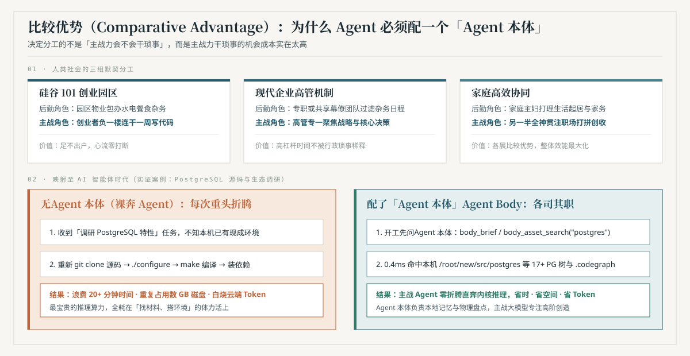

# 缘起：从硅谷园区物业、专业幕僚到 Agent 的「比较优势」

> **记录人**: digoal 德哥  
> **对齐**: [README.md ISSUE #9](../../README.md) · **范式延续**: [04-agent-body-philosophy.md](04-agent-body-philosophy.md)  
> **核心命题**: 为什么要做 Agent Body？不是因为大模型不够聪明，而是缺了一个驻留本机的**「Agent 本体」**（“Agent 本体”是其感官盘点与稳态防撞的两大侧面），让瞬态大脑发挥「比较优势」。

---

## 一、三个看似无关的生活画面，指向同一个经济学原理

我在思考为什么要做 **Agent Body（Agent 本体）** 时，脑海里浮现出三个非常生活化、却高度同构的画面：

1. **硅谷 101 访谈里的创业者**：  
   我看过硅谷 101 采访一位硅谷创业者，他说自己居然在办公区（负一楼）将近一周都沉浸在 coding 中，几乎足不出户。原因很简单——这个园区的物业把创业者的生活琐事和后勤保障全都办了，创业者不需要分心去管水电、餐饮、杂务，可以把 100% 的心力沉浸在最核心的 coding 主业上。
2. **现代企业里的高管**：  
   企业高管往往都会配置专职或共享幕僚团队。Agent 本体把日程协调、材料归档、环境准备等琐事全部办掉，高管就能专一地干战略决策与核心拍板这些高杠杆的本职工作，发挥最大能效。
3. **家庭里的默契分工**：  
   很多家庭里也是一样，家庭主妇把家里的采买、起居、后勤一切琐事都包了，另一半就能专心在外面工作赚钱。

这三件事表面上看毫不相干，底层其实都在践行同一套经济学第一性原理——大卫·李嘉图提出的 **比较优势（Comparative Advantage）**。

> **决定分工的，从来不是「谁能不能干这件琐事」，而是「主战力去干这件琐事的机会成本实在太高」。**

高管自己当然也能订机票、整理文件夹，创业者自己当然也能买菜做饭；但只要他们把时间花在这些琐事上，核心创造力就会被严重稀释。每个角色都把主要精力放在自己最本职、最专长、单位产出最高的事情上，彼此协同，整体系统的总产出才会成倍放大。

---

## 二、把镜头切回 AI Agent：PostgreSQL 调研里的真实折腾

用了很长时间的 AI Agent 之后，我越来越强烈地感受到：**今天的 Agent，正处在一个「没有Agent 本体、没有物业、什么琐事都得自己干」的裸奔状态。**

举一个我自己每天都在经历的真实场景——**调研 PostgreSQL**。

我经常让 Agent 去调研 PostgreSQL 的内核代码、新特性功能、或者某个具体应用场景。每次给它提交任务，如果我没有手动把精确路径喂到它嘴边，它就会在宿主机上上演一套固定戏码：
- 重新 `git clone` 一份 PostgreSQL 源码（或者反复到处 `find`）；
- 重新拉取相关文档和依赖；
- 重新 `./configure`、编译、安装、搭测试实例、跑验证。

**荒诞的是什么？**  
在这台宿主机上，`/root/new/src/` 目录下其实早就静静躺着上百个开源仓库（实测 **110 个**目录），其中仅 PostgreSQL 核心与生态就已经备好了 `/root/new/src/postgres`、`pg19_fixed`、`pg19_fixed_asan`、`pgvector`、`pg_duckdb`、`pg_mooncake`、`pg_cron` 等 **17 个以上的源码树与现成编译环境**，甚至连 `codegraph` 代码地图和 `/root/new/src/blog` 里的历史技术沉淀都是现成的！

但 Agent **不知道**。它就像一个刚进办公室、既没有Agent 本体也没有台账的高管，每次要看一份财报，都得自己跑去档案室从零翻箱倒柜，甚至自己重新抄写一遍。

---

## 三、解法：给主战 Agent 配一个驻留本机的「Agent 本体」

如果能给 Agent 配一个驻留在本机的 **Agent 本体（Agent Body）**，局面会立刻反转：

1. **开工先问Agent 本体（Compare Advantage 协同）**：  
   Agent 接到任务后，不再盲目 `git clone` 或全盘 `find`，而是先花不到 1 毫秒问一句Agent 本体：`body_brief`、`body_asset_search(query="postgres")` 或 `body_fact_query`。
2. **现成家底毫秒直达**：  
   Agent 本体直接把本机 `/root/new/src/postgres` 的物理路径、是否已建好 `.codegraph` 代码地图、当前 5432 端口被谁占用、以及之前调优过 `shared_buffers` 的历史决策一并递到 Agent 面前。
3. **三省其身**：
   - **省时间**：跳过动辄十几二十分钟的重复拉代码与编译安装；
   - **省空间**：不再在工作区与 `/tmp` 里堆出十几份重复克隆的源码垃圾；
   - **省 Token**：主战大模型把宝贵的 Context 窗口和推理算力，100% 留给架构分析、源码解读和 Bug 诊断。

这就是 **Agent Body** 最朴素的初心——**让驻留在本地的轻量级Agent 本体（零云端 Token 消耗、微秒级响应、事实零幻觉）接管一切宿主机环境盘点与杂务，让主战 Agent 像负一楼的创业者、有Agent 本体的高管一样，心无旁骛地沉浸在它的主业创造中。**

---

*进一步阅读：*
- *[01-why-memory-management-failed.md](01-why-memory-management-failed.md) — 从「记忆管理」到「Agent 本体」的技术归因*
- *[03-modular-body-architecture.md](03-modular-body-architecture.md) — 事实、偏好与记忆的三位一体架构设计*
