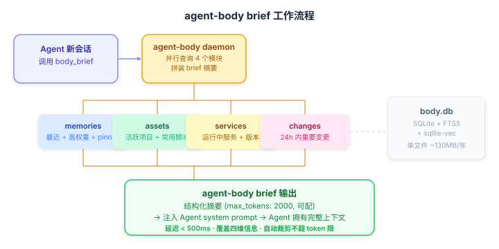
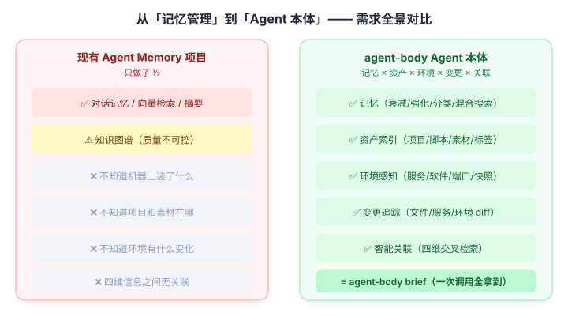
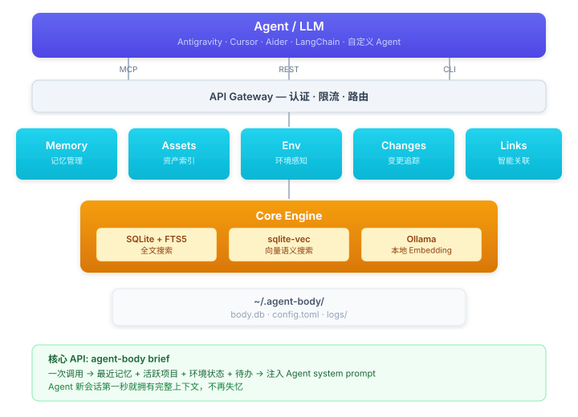

# 我设计了一个 Agent 宿主机Agent 本体，这是全部思考过程

上一篇文章《谈谈我真正想要的 Agent Memory 项目》发出来之后，反响不错。不少人在留言区说："方向对，但太概念了，什么时候出东西？"

所以这一篇，我把这个想法变成了**完整的产品设计**——7 份文档、14 项交叉 Review、可执行的 init.sql、以及一套经过反复推敲的架构决策。

但我今天不打算把 7 份文档的内容复述一遍。我想讲的是：**从一个模糊的想法到一套可落地的产品设计，这条路上我做了哪些关键决策，为什么这么决策，踩了哪些"看起来对但实际上有毒"的坑。**

希望对你有用——不管你做不做这个产品，产品设计的思考方式是通用的。

## 一、第一个决策：问题边界在哪

上一篇文章的核心论点是"Agent Memory 项目们都做窄了"。但做产品时第一个要回答的问题恰恰是：**那你做多宽？**

做窄了没价值，做宽了做不完。

我最终画了一条线：

**管的：** 记忆、资产（项目/脚本/素材/数据集）、环境（服务/软件/端口/系统状态）、变更（什么时候什么变了）、以及这四者之间的关联。

**不管的：** 不管 Agent 的推理过程、不管对话内容本身（那是 Agent 框架的事）、不管远端服务器（只管本机）、不管文件内容索引（那是 RAG 的事，我只管元数据和路径）。

这条边界花了我最多时间。因为"Agent 本体"这四个字太容易失控——你可以把操作系统的每个角落都纳进来。但一旦失控，就永远做不完。

**我最后定这条边界的逻辑是：站在 Agent 的视角，它在新会话的前 10 秒最需要知道什么？**

答案是四样东西：
1. 我们之前做过什么决定（记忆）
2. 我能用什么工具和素材（资产）
3. 机器上现在跑着什么（环境）
4. 从上次到现在发生了什么变化（变更）

刚好四个维度。多一个维度都显得画蛇添足，少一个维度 Agent 就会在关键时刻"装瞎"。

## 二、核心产品洞察：agent-body brief

**如果整个产品只保留一个 API，保留哪个？**

我的答案是 `agent-body brief`。

这个 API 做一件事：Agent 在新会话开始时调用它，返回一段结构化的摘要文本。摘要包含最近的记忆、活跃的项目、运行中的服务、24 小时内的重要变更——刚好够 Agent "醒来"时知道自己身处何方。

为什么这个 API 是核心？

因为**它定义了产品的价值检验标准**——如果装了 agent-body 之后，Agent 新会话的第一句回复就变得更准确、更有上下文感，那产品就有价值；如果没变化，那不管底层架构多精妙，都是白搭。

这也直接影响了我的开发优先级：MVP 只需要做到 `agent-body brief` 能返回有用信息，其他都可以往后排。

`brief` 的另一个设计要点是 **max_tokens 参数**（默认 2000，范围 200-8000）。不同的 Agent 框架、不同的模型，上下文窗口不一样，能承受的 system prompt 长度也不一样。brief 必须能按需裁剪——你给我 500 tokens 的预算，我就给你最精华的 5 条；给我 8000，我就给你全景。

## 三、四个"看起来对但我改了主意"的决策

### 3.1 Rust 还是 Go？

第一反应是 Rust。本地 daemon、低资源占用、单二进制分发——Rust 简直天生为这个场景而生。

但冷静下来想了想，**MVP 阶段的核心风险是什么？** 不是性能，是"产品定义对不对"。agent-body 的目标用户量在千级到万级，数据量在万级条目。这个量级下，Go 和 Rust 的性能差异用户根本感知不到。

而 Go 的开发速度大约是 Rust 的 2-3 倍（我个人体感）。用 Rust 多花的时间，可能导致 MVP 晚发一个月。

**最终决策：MVP 用 Go，如果产品验证成功且性能有瓶颈，1.0 再评估 Rust 重写核心热路径。**

不是 Rust 不好，是时机不对。先验证产品值不值得存在，再优化产品的技术底座。

### 3.2 SQLite 够用吗？

直觉上，一个"管一切"的Agent 本体应该用一个强大的数据库——PostgreSQL，甚至 DuckDB。

但 agent-body 的部署约束是 **"一个二进制 + 一个文件就能跑"**。引入 PG 就意味着用户还得装 PG、维护 PG、担心 PG 挂了数据丢不丢。这跟"Agent 本体"的定位矛盾——Agent 本体自己不应该成为环境的负担。

SQLite 的核心优势在这个场景里恰好全部命中：
- 零配置、单文件、嵌入式
- FTS5 内置全文搜索，不需要 Elasticsearch
- sqlite-vec 扩展提供向量搜索，不需要 Milvus/Qdrant
- WAL 模式支持并发读，单写够用（daemon 是唯一写者）
- 一年的典型数据量约 130 MB，完全在 SQLite 的舒适区

**我甚至直接把 init.sql 写好并跑通了验证：14 个逻辑表、8 个触发器、15 个索引，一个 `sqlite3 ~/.agent-body/body.db < init.sql` 就完成初始化。**

### 3.3 中文搜索怎么办？

FTS5 的默认 tokenizer 是按 Unicode 字符类别分词，对英文友好，对中文很差——它会把"项目选型确定为 SQLite"拆成一个字一个字。

我调研了三个方案：
1. 编译 ICU tokenizer（需要 ICU 库，增加编译复杂度，跨平台麻烦）
2. 写 FTS5 自定义 tokenizer（C 层工作，维护成本高）
3. **入库前用 jieba 分词，FTS5 只管按空格切已分好的词**

方案 3 最丑但最实用：写入时多一步 `jieba.cut(text)` → 用空格连接 → 存入 FTS5；查询时同样先 `jieba.cut(query)` → 再做 FTS5 MATCH。

Go 生态有纯 Go 实现的 jieba（`go-ego/gse`），无 cgo 依赖，开销极小（< 1ms/条）。

**选它。工程不追求优雅，追求有效且可维护。**

### 3.4 向量搜索要不要做？

有一种声音说："FTS5 关键词搜索就够了，向量搜索是过度设计。"

对某些场景确实如此。但记忆搜索有一个特点：**用户描述问题的方式和记忆记录的表述方式经常差很远。**

比如你三个月前记录了一条记忆："`shared_buffers` 从 256MB 调到 2GB，解决了慢查询"。三个月后你遇到 seq scan 太多的问题，想找之前的经验。关键词搜索可能搜不到——因为"seq scan"和"shared_buffers"在词层面几乎不相关。但在语义层面，它们都属于"PostgreSQL 性能调优"。

所以 **向量搜索不是可选的，是必须的。** 但它应该优雅降级——如果本机没有 Ollama 或者 Ollama 暂时不可用，agent-body 应该仍然能正常工作，只是退化为纯关键词搜索。

这就是为什么我在数据库表里设计了 `embedding_status` 字段（pending/done/failed）。写入不阻塞、embedding 异步做、Ollama 恢复后自动补上。

## 四、最重要的设计决策：关联

现有的 Agent Memory 项目做的都是"单表查询"——给我一个 query，我从记忆库里搜出最相关的 N 条，完事。

agent-body 不同。它的五个数据维度——记忆、资产、环境、变更、关联——**不是五个独立的数据库，而是通过 `links` 表相互串联的一张大图。**

举个例子。你上周让 Agent 帮你调了 PostgreSQL 的配置，整个过程 agent-body 记录了：

- **记忆**：决策记录 "把 `work_mem` 从 64MB 调到 256MB"
- **资产**：关联的配置文件 `/etc/postgresql/17/main/postgresql.conf`
- **环境**：当时的 PG 版本是 17.2，运行在 5432 端口
- **变更**：配置文件在 2026-11-14 15:30 被修改
- **关联**：以上四条记录通过 `links` 表串在一起

一周后你问 Agent："上次我们调了什么 PG 参数？"

如果只有记忆搜索，Agent 只能返回"把 `work_mem` 调到 256MB"。

但有了关联，Agent 还能告诉你："配置文件在 `/etc/postgresql/17/main/postgresql.conf`，当前 PG 版本是 17.2，上次改的时间是 11 月 14 号下午。对了，从那次修改到现在，这个文件没有再被动过。"

**这才是"记忆"和"Agent 本体"的区别。** 记忆只告诉你"发生过什么"，Agent 本体告诉你"发生过什么 + 涉及什么 + 现在什么状态"。

## 五、我是怎么保证设计质量的

7 份文档写完不算完，我对每份文档做了交叉一致性 Review。

什么叫交叉一致性？就是检查 7 份文档之间是否自洽。比如：
- 03 功能规格里说资产类型有 8 种，07 数据模型的 CHECK 约束里是不是也是 8 种？
- 06 API 文档里 `body_brief` 有没有 `max_tokens` 参数？和 03 描述的行为是否一致？
- 05 架构文档说用 Go，04 产品手册里的示例命令是不是也对得上？

Review 找出了 14 个问题——3 个红色（数据不一致）、8 个黄色（信息缺失）、3 个橙色（风险未评估）。

**每一个问题我都做了修复，而且每修一个就更新一次进度文件。** 整个过程是可追踪的——中途断电、重启、换台电脑继续，都能从进度文件接着来。

这套"写文档 → 交叉 Review → 逐项修复 → 断点续传"的流程，比文档本身更有价值。它适用于任何多文档协作的产品设计项目。

## 六、技术架构全景

整个架构的设计哲学：**像 SQLite 一样简单——一个进程、一个文件、零外部依赖。**

- **一个二进制**：`agent-body`，包含 daemon、MCP server、REST server、CLI、scheduler、file watcher。
- **一个数据库文件**：`~/.agent-body/body.db`，SQLite + FTS5 + sqlite-vec。
- **一个配置文件**：`~/.agent-body/config.toml`。
- **一个 Embedding 依赖**：本地 Ollama（可选，没有时优雅降级为纯关键词搜索）。

不需要 Docker，不需要 Kubernetes，不需要云服务。`curl | sh` 安装，`agent-body init` 初始化，完事。

Agent 通过 MCP 协议连接 agent-body（和连接其他 MCP server 的姿势完全一样），也可以通过 REST API 或 CLI 调用。

## 七、我在这个项目上学到的三件事

### 7.1 产品设计的第一个输出应该是"场景"，不是"功能"

我一开始就想写功能清单——agent-body 要有记忆写入、记忆搜索、资产扫描、环境快照……列了一大堆。

后来退回来，先写场景集。4 个用户画像 × 26 个具体场景，按"冷启动 / 日常工作 / 跨会话续接 / 异常排障 / 定时自动 / 多 Agent 协作"六个触发时机分类。

**写完场景之后，功能清单几乎是自动推导出来的。** 每个功能都能追溯到至少一个场景，没有场景支撑的功能直接砍掉。

这比凭空想功能靠谱得多。

### 7.2 "交叉一致性"是多文档项目的命根子

7 份文档加起来 4000+ 行，涉及数据类型、API 名称、字段名、参数范围、状态枚举……这些东西分散在不同文档里，特别容易不一致。

不一致的后果是什么？开发到一半发现 API 文档和数据模型对不上，改一个就得改一串，返工成本巨大。

**所以我在写完所有文档之后，专门做了一轮交叉一致性 Review，结果真找出了 14 个问题。** 如果不做这一步，这些问题会在开发阶段以 bug 的形式暴露出来，修复成本至少翻 5 倍。

### 7.3 写出来的东西要能跑

产品设计文档最大的风险是"看起来很完美但跑不通"。

所以我把 07 数据模型里的所有 DDL 合并成了一个 `init.sql`，然后真的用 `sqlite3` 跑了一遍。14 个表全部创建成功（除了 sqlite-vec 需要运行时加载扩展），初始配置数据正确写入，触发器正常工作。

**能跑通的 init.sql > 10 页的数据模型文档。**

## 八、这个产品的终局

上一篇文章我说过，Agent 本体的终局是"Agent 时代的认知操作系统"。

经过这次完整的产品设计之后，我对这个判断更有信心了。原因有三：

**第一，需求是真实的且没有替代品。** 我自己每天用 Agent，Agent 每开新会话就失忆的痛点真的很痛。现有的 Agent Memory 项目只解决了 ⅓ 的问题。

**第二，技术栈是成熟的。** SQLite + FTS5 + sqlite-vec + Go + Ollama，每一个组件都经过了大规模验证。不需要发明新技术，只需要把成熟的组件正确地组合在一起。

**第三，产品形态是明确的。** 本地 daemon + MCP 原生接口 + CLI，这个形态已经被 Claude MCP 生态验证了。用户的接入成本极低——在 MCP 配置里加两行 JSON 就完事。

下一步是写 Go 代码，从 `agent-body brief` 这一个 API 开始。

如果你也对这个方向感兴趣，或者你有 Agent 失忆的痛点想吐槽，欢迎来 GitHub 聊：`https://github.com/digoal`。

*全部设计文档、init.sql、Review 报告开源在项目目录中，欢迎 fork。*

*—— digoal 德哥 · 2026-11-15*
