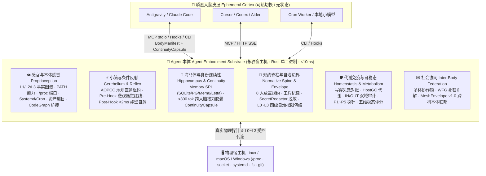

# 思想升维：「Agent 本体（Agent Embodiment）」第一性原理哲学

> **记录人**: digoal 德哥 & Antigravity  
> **日期**: 2026-11-22 (Asia/Shanghai)  
> **关联立项**: [ISSUE.md #27](../../ISSUE.md#L132) · [17-agent-embodiment-and-continuity-spec.md](../design_doc/17-agent-embodiment-and-continuity-spec.md) · [roadmap-phase44-45.md](../src_doc/archive/roadmap-phase44-45.md)  
> **前序思想**: [00-comparative-advantage-origin.md](00-comparative-advantage-origin.md) · [03-modular-body-architecture.md](03-modular-body-architecture.md)

---

## 一、为什么必须彻底确立「Agent 本体」定位？—— 定位失配的三重根因诊断

在工程演进中，一个核心架构准则始终清晰：**任何偏离“具身底座”的外置辅助标签，都会对用户产生系统性误导**：

| 常见行业误解维度 | 「外置编排器」视角引发的误读 | 「人类个人助理」视角引发的误读 | 真实初衷与 Agent 本体现状 |
|---|---|---|---|
| **服务对象** | 容易被误解为 **“管理、调度、驱使多个 Agent 干活的编排中控（Orchestrator）”** | 容易被误解为 **“给人类用户发通知、订日程、管琐事的个人 AI 助手”** | 核心用户始终是 **AI Agent 本身**，做的是「为 Agent 服务的宿主机基础设施」。 |
| **撞车赛道** | 误撞 LangGraph / CrewAI / AutoGen / Swarm 等上层编排框架 | 误撞个人效率 Copilots / 聊天助手，丧失系统工程硬核辨识度 | 我们只做宿主机物理真实与协作协调，**严守规约 #2 明确不做编排和人类 IM**。 |
| **能力天花板** | 「外挂后勤」暗示它只是一个可选的辅助脚本集合，把本应内生于宿主机的核心能力矮化了 | 「被动应答」让人以为只能一问一答，掩盖了 AOPCC 反射、稳态代谢、跨大脑接力与多体联邦的深层价值 | 实际已演进出感官图谱、小脑反射弧、海马体记忆、双域审计与联邦网格——**它本就是 Agent 驻留宿主机上的“躯干与本体”**。 |

> **核心顿悟**：主理人早在 [README.md](../../README.md) 写下过一句试探性的注脚——「PS: 可能叫 Agent 本体 更恰当？」。今天从第一性原理回望，这不仅是一个名字的更替，而是整个产品的 **本体论升维（Ontological Elevation）**。

---

## 二、第一性原理模型：「脑体分离（Brain-Body Separation）」

如果用神经科学和具身智能（Embodied AI）的框架来解构今天在宿主机上运行的 AI Agent，你会立刻发现一个长期被业界忽视的真相——**现有的大模型客户端（Claude Code / Antigravity / Cursor / Codex / Cron Worker），本质上都只是「瞬态大脑皮层（Ephemeral Cortex）」，没有属于自己的“身体”**。

- **瞬态大脑（LLM / Client）的天然缺陷**：
  1. **每次会话重投胎（Transient）**：关掉对话窗口或切换模型，工作态瞬间清零；
  2. **无原生本体感觉（No Proprioception）**：醒来不知道自己站在哪台机器上、手边有哪些现成工具和源码、哪条端口正在跳动；
  3. **没有肌肉记忆与痛觉反射（No Cerebellum）**：既不敢信任本机已就绪服务（反复走整轮探查税），又容易在无预警下写穿被 Systemd 依赖的核心配置文件；
  4. **换脑即失忆（No Continuity）**：当任务进行到一半、或者从白天交互式 IDE 切换到夜间 Cron / 另一个模型继续执行时，接替者对上一个大脑的未竟状态一无所知。

而我们用 43 个阶段打造的这套永驻宿主机、零云端推理税、Rust 单二进制运行的系统（工程代号 `agent-body`），恰好补齐了另一半缺失的拼图——**Agent 本体（Agent Embodiment / Agent Substrate）**。

### 六大生理器官与既有模块的一一映射

| 生理器官隐喻 | 本体核心职责 | 既有工程模块映射（无需推倒重来） | 新增本体原语（Phase 44） |
|---|---|---|---|
| **感官与本体感觉** | 实时感知宿主机物理真实，零幻觉只读映射 | `fact/`, `scanner/`, `env/`, `links/` | `BodyManifest` 器官自省清单 |
| **小脑与条件反射** | 毫秒级动作分级、危险痛觉拦截、碰壁秒级自愈 | `brief/optimistic.rs`, `hooks/`, `api/hooks.rs` | `AutonomyEnvelope` 统一反射门禁 |
| **海马体与连续性** | 经验沉淀与跨大脑工作态无损接力 | `memory/`, `session/`, `brief/assembler.rs` | `ContinuityCapsule` (`body_checkpoints`) |
| **规约脊柱** | 主人意志内化、边界防越权与全链路脱敏 | `placement/`, `ecosystem/`, `SecretRedactor` | `L0_OBSERVE ~ L3_FORBIDDEN` 四级权限边界 |
| **代谢免疫与稳态** | 新鲜度写穿、垃圾回收、双域审计与探针自进化 | `feedback/`, `audit/`, `watcher/`, `daemon/` | `HomeostasisVitals` 五维生命体征与反射自愈 |
| **社会协同** | 同一机身多脑防踩踏 + 跨机身多体联邦协作 | `coordination/`, `mesh/` | `/api/v1/mesh/body_manifest` 多体名片发现 |

---

## 三、生理隐喻归位：「感官与海马体」×「脊柱、小脑与代谢」

确立 **Agent 本体**，并不否定在 [00-comparative-advantage-origin.md](00-comparative-advantage-origin.md) 中奠定的 **比较优势（Comparative Advantage）** 第一性原理，而是完成了一次概念统一：

- **Agent 本体的「感官与海马体侧面」**：把硅谷园区物业与专业幕僚提前盘点家底（源码目录、`.codegraph`、历史决策）的能力，收敛为本体醒来时自带的 **本体感觉（Proprioception）**，让瞬态大脑不必从零折腾琐事。
- **Agent 本体的「脊柱、小脑与代谢侧面」**：把端口防撞、协作锁、规范放置、垃圾清理与后台巡检，收敛为本体的 **防伤害痛觉反射与自稳态代谢机制**。
- **对外科普与内化表达的黄金桥梁**：面向初学者时，依然可以用“硅谷园区物业与专业幕僚”的比较优势故事零门槛引入；但一旦进入架构定义，立刻点破——**在数字世界里，最彻底的“比较优势”分工不是再雇一个外部助理，而是把环境感知、规约防线和记忆连续性直接做成 Agent 的“身体”。**

---

## 四、递弱代偿防膨胀红线：本体 ≠ 全栈 Agent Runtime

历史上无数叫 “Agent OS / Agent Runtime” 的项目之所以失败，是因为它们试图吞掉大脑本身——在底层强塞 ReAct 循环、内置 LLM API 代理、搞出一套新的多 Agent 编排 DSL，最终变成既臃肿又抢主战模型饭碗的四不像。

升维为 **Agent 本体** 必须比以往任何时候都更加敬畏 **规约 #2（递弱代偿）**：

1. **绝不长出自己的“主战大脑皮层”**：`agent-body` 内部除极轻量的本地文本/向量精炼（如 `qwen3.5:0.8b` 语义标注与 Embedding）外，**绝不内置任务规划、代码生成或业务推理循环**；决策与思考主权 100% 属于上层接入的 LLM 大脑。
2. **绝不做多 Agent 编排调度器**：多个大模型（或子 Agent）共享同一具“身体”或跨机协作时，本体只提供 **协作锁（`CoordinationEngine`）**、**接力胶囊（`ContinuityCapsule`）** 与 **联邦名片（`BodyManifest`）**，绝不编排对话流或任务 DAG。
3. **绝不替代容器沙箱、Vault 或通用 SIEM**：本体专注做“有自主操作权限的宿主机具身认知与稳态底座”，保持 Rust 单二进制、`< 15ms` 冷启动简报、`< 90MB` 常驻内存的极致轻盈。

---

## 五、三条演进路径对比与决策建议

围绕 ISSUE #27 提出的“改进文档/代码注释/HTML 演示，并重新思考产品功能点”，存在三条可行路径：

| 方案 | 做法摘要 | 优势 | 风险与代价 | 结论 |
|---|---|---|---|---|
| **方案 A：纯文案换皮** | 仅把文档、PPT、注释里的外置辅助工具隐喻批量替换为“Agent 本体”，不增任何本体原生能力 | 改动小，短期不会引入新代码风险 | **名实不副**：如果只有“本体”标签却缺少身体身份证、换脑连续性、生命体征与统一自治边界，读者依然会觉得只是换了个时髦名词 | ❌ 不推荐 |
| **方案 B：定位升维 + 渐进兼容 + 五大本体原语增量演化（Phase 44~45 历史决策）** | ① 文档/注释/HTML/Web UI 全面升维为「脑体分离 · Agent 本体」；② 在 Phase 44~45 过渡期暂保留 `agent-body`/`body_*`/`~/.agent-body/` 三层命名兼容；③ 落地 `src/body/` 五大本体原生能力（`BodyManifest`、`ContinuityCapsule`、`HomeostasisVitals`、`AutonomyEnvelope`、多体名片发现）与 `W17`/`DQ8`；④ 完成注释/文档/SKILL/路演刷新，无缝衔接 `#28` 与 `#29` | **名实相符 + 渐进平滑升级 + 逻辑连绵**：既彻底消除外部误解，又以最少增量补齐本体作为独立范式的核心产品闭环，同时保护过渡期 Hook/MCP/Systemd 契约 | 需要 2 个阶段（Phase 44 内核 + Phase 45 物料刷新）有序推进 | ✅ **Phase 44~45 采用** *(注：随后在 Phase 48 经主理人拍板，已完成无损硬切，统一升级为 `agent-body` / `body_*` / `~/.agent-body/`)* |
| **方案 C：当期直接推倒改名重构（Phase 44 时点评估）** | 在尚未补齐本体内核与目录收拢时直接将二进制、Crate 名、`~/.agent-body/`、`body_*` 全量重命名为 `agent-body` / `body_*` | 字面一步到位 | **当期风险极高**：会与 `#28`/`#29` 并发冲突并打断现网 `hooks.json` 与 Systemd 服务，需待内核稳定后择机专项硬切 | ❌ Phase 44 暂缓 *(后于 Phase 48 专项无损落地)* |

---

## 六、站在「Agent 本体」高度重新思考的五大产品功能点

当产品心智从“外置辅助工具”切换为“Agent 本体”后，五个原先零散或缺失的关键能力瞬间变得无比清晰（详尽技术规格见 [17-agent-embodiment-and-continuity-spec.md](../design_doc/17-agent-embodiment-and-continuity-spec.md)）：

1. **身体身份证与器官自省（`BodyManifest`）**：让任意新接入的大脑在 `<10ms` 内看清自己着陆的物理躯干 ID、宿主资源、6 大器官健康度与不可越界的边界。
2. **跨大脑工作态接力胶囊（`ContinuityCapsule`）**：解决业界高频痛点——“Claude Code 改到一半换 Antigravity / Codex / Cron 接手”时，由本体保管 `<300 tok` 脱敏防投毒的接力胶囊，实现**换脑不失忆、换壳不换魂**。
3. **五维本体生命体征与反射自愈（`HomeostasisVitals`）**：把分散的 `DQ1~DQ7`、`P1~P5`、AOPCC 租约有效率、磁盘水位与审计覆盖度收敛成一张直观的 `0~100` 体检雷达表与自动稳态反射。
4. **四级本体自治权限包络（`AutonomyEnvelope`）**：把“哪些事身体能自主反射修复（`L1_AUTONOMIC`）、哪些必须经大脑/主人拍板（`L2_SUPERVISED`）、哪些是绝不触碰的痛觉红线（`L3_FORBIDDEN`）”显式契约化。
5. **多本体联邦名片发现（Body-to-Body Discovery）**：跨主机协同之前先通过 `MeshEnvelope v1.0` 交换只读 `BodyManifest`（看对方有没有特定 GPU/源码树/稳态分），再优雅托付任务。
