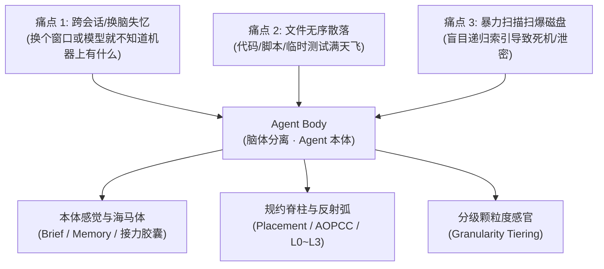
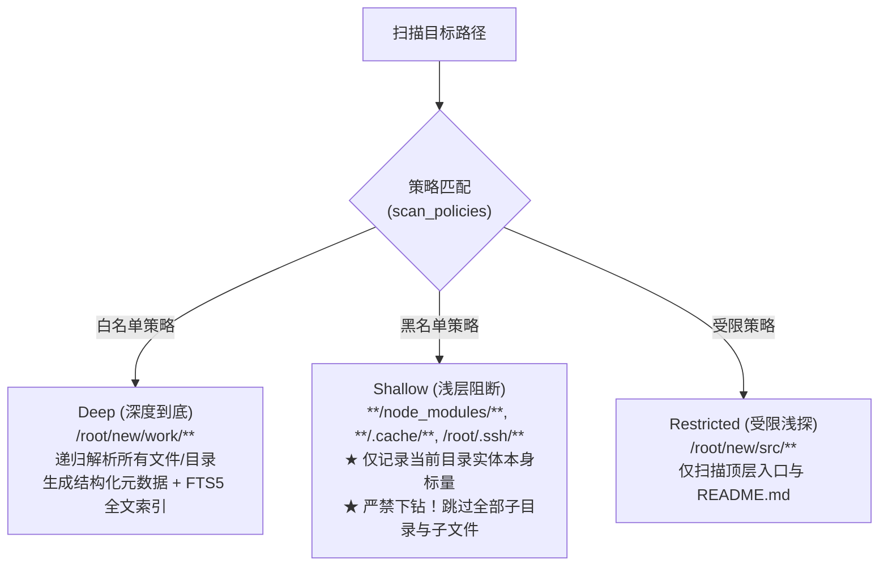

# 02 — 核心理念与设计哲学（Core Concepts）

> **章节目标**: 深入阐述 Agent Body 作为「脑体分离 · Agent 本体（宿主机具身底座）」的底层心智模型（其中外置辅助工具隐喻是其功能侧面），重点掌握白黑名单颗粒度分级、放置建议哲学、跨大脑连续性与动态进程感知法则。

---

## 1. 为什么需要「Agent 本体」（宿主具身底座）？

在本地常驻运行 AI Agent 的工作流中，各类大模型（LLM）只是可热切换的瞬态大脑，开发者和 Agent 在宿主机上面临着三大结构性痛点：

Agent 本体的核心定位：**它不是为了让 Agent 做好某一次任务的调度编排框架，也不是人类私人助理，而是让任意接入的 AI Agent 大脑拥有持久宿主机身体、感知物理全貌与保持跨大脑连续性的具身底座。**

---

## 2. 核心机制一：放置建议法则（Placement Advice）

在过去，Agent 在接到用户“写个脚本排查日志”或“临时起个 demo”的需求时，往往随意在当前目录甚至根目录创建文件，导致宿主机环境迅速劣化。

Agent 本体引入了 **放置建议机制（Placement Engine）**：
- 任何文件和对象产生前，优先向Agent 本体咨询；
- 内置针对工程、脚本、笔记、临时文件、技能等对象的推荐规范路径、命名模式与安全指引：

| 规则名称 | 对象类型 | 推荐基准路径 | 命名建议模式 | 伴随治理要求 |
|---|---|---|---|---|
| `shared_tools` | script / 工具 | `/root/new/shared_proj/` | `{name}/` | 独立子目录，配备 README.md 与入口脚本，禁止硬编码敏感密码 |
| `work_projects` | project / 常规工作 | `/root/new/work/` | `{name}/` | 每个工程独立版本控制，优先采用设计文档闭环验证 |
| `ai_skills` | skill / 智能体技能 | `/root/new/skills/` | `{name}/` | 必须包含标准 SKILL.md，保障被高频调用的稳定性 |
| `open_source_src`| src / 开源浅克隆 | `/root/new/src/` | `{name}/` | 克隆后进入根目录优先使用 `codegraph init` 生成代码地图 |
| `notes_and_lists`| note / 知识笔记 | `/root/new/note/` | `{name}.md` | 好记性不如烂笔头，用于跨周期翻阅沉淀 |
| `temp_files` | tmp / 临时测试 | `/root/new/tmp/` | `{name}` | 明确生命周期，会话完工时通过 `close` 一键自洁回收 |

---

## 3. 核心机制二：白黑名单与分级颗粒度扫描（Granularity Tiering）

传统桌面搜索工具或 RAG 引擎的致命缺陷是“一视同仁”：一旦开启目录扫描，就会盲目递归进 `node_modules`、`.cache`、`.git` 等海量小文件目录，不仅导致磁盘 I/O 飙升，而且会把 SQLite 数据库打爆几百兆甚至几 GB，还极易将 `.ssh` 密钥泄露。

Agent 本体从第一性原理出发，确立了 **三级颗粒度扫描体系**：

- **白名单（Deep）**：对核心工作区与沉淀库，递归扫描到底，提取大小、行数、标签并同步生成 FTS5 全文索引；
- **黑名单（Shallow）**：**敲门但不进屋**。Agent 本体会在资产表中记录“存在一个名为 `node_modules` 的目录”，记录其基本属性，但在文件系统遍历器层面直接调用 `it.skip_current_dir()`，**100% 杜绝解析任何子文件**；
- **受限区（Restricted）**：对浅克隆的庞大开源项目，只建顶层索引，不消耗过多存储。

---

## 4. 核心机制三：动态任务与非守护进程感知（Active Processes）

以往的运维工具（如 `systemctl status`）只能查看通过 systemd 纳管的系统级服务（如 PostgreSQL、Redis）。但 Agent 真正关心的往往是：
- 刚才后台起了一个 Python 训练脚本，还在跑吗？
- 为什么系统 load 突然飙高？是不是某个 cron 被卡死在无限循环了？
- 本地起了一个测试 HTTP 服务，到底监听在哪个端口？

Agent 本体直接深入 Linux 内核 `/proc` 文件系统与 `sysinfo`：
1. **智能过滤底噪**：自动过滤内核工作线程（`kthreadd` 系列）与 systemd 内部调度进程；
2. **提取动态任务元数据**：精准采集由用户或 Agent 会话启动的 Python 脚本、构建 Worker、Ollama 推理服务等；
3. **纳管运行时指标**：记录 PID、完整启动命令、CPU 占用率、物理内存大小、占用端口与启动时间，帮助 Agent 进行排障与资源防撞。

---

## 5. 核心机制四：关联图谱与生命周期自洁

1. **依赖关联（Links Engine）**：
   通过静态语法与文本分析，自动建立代码文件与代码文件、脚本与后台服务之间的依赖连线（如 `app.py` -> `depends_on` -> `postgresql:5432`），并支持一键导出 Mermaid 架构拓扑图；
2. **开工回溯与完工自洁（Changes & Session Close）**：
   - Agent **开工时**：调用 `changes since`，查看上次离线以来宿主机发生的所有新增、删除与修改；
   - Agent **完工时**：调用 `close <session_id>`，自动清理临时测试垃圾，将工单总结自动沉淀为一条长期记忆。

---

## 6. 核心机制五：微内核 (`kernel/`) 与周边 (`contrib/`) 分离及四大发行版

借鉴 PostgreSQL `src/backend/` + `contrib/` 插件体系，项目自 Phase 70~73 起落地了微内核与独立周边分离架构（详述见 [20-plugin-microkernel-architecture-spec.md](../design_doc/20-plugin-microkernel-architecture-spec.md)）：

- **`kernel/` 纯机制微内核**：仅包含 `body-sdk` / `body-protocol` / `body-kernel` 3 个核心 crate（8 张 `body_cat_*` 目录表 + 6 大开放 Routine + 7 大 Lifecycle Hook + `OutOfProcessFdwAdapter` 轨 B 沙盒），严格 0 业务/行业词污染；
- **`contrib/` 独立周边扩展**：9 个遵循标准五件套与 `ext_<id>__*` 前缀隔离的插件模块按需挂载；
- **四大发行版谱系 (`distributions/`)**：在保留个人旗舰全功能版 `agent-body` 100% 向后兼容的同时，独立交付零 C++/DuckDB 依赖的 `agent-body-kernel-minimal`（`3.8M`）、`agent-body-probe`（`6.5M` 政务云 AIOps 探针）与 `agent-body-dba`（`6.1M` 数据库专项哨兵）。
