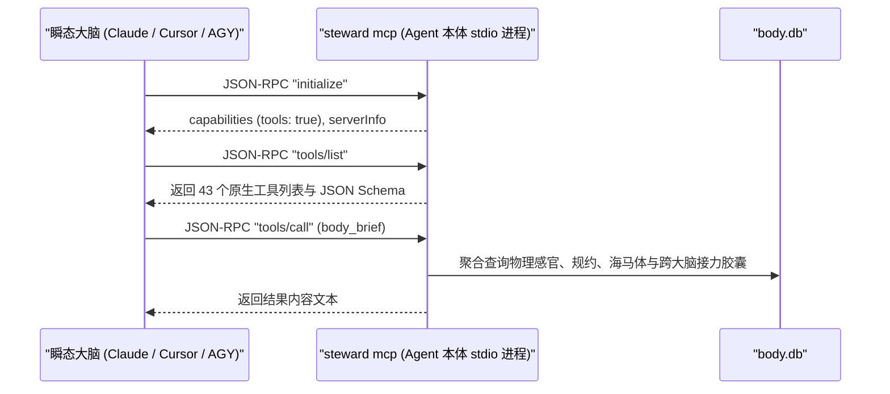

# 04 — Agent 接入与 MCP 协议指南（MCP Integration）

> **章节目标**: 指导 AI Agent 大脑（如 Claude Desktop、Cursor、Antigravity、Codex 等）通过标准 Model Context Protocol (MCP) 原生挂载并接入 **Agent 本体（Agent Body）**。

---

## 1. MCP 协议工作模式

Agent Body 原生内置了轻量级、无依赖的 JSON-RPC 2.0 stdio 服务端。



- **通信方式**: Stdio（标准输入/输出），按换行符（`\n`）分隔 JSON-RPC 报文；
- **启动命令**: `agent-body mcp`；
- **零外部端口依赖**: 不占用本地 TCP 端口，物理级进程隔离，随 Agent 会话启停。

---

## 2. 客户端配置指南

### 2.1 Claude Desktop 配置
在 Claude Desktop 配置文件中（Linux: `~/.config/Claude/claude_desktop_config.json` 或 macOS: `~/Library/Application Support/Claude/claude_desktop_config.json`）添加：

```json
{
  "mcpServers": {
    "agent-body": {
      "command": "/usr/local/bin/agent-body",
      "args": ["mcp"]
    }
  }
}
```

### 2.2 Cursor 配置
在 Cursor Settings -> Features -> MCP Servers 中新增：
- **Name**: `agent-body`
- **Type**: `command`
- **Command**: `/root/new/work/agent-body/target/release/agent-body mcp`

---

## 3. 43 个原生 MCP 工具标准字典

Agent 本体向瞬态大脑暴露 43 个原子级感官、反射、海马体与稳态协同工具：

| MCP 工具名 | 核心功能 | 核心参数说明 |
|---|---|---|
| `body_brief` | 一键获取宿主硬件、活跃任务、资产、记忆简报与 AOPCC 开工乐观直通租约 (`<=120 tok`) | `query`, `session_id`, `budget_tokens` |
| `body_placement_suggest` | 索取新文件/工程的标准存放路径与命名建议 | `object_type`, `name`, `intent`, `security_level` |
| `body_placement_rules` | 查看生效的 8 大目录放置规范 | 无 |
| `body_placement_learn` | 放置规范自演化：聚类挖掘新规则候选与持久化 | `min_samples`, `accept` |
| `body_asset_search` | 全文与语义检索已知纳管资产（支持三级渐进 Token 披露） | `query`, `limit`, `detail_level` (`micro`/`standard`/`full`) |
| `body_asset_register` | 手动注册一个新资产对象 | `path`, `type`, `owner`, `desc` |
| `body_asset_scan` | 触发指定目录白黑名单分级扫描（含 L1 提取与可选 Ollama L2 标注） | `path`, `enrich_with_ollama`, `enrich_limit` |
| `body_env_processes` | 检索当前运行的普通任务进程 (过滤底噪与脱敏 cmdline) | 无 |
| `body_env_show` | 查看系统硬件规格 (CPU/内存/磁盘) | 无 |
| `body_env_gc` | 宿主垃圾回收：安全清理超期临时文件与孤儿进程 | `tmp_dir`, `max_age_hours`, `apply` |
| `body_port_check` | 端口防撞检测与空闲可用端口推荐 | `port`, `suggest_count` |
| `body_memory_add` | 写入一条跨会话长期记忆 | `type`, `content`, `summary` |
| `body_memory_search` | 语义+全文混合 RRF 检索记忆 | `query`, `limit`, `hybrid` |
| `body_memory_audit` | 长期记忆体检：认知矛盾对与衰减淘汰仲裁 | `archive_id` |
| `body_links_query` | 查询实体双向依赖与 `L1/L2/L3` 分层有向加权属性图谱 | `type`, `id`, `max_hops`, `min_weight`, `include_semantic` |
| `body_links_visualize` | 导出当前实体拓扑关系为 Mermaid 架构图 (支持触发 L2/L3 挖掘) | `limit`, `discover_semantic` |
| `body_links_impact` | 变更爆炸半径推演 (加权衰减 BFS，支持 `L1+L2` 基准与可选 `L3` 语义) | `target`, `max_depth`, `min_weight`, `include_semantic` |
| `body_links_audit` | 全局依赖断链审计 (缺失文件/离线端口) | `fix_dangling` |
| `body_links_repair` | 断链智能修复与重定向推演 (生成 patch 或自动应用) | `apply` |
| `body_codegraph_bridge` | CodeGraph 宏微联邦联动与符号调用方下钻 | `path`, `symbol` |
| `body_changes_since` | 查看自指定时间点以来的宿主环境变更历史 | `since`, `limit` |
| `body_session_close` | 会话完工结算与垃圾回收 | `session_id`, `clean_temp` |
| `body_fact_query` | 宿主机客观事实图谱查询 (工具能力/端口/Systemd/Cron/资料) | `query`, `fact_type` |
| `body_hook_pre` | Agent 工作流前置检查钩子 (AOPCC 三态并发路由、端口防撞、协作锁、爆炸半径) | `tool_name`, `args` |
| `body_hook_post` | Agent 工作流后置通知与 AOPCC 自愈钩子 (成功自动建档/刷新拓扑；`success=false` 触发 `<2ms` 碰壁处方注入) | `tool_name`, `args`, `success`, `error_output` |
| `body_hook_generate` | Agent 客户端 Hook 自动生成器 (AGY / Cursor / Claude / Git) | `client`, `out_dir`, `dry_run` |
| `body_lock_acquire` | 获取多 Agent 资源协作互斥锁 (端口/目录/服务/文件) | `resource_type`, `resource_id`, `scope`, `holder_agent`, `ttl_seconds` |
| `body_lock_release` | 释放指定资源协作互斥锁 | `lock_id`, `holder_agent` |
| `body_lock_list` | 列出当前所有活跃的协作互斥锁 | `resource_type` |
| `body_analytics_heatmap` | 宿主变更活跃度热力图与密度聚合分析 (DuckDB) | `days` |
| `body_analytics_trend` | 资产增长趋势与类别分布聚合统计 (DuckDB) | `metric`, `days` |
| `body_analytics_export` | 导出宿主分析数据为 Parquet 列存文件 (DuckDB) | `table`, `output_path` |
| `body_mcp_catalog` | 扫描/列出/路由宿主机已纳管的 MCP Server 与工具摘要 | `action`, `query`, `limit` |
| `body_skill_route` | 扫描 120+ SKILL 目录并按 Token 预算防爆路由推荐 Top-K | `action`, `intent`, `budget_tokens`, `max_skills` |
| `body_service_contact` | 外部可用服务通讯录管理（脱敏登记、查询与健康探活） | `action`, `service_name`, `endpoint`, `auth_env_var` |
| `body_lock_wait` | 排队等待获取协作锁，支持超时与主动唤醒（含死锁拦截） | `resource_type`, `resource_id`, `holder_agent`, `wait_timeout_ms` |
| `body_lock_deadlock_check` | 运行 Wait-For Graph (WFG) 环路检测，诊断多 Agent 死锁 | 无 |
| `body_mesh_query` | `MeshEnvelope v1.0` HMAC 防重放联邦协同：ping/facts/locks/port/acquire/跨机图谱/脱敏对话/<=10MB 沙盒投递 | `action`, `port`, `peer`, `query`, `thread_id`, `intent`, `content`, `file_path`, `transfer_id` |
| `body_demo_scenario` | Web 路演与黑屏同源场景演示引擎（7 大剧目、ROI、43/43 Parity、沙盒重置） | `action`, `scenario_id` |
| `body_benchmark` | 实证 Benchmark v3.7 对照评测（`W1~W17` + `M1~M5` + `DQ1~DQ8` + `COMP-C1~C4`）与生产效能账本（`PR-01~13`） | `action`, `suite`, `track`, `save`, `run_id`, `run_a`, `run_b`, `window`, `tool_filter`, `format`, `limit` |
| `body_feedback` | 使用反馈总账 (`user_feedback.md`) 读写沉淀、`reconcile` 信息新鲜度对账与 `P1~P5` 自进化对比探针 | `action`, `category`, `priority`, `title`, `evidence`, `target`, `auto_heal`, `auto_feedback` |
| `body_audit_query` | 双域全链路行为审计 (`IN_AGENT` + `OUT_OF_AGENT`)、因果钻取、DuckDB OLAP 导出与租约滑窗自进化 | `action`, `domain`, `actor_kind`, `category`, `outcome`, `trace_id`, `window`, `auto_feedback`, `output_path` |
| `body_state` | Agent 本体中枢：六器官自省 (`manifest`)、五维稳态 (`vitals`)、四级包络 (`envelope`)、跨大脑接力 (`handoff_save`/`handoff_resume`)、`L1` 自愈 (`heal`)、多本体名片发现 (`peers`) 以及内生等待事件与 AWR 性能快照/差分诊断/L1 自调优 (`perf_snapshot`/`perf_awr`/`perf_tune`) | `action`, `from_brain`, `session_id`, `goal_summary`, `active_files`, `verified_facts`, `open_blockers`, `next_step_hint`, `checkpoint_id`, `check_action`, `target`, `dry_run`, `label`, `set_baseline`, `snap_a`, `snap_b`, `vs_baseline` |

---

## 4. MCP Stdio 通信协议报文示例

### (1) 初始化握手 (`initialize`)
**请求**:
```json
{"jsonrpc":"2.0","id":1,"method":"initialize","params":{"protocolVersion":"2024-11-05","capabilities":{},"clientInfo":{"name":"antigravity","version":"1.0"}}}
```
**响应**:
```json
{"jsonrpc":"2.0","id":1,"result":{"protocolVersion":"2024-11-05","capabilities":{"tools":{}},"serverInfo":{"name":"agent-body","version":"0.4.0"}}}
```

### (2) 工具调用 (`tools/call`) — 放置建议
**请求**:
```json
{
  "jsonrpc": "2.0",
  "id": 2,
  "method": "tools/call",
  "params": {
    "name": "body_placement_suggest",
    "arguments": {
      "type": "script",
      "name": "sec_fetcher",
      "intent": "抓取上市公司财报"
    }
  }
}
```
**响应**:
```json
{
  "jsonrpc": "2.0",
  "id": 2,
  "result": {
    "content": [
      {
        "type": "text",
        "text": "╔═══════════════════════════════════════════════════════╗\n║             Steward 对象放置与路径建议                ║\n╚═══════════════════════════════════════════════════════╝\n推荐目标路径:   \"/root/new/shared_proj/sec_fetcher/\"\n命中规范规则:   shared_tools\n..."
      }
    ]
  }
}
```

### (3) 工具调用 (`tools/call`) — 运行实证 Benchmark 与审计账本 (`body_benchmark`)
支持 `action`: `"workloads" | "run" | "report" | "ledger" | "compare" | "export" | "reset" | "competitors"`（默认为 `"report"`）。

**请求（真机跑批全量套件 v3.5）**:
```json
{
  "jsonrpc": "2.0",
  "id": 3,
  "method": "tools/call",
  "params": {
    "name": "body_benchmark",
    "arguments": {
      "action": "run",
      "suite": "full",
      "save": true
    }
  }
}
```

**请求（审计过去 7 天生产效能存证账本）**:
```json
{
  "jsonrpc": "2.0",
  "id": 4,
  "method": "tools/call",
  "params": {
    "name": "body_benchmark",
    "arguments": {
      "action": "ledger",
      "window": "7d",
      "limit": 20
    }
  }
}
```

### (4) 工具调用 (`tools/call`) — 五点对比探针与新鲜度对账 (`body_feedback`)
支持 `action`: `"list" | "add" | "sync" | "reconcile" | "probes"`（默认为 `"list"`）。

```json
{
  "jsonrpc": "2.0",
  "id": 5,
  "method": "tools/call",
  "params": {
    "name": "body_feedback",
    "arguments": {
      "action": "probes",
      "auto_heal": true,
      "auto_feedback": false
    }
  }
}
```
