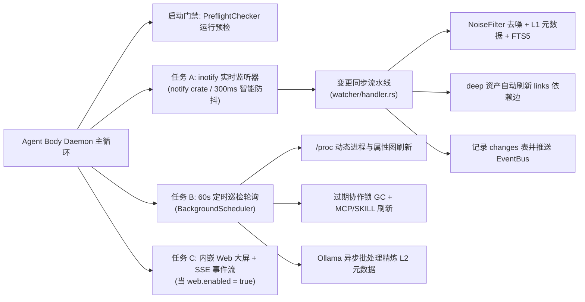

# 05 — 守护进程与 inotify 实时监听（Daemon & Watcher）

> **章节目标**: 掌握Agent 本体常驻守护进程工作机制，理解 Linux inotify 异步文件监听、300ms 智能防抖流水线，以及如何配置 systemd 实现无人值守开机自启。

---

## 1. 守护进程主循环架构

Agent 本体支持常驻后台运行（`agent-body daemon`）。守护进程采用 Tokio 异步运行时，驱动两大核心任务：



---

## 2. inotify 文件监听与 300ms 智能防抖

### 2.1 为什么需要防抖？
当 Agent 或编辑器保存一个文件时，操作系统底层通常会密集连续触发多个底层事件（如：创建临时文件 -> 写入字节 -> 重命名替换原文件 -> 修改属性 -> 关闭句柄）。若对每个事件均触发一次数据库写入，将造成严重的 SQLite 锁竞争与 CPU 浪涌。

### 2.2 防抖策略
Agent 本体在 `src/watcher/mod.rs` 中实现了 **300 毫秒批处理防抖队列**：
1. 捕获到文件创建/修改/删除事件后，暂存入内存通道；
2. 聚合 300ms 窗口内的同路径变动；
3. 将最终稳定态分发给 `src/watcher/handler.rs`：
   - **新增/修改文件**：先经 `PolicyMatcher`（黑名单目录仅记目录本身，子文件直接跳过）与 `NoiseFilter` 去噪；再通过 `HeuristicMetadataExtractor` 生成 L1 语义元数据、更新 `assets` 与 FTS5；若内容哈希/尺寸变化，执行写穿失效（将旧向量重置为 `'[]'` 并标 `embedding_status="stale"`、旧 L2 标注标为 `"needs_re_enrich"`）；若属于 `deep` 白名单目录，同步触发 `LinksEngine::refresh_links_for_asset` 幂等刷新依赖边，并记录 `changes` 与推送 `EventBus`；
   - **删除文件**：将 `assets` 对应记录置为 `missing`（`search_assets_fts` 三后端强制仅召回 `status = 'active'` 零僵尸返回），级联清理 `fact_nodes`、`links` 入出边（`delete_auto_links_for_source` & `delete_links_for_target`）与同路径关联 `auto_sync` 记忆，记录 `file_deleted` 并推送 `EventBus`。
4. **后台巡检协同（`src/daemon/scheduler.rs`）**：每 60 秒执行一次 `run_inspection_cycle`，自动刷新 `/proc` 动态进程、构建多层属性图（含 `L2` 结构上卷与 `L3` 语义发现）、审计记忆冲突、推进断点扫描任务、回收过期协作锁、刷新 MCP/SKILL 生态目录，每 30 分钟运行 `FreshnessReconciler::reconcile` 核对磁盘存在性/剪除幽灵端口节点/检验 `.codegraph` 时效，并按 `annotation.auto_enrich_batch_size` 调用本地 Ollama（`qwen3.5:0.8b`）异步精炼待标注资产的 L2 语义元数据。

---

## 3. 手动启动与调试

在终端前台运行守护进程（按 `Ctrl+C` 触发 SIGINT 优雅退出）：

```bash
agent-body daemon
```

**启动输出示例（对齐 `src/daemon/mod.rs`）**:
```text
╔═══════════════════════════════════════════════════════╗
║      Agent Body Daemon 已在后台启动运行       ║
╚═══════════════════════════════════════════════════════╝
数据目录:       "/root/.agent-body"
数据库路径:     "/root/.agent-body/body.db"
实时监听目录:   ["/root/new/work", "/root/new/shared_proj"]
✅ inotify 文件系统实时监听就绪 (300ms 防抖)
```

---

## 4. systemd 开机自启服务配置

对于生产开发机，推荐将Agent 本体配置为 systemd 用户服务或系统服务：

### 4.1 创建 service 单元文件
创建 `/etc/systemd/system/agent-body.service`：

```ini
[Unit]
Description=Agent Body Daemon Service
Documentation=https://github.com/digoal/agent-body
After=network.target

[Service]
Type=simple
User=root
WorkingDirectory=/root/new/work/agent-body
ExecStart=/usr/local/bin/agent-body daemon
Restart=always
RestartSec=5
StandardOutput=journal
StandardError=journal
LimitNOFILE=65536

[Install]
WantedBy=multi-user.target
```

### 4.2 启动与开机自启
```bash
# 重新加载 systemd 配置
systemctl daemon-reload

# 启动Agent 本体守护服务
systemctl start agent-body

# 检查服务运行状态
systemctl status agent-body

# 设置开机自动启动
systemctl enable agent-body
```

---

## 5. macOS LaunchAgent 常驻守护与 Web UI 2.0 (Phase 64 · `v1.1.0`)

在 macOS 上可通过用户级 `LaunchAgent` 托管 `agent-body daemon`（同时拉起内嵌 Web UI `http://127.0.0.1:8765`）：

```xml
<!-- ~/Library/LaunchAgents/com.digoal.agent-body.plist -->
<key>Label</key><string>com.digoal.agent-body</string>
<key>ProgramArguments</key>
<array>
  <string>/Users/<your_user>/.local/bin/agent-body</string>
  <string>daemon</string>
</array>
<key>RunAtLoad</key><true/>
<key>KeepAlive</key><true/>
```

```bash
launchctl bootstrap gui/$(id -u) ~/Library/LaunchAgents/com.digoal.agent-body.plist
launchctl kickstart -k gui/$(id -u)/com.digoal.agent-body
```
