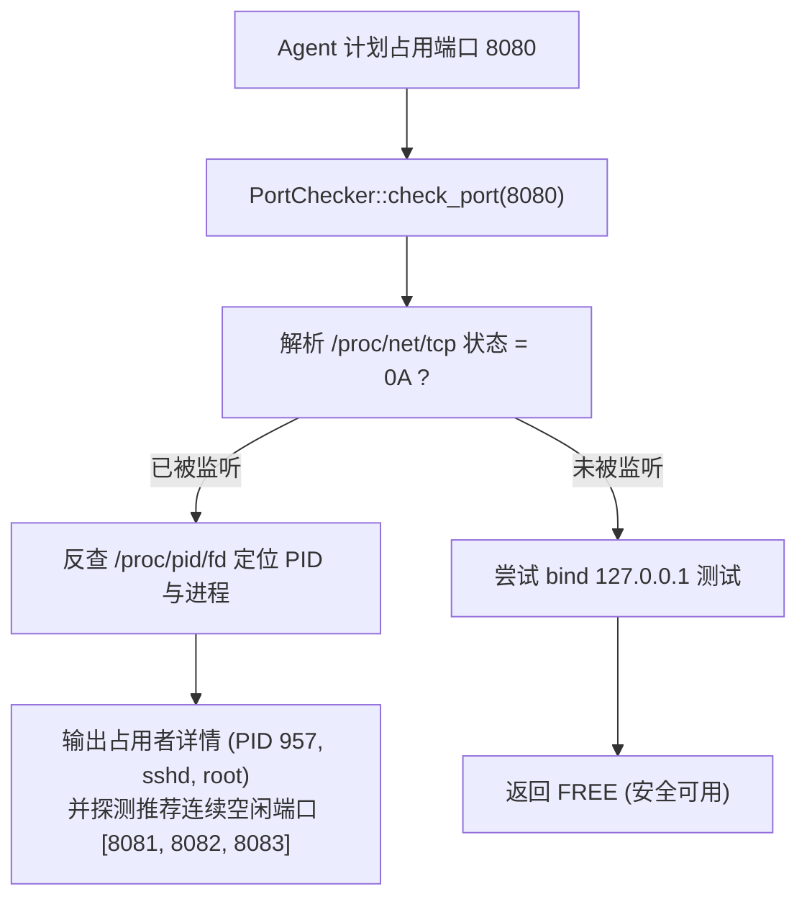

# 06 — 进阶特性指南（Advanced Features）

> **章节目标**: 详细介绍 Agent Body (`v1.1.0`) 的核心进阶能力：端口防撞预警、变更爆炸半径推演、全信号 Omni-RRF 与知识网络检索、三态运行模式与 Shadow A/B 证伪自愈、纯 Rust 多模态 L1A (`schema_version=2.0`)、会话自洁、CodeGraph 联邦、WFG 死锁检测、跨机联邦 Mesh、内生 Wait Events/AWR 与可移植配置（`AGENT_BODY_CONFIG` / `[workspace]`）。

---

## 1. 端口防撞预警与空闲推荐（Port Conflict Guard）

### 1.1 痛点
在单台宿主机上，常驻着数据库、缓存、推理模型以及各种定时任务。Agent 在接手临时任务（如“写个可视化看板”）时，一旦随机挑了个常见端口（如 8080 或 5432）并强行 bind，将造成线上服务崩溃或进程起不来的混乱。

### 1.2 原理与机制
Agent 本体深度解析 Linux 内核 `/proc/net/tcp` 与 `/proc/[pid]/fd`：
1. 毫秒级探测端口是否处于 `TCP_LISTEN` 状态；
2. 反查持有该 socket 的进程 PID、可执行文件名、完整启动命令行与所属 UID 用户；
3. 若冲突，自动执行可用端口探测，返回后续连续空闲的推荐端口列表。



### 1.3 使用方式
- **CLI**: `agent-body env port <PORT>`
- **MCP**: `body_port_check(port, suggest_count)`

---

## 2. 变更爆炸半径推演（Blast Radius Analysis）

### 2.1 痛点
修改或重命名公共基础库（如 `/root/new/shared_proj/common_utils.py`）时，Agent 往往盲目直接修改，导致依赖它的定时任务或后台服务在夜间执行时大面积报 `ImportError` 崩溃。

### 2.2 原理与机制
基于 SQLite `links` 依赖图谱，执行 **广度优先搜索 (BFS) 逆向多跳推演**：
- 输入拟改动或删除的资产路径；
- 递归计算有多少上游应用、测试脚本或 cron 任务 `depends_on` 或 `references` 该资产；
- 根据依赖总数和资产是否属于核心目录（`shared_proj/`），评估输出综合风险等级：
  - `LOW`: 0 个依赖；
  - `MEDIUM`: 1~2 个普通依赖；
  - `HIGH`: >= 3 个依赖或属于核心库且有依赖；
  - `CRITICAL`: >= 5 个依赖或核心库受到多个应用强依赖。

### 2.3 使用方式
- **CLI**: `agent-body links impact <TARGET>`
- **MCP**: `body_links_impact(target, max_depth)`

---

## 3. 语义与全文混合检索（Hybrid RRF Search）

### 3.1 痛点
传统的 SQLite FTS5 全文搜索依赖关键词的字面精确匹配。当用户使用口语表述（例如“看看以前做过什么容灾预案”）而数据库中记录的是“PostgreSQL 连接池故障应急方案”时，单纯的全文搜索召回为 0 条。

### 3.2 原理与机制
Agent 本体无缝融合了本地部署的 Ollama（推荐 `bge-m3:latest` 1024 维模型）：
1. **关键词通道**: FTS5 全文索引，负责精准命中专业术语；
2. **向量语义通道**: 异步计算 Query 向量，基于余弦相似度计算前 500 条记忆的语义距离；
3. **RRF 融合重排 (Reciprocal Rank Fusion)**:
   $$RRF\_score = \frac{1}{60 + rank_{fts}} + \frac{1}{60 + rank_{vec}}$$
4. **全自动优雅降级**: 若本地 Ollama 服务未启动或网络超时，Agent 本体自动无感知降级为纯 FTS5 检索，系统 100% 不报错。

### 3.3 使用方式
- **CLI**: `agent-body memory search "容灾预案" --hybrid`
- **MCP**: `body_memory_search(query, limit, hybrid=true)`

---

## 4. 会话完工结算与环境治理（Session Close）

### 4.1 痛点
长任务会话结束后，Agent 往往在 `/root/new/tmp/` 产生大量测试碎片脚本，缺乏总结，下一次会话进来时环境杂乱。

### 4.2 原理与机制
在工单结束时调用 `close`：
1. **垃圾回收**: 自动扫描 `/root/new/tmp/` 下属于该会话 ID 或带有 `test_`/`tmp_` 标记的过期文件，安全删除并统计释放空间；
2. **工单纪要沉淀**: 提取该会话期间触发的 `changes` 审计流水线，自动格式化为标准 Markdown 总结，并沉淀入库为一条长期记忆。

### 4.3 使用方式
- **CLI**: `agent-body close <SESSION_ID>`
- **MCP**: `body_session_close(session_id, clean_temp=true)`

---

## 5. 宿主图智能与 CodeGraph 宏微联邦联动 (Graph Intelligence & CodeGraph Federation)

### 5.1 痛点与背景
在过去，实体图关联存在两大痛点：
1. **只知依赖、不知出处**：系统提示“A 依赖 B”，但不知道在 A 的哪一行、调用了什么代码；
2. **宏观微观割裂**：Agent 本体停留在“文件与服务”级，而代码仓库内可能已有 `codegraph` 建立的“AST 符号级”代码图，两者无法联动下钻。

### 5.2 原理与机制
Agent 本体吸收 CodeGraph 的图谱模型设计：
1. **出处强化（Provenance & Snippet）**:
   - `links` 表扩展记录行号 `line_number`、截取代码 `snippet` 以及发现来源 `provenance`（`ast_import` / `path_regex` / `port_detect`）。
2. **断链体检与自愈 (`agent-body links audit`)**:
   - 定期或手动扫描全局拓扑，排查“目标文件已被物理删除”或“依赖的端口未监听”等坏死依赖，计算健康分，并支持 `--fix` 自动剔除死链。
3. **CodeGraph 宏微双层联邦 (`CodeGraphBridge`)**:
   - 自动向上溯源探测目标路径所在工程是否包含 `.codegraph/codegraph.db`；
   - 支持跨层下钻：直连代码图 SQLite，毫秒级查询特定函数或类的全部调用方（Callers）与定义位置。

### 5.3 使用方式
- **CLI**:
  ```bash
  agent-body links audit [--fix]
  agent-body links codegraph <PATH> [SYMBOL]
  ```
- **MCP**:
  - `body_links_audit(fix_dangling=false)`
  - `body_codegraph_bridge(path, symbol)`

---

## 6. 三层正交元数据与 Ollama 异步双轨标注 (Phase 23)
- **三层正交 Key 体系**：
  - **L0 管线溯源**：`content_hash`、`annotation_status`、`annotation_model`，保证幂等跳过未变更文件；
  - **L1 确定性提取**：Rust 毫秒级静态解析 `purpose`、`domain`、`capabilities`、`entry_point`、`usage_hint`，不依赖外部模型；
  - **L2 本地小模型精炼**：经 `SecretRedactor` 脱敏后送入本地 Ollama `qwen3.5:0.8b` 异步精炼，零云端 Token 消耗；
- **三级渐进披露**：`body_asset_search` 支持 `detail_level = "micro" | "standard" | "full"`，按任务需要控制 Token 注入体积。

---

## 7. 多 Agent 协作锁与 WFG 死锁检测 (Phase 17)
- 支持针对 `port`、`directory`、`service`、`file` 等资源申请排他/共享锁（`body_lock_acquire`），并具备目录祖先-后代路径递归互斥检测；
- 提供主动排队唤醒（`body_lock_wait`）与 **Wait-For Graph (WFG)** 全局环路检测（`body_lock_deadlock_check`），当双 Agent 交叉等锁时毫秒级识别死锁环并阻断。

---

## 8. 轻量多机联邦 Peer Mesh (`MeshEnvelope v1.0`) 与跨机协同 (Phase 18 & 41)
- **Peer Mesh (`body_mesh_query`)**：基于 **`MeshEnvelope v1.0`** 线协议（`HMAC-SHA256` 规范签名、`+-300s` 时间窗与 `NonceCache` 防重放、`Peer Scopes` 最小权限），支持跨节点只读查询 facts/locks/端口、跨机图谱联邦探查（`graph`）、双向脱敏抗投毒结构化对话（`dialogue_send` / `dialogue_inbox` / `dialogue_ack`）与限额 `<= 10MB` + SHA-256 校验的 `~/.agent-body/mesh_inbox/` 隔离沙盒文件投递（`transfer_send` / `transfer_inbox` / `transfer_accept` / `transfer_reject`）。

---

## 9. 多维证据分层有向加权图谱 (Phase 40)
- **三层证据本体**：`fact_edges` 显式区分 **`L1_EXPLICIT`**（物理硬依赖，`0.85~1.00`）、**`L2_STRUCTURAL`**（文件级 `links` 上卷项目边、Systemd/运行服务同体桥接与工具提取，`0.55~0.84`）与 **`L3_SEMANTIC`**（向量余弦 $\ge 0.78$ + 标签混合发现，`0.35~0.65`，每节点 `Top-K <= 3` 稀疏剪枝）；
- **加权衰减爆炸半径**：`body_links_impact` 按跳数衰减系数 `0.8^(hop-1)` 计算有效传播强度，默认以 `L1+L2` 为强影响基准，按需开启 `--include-semantic` 探索跨项目隐式关联。

---

## 10. 全生命周期信息新鲜度、五点对比探针与 AOPCC 自适应并发 (Phase 38~39 & 42)
- **写穿失效与现实对账 (`FreshnessReconciler`)**：内容变化立即重置旧向量为 `stale`，文件删除级联净化 FTS/图谱/记忆，并通过 `agent-body feedback reconcile`（及守护进程 30 分钟周期）核销幽灵端口节点、归档同路径重复 `auto_sync` 记忆与检测 `.codegraph` 滞后；
- **五点对比探针 (`agent-body feedback probes`)**：在 `P1 开工 Brief` / `P2 事前 Pre-Hook` / `P3 检索效用` / `P4 事后漂移` / `P5 周期回归` 以物理真值量化 Before/After/Delta 差值并自动自愈或去重写入 `user_feedback.md`；
- **AOPCC 悲观-乐观自适应并发控制**：`body_brief` 在开工时签发 `<= 120 tok` 乐观直通租约（如本机 `:5432` PostgreSQL、已装 CLI、`<temp_dir>`）；高危端口绑定与共享资源写维持悲观前置拦截；若乐观直连碰壁失败，`body_hook_post(success=false)` 在 `< 2ms` 内注入宿主机替代处方并自适应降级租约；
- **内生 Wait Events、`/proc/self` 与 AWR/ADDM 自调优**：覆盖 6 大类 `18/18` 标准等待事件、AWR 快照黄金基线差分与 `L1_AUTONOMIC` 一键自调优（`perf-snapshot`/`perf-awr`/`perf-tune`/`perf-delete`）；
- **实证 Benchmark 与存证账本 (`v4.1`)**：关于 A/B 对照负载（`W1`~`W22`）、内核微基准 SLA（`M1`~`M6`）、质量与 Shadow A/B/睡眠整理/快权重血缘门禁（`DQ1`~`DQ12`）、竞品对标（`COMP-C1`~`C4`）及 `PR-01`~`PR-16` 生产效能存证流水，请直接阅读专题章节 [10-benchmark-and-roi.md](10-benchmark-and-roi.md)。
- **三态运行模式、纯 Rust 多模态 L1A (`schema_version=2.0`) 与全信号 Omni-RRF 知识网络 (Phase 58~63)**：支持 `bypass`/`shadow_ab`/`body_only` 三态动态切换与 `H1~H5` Shadow A/B 自主自愈、MCP `core`/`dev`/`ops`/`full` Schema 减税档位、纯 Rust 多模态解析与 `asset_chunk` 分块，以及 BM25 + Fuzzy + Semantic + 属性图 + 层级 + `links` + 标量调制的 7 路 Omni-RRF 召回。
- **原生 PreToolUse Token 守卫 (`[runtime].token_guard_*`, Phase 80)**：无需额外第三方 MCP，原生支持在 `[runtime]` 配置 `token_guard_enabled`（默认 `true`）、`token_guard_max_full_read_bytes`（默认 `36864`）、`token_guard_max_full_read_lines`（默认 `600`）、`token_guard_auto_slice_lines`（默认 `250`）与 `token_guard_search_max_lines`（默认 `180`），并可通过 `AGENT_BODY_TOKEN_GUARD=0`（或 `AGY_TOKEN_OPTIMIZER=0`）环境变量一键旁路。

---

## 11. PostgreSQL 事务级海马体、睡眠整理与旁路快权重 (`pg_tx` / Phase 76~78)
- **定位与隔离**：由独立五件套扩展 `contrib/mem_pg_tx/` 与旗舰 `PgTxMemoryAdapter` 提供（完整规格见 [22-pg-tx-memory-spi-a-to-b-spec.md](../design_doc/22-pg-tx-memory-spi-a-to-b-spec.md)），彻底解决多 Agent 并发写丢写、更新写放大与删除僵尸向量召回，同时在 PG 不可达时默认自动透明降级至本地 SQLite 并记入 `OUT_OF_AGENT` 审计；M3（Phase 78）通过 `FastWeightCheckpointSpi` + JSON-RPC 2.0 旁路控制面外挂外部快权重与定向遗忘（本体零权重、零训练代码）。
- **启用配置 (`~/.agent-body/config.toml`)**：
  ```toml
  [memory]
  provider = "pg_tx"
  pg_url = "host=127.0.0.1 port=5432 user=postgres dbname=agent_body_mem"
  pg_pool_size = 8
  pg_tenant_scope = "default"
  vector_backend = "none"         # 可选: none | pgvector | pg_vectorsearch | external_lsm
  fallback_to_sqlite = true       # PG 不可达时自动无损降级 SQLite
  fast_weight_enabled = false
  fast_weight_runtime_url = ""    # 外部 In-Place TTT / Atlas / SCoL JSON-RPC 服务地址
  ```
- **三端一致操作（43 工具零膨胀）**：
  - 写入双时态逻辑键与 CAS 校验：`agent-body memory add -c "主库迁移至 5433" --fact-key "deploy:pg_port" --evidence-tier L1_EXPLICIT --expected-epoch 12`（`body_memory_add`）；
  - 双时态时间旅行检索：`agent-body memory search "5432" --as-of-epoch 12 --include-history`（`body_memory_search`）；
  - 健康巡检、墓碑清除与 M2 空闲期睡眠整理：`agent-body memory audit --tx-status` / `agent-body memory audit --tombstone-fact "deploy:pg_port"` / `agent-body memory audit --sleep-action run --force`（`body_memory_audit`；高熵探索型查询自动触发 `QueryPredictabilityGate` 旁路直查原始活跃事件，每次整理经 `SecretRedactor` 脱敏并以 `OUT_OF_AGENT` 写入 `audit_events`）；
  - M3 旁路快权重血缘、三门禁切换与秒级回滚：`agent-body memory audit --fast-weight-action lineage` / `compact --base-model-id qwen3-8b` / `unlearn` / `rollback --target-epoch 12`，并在 `body handoff`/`resume --base-model-id` 中支持 `ContinuityCapsule v2` 同基座热挂载与异构回退。
