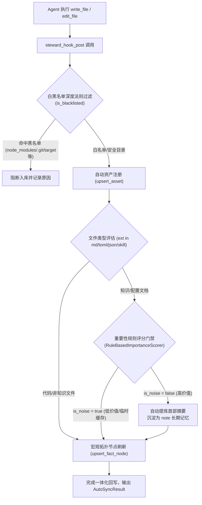
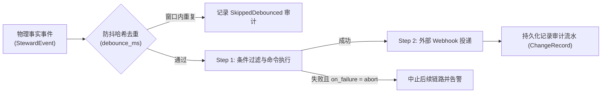

# docs/manual/09-hooks-integration.md — Agent Host Steward HOOK 机制与自动化接入指南

> **版本**: v0.4.0 (Phase 14)  
> **适用对象**: 所有接入 Agent Host Steward 的智能体框架、定时脚本与宿主运维体系

---

## 一、为什么需要 HOOK 驱动接入？

传统模式下，Agent 必须**主观记得**在行动前调用 `steward_port_check` 或行动后调用 `steward_memory_add`。
这种被动 MCP 调用的主要弊端：
1. **模型遗忘与幻觉**：长对话或高负载下，模型经常忘记调用辅助工具；
2. **缺乏原子保障**：文件产出后如果没有手动注册，宿主机资产索引就会脱节；
3. **协同成本高**：每个会话都需要注入繁琐的 Prompt 提示。

**HOOK 模式（Phase 42 已升级 AOPCC 悲观-乐观自适应并发控制）**将大管家能力深度内嵌进宿主与会话执行回路：
- **开工阶段（SessionStart / `steward_brief`）**：签发 MVCC **乐观直通契约 (`Optimistic Leases`)**（`<= 120 tok`），允许高置信可逆操作（如本机 `psql -p 5432`、`/root/new/tmp/` 沙盒与已装 CLI）免除回路前置查询税；
- **执行前（Pre-Hook）**：通过 `ConcurrencyPolicyClassifier` 划分 `OPTIMISTIC` / `CAUTIOUS_CAS` / `PESSIMISTIC_LOCK`，对端口 `bind`、高危系统路径、破坏性命令与多 Agent 锁冲突执行强制悲观前置排查，并对乐观客户端动作零阻塞放行；
- **执行后（Post-Hook）**：成功写操作自动登记资产索引与拓扑；当乐观执行报错（`Connection refused` / `password authentication failed` / `command not found` / `Address already in use`）时，`OptimisticFailureDiagnoser` 在 `< 2 ms` 内反查宿主机真实端口/工具/服务并注入自愈处方，同时触发对应乐观租约置信度降级；
- **守护端（EventBus）**：inotify 与内核态变更事件由异步总线快速广播（延迟 < 1ms），按规则触发外部脚本或 Webhook。

---

## 二、事件总线与规则配置 (`config.toml`)

在 `~/.steward/config.toml` 中配置 `[[hooks]]`：

```toml
# 示例 1: 本地脚本响应
[[hooks]]
event = "on_file_created"
filter = { path_prefix = "/root/new/work", extensions = [".md"] }
action = "exec"
command = "agent-steward asset scan {path} --depth 1"

# 示例 2: 外部 Webhook 推送
[[hooks]]
event = "on_memory_added"
filter = { tags_contain = ["decision", "architecture"] }
action = "webhook"
url = "http://127.0.0.1:8765/api/v1/notify"
timeout_ms = 3000
```

### 支持事件列表
| 事件标识 | 触发时机 | 典型载荷字段 |
|---|---|---|
| `on_file_created` | inotify / Agent 产出新物理文件 | `path`, `source`, `timestamp` |
| `on_file_modified` | 物理文件被修改 | `path`, `source`, `timestamp` |
| `on_file_deleted` | 物理文件被删除 | `path`, `source`, `timestamp` |
| `on_asset_registered` | 资产成功建档登记 | `path`, `object_type`, `owner` |
| `on_memory_added` | 长期记忆写入成功 | `memory_id`, `memory_type`, `tags` |
| `on_lock_acquired` | 协作锁成功持有 | `resource_type`, `resource_id`, `holder_agent` |
| `on_lock_released` | 协作锁释放或失效 | `resource_type`, `resource_id` |

---

## 四、Post-Hook 全自动回写引擎 (AutoSyncEngine)

当 Agent 通过 `write_file` / `edit_file` 或相关工具产出物理文件后，`AutoSyncEngine` 在后置链路执行一体化原子回写：



### 核心特性
1. **0 LLM 开销的摘要提取**：严格遵守设计规约 #2，不调用外部大模型做文本摘要，纯粹通过高效的首行结构化切分提炼关键信息；
2. **多层入库门禁**：结合 `RuleBasedImportanceScorer`（规约 #4），拦截缓存、构建产物等底噪干扰；
3. **宏观拓扑自动建链**：产出文件即时建立 `FactNodeRecord`（类型为 `file`），自动融入全局属性图；
4. **全链路零 Panic**：依据规约 #12，存储或分词异常均受防护并返回安全结果，不影响宿主调用主链路。

---

## 五、Agent 客户端 Hook 自动生成器 (`hooks generate`)

为了让各种主流 Agent 客户端快速接入大管家协同体系，agent-steward 提供了客户端 Hook 生成器：

### 1. CLI 命令行生成
```bash
# 生成 Antigravity 规约 (默认预览 Dry-Run)
agent-steward hooks generate --client agy --dry-run

# 直接落地到当前工作区
agent-steward hooks generate --client agy --out-dir .

# 为 Git 仓库生成 post-commit 钩子 (自动赋予 0o755 可执行权限)
agent-steward hooks generate --client git --out-dir .

# 生成 Cursor 规则文件 (.cursorrules)
agent-steward hooks generate --client cursor --out-dir .

# 生成 Claude Code 规范文件 (CLAUDE.md)
agent-steward hooks generate --client claude --out-dir .
```

### 2. MCP 自动化接入 (`steward_hook_generate`)
在 Agent 首次连接到宿主机时，可通过 MCP 工具一键自举规则：
```json
{
  "name": "steward_hook_generate",
  "arguments": {
    "client": "agy",
    "out_dir": "/root/new/work/my-project",
    "dry_run": false
  }
}
```

---

## 六、Session 生命周期自动绑定 (Session Lifecycle)

Agent 会话在执行过程中会自动完成生命周期托管：

1. **自动注册心跳 (`touch_session`)**：
   - Agent 首次调用 Pre/Post Hook 时自动建立会话状态；
   - 记录会话创建时间、工具调用次数与产出资产列表 (`artifacts_produced`)。
2. **超时自动归档结清 (`check_timeout_sessions`)**：
   - 默认 30 分钟无交互的冷会话将触发自动结清；
   - **规约 #8 严格约束**：自动回收触发的临时文件清理默认强制以 `dry-run` 模式运行，生成待清理列表，严禁盲目删除文件；
   - 自动聚合本次会话的变更日志并沉淀到长期记忆。

---

## 七、Webhook / SSE / Unix Socket 主动推送通道

大管家提供三种低延迟主动通知通道，实现宿主与外部监控体系的实时联动：

1. **SSE 实时事件流 (`/api/v1/stream`)**：
   - Web 客户端与外部仪表盘可直接订阅；
   - 包含每 15 秒保活 Ping 与事件自动推流。
2. **HTTP Webhook (`WebhookPusher`)**：
   - 符合规约 #1 的 `StewardResponse<T>` 统一封套；
   - 支持指数退避重试（重试 3 次，间隔 100ms, 200ms, 400ms）。
3. **本地 Unix Domain Socket (`UdsBroadcaster`)**：
   - 面向本地高性能进程，广播延迟 < 0.1ms，轻量零拷贝。

---

## 八、Hook Pipeline 链式编排引擎 (`HookPipelineEngine`)

针对复杂的自动化工作流，大管家支持声明式 Pipeline 编排：



### 核心特性
1. **多级步骤串联**：支持顺序执行多步骤动作（本地脚本执行与远程通知）；
2. **可配置失败策略**：`abort`（立即中止后续执行）与 `continue`（容错继续）；
3. **基于事件哈希的防抖去重**：防止高频文件保存触发惊群雪崩；
4. **全链路持久化审计流水**：自动通过 `ChangeRecord` 记录入库，并同步至 DuckDB 分析池。

---

## 九、白黑名单与物理真实安全准则

1. **零捏造原则**：事件总线仅发射物理存在的客观事件；
2. **白黑名单深度法则**：黑名单目录（如 `node_modules`、`.git`、`target`）内的文件变化会被 HookDispatcher 自动阻断，绝不下发外部动作；
3. **非阻塞异步机制**：所有总线广播与钩子分发均在独立 Tokio 任务中异步运行，保障毫秒级系统开销。
