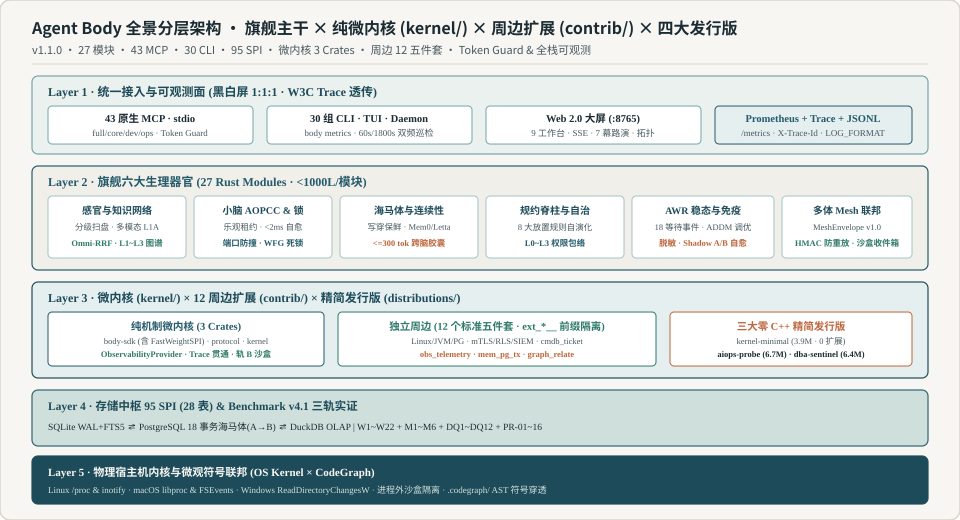
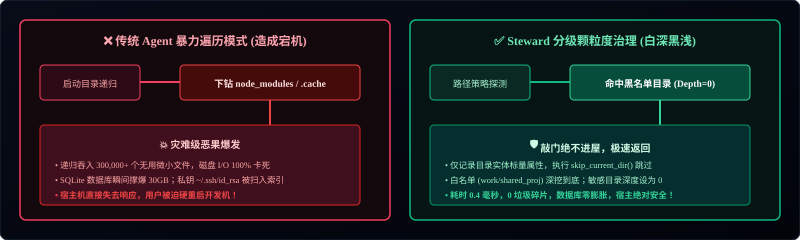
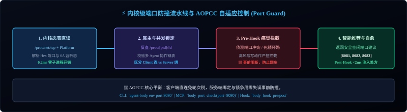
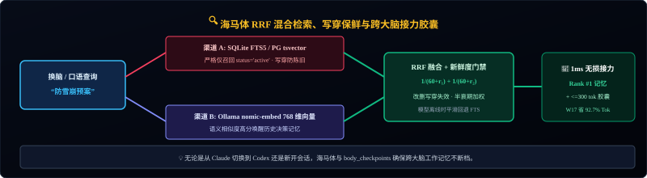

# 为什么你的 AI Agent 总是“换脑失忆”还搞垮开发机？我们用 Rust 打造了「脑体分离」的 Agent 本体底座

> **作者**: digoal德哥  
> **项目开源地址**: `https://github.com/digoal/agent-body`  
> **发布版本**: `v1.0.0 GA` · **核心定位**: 脑体分离 · Agent 本体（驻留在宿主机上的轻量级具身底座）

---

## 引言：越聪明、越自主的 Agent，为什么越容易“翻车”？

随着 Claude Code、Codex、Cursor、Antigravity 等终端与编码助手走向普及，大模型正在从“对话窗口”演进为“拥有宿主机 Shell 权限的数字员工”。然而，在开发机与生产服务器上放开权限后，一线工程师最常遇到五大结构性尴尬：

- **痛点一：暴力盲扫，磁盘吞入 30 万个小文件卡死**  
  Agent 起手就是一个无边界全局遍历，一头扎进 `node_modules`、`.cache` 和 `.git/objects`，瞬间拉满磁盘 I/O 与 inotify 句柄，把向量库打爆几十 GB，甚至顺手将 `~/.ssh/id_rsa` 编入嵌入检索；
- **痛点二：随手占端口，击沉后台核心服务**  
  临时脚本起个测试 Web 服务顺手监听 `8080`，恰好撞翻已在后台跑了数周的生产监控看板；
- **痛点三：误改公共库，半夜 5 个定时任务全线雪崩**  
  以为重构一个 `utils.py` 只是局部调整，却不知宿主机上多个脚本与凌晨 Cron 正通过路径或同体服务依赖它；
- **痛点四：跨会话 / 跨大脑“换脑失忆”**  
  同一个任务，上午在 Claude 里分析了一半，下午切到 Codex 或新开窗口立刻从零摸索；或者因为口语问“防雪崩预案”而搜不到标题为“PostgreSQL 熔断降级方案”的历史记忆；
- **痛点五：黑盒运行与“过度悲观”对话税**  
  要么事无巨细每条命令都先查询造成额外的整轮大模型思考延迟（“过度悲观”），要么出错后盲目重试；守护进程本身若出现 CPU 飙高或 SQLite 锁争用也无从自省诊断。

**根因只有一个**：大语言模型只是可热切换的**瞬态大脑**，它天生缺乏在宿主机上长期驻留的**物理身体（Agent 本体）**——既没有感觉神经，也没有痛觉反射弧和跨大脑延续的海马体。

面对这一本质问题，我们以第一性原理（比较优势 × 递弱代偿）用 Rust 纯原生打造了 **Agent Body（Agent 本体）**。

---

## 第一性原理：脑体分离与六大生理器官

Agent Body 不造重型 Agent Runtime、不接管大模型 ReAct 规划，而是严格锚定「宿主机物理具身底座」，用高内聚的 **27 个 Rust 模块** 构筑起六大生理器官：



1. **接入与协同层（黑白屏 1:1:1 同源）**：内置标准 MCP Stdio（**43 个原生 `body_*` 工具**）、**30 组顶层 CLI 命令**、自动化 Hook 引擎（Antigravity / Claude / Cursor / Codex / Hermes），以及单二进制内嵌的昼夜双主题 Web 控制台（**9 大工作台** + **7 幕真引擎路演剧场**）；
2. **六大核心本体器官**：覆盖 **宿主机感官图谱**（`/proc` 探测、白黑灰分级扫描、L1~L3 有向图）、**小脑反射**（AOPCC 乐观-悲观并发控制 + 多 Agent 协作锁与 WFG 死锁检测）、**海马体**（FTS5+Ollama 混合 RRF、改删写穿失效与 `<=300 tok` 跨脑接力胶囊）、**规约脊柱**（放置规则自学习与 Context 防爆路由）、**内生性能与免疫**（6 类 18 种等待事件 `<100ns` 埋点、AWR 黄金基线差分、ADDM 一键自调优、全链路脱敏/抗投毒、双域审计与 P1~P5 探针）以及 **多体联邦 Mesh v1.0**（HMAC-SHA256 防重放与沙盒收件箱）；
3. **三后端存储 SPI（88 方法）**：一套强类型语义接口无缝切换并热迁移 SQLite（默认 `~/.agent-body/body.db` 27 表 WAL+FTS5）、PostgreSQL（21 表 `tsvector` + Advisory Lock）与 DuckDB（22 表 OLAP 列存与 Parquet 导出）。

---

## 核心特性一：分级颗粒度扫描（白黑灰三层）——敲门绝不进屋



- **白名单目录（Deep Tier）**：针对活跃工程与公共工具库，递归解析到底，提取结构化元数据、L1/L2 语义标注（本地 Ollama 脱敏精炼）、代码依赖与 FTS5 全文索引；
- **灰名单目录（Restricted Tier）**：针对海量三方开源浅克隆目录，仅采集顶层目录与入口 README，不做盲目深挖；
- **黑名单目录（Shallow Tier）**：针对 `node_modules/`、`.cache/`、`.git/`、`target/`、`~/.ssh/`，在 `WalkDir` 与 `FileWatcher` 双重层面仅记录目录节点本身并直接执行 `skip_current_dir()` 与 watch 剪枝——**“敲门绝不进屋”**。

在 Benchmark `v3.8` `W3` 负载实测中，分级扫盘拦截大量噪音目录并节省 **95.8% Prompt Token**，同时守住敏感私钥零入库。

---

## 核心特性二：内核级端口防撞 & AOPCC 自适应并发控制



传统排查依赖外部 `lsof` 或 `netstat` 且属于事后灭火；而一刀切要求 Agent 每条命令都前置查询又会白白支付“整轮大模型思考税”。Agent Body 用 **AOPCC（自适应乐观-悲观并发控制）** 解开这个死结：

1. **客户端直连乐观放行**：开工时由 `SessionStart (body_brief)` 签发 `<=120 tok` 短时乐观租约，像直连已知本地数据库或安全沙盒临时文件直接执行，免除冗余问询轮次；
2. **高风险写操作悲观锁守门**：一旦涉及绑定监听端口、重构公共代码库或竞争共享目录，直接读取宿主机 `/proc/net/tcp`、`/proc/[pid]/fd` 与 `coordination_locks`（含多机/跨目录递归锁与 Wait-For Graph 死锁检测），在 **`0.2ms`** 内识别占用者 PID 并推荐安全空闲端口；
3. **碰壁 `<2ms` 毫秒级自愈**：万一乐观直连撞上 `ECONNREFUSED` / `command not found` / 端口冲突，Post-Hook 在 2 毫秒内反查宿主机真实环境注入替代处方并降级失效租约（`W15` 实测节省 **83.9% Token**、加速 **4.25x**）。

---

## 核心特性三：L1~L3 分层图谱、爆炸半径与 CodeGraph 宏微联邦


基于**递弱代偿**原则，Agent Body 不重复造 AST 解析轮子，而是构建了多维证据图谱并向下联邦接力：

- **三层有向加权边（`L1 / L2 / L3`）**：不仅抽取多语言源码显式 `import / source` 语法依赖与精确行号切片（`L1`），还将服务/Cron/端口同体关系上卷（`L2`），结合标签与向量相似度发现跨仓隐式关联（`L3`）；
- **加权衰减爆炸半径**：修改关键脚本前自动评估上游调用文件与生产定时任务波及面（`W5` 节省 **96.2% Token**）；
- **CodeGraph 宏微双层联邦**：当仓库存在 `.codegraph/` 时，通过 `body_codegraph_bridge` 检查索引新鲜度并无缝下钻至函数级 AST 调用链。

---

## 核心特性四：海马体 RRF 检索、写穿保鲜与跨大脑 `1ms` 无损接力



面对“旧记忆陈旧误导”与“换模型/换窗口就失忆”两大痛点：

1. **全生命周期写穿保鲜**：文件一经修改或删除，`Watcher`（300ms 智能防抖）同步执行写穿失效——重置旧向量、`status='missing'` 隔离僵尸召回、级联清理图边与自动记忆，彻底消除陈旧幻觉（`W12` 实测省 **91.2% Token**）；
2. **FTS + 向量双路 RRF 融合**：支持 SQLite FTS5 / PG `tsvector` 与本地 Ollama `nomic-embed-text`（768 维）向量倒数排名融合，语义联想准确召回历史决策，模型离线时 100% 无损降级为 FTS 全文；
3. **跨大脑 `<=300 tok` 接力胶囊（`body_checkpoints`）**：切换大模型或新开窗口时，脱敏抗投毒的接力胶囊瞬间注入目标、关键事实、阻塞项与下一步行动（`W17` 省 **92.7% Token**，质量 **100.0**）。

---

## `v1.0.0 GA` 内生性能工程 & Benchmark `v3.8` 三轨实证

借鉴 PostgreSQL 与 Oracle 数据库内核经验，Agent Body 将可观测性直接内建到单二进制中：

- **18/18 无锁等待事件与 AWR/ADDM 自调优**：覆盖 Lock / IO / Net / CPU / IPC / Idle 6 大类 18 种子事件（单次埋点实测仅 **7 μs**，零堆分配零 eBPF 依赖），直读 `/proc/self` 与 32 份快照黄金基线比对；5 条 ADDM 规则可在 `L1` 安全边界内一键触发 `PRAGMA optimize`、`wal_checkpoint`、`shrink_memory` 与 `malloc_trim(0)`；
- **Benchmark `v3.8` 帕累托双门禁实机战报**（同机运行 `agent-body bench run --suite full`）：
  - **18 项标准负载 (`W1~W18`)**：Prompt Token 总消耗从 `662,502 tok` 压降至 `5,114 tok`（**总体节省 -99.23%**），上下文质量分 `D6` 从 `35.6` 跃升至 **`98.0 / 100`（+64.2 分）**，有效信息密度提升 **94.5 倍**，事前拦截风险 **61 次**，阻断噪音文件 **538 个**；
  - **6 项内核微基准 (`M1~M6`)**：放置推导 `33 μs`、3 跳图 `139 μs`、FTS5 `259 μs`、无锁等待探针 `7 μs`；
  - **9 项质量门禁与 4 赛道竞品同机对标 (`DQ1~DQ9`, `COMP-C1~C4`)**：涵盖脱敏 (`DQ4=100%`)、新鲜度对账 (`DQ5>=98%`)、双域审计 (`DQ7=100%`)、五维稳态 (`DQ8=100%`) 与 18/18 遥测闭环 (`DQ9=100%`)，输出带 **SHA-256 防篡改存证指纹**；
- **五重确定性工程门禁**：>1500 行单文件清零（`0` 个）、核心自治链路零静默吞错、全仓库零编译期路径硬编码、320+ 自动化测试全绿。

---

## 极速上手与现网体验

通过单二进制与 Systemd 常驻部署，只需几条命令即可接管你的宿主机认知与并发防线：

```bash
# 1. 环境预检与本体体检（六大器官 + 五维稳态）
agent-body preflight && agent-body body manifest && agent-body body vitals

# 2. 分级扫描核心工作区（黑名单毫秒级 Depth=0 跳过）
agent-body asset scan ./your-workspace

# 3. 端口防撞与 AWR 性能诊断
agent-body env port 8080
agent-body body perf-snapshot --label baseline --set-baseline
agent-body body perf-awr --vs-baseline true

# 4. 打开单二进制内嵌 Web 指挥舱（9 大工作台 · 昼夜双主题 · 7 幕沙盒路演）
agent-body web --port 8756

# 5. 一键安装 Antigravity / Claude / Codex / Hermes Hook 自动协同
agent-body hooks generate --client agy --out-dir ~
```

欢迎试用、贡献代码与 Star：  
👉 GitHub 开源地址：[https://github.com/digoal/agent-body](https://github.com/digoal/agent-body)
