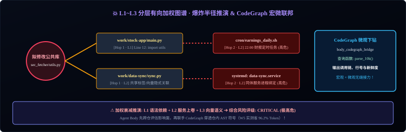

# 为什么你的 AI Agent 总是“换脑失忆”还搞垮开发机？我们用 Rust 打造了「脑体分离」的 Agent 本体底座

> **作者**: digoal德哥  
> **项目开源地址**: `https://github.com/digoal/agent-body`  
> **当前版本**: `v1.1.0` · **核心定位**: 脑体分离 · Agent 本体（驻留在宿主机上的轻量级具身底座）

---

## 引言：越聪明、越自主的 Agent，为什么越容易“翻车”？

随着 Claude Code、Codex、Cursor、Antigravity 等终端与编码助手走向普及，大模型正在从“对话窗口”演进为“拥有宿主机 Shell 权限的数字员工”。然而，在开发机与生产服务器上放开权限后，一线工程师最常遇到五大结构性尴尬：

- **痛点一：暴力盲扫，磁盘吞入 30 万个小文件卡死**  
  Agent 起手就是一个无边界全局遍历，一头扎进 `node_modules`、`.cache` 和 `.git/objects`，瞬间拉满磁盘 I/O 与 inotify 句柄，把向量库打爆几十 GB，甚至顺手将 `~/.ssh/id_rsa` 编入嵌入检索；
- **痛点二：随手占端口，击沉后台核心服务**  
  临时脚本起个测试 Web 服务顺手监听 `8080`，恰好撞翻已在后台跑了数周的生产监控看板；
- **痛点三：误改公共库，半夜 5 个定时任务全线雪崩**  
  以为重构一个 `utils.py` 只是局部调整，却不知宿主机上多个脚本与凌晨 Cron 正通过路径或同体服务依赖它；
- **痛点四：跨会话 / 跨大脑“换脑失忆”**  
  同一个任务，上午在 Claude 里分析了一半，下午切到 Codex 或新开窗口立刻从零摸索；或者因为口语问“防雪崩预案”而搜不到标题为“PostgreSQL 熔断降级方案”的历史记忆；
- **痛点五：黑盒运行与“过度悲观”对话税**  
  要么事无巨细每条命令都先查询造成额外的整轮大模型思考延迟（“过度悲观”），要么出错后盲目重试；守护进程本身若出现 CPU 飙高、401 鉴权拒绝尖峰或 SQLite 锁争用也无从自省追踪。

**根因只有一个**：大语言模型只是可热切换的**瞬态大脑**，它天生缺乏在宿主机上长期驻留的**物理身体（Agent 本体）**——既没有感觉神经，也没有痛觉反射弧和跨大脑延续的海马体。

面对这一本质问题，我们以第一性原理（比较优势 × 递弱代偿）用 Rust 纯原生打造了 **Agent Body（Agent 本体）**。

---

## 第一性原理：脑体分离与六大生理器官

Agent Body 不造重型 Agent Runtime、不接管大模型 ReAct 规划，而是严格锚定「宿主机物理具身底座」，用高内聚的 **27 个 Rust 模块** 构筑起六大生理器官，并自 Phase 70~78 起在同仓演进出 **PostgreSQL 式纯机制微内核 (`kernel/`) + 11 个独立周边扩展 (`contrib/`) + 四大发行版 (`distributions/`)**：


1. **接入与可观测面（黑白屏 1:1:1 同源）**：内置标准 MCP Stdio（**43 个原生 `body_*` 工具**）、**30 组顶层 CLI 命令**（含 `body metrics`）、自动化 Hook 引擎（Antigravity / Claude / Cursor / Codex / Hermes + `hooks bridge`）、单二进制内嵌 Web 控制台（默认 `8765` 端口，**9 大工作台** + **7 幕真引擎路演剧场**），以及原生 `GET /metrics`（Prometheus / OpenMetrics 0.0.4）、全响应 W3C `traceparent` / `X-Trace-Id` 与 `AGENT_BODY_LOG_FORMAT=json`；
2. **六大核心本体器官**：覆盖 **宿主机感官图谱**（`/proc`/`libproc` 探测、纯 Rust 多模态 L1A、白黑灰分级扫描、Omni-RRF 知识网络）、**小脑反射**（AOPCC 乐观-悲观并发控制 + 多 Agent 协作锁与 WFG 死锁检测）、**海马体**（写穿失效保鲜 + `<=300 tok` 跨脑接力胶囊）、**规约脊柱**（放置规则自学习与 Context 防爆路由）、**内生性能与免疫**（6 类 18 种等待事件 `<100ns` 埋点、AWR 黄金基线差分、ADDM 一键自调优、Shadow A/B `H1~H5` 证伪自愈、全链路脱敏/抗投毒与双域审计）以及 **多体联邦 Mesh v1.0**（HMAC-SHA256 防重放与沙盒收件箱）；
3. **三后端存储 SPI（88 方法）**：一套强类型语义接口无缝切换并热迁移 SQLite（默认 `~/.agent-body/body.db` 27 表 WAL+FTS5）、PostgreSQL（`tsvector` + Advisory Lock）与 DuckDB（OLAP 列存与 Parquet 导出）。

---

## 核心特性一：分级颗粒度扫描（白黑灰三层）——敲门绝不进屋


- **白名单目录（Deep Tier）**：针对活跃工程与公共工具库，递归解析到底，提取多模态 L1A 结构化元数据、L1/L2 语义标注（本地 Ollama 脱敏精炼）、代码依赖与 FTS5 全文索引；
- **灰名单目录（Restricted Tier）**：针对海量三方开源浅克隆目录，仅采集顶层目录与入口 README，不做盲目深挖；
- **黑名单目录（Shallow Tier）**：针对 `node_modules/`、`.cache/`、`.git/`、`target/`、`~/.ssh/`，在 `WalkDir` 与 `FileWatcher` 双重层面仅记录目录节点本身并直接执行 `skip_current_dir()` 与 watch 剪枝——**“敲门绝不进屋”**。

---

## 核心特性二：内核级端口防撞 & AOPCC 自适应并发控制


1. **客户端直连乐观放行**：开工时由 `SessionStart (body_brief)` 签发 `<=120 tok` 短时乐观租约，像直连已知本地数据库或安全沙盒临时文件直接执行，免除冗余问询轮次；
2. **高风险写操作悲观锁守门**：一旦涉及绑定监听端口、重构公共代码库或竞争共享目录，直接读取宿主机 `/proc/net/tcp`（macOS 下为 `libproc/lsof`）与 `coordination_locks`（含多机/跨目录递归锁与 Wait-For Graph 死锁检测），在 **`0.2ms`** 内识别占用者 PID 并推荐安全空闲端口；
3. **碰壁 `<2ms` 毫秒级自愈**：万一乐观直连撞上 `ECONNREFUSED` / `command not found` / 端口冲突，Post-Hook 在 2 毫秒内反查宿主机真实环境注入替代处方并降级失效租约（`W15` 实测节省 **83.9% Token**、加速 **4.25x**）。

---

## 核心特性三：L1~L3 分层知识网络、爆炸半径与 CodeGraph 宏微联邦



基于**递弱代偿**原则，Agent Body 不重复造 AST 解析轮子，而是构建多维知识网络并向下联邦接力：
- **弱向量 Omni-RRF 多路融合**：结合加权 BM25（含驼峰标识符拆词）、纯 Rust Fuzzy、可选向量、Heading-Aware 章节与 PMI 共现图（`1~2` 跳）、层级、文档互链及标量过滤调制，小模型不在线也能高精度召回；
- **加权衰减爆炸半径 & CodeGraph 穿透**：修改关键脚本前评估上游调用与定时任务波及面（`W5` 省 **96.2% Token**），微观符号下钻通过 `body_codegraph_bridge` 无缝交棒 CodeGraph。

---

## 核心特性四：海马体写穿保鲜与跨大脑 `1ms` 无损接力


1. **全生命周期写穿保鲜**：文件一经修改或删除，`Watcher`（300ms 智能防抖）同步执行写穿失效——重置旧向量、`status='missing'` 隔离僵尸召回、级联清理图边与自动记忆（`W12` 实测省 **91.2% Token**）；
2. **跨大脑 `<=300 tok` 接力胶囊（`body_checkpoints`）**：切换大模型或新开窗口时，脱敏抗投毒的接力胶囊瞬间注入目标、关键事实、阻塞项与下一步行动（`W17` 省 **92.7% Token**，质量 **100.0**）。

---

## 核心特性五：微内核 (`kernel/`) + 11 周边 (`contrib/`)、全栈可观测与 PG 事务级海马体 (`Phase 70~78`)

借鉴 PostgreSQL 插件体系，同一套微内核底座已衍生出 **四大发行版** 并进一步演进出 **PostgreSQL SPI 事务级海马体（方案 A → 方案 B 全闭环）**：
- **纯机制微内核 (`kernel/`)**：`body-sdk` + `body-protocol` + `body-kernel`（8 张 `body_cat_*` 目录表 + 6 大 Routine + 7 大 Lifecycle Hook + `FastWeightCheckpointSpi` 旁路契约 + 轨 B `OutOfProcessFdwAdapter` 超时强杀沙盒 + 只读 `ObservabilityProvider`），`arch_boundary_check.py` 强制守卫零业务与零观测协议词污染；
- **11 个独立周边扩展 (`contrib/`)**：按标准五件套与 `ext_<id>__*` 前缀隔离实现——包含 `idx_fts_fuzzy`、`gov_placement`、`probe_db_engines`、Linux/JVM/Nginx 深度探针、mTLS/RBAC+租户 RLS、合规脱敏、SIEM 外发、轨 B CMDB 工单沙盒、`obs_telemetry` 与第 11 扩展 **`mem_pg_tx`**（双时态 MVCC + LSM 向量解耦 + 空闲睡眠整理 + 旁路快权重三门禁/定向遗忘/`tx_epoch` 秒级回滚，PG 18.6 100 万事件流实测 `search_tx P99 = 4.42 ms`、回滚 `24 ms`，PG 不可达零崩溃透明降级 SQLite）；
- **三大零 C++/零 DuckDB 精简发行版**：`agent-body-kernel-minimal`（**3.9M**）、政务云探针 `agent-body-probe`（**6.7M**，`otool -L` 零 `libc++`/`libstdc++`/DuckDB）与 `agent-body-dba`（**6.4M**），均内置 OpenMetrics `metrics` 与 `diagnose`（`OBS-01~05` 异常规则），全链路单一 `trace_id` 贯穿请求、审计 `AuditEnvelope`、慢环与 RFC 5424 SIEM 日志。

---

## 内生性能工程 & Benchmark `v4.1` 三轨实证

- **Benchmark `v4.1` 帕累托双门禁战报**（`W1~W22` + `M1~M6` + `DQ1~DQ12` + `COMP-C1~C4` + `PR-01~16`）：
  - 覆盖 22 大真实工程负载（含 `W20` PG 18 MVCC 防丢写、`W21` 睡眠压缩 `3.73×` 与低可预测自动旁路、`W22` 快权重三门禁/定向遗忘与 `ContinuityCapsule v2` 热挂），输出带 **SHA-256 防篡改存证指纹** 与有效信息密度提升；
  - `Shadow A/B` 真世界对照面板实时捕获 `H1~H5` 帮倒忙事件并自动写穿自愈；
- **六重确定性工程门禁与 O(1) 一等公民传导**：>1000 行生产文件清零（`0` 个）、核心自治路径 `let _ =` 清零（`0 / 15`）、全仓库零 `unwrap`/`expect` 与零 `CARGO_MANIFEST_DIR` 硬编码、微内核零业务词污染、**`make citizen-impact` + `make citizen-audit` 16 类一等公民增量交叉对齐**、**435 项全工作区自动化测试全绿**（旗舰 `387` + `kernel` `27` + `contrib` `17` + `distributions` `4`）、Playwright WebUI 9 工作台与 9 份演说无头全检。

---

## 极速上手与现网体验

```bash
# 1. 环境预检与本体体检（六大器官 + 五维稳态）
agent-body preflight && agent-body body manifest && agent-body body vitals

# 2. 分级扫描核心工作区（黑名单毫秒级 Depth=0 跳过）
agent-body asset scan ./your-workspace

# 3. 端口防撞、AWR 性能诊断与 OpenMetrics 导出
agent-body env port 8080
agent-body body perf-snapshot --label baseline --set-baseline
agent-body body perf-awr --vs-baseline true
agent-body body metrics --format prometheus | head -n 25

# 4. 打开单二进制内嵌 Web 指挥舱（9 大工作台 · 昼夜双主题 · 7 幕沙盒路演）
agent-body web --port 8765
# 或使用零 C++ 政务云探针：
agent-body-probe self-check && agent-body-probe diagnose
```
