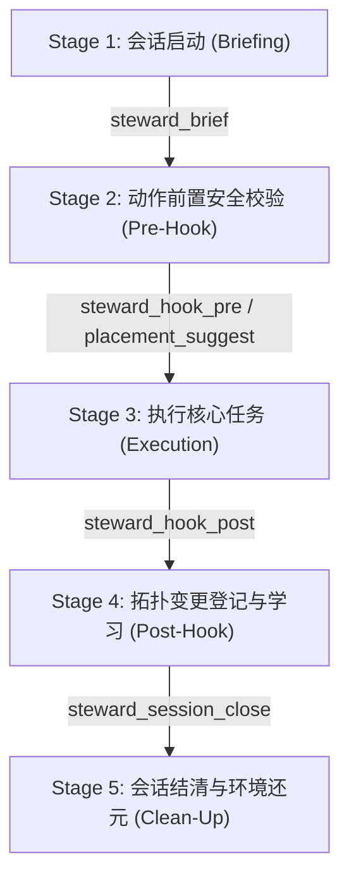

# Agent 生态集成协议与最佳实践指南 (Ecosystem Integration Protocol)

本文档规范外部自主 Agent（如 Claude, GPT-4, DeepSeek, Antigravity, AutoGen, CrewAI 等）接入并协同 **Agent Host Steward** 的标准工作流与协议交互范式。

---

## 1. 接入形态与传输协议

Steward 支持两种核心交互通道：
1. **Model Context Protocol (MCP)**：通过标准 `stdio` 接入，注册 25 个原生工具。
2. **CLI 命令行**：直接通过 Bash 调用 `agent-steward <subcommand>`，输出格式支持纯文本或 `--json`。

### MCP 客户端配置示例 (Claude Desktop / Cursor / Antigravity)
```json
{
  "mcpServers": {
    "agent-steward": {
      "command": "/usr/local/bin/agent-steward",
      "args": ["mcp"]
    }
  }
}
```

---

## 2. 生产级 Agent 五阶段集成闭环 (5-Stage Lifecycle Protocol)



### Stage 1: 会话启动 (Morning Briefing)
- **调用工具**：`steward_brief`
- **目标**：在 Agent 开始任何推理和代码生成前，注入当前宿主机的客观现实（硬件规格、可用显存、当前运行的关键进程、最近的变更审计记录、相关领域的工程偏好与错题录）。
- **参数示例**：
  ```json
  {
    "query": "PostgreSQL 内核分析",
    "budget_tokens": 1500,
    "session_id": "sess-20261118-01"
  }
  ```

### Stage 2: 动作前置安全校验 (Pre-Hook)
- **调用工具**：`steward_hook_pre` 与 `steward_placement_suggest`
- **适用场景**：
  - 准备写入新文件、新项目或新脚本前；
  - 准备拉起后台服务并绑定某端口前；
  - 准备修改已被系统托管的基础配置时。
- **返回处理**：
  - 若返回 `allowed: true`，直接执行；
  - 若返回 `warnings`（如：“端口 5432 已被占用”或“目标文件被 systemd 服务依赖”），Agent 必须主动调整端口或进行确认，严禁盲目执行。

### Stage 3 & 4: 执行与后置留痕 (Post-Hook)
- **调用工具**：`steward_hook_post`
- **目标**：在文件创建、服务部署或环境变动完成后，通知管家记录变更审计轨迹，自动更新属性图与依赖拓扑网络。
- **参数示例**：
  ```json
  {
    "tool_name": "write_file",
    "args": { "path": "/root/new/shared_proj/pg_probe.py" },
    "success": true
  }
  ```

### Stage 5: 会话结清与环境还元 (Session Closing)
- **调用工具**：`steward_session_close`
- **目标**：在 Agent 宣布任务完成或结项时调用。
- **动作**：
  - 自动清理该会话在 `/root/new/tmp/` 产生的所有临时草稿文件；
  - 汇总该会话的全部变更记录形成结构化交付物；
  - 归档会话阶段沉淀的有效记忆。

---

## 3. 标准化响应封套规范 (`StewardResponse<T>`)

为避免不同 Agent 对文本输出解析产生歧义，Steward 工具层支持统一 Envelope 结构：
```json
{
  "success": true,
  "code": "OK",
  "message": "端口可用，未发现冲突",
  "data": {
    "port": 9876,
    "is_free": true
  },
  "token_estimate": 45,
  "provenance": {
    "source": "reality:socket",
    "host": "localhost",
    "timestamp": "2026-11-18T12:25:00+08:00",
    "duration_us": 128
  }
}
```

常见状态码列表：
- `OK`: 操作成功执行；
- `PORT_CONFLICT`: 目标端口已被占用；
- `FILE_LOCKED`: 目标文件正被关键服务独占或正在写入；
- `NOISE_FILTERED`: 探测或记忆被判为系统底噪/无意义对话，已自动拦截；
- `RULE_MATCHED`: 成功命中已学得或预置的放置规范；
- `BLAST_RADIUS_WARNING`: 检测到潜在的跨服务依赖破坏风险。
