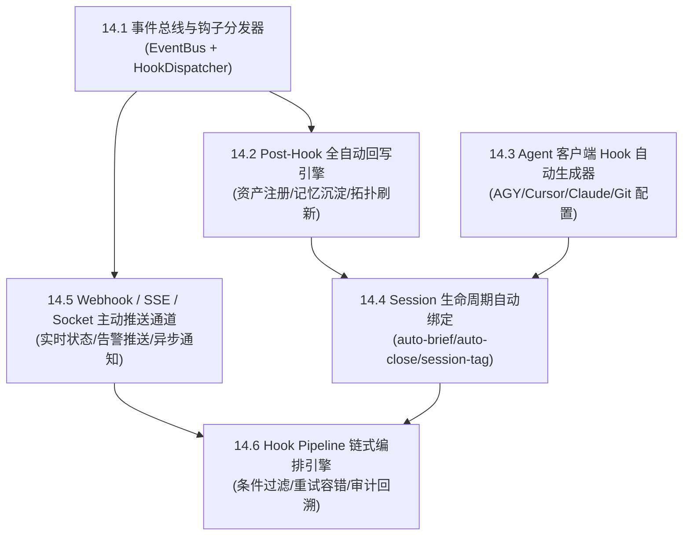

# Phase 14: HOOK 驱动集成引擎路线图 (Roadmap Phase 14)

> 编制：digoal德哥 · 日期：2026-11-18  
> 状态：规划就绪 / 待启动实施  
> 对齐标准：[README.md 核心设计原则与约束 §1-§15](file:///root/new/work/agent-steward/README.md#L205-L277)  
> 追踪检查点文件：[progress-phase14.md](file:///root/new/work/agent-steward/src_doc/progress-phase14.md)

---

## 一、战略目标与定位

让 Agent 接入 Agent Host Steward 从**“被动调用 MCP 工具”**升级为**“在 Agent 执行回路中由 HOOK 自动触发驱动”**。
同时实现双向赋能：
1. **读向赋能（Pre-Tool Hook）**：执行前自动环境预检、协作锁互斥检查、端口防撞、爆炸半径评估与规范路径提示；
2. **写向赋能（Post-Tool Hook & Inotify Event）**：执行后自动增量资产注册、根据内容/重要性评分门禁自动沉淀记忆、自动刷新宏观拓扑图谱，无需依赖 Agent 主观记忆。

---

## 二、六大子阶段任务规划

### 14.1 事件总线与钩子分发器 (EventBus & HookDispatcher)
- **目标**：实现 `src/hooks/event_bus.rs` 与 `src/hooks/dispatcher.rs`，在 Daemon 中提供基于 `tokio::broadcast` 的异步事件分发中枢；支持 `config.toml` 的 `[[hooks]]` 配置解析。
- **涉及路径**：`src/hooks/`、`src/config/mod.rs`、`src/watcher/handler.rs`、`src/memory/mod.rs`、`src/coordination/mod.rs`。
- **设计约束**：
  - 仅发射真实物理事实（零捏造，规约 #5）；
  - 广播延迟 < 1ms，吞吐量 >= 1000 events/s（规约 #9）；
  - 严格使用 `anyhow::Result` / `thiserror`，零 Panic（规约 #12）。

### 14.2 Post-Hook 全自动回写引擎 (Auto-Sync & Active Ingestion)
- **目标**：升级 `src/api/hooks.rs` 中的 `post_tool_call` 与 `src/hooks/auto_sync.rs`，Agent 写入文件或 Daemon 感知到新产出时，自动完成资产登记、记忆沉淀与拓扑关联。
- **涉及路径**：`src/hooks/auto_sync.rs`、`src/api/hooks.rs`、`src/scanner/matcher.rs`。
- **设计约束**：
  - 白名单深挖、黑名单目录严禁入库（规约 #6）；
  - 记忆摄入必须经过 `ImportanceScorer` + `MemoryIntakeFilter` 过滤，严禁全盘垃圾入库（规约 #4）；
  - 摘要提取禁止调用昂贵外部 LLM，仅采用首行/标题结构提取（规约 #2）；
  - 500ms 防抖幂等，后台异步 Task 执行，不阻塞主流程（规约 #9）。

### 14.3 Agent 客户端 Hook 自动生成器 (Client Hook Generator)
- **目标**：提供 `agent-steward hooks generate --client <agy|cursor|claude|git>` CLI 命令与对应 MCP 端点，自动产出各端适配的自动化 Hook 脚本与规则。
- **涉及路径**：`src/hooks/client_gen.rs`、`src/main.rs`、`src/api/mcp_tools.rs`。
- **设计约束**：
  - CLI 与 MCP 工具必须保持 1:1 映射（规约 #13）；
  - 保持建议式和非阻断机制，不破坏 Agent 原有工作回路（规约 #8）。

### 14.4 Session 生命周期自动绑定 (Session Lifecycle Auto-Binding)
- **目标**：实现会话首次交互自动注册、变更操作携带 `session_id` 追踪标签、30 分钟无调用自动触发带预览保护的 `session_close`。
- **涉及路径**：`src/session/lifecycle.rs`、`src/session/mod.rs`、`src/api/mcp_tools.rs`。
- **设计约束**：
  - GC 临时文件清理必须遵循默认 `dry-run` 预览保护（规约 #8）；
  - 沉淀会话总结进长期记忆。

### 14.5 Webhook / SSE / Socket 主动推送通道 (Active Push Channels)
- **目标**：扩展 `/api/v1/stream` SSE 推流，支持出站 Webhook（HTTP POST）与本地 Unix Domain Socket。
- **涉及路径**：`src/hooks/push.rs`、`src/web/sse.rs`、`src/daemon/mod.rs`。
- **设计约束**：
  - 推送 Payload 格式必须符合统一 `StewardResponse<T>` 封套规范（规约 #1）。

### 14.6 Hook Pipeline 链式编排引擎 (Hook Pipeline Engine)
- **目标**：支持多步骤链式触发、多维条件过滤（路径前缀、扩展名、标签）、去重与指数退避重试，以及持久化审计流水。
- **涉及路径**：`src/hooks/pipeline.rs`、`src/storage/schema.sql`、`src/storage/models.rs`。
- **设计约束**：
  - 审计流水对接 StorageProvider 并同步至 DuckDB 分析分析池（规约 #10）。

---

## 三、四层贯通清单

根据规约 #10（代码 × 配置 × 文档 × SKILL 四层贯通）：
1. **代码层**：新增 `src/hooks/` 模块与单元测试，保持零 Panic，`cargo check --tests` 零警告；
2. **配置层**：更新 `config.example.toml`，详尽注释 `[[hooks]]`、`[auto_sync]` 与 `[session]` 配置；
3. **文档层**：创建 `docs/manual/09-hooks-integration.md`，更新 `README.md` 与 `docs/manual/03-cli-reference.md`；
4. **SKILL 层**：同步更新 `agent-steward-developer`、`agent-steward-guide` 与 `agent-steward-doc-writer`。
