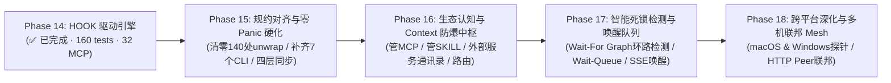
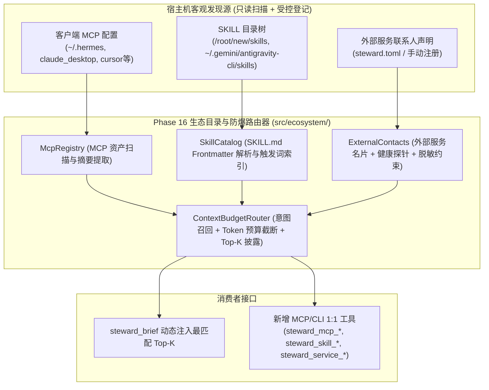

# Agent Host Steward — 代码与文档全景审计及 Phase 15~18 演进路线图

> **编制**: Antigravity · **日期**: 2026-11-18  
> **基线 Commit**: `80efa9f` (`v0.3.2`, Phase 1~14 全部交付)  
> **对齐基准**: [README.md 核心设计原则与约束 §1-§15](../../README.md#L206-L271) & [未来演进与待探讨 ISSUE](../../README.md#L274-L287)  
> **近期实施拆解**: [roadmap-phase15.md](roadmap-phase15.md) · **断点检查点**: [progress-phase15.md](progress-phase15.md)

---

## 一、代码与文档全景扫描审计报告

在启动下一轮特性演进前，对仓库全量源码（`src/` 下 19 个 `pub mod` 模块 + `main.rs` + `tests/`）与全量文档（`README.md`、`docs/arch/`、`docs/manual/`、`docs/design_doc/`、`docs/src_doc/`、`skills/`）进行了交叉核验。

### 1.1 当前研发基线（实测事实）

| 维度 | 实测基线数据 | 来源验证 |
|---|---|---|
| **模块规模** | `src/lib.rs` 导出 **19 个顶层模块**（`config`, `storage`, `placement`, `scanner`, `env`, `memory`, `api`, `watcher`, `daemon`, `links`, `changes`, `session`, `tui`, `fact`, `brief`, `coordination`, `preflight`, `web`, `hooks`）+ `src/main.rs` | `src/lib.rs` |
| **存储抽象** | `StorageProvider` Trait 定义 **40 个核心方法**，实现 SQLite (Bundled + FTS5) / PostgreSQL (pgvector + Advisory Lock) / DuckDB (列存 OLAP) 三后端 | `src/storage/spi.rs` |
| **MCP 端点** | `McpToolRegistry` 注册 **32 个原生 MCP 工具**（含 Phase 14 新增 `steward_hook_generate`） | `src/api/mcp_tools.rs` |
| **编译与测试** | `cargo check --tests` **0 warnings**；`cargo test` 实跑 **160 passed, 0 failed, 1 ignored**（141 项 lib 单测 + 5 项 benchmarks + 8 项 coordination + 5 项 duckdb + 1 项 web dashboard + 1 ignored doctest） | `cargo test` 实测 |
| **宿主机现网背景** | 仅 `~/.gemini/antigravity-cli/skills/` 下已沉淀 **130 个技能目录**，加上 `/root/new/skills/` 下 **9 个技能目录**及多套 MCP Server；Context 膨胀风险已成为真实物理痛点 | 宿主机目录扫描 |

### 1.2 对照 `README.md` 15 条核心规约的合规差距清单

依据 [README.md §1-§15](../../README.md#L206-L271) 逐条体检，发现以下 **3 项亟待清偿的规约差距**：

1. **差距 A — 违反规约 #12（零 Panic 原则）：非测试生产代码存在 140 处 `.unwrap()` / `.expect()`**
   - `src/storage/pg_provider.rs`：**41 处**（集中在 `client.lock().unwrap()` 及 `tokio::runtime::Runtime::new().unwrap()`）
   - `src/storage/sqlite_provider.rs`：**39 处**（集中在 `self.conn.lock().unwrap()`）
   - `src/storage/duckdb_provider.rs`：**39 处**（集中在 `self.conn.lock().unwrap()`）
   - `src/storage/duckdb_analytics.rs`：**6 处**（连接锁与类型转换 `.unwrap()`）
   - `src/links/mod.rs`：**5 处**（`Regex::new(...).unwrap()` 等）
   - `src/session/lifecycle.rs`：**5 处**（`self.sessions.lock().unwrap()`）
   - `src/hooks/pipeline.rs`：**3 处**（`self.last_fired.lock().unwrap()`）
   - `src/fact/automation.rs`：**2 处**（`Regex::new(...).unwrap()`）
   - *风险*：当 Mutex 发生毒化（PoisonError）或异常边界条件触发时，7×24 常驻守护进程或 MCP 子进程将直接崩溃，违背规约 #12 与 NFR 99.99% 可用性要求。

2. **差距 B — 违反规约 #13（MCP 工具与 CLI 子命令必须 1:1 映射）：存在 7 个工具缺失 CLI 子命令**
   - 在 `src/api/mcp_tools.rs` 已注册 32 个 MCP 工具，但 `src/main.rs` 仅覆盖其中 25 个，缺少以下 **7 个 CLI 子命令映射**：

| 序号 | 已注册 MCP 工具 | 缺失的 CLI 子命令映射 | 归属模块 |
|:---:|---|---|---|
| 1 | `steward_asset_register` | `agent-steward asset register` | `AssetCommands` |
| 2 | `steward_hook_pre` | `agent-steward hooks pre` | `HooksCommands` |
| 3 | `steward_hook_post` | `agent-steward hooks post` | `HooksCommands` |
| 4 | `steward_analytics_heatmap` | `agent-steward analytics heatmap` | 新增 `AnalyticsCommands` |
| 5 | `steward_analytics_trend` | `agent-steward analytics trend` | 新增 `AnalyticsCommands` |
| 6 | `steward_analytics_export` | `agent-steward analytics export` | 新增 `AnalyticsCommands` |
| 7 | `steward_lock_acquire` | `agent-steward coordination acquire` | `CoordinationCommands` |

3. **差距 C — 违反规约 #10 & #11（四层贯通 & 文档/SKILL 一等公民同步）：多份核心文档滞后于 Phase 14 现状**
   - `README.md`：第 110 行仍写 `145 项自动化测试套件`（实际为 160 passed），第 108 行“19 大模块”在 `docs/arch/02-for-developers.md` 中仅列出了 10 个核心目录（缺少 `hooks/`、`session/`、`brief/`、`changes/`、`daemon/`、`tui/`、`watcher/` 等）。
   - `docs/arch/01-for-architects.md`、`docs/arch/02-for-developers.md`、`docs/arch/03-for-users.md`：仍写 `31 Tools` / `31 个原生工具` / `145 项测试` 与 `StorageProvider 35+ 接口`。
   - `docs/src_doc/progress.md`：总阶段表格仅写到 Phase 13，缺少 Phase 14 验收记录；`docs/src_doc/development.md` 仍写 `31 个原生 MCP 工具` 与 `v0.3.2` 旧测试数。
   - 仓库内 `skills/agent-steward-*/SKILL.md`：停留在 `31 个原生 MCP` 版本，未与 Phase 14 的 32 工具及 `steward_hook_pre` 大小写修复状态同步。

> **顺带记录的工程性能观察**（建议纳入后续优化）：`src/api/mcp_tools.rs` 中 `steward_analytics_*` 每次调用都新建 DuckDB 内存连接并全量执行 `pipeline.sync_all()`；随着资产/变更表行数增长，该路径存在突破规约 #9（亚毫秒/毫秒级响应）的风险，应在后续演进中改为增量水位同步或复用持久化分析副本。

---

## 二、战略演进方案对比与决策 (Architecture Decision)

针对上述 3 项规约差距与 [README.md §未来演进与待探讨 ISSUE](../../README.md#L274-L287) 的 4 大课题，提出三种演进路线对比：

| 对比维度 | 方案 A：先固底清债，再攻 Context 防爆，后扩协作与多机 (推荐) | 方案 B：跳过规约清债，直接堆叠新特性 | 方案 C：优先做跨主机分布式 Mesh 与 Raft/Gossip |
|---|---|---|---|
| **演进顺序** | **Phase 15 (规约清债/零Panic/CLI对齐)** → **Phase 16 (MCP/SKILL/外部服务通讯录与Context防爆)** → **Phase 17 (死锁检测与等待唤醒)** → **Phase 18 (跨平台+多机Mesh)** | 直接上 Phase 16~18，把 unwrap/CLI 缺口/文档滞后继续向后拖延 | 先建多机网络协同，再解决单机 Context 爆炸与服务发现 |
| **优点** | 1. 新模块直接在零 Panic 与 1:1 映射门禁下生长，不叠加技术债； 2. 优先解决宿主机 **130+ SKILL & 多 MCP** 导致的 Context 爆炸第一痛点，Agent 立即可用； 3. 符合“先单机极致稳定，后多机联邦扩展”的递弱代偿原则 | 短期内看似功能列表增长快 | 提前满足多服务器集群部署需求 |
| **缺点/风险** | 前期需投入 1 个短周期清理已有 140 处 unwrap 与文档债，新特性稍延后 1 个阶段 | 1. 每加一个存储方法继续复制 `.unwrap()`，守护进程随时可能因锁毒化宕机； 2. 文档/SKILL 与代码差距拉大，导致 Agent 调用自己时产生幻觉 | 1. 当前核心宿主为单机工作站，`Gossip/Raft` 引入复杂度极高，易突破 `<30MB` 内存红线； 2. 单机 Context 打爆痛点悬而未决，投入产出比低 |
| **结论** | ✅ **强烈推荐采纳** | ❌ 不推荐（技术债雪球效应） | ❌ 不推荐（违背轻量化与痛点优先级） |

**推荐理由（第一性原理）**：
1. 大管家自身核心用户是 **AI Agent**，若仓库文档与 `SKILL.md` 滞后，Agent 读到旧契约就会产生认知偏差；若生产路径仍有 140 处 `unwrap()`，7×24 守护稳定性就无法兑现。因此 **Phase 15 必须作为前置底座清债**。
2. 当前宿主机已存在 **139 个 SKILL 目录（130 个全局 + 9 个 `/root/new/skills/`）** 及多个 MCP 服务，Open Issue #4（管理 MCP / SKILL / 外部服务并防止 Context 被打爆）直接决定大模型推理质量与召回信噪比，具有最高业务杠杆，故列为 **Phase 16 (P0)**。
3. 单机多 Agent 锁已有基础（Phase 11），但仅支持非阻塞快速失败（`Denied`），补齐等待队列与死锁环路检测（Open Issue #2）即可形成完整并发原语闭环，列为 **Phase 17 (P1)**。
4. 跨平台抽象与轻量多机联邦（Open Issue #3 & #1）属于边界拓展层，适合在单机语义底座完全稳固后作为 **Phase 18 (P2)** 落地。

---

## 三、Phase 15 ~ Phase 18 全景演进路线图

---

### Phase 15：工程规约全面对齐与零 Panic 硬化 (Compliance & Zero-Panic Hardening)

- **战略目标**：彻底清偿代码与文档存量技术债，使全库 100% 符合 `README.md` §1~§15 硬约束，为后续新模块建立“零债务”工程基线。
- **核心任务**：
  1. **15.1 生产代码零 Panic 硬化（规约 #12）**：
     - 消除 `src/storage/{pg_provider,sqlite_provider,duckdb_provider,duckdb_analytics}.rs`、`src/links/mod.rs`、`src/session/lifecycle.rs`、`src/hooks/pipeline.rs`、`src/fact/automation.rs` 中全部 **140 处** 非测试代码 `.unwrap()` / `.expect()`；
     - Mutex 加锁统一封装 `lock_conn()` / `lock_guard()` 辅助方法返回 `anyhow::Result`，正则编译统一使用 `std::sync::OnceLock<Regex>` 或安全返回 `Result`。
     - 增加 CI/脚本门禁校验（扫描 `#[cfg(test)]` 之前禁止出现 `.unwrap(` / `.expect(`）。
  2. **15.2 CLI 与 MCP 1:1 映射补齐（规约 #13）**：
     - 在 `src/main.rs` 补齐缺失的 7 个 CLI 子命令：`asset register`、`hooks pre`、`hooks post`、`analytics {heatmap, trend, export}`、`coordination acquire`；
     - 同步审视 `close` / `steward_session_close` 的 `dry_run` 预览开关参数一致性（规约 #8）。
  3. **15.3 四层贯通文档与 SKILL 全面刷新（规约 #10 & #11）**：
     - 同步更新 `README.md`、`docs/arch/01~03`、`docs/manual/03 & 04`、`docs/src_doc/progress.md`、`docs/src_doc/development.md` 中的模块数（19 大模块）、MCP 工具数（32 个，Phase 15 完成后保持一致）、存储 SPI 方法数（40 个）与实测测试数；
     - 将仓库 `skills/agent-steward-*/SKILL.md` 与全局已部署技能事实对齐，移除已过时的“31 工具”和“未修复 bug”表述。
- **DoD 验收门禁**：
  - 生产路径 `.unwrap()` / `.expect()` 扫描计数 **= 0**；
  - 32 个 MCP 工具与 CLI 子命令 **100% 一一映射**；
  - `cargo check --tests` 零警告，全量测试 100% PASS。

---

### Phase 16：管理范围扩展与 Context 防爆路由器（对齐 Open Issue #4）

> **核心定位与边界约束（规约 #2 递弱代偿 & #5 零捏造）**：
> - 大管家**只做“宿主机能力地图 + 服务通讯录 + 按需渐进式路由推荐”**；
> - **明确不做**：不做 MCP 流量代理网关、不替代 LLM 执行业务推理、**绝不在 SQLite/PostgreSQL 中存储明文 API Key 或密码**（外部服务仅登记 `auth_env_var` 环境变量名引用，契合规约 #2 不替代 Vault 及“隐私安全不泄露敏感信息”准则）。

- **战略目标**：解决“宿主机 MCP Server / 工具定义与 130+ SKILL 全量塞入上下文导致 Context 被打爆、模型注意力退化”以及“Agent 不知道可调用哪些宿主机外延服务”的两大难题。
- **模块架构规划**：新增 `src/ecosystem/`（或 `src/catalog/`）模块，由四大组件构成：

- **核心能力拆解**：
  1. **16.1 存储层扩展（三后端 Schema 同步）**：
     - 新增 `mcp_servers` / `mcp_tools_index`（记录 Server 名、传输方式、状态、工具摘要与预估 Token 成本，用于估算省下多少 Context）；
     - 新增 `skills_catalog`（记录 Skill 名、物理路径、`SKILL.md` YAML frontmatter 的 `description`、触发词、依赖工具与本地/全局来源）；
     - 新增 `external_services`（外部服务通讯录：服务名、类别如 `llm/embedding/search/db/webhook/saas`、Endpoint URL、能力标签、健康检查端点、**仅存 `auth_env_var` 变量名绝不存密钥值**、调用示例模板与可用性状态）；
     - 同步更新 `src/storage/{schema.sql, pg_schema.sql, duckdb_schema.sql, models.rs, spi.rs}` 及三引擎实现 + `StorageMigrator` / `SyncPipeline`。
  2. **16.2 MCP 与 SKILL 自动发现与精简索引**：
     - 严格遵守规约 #6（黑名单浅层阻断，只读 `SKILL.md` 头部 YAML/摘要与 MCP `config.json`/`config.yaml` 清单，不扫 `node_modules`/大文件）；
     - 支持在脱敏后（自动掩码或剥离配置文件中的 `env` 密钥值）索引宿主机已挂载 MCP 与可用 SKILL，并建立 FTS5 全文搜索索引。
  3. **16.3 外部服务通讯录（External Service Contacts）与探活**：
     - 支持自动从本机已有信息（如 `config.toml` Ollama、`pg_url`、`~/.hermes` 外部端点或 `/root/new/note/*权威网站*.md` 提取的常用公开服务）冷启动预置，也支持通过 CLI/MCP 手动登记、查询和轻量探活（TCP/HTTP HEAD 状态检查）。
  4. **16.4 Context Budget Router（防爆渐进式披露路由器）**：
     - 给定 `intent` 与 `budget_tokens`（默认 `<= 600 tokens`），融合关键字/BM25/意图匹配，**只返回 Top-K 最相关 MCP 工具清单、Top-K SKILL 路径与可用外部服务调用卡片**，其余折叠为数量提示与按需展开命令，防止 Context 膨胀；
     - 无缝接入 `BriefAssembler`（`src/brief/assembler.rs`），使 `steward_brief` 自动附带当前任务最该加载的 SKILL/MCP/外部服务推荐，并统计“节省 Context Token 估算值”。
  5. **16.5 新增 MCP & CLI 1:1 工具矩阵**：
     - `steward_mcp_catalog` <-> `agent-steward mcp-catalog [scan|list|route]`
     - `steward_skill_route` <-> `agent-steward skill [scan|list|route]`
     - `steward_service_contact` <-> `agent-steward service [register|list|query|check]`
- **DoD 验收门禁**：
  - 宿主机 130+ 个 SKILL 与多 MCP Server 秒级建索引，敏感字段脱敏率 100%；
  - 在 `budget_tokens = 600` 约束下，路由器单次召回响应 `< 10ms`，准确给出 Top-K SKILL/MCP 与外部服务名片；
  - `steward_brief` 总体预算继续保持可控不超限，CLI 与 MCP 1:1 映射。

---

### Phase 17：智能死锁检测与协作锁等待唤醒中枢（对齐 Open Issue #2）

- **战略目标**：将 Phase 11 的非阻塞协作锁升级为支持“排队等待 + 主动唤醒 + 死锁图环路预警”的企业级多 Agent 协调原语，彻底消除轮询空耗与互相等待僵局。
- **核心任务**：
  1. **17.1 锁等待队列 (`lock_wait_queue`) 与持久化**：
     - 在 `schema.sql` / `pg_schema.sql` / `duckdb_schema.sql` 新增 `lock_wait_queue` 表，记录 `wait_id`、`resource_type`、`resource_id`、`waiting_agent`、`held_resources`（当前已持有资源快照，用于死锁图推导）、`priority`、`timeout_at`、`notify_channel`。
  2. **17.2 Wait-For Graph (WFG) 死锁检测引擎 (`src/coordination/deadlock.rs`)**：
     - 基于 Agent 当前持锁集合与等待目标集合构建有向等待图；
     - 运行 DFS/Tarjan 强连通环路检测：当 `Agent A` 持 `R1` 等 `R2`，同时 `Agent B` 持 `R2` 等 `R1`（包含目录祖先后代关系传递），立即在申请排队时返回 **死锁环路路径诊断报告** 并拒绝进入死等，而非事后超时；
     - 针对已形成的僵尸等待链，支持最低优先级/最短剩余租期退让建议。
  3. **17.3 Push 通知唤醒通道（复用 Phase 14 事件总线）**：
     - 当 `CoordinationEngine::release()`、`force_release()` 或后台调度器 `gc_expired_locks()` 释放资源时，自动从等待队列按优先级 + FIFO 出队下一个等待者，向 `EventBus` 发射 `StewardEvent::LockWaiterNotified`，通过 **UDS Socket / SSE (`/api/v1/stream`) / Webhook** 推送唤醒信号，并配套同步阻塞/长轮询命令 `steward_lock_wait`（带超时保护）。
  4. **17.4 Web 大屏与 CLI/MCP 1:1 联动**：
     - Web 看板新增“锁等待队列与 WFG 死锁拓扑态”视图；
     - 新增 `steward_lock_wait` / `steward_lock_deadlock_check` 及其 CLI 对等子命令 `coordination wait` / `coordination deadlock`。
- **DoD 验收门禁**：
  - 构造双 Agent 与三 Agent 环形等待场景，100% 检出精确死锁环路且延迟 `< 2ms`；
  - 持锁释放后排队 Agent 在 `< 50ms` 内通过 UDS/SSE 收到唤醒事件，零空转轮询；
  - 多线程并发集成测试通过。

---

### Phase 18：跨平台原生探测深化与轻量多机联邦网格（对齐 Open Issue #3 & #1）

> **边界约束**：跨平台深化通过编译期 `cfg(target_os)` 隔离；多机联邦严守规约 #2 & #9，**不造重型 Raft 轮子**，采用“HTTP Peer Mesh 只读联邦查询 + PostgreSQL Advisory Lock / HTTP Lease 跨节点锁”。

- **战略目标**：打破 Linux 单机物理限制，覆盖 macOS / Windows 开发者桌面宿主机，并支持多台 Linux/混合机器组成轻量协作集群。
- **核心任务**：
  1. **18.1 跨平台原生探针深化 (`src/platform/`)**：
     - 提炼统一 `PlatformProbe` Trait（端口监听枚举、进程详情 Cwd/Cmdline、自动化服务单元扫描、系统硬件规格）；
     - `linux.rs`：保留现有 `/proc` + `systemd` + `cron` 微秒级零外依赖实现；
     - `macos.rs`：实现 `lsof -iTCP -sTCP:LISTEN -n -P` / `sysctl` / `launchctl` & `~/Library/LaunchAgents/*.plist` 解析；
     - `windows.rs`：实现 `netstat -ano` + PowerShell/WMI 进程命令行提取 + Windows Service (`sc query`) / Scheduled Tasks (`schtasks`) 解析；
     - 更新 `PreflightChecker` 按目标 OS 分类校验，确保非 Linux 下核心能力可用而不误报 FAIL。
  2. **18.2 轻量级多机 Peer Mesh (`src/mesh/`)**：
     - 在 `config.toml` 新增 `[mesh]` 配置节（`node_id`, `peers = ["http://192.168.31.161:8765"]`, `heartbeat_secs`, `shared_secret`）；
     - 利用内嵌 `src/web/` HTTP 服务暴露 `/api/v1/mesh/ping`、`/api/v1/mesh/facts`、`/api/v1/mesh/locks`（带 HMAC/Bearer Token 鉴权，规约隐私安全）；
     - 实现跨主机事实联邦查询（“集群哪台机器有 GPU/空闲 8080 端口/部署了某开源仓库？”）与跨节点分布式协作锁路由（优先复用 PG `Advisory Lock` 共享库，无 PG 时通过 Mesh Primary Coordinator 租约协调）。
  3. **18.3 CI 多目标编译与四层贯通**：
     - 验证 Linux (`x86_64-unknown-linux-gnu`) 正常构建及 macOS/Windows `cfg` 模块结构编译检查；
     - 完善 `INSTALL.md`、`config.example.toml`、Web 大屏多节点视图与相关 SKILL。
- **DoD 验收门禁**：
  - `PlatformProbe` 在 macOS/Windows 路径通过结构化解析单测（基于真实样本输出 fixture 验证）；
  - 双机本地/双端口模拟 Peer Mesh 实例能够互相发现、跨节点防端口碰撞与跨机查询事实图谱，且单节点常驻内存仍 `< 30MB`。

---

## 四、四阶段总览矩阵与验收标准对齐

| 阶段 | 对齐规约 / ISSUE | 预计工作量拆解 | 核心交付物 | 关键验收指标 (DoD) |
|---|---|---|---|---|
| **Phase 15** | 规约 #10 #11 #12 #13 | 3 个模块组 / 8 原子任务 | 生产代码零 unwrap、32 工具 CLI 1:1 映射、全文档与 SKILL 对齐 | 非测试 unwrap = 0；CLI 映射 32/32；`cargo test` 全绿零警告 |
| **Phase 16** | Open Issue #4 (防 Context 爆) | 5 个模块组 / 14 原子任务 | `src/ecosystem/`、三后端表扩展、脱敏 MCP/SKILL 扫描、外部服务通讯录、Context 路由器 | 130+ SKILL 索引正常；路由延迟 `< 10ms`；`budget_tokens` 严格不越界 |
| **Phase 17** | Open Issue #2 (死锁与唤醒) | 4 个模块组 / 10 原子任务 | `lock_wait_queue`、WFG 死锁环路检测、`EventBus/UDS/SSE` 唤醒推送 | 环形死锁 100% 即时检出；解锁唤醒延迟 `< 50ms` |
| **Phase 18** | Open Issue #3 & #1 | 3 个模块组 / 9 原子任务 | `src/platform/` 多 OS 探针、`src/mesh/` 轻量联邦节点、分布式锁协调 | 跨 OS 解析 fixture 测试全绿；双节点 Mesh 互通，RSS `< 30MB` |

---

## 五、立即启动指引

本全景路线图中的近期落地阶段（**Phase 15 + Phase 16**）已细化为 30 分钟以内粒度的原子可执行步骤，请查看：
- 详细设计与子任务规格：[roadmap-phase15.md](roadmap-phase15.md)
- 断点续传检查点追踪表：[progress-phase15.md](progress-phase15.md)
