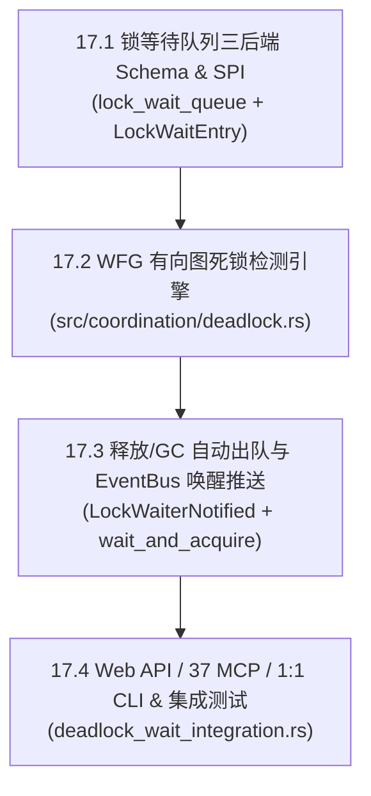

# Phase 17 详细实施路线图：智能死锁检测与协作锁等待唤醒中枢

> **编制**: Antigravity · **日期**: 2026-11-18  
> **对齐**: [README.md 待探讨 ISSUE #2](../../README.md#L279-L280) · [roadmap-phase15-18.md](roadmap-phase15-18.md)  
> **断点检查点**: [progress-phase17.md](progress-phase17.md)

---

## 一、战略目标

将 Phase 11 的非阻塞协作锁升级为支持**等待队列 (`lock_wait_queue`) + 实时死锁环路检测 (Wait-For Graph) + EventBus/SSE/UDS 主动唤醒推送**的完整并发协调中枢，杜绝轮询空转与跨 Agent 循环等待死锁。

---

## 二、四步串行架构拆解

### 17.1 `lock_wait_queue` 三后端 Schema & SPI 扩展
- 新增 `lock_wait_queue` 表（`schema.sql`、`pg_schema.sql`、`duckdb_schema.sql`）：
  `wait_id`, `resource_type`, `resource_id`, `scope`, `waiting_agent`, `priority`, `enqueued_at`, `timeout_at`, `status` (`waiting` | `notified` | `acquired` | `expired` | `cancelled`)。
- `StorageProvider` SPI 新增 5 个方法：`enqueue_lock_wait`、`list_lock_wait_queue`、`pop_next_lock_waiter`、`update_lock_wait_status`、`gc_expired_lock_waits`，并在 SQLite / PG / DuckDB 全部实现（零 unwrap）。

### 17.2 Wait-For Graph (WFG) 死锁检测引擎 (`src/coordination/deadlock.rs`)
- **图构建**：
  - `holder_map`：每个活跃锁的资源 `(resource_type, resource_id)` -> `holder_agent`（同时支持目录祖先/后代互斥冲突判定）；
  - `waiter_edges`：若 `waiting_agent` 正在等待（或拟申请等待）某资源，而该资源被 `holder_agent` 持有（含目录层级重叠），则连边 `waiting_agent -> holder_agent`（附带资源标签）。
- **DFS 环路检测**：
  - 在 `enqueue_wait` 时先假设加入边 `applicant -> current_holder`，立即执行 DFS 环路探测；
  - 若成环，立即拒绝入队并返回 `DeadlockDetected { cycle_agents, cycle_resources, suggestion }`，提供最低代价退让建议。

### 17.3 Push 唤醒通知与同步等待 (`StewardEvent::LockWaiterNotified`)
- 在 `src/hooks/mod.rs` 新增 `StewardEvent::LockWaiterNotified { wait_id, resource_type, resource_id, notified_agent, timestamp }`；
- 在 `CoordinationEngine::release()`、`force_release()` 与 `gc_expired_locks()` 成功后，自动弹出同资源队列首个等待者，将其状态更新为 `notified`，并向 `EventBus` 发射唤醒事件（自动广播到 SSE `/api/v1/stream` 与 UDS Socket）；
- 提供 `CoordinationEngine::wait_and_acquire(req, wait_timeout_ms)`：若直接可拿锁立即成功；若冲突且无死锁，入队等待事件通知或轻量 backoff 重试直至拿到锁或超时自动撤回。

### 17.4 Web / MCP / CLI 1:1 暴露与全量验收
- 新增 2 个原生 MCP 工具（总数达到 **37 个**）：
  - `steward_lock_wait` <-> `agent-steward coordination wait`
  - `steward_lock_deadlock_check` <-> `agent-steward coordination deadlock`
- Web 大屏 API (`src/web/locks_api.rs` & `src/web/server.rs`) 新增 `GET /api/v1/locks/wait-queue` 与 `GET /api/v1/locks/deadlocks`；
- 编写 `tests/deadlock_wait_integration.rs` 验证双/三 Agent 环形死锁拦截与解锁秒级唤醒。
