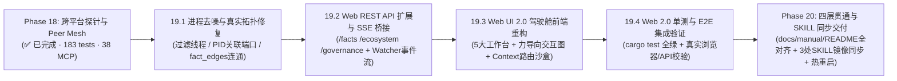

# Agent Body — 代码与现网体检及 Phase 19~20 演进路线图

> **编制**: Antigravity · **日期**: 2026-11-19  
> **基线 Commit**: `69f6cce` (`v0.3.2`, Phase 1~18 全部交付)  
> **对齐基准**: [README.md 核心设计原则与约束 §1-§15](../../README.md#L206-L271) & [未来演进与待探讨 ISSUE](../../README.md#L274-L290)  
> **断点续传检查点表**: [progress-phase19.md](progress-phase19.md)

---

## 一、代码、文档与现网运行态全景体检报告

在启动下一轮演进前，对仓库全量源码（`src/` 下 22 个 `pub mod` 模块 + `src/main.rs` + `tests/`）、全量文档（`README.md`、`docs/arch/`、`docs/manual/`、`docs/src_doc/`、`skills/`）以及本机现网数据库（`/root/.agent-body/body.db`）和常驻守护服务（`agent-body.service`，Web 监听 `0.0.0.0:8756`）进行了实测交叉核验。

### 1.1 当前实测基线事实

| 维度 | 实测基线数据 | 来源验证 |
|---|---|---|
| **模块与代码规模** | `src/lib.rs` 导出 **22 个顶层模块**（新增 `ecosystem`、`platform`、`mesh`）+ `src/main.rs` | `src/lib.rs` |
| **存储 SPI 契约** | `StorageProvider` Trait 定义 **54 个方法**，覆盖 SQLite / PostgreSQL / DuckDB 三后端 | `src/storage/spi.rs` |
| **MCP 与 CLI 对齐** | `McpToolRegistry` 注册 **38 个原生 MCP 工具**，与 CLI 子命令保持 1:1 映射 | `src/api/mcp_tools.rs` |
| **零 Panic 门禁** | `make lint-panic` 实跑 **0 处** 生产路径 `.unwrap()` / `.expect()` | `Makefile` (`lint-panic`) |
| **编译与测试基线** | `cargo test` 实跑 **183 passed, 0 failed, 1 ignored**（160 lib 单测 + 1 main 单测 + 5 benchmarks + 8 coordination + 2 deadlock_wait + 5 duckdb + 1 ecosystem + 1 web_dashboard + 1 ignored doctest） | `cargo test` 实测 |
| **现网数据库资产** | `assets`: 2,195 条；`changes`: 2,566 条；`fact_nodes`: 307 个（`project`: 213 / `service`: 27 / `file`: 27 / `port`: 17 / `tool`: 16 / `cron`: 7）；`fact_edges`: 52 条；`skills_catalog`: 121 个；`mcp_catalog`: 5 个；`external_services`: 1 个；`memories`: 2 条 | `/root/.agent-body/body.db` |
| **现网运行态资源** | `agent-body.service` 状态 `active (running)`；Web 控制台监听 `0.0.0.0:8756`；守护进程 `VmRSS` ≈ 55.8 MB（其中 `RssAnon` ≈ 20.8 MB，`RssFile` ≈ 35.0 MB），`Threads`: 18 | `/proc/<pid>/status` & `systemctl` |

> **关键发现**：`README.md` §未来演进与待探讨 ISSUE 中的 **ISSUE #1（多机 Mesh）、#2（死锁检测与唤醒队列）、#3（跨平台原生探针）、#4（MCP/SKILL/外部服务管理与 Context 防爆）** 已在 Phase 16~18 落地；当前唯一尚未交付的显式 ISSUE 为 **ISSUE #5（Web UI 显示简陋、不美观，需要重新设计）**，且代码中存在若干影响真实性（规约 #5）、底噪过滤（规约 #7）与四层贯通（规约 #10/#11）的实测缺陷。

---

### 1.2 扫描发现的 4 大核心问题

#### 问题 A（P0 · 对齐待探讨 ISSUE #5 & 违反规约 #5 零捏造）：Web UI 前端极简陋且拓扑图硬编码假数据
- **实测证据 1（前端假图）**：[src/web/assets/mod.rs](../../src/web/assets/mod.rs#L258-L320) 中 `initTopology()` **根本未请求 `/api/v1/topology`**，而是直接调用 `drawMockGraph(ctx, w, h)` 在 Canvas 上绘制 4 个写死的假节点（`:8080 (TCP)`、`python3`、`agent-body.service`、`shared_proj`），直接违反 `README.md` 规约 #5（实事求是、零捏造）。
- **实测证据 2（功能缺失）**：Web 控制台目前仅有单屏 3 个简陋框体（拓扑 Canvas、活跃锁列表、SSE 日志），Phase 1~18 沉淀的 85% 核心能力（307 个 `fact_nodes` / 52 条 `fact_edges`、121 个 `skills_catalog`、5 个 `mcp_catalog`、外部服务通讯录、Context 防爆路由器、锁等待队列 `lock_wait_queue`、WFG 死锁检测、8 大放置规则、长期记忆、变更审计热力图、跨平台探针与 Peer Mesh 状态）在界面上完全不可见。

#### 问题 B（P0 · 违反规约 #5 & #7）：后端进程底噪失真与拓扑图孤岛化
- **实测证据 1（线程当作独立进程 & 端口未关联）**：[src/env/mod.rs](../../src/env/mod.rs#L95-L133) 中 `EnvCollector::collect_and_sync_processes()` 遍历 `sys.processes()` 时未过滤 Linux 用户态线程（`proc.thread_kind().is_some()`），也未过滤常见系统背景守护进程，导致单个 18 线程的 `agent-body daemon` 在 `active_processes` 表里反复写入多条同命令记录（现网共 271 条进程）；同时第 119 行硬编码 `listening_ports: vec![]`，未与 `ProcessNetTopology::scan_listening_ports()` 按 PID 关联。
- **实测证据 2（拓扑图 0 连边 & 0 端口）**：[src/web/topology.rs](../../src/web/topology.rs#L85-L157) 中 `build_full_topology()` 依赖 `active_processes.listening_ports` 生成端口与连边，且只读取了 `node_type == "service"` 的前 50 个 `fact_nodes`，完全没有读取 `fact_edges` 与 `links` 表！实测访问现网 `GET http://127.0.0.1:8756/api/v1/topology` 返回：
  `{"total_nodes": 319, "total_edges": 0, "process_count": 269, "port_count": 0, "service_count": 0, "file_count": 50}` —— **319 个全孤立节点、0 条边**，而真实库中明明有 307 个 `fact_nodes` 和 52 条 `fact_edges`。
- **实测证据 3（历史锁空桩）**：[src/web/locks_api.rs](../../src/web/locks_api.rs#L62-L66) 的 `handle_locks_history()` 仍为返回空数组的占位桩（`let history: Vec<serde_json::Value> = Vec::new();`）。

#### 问题 C（P1 · 实时推流断路）：Daemon 未向 Web SSE 通道广播真实事件
- **实测证据**：[src/daemon/mod.rs](../../src/daemon/mod.rs#L69-L130) 中 `ChangeHandler::new()` 未绑定 `EventBus`，`FileWatcher` 捕获的文件变更、`BackgroundScheduler` 完成的周期巡检、以及协作锁的获取/释放/等待唤醒事件均未桥接到 `WebServer::event_broadcaster()`，导致 `/api/v1/stream` 除连接欢迎帧与 15s 心跳外无任何实时业务推流。

#### 问题 D（P1 · 违反规约 #10 & #11）：四层文档与宿主机多处 SKILL 未同步
- **实测证据 1（三处 SKILL 漂移）**：仓库内 [skills/agent-body-developer/SKILL.md](../../skills/agent-body-developer/SKILL.md) 已同步至 38 MCP 工具，但 `/root/.gemini/antigravity-cli/skills/agent-body-*/SKILL.md`（实际被全局 Agent 加载）与 `/root/new/skills/agent-body-*/SKILL.md` 仍停留在旧版本（分别来自 Nov 18 22:49 与 Nov 15 18:39）。
- **实测证据 2（手册与测试计数滞后）**：[docs/manual/04-mcp-integration.md](../manual/04-mcp-integration.md#L56-L94) 第 3 节标题仍写“32 个原生 MCP 工具标准字典”（缺少 Phase 16~18 新增的 `body_mcp_catalog`、`body_skill_route`、`body_service_contact`、`body_lock_wait`、`body_lock_deadlock_check`、`body_mesh_query` 6 个工具条目）；[README.md](../../README.md#L110) 与 [docs/arch/02-for-developers.md](../arch/02-for-developers.md#L92) 测试数仍写 `161 项`（实际已达 `183 passed`）；`README.md` 待探讨 ISSUE #1~#4 尚未标注已实现阶段状态。
- **顺带工程观察**：现网守护进程匿名内存 `RssAnon` 为 `20.8 MB`（满足 `<25MB/30MB` 轻量化基准），加上 DuckDB/SQLite 映射文件页 `RssFile` 后 `VmRSS` 为 `55.8 MB`；另外 `/root/.agent-body/config.toml` 配置 Web 端口为 `8756`，而手册默认示例为 `8765`，可在文档中明确说明端口可配置机制。

---

## 二、Web UI 与架构演进方案对比与决策（第一性原理）

针对 ISSUE #5 与上述 4 大核心问题，评估三种演进方案：

| 对比维度 | 方案 A：自包含 Web UI 2.0 多视图驾驶舱 + 真实拓扑与 SSE 闭环（推荐） | 方案 B：引入 React/Vite + Cytoscape.js 前端构建流水线 | 方案 C：仅替换 `drawMockGraph` 拉取 `/api/v1/topology`，维持旧单屏三框 |
|---|---|---|---|
| **单二进制交付** | ✅ 100% 保持单二进制零外部依赖（内嵌 HTML/CSS/JS + Canvas 力导向引擎） | ❌ 破坏单二进制纯 Rust 构建，强依赖 Node.js/npm 或外部静态目录 | ✅ 保持单二进制 |
| **解决痛点完整度** | ✅ 彻底解决 ISSUE #5（5 大工作台覆盖事实/拓扑/协作锁/生态路由器/治理与 Mesh），并根治线程底噪、0 连边与 SSE 断路 | ✅ 前端表现力强，但与宿主工具边界过重 | ❌ 无法展示 121 SKILL/Context 路由/WFG 死锁/等待队列/放置规则，依旧简陋 |
| **性能与内存开销** | ✅ 原生 Canvas + 分页/限流只读 API，常驻内存增量 `< 2MB` | ⚠️ 构建复杂，前端包体积膨胀 | ✅ 开销极低 |
| **结论** | ✅ **强烈推荐采纳** | ❌ 不推荐（违背轻量化与零外部前端工具链原则） | ❌ 不推荐（治标不治本） |

**推荐理由**：Agent Body 的定位是“驻留在宿主机中的轻量级系统认知底座”。人类主理人与开发者通过 Web 控制台核心需要看清四件事：**① 宿主机物理资源之间真实的依赖连通拓扑（零幻觉）；② 多 Agent 并发协作锁、等待队列与潜在死锁环路；③ 121+ SKILL / MCP / 外部服务的 Context 防爆路由效果；④ 规范放置、记忆与实时变更流**。采用零外依内嵌的多视图控制台 + 真实后端图谱与 SSE 桥接，既守住单二进制交付护城河，又将系统 100% 能力可视化闭环。

---

## 三、Phase 19 ~ Phase 20 演进路线图与原子任务计划

---

### Phase 19：真实事实拓扑修正与 Web UI 2.0 全景交互指挥舱（对齐 Open Issue #5 & 规约 #5/#7/#9）

- **战略目标**：彻底消除 Web 端假图与后端进程/拓扑失真问题，打造 100% 离线自包含、高颜值、可交互的 Agent Body 2.0 全景指挥舱。

#### 19.1 进程采集去噪与真实属性图拓扑修复
| 原子任务 | 涉及路径 | 具体改造方案 | 验收门禁 |
|---|---|---|---|
| **19.1.1** | `src/env/mod.rs` | 1. 在 `collect_and_sync_processes()` 中过滤 Linux 用户态线程（`proc.thread_kind().is_some()`），彻底消除同一守护进程 18 线程重复入库； 2. 扩充系统底噪过滤规则并按 PID 聚合 `ProcessNetTopology::scan_listening_ports()` 结果，真实回填每条 `ActiveProcessRecord.listening_ports`（不再硬编码 `vec![]`）。 | `active_processes` 无线程重复项；监听进程精确携带真实端口列表；相关单测通过。 |
| **19.1.2** | `src/web/topology.rs` | 1. 重构 `build_full_topology()`：整合 `fact_nodes`（优先纳入 `port`/`service`/`cron`/`project`/`tool`/`file`）、`fact_edges`（`listens_on`/`depends_on`/`scheduled_by`）、真实 `active_processes`（按 PID 与端口/服务关联）以及 `links` 表引用边； 2. 修复 `build_impact_topology()`：同时遍历 `links` 与 `fact_edges` 双向/多跳关系，确保爆炸半径子图真实连通。 | `/api/v1/topology` 返回真实 `edges > 0`、`port_count > 0`、`service_count > 0`；无孤岛假图。 |

#### 19.2 Web REST API 全景扩展与 Daemon SSE 实时事件桥接
| 原子任务 | 涉及路径 | 具体改造方案 | 验收门禁 |
|---|---|---|---|
| **19.2.1** | `src/web/api.rs` `src/web/server.rs` | 1. 扩展 `SystemOverview`：补充 `skills_count`、`mcp_servers_count`、`external_services_count`、`fact_nodes_count`、`fact_edges_count`、`wait_queue_count`、`os_platform`； 2. 新增只读聚合端点： - `GET /api/v1/facts`：输出真实监听端口、活跃任务进程、Systemd 服务、Cron 任务、工程仓库（含 CodeGraph 状态）、工具能力与 Preflight 摘要； - `GET /api/v1/ecosystem`：输出 `mcp_catalog`、`skills_catalog`（支持 `?q=` 过滤）与 `external_services` 列表； - `GET /api/v1/ecosystem/route?intent=...&budget=600`：实时调用 `ContextBudgetRouter` 返回 Top-K 推荐与 Token 节省估算； - `GET /api/v1/governance`：输出 `placement_rules`、`scan_policies`、最近 `memories`、近期 `changes` 审计流及轻量变更统计； - `GET /api/v1/mesh/status`：输出本机 `node_id`、配置的 Peer 节点状态与跨平台探针类型。 | 全部新接口返回标准 `WebResponse<T>` JSON，严格只读且敏感字段零泄露。 |
| **19.2.2** | `src/web/locks_api.rs` `src/daemon/mod.rs` | 1. 补齐 `handle_locks_history()`：从 `changes` 表检索锁生命周期与协调审计记录（取代空桩）； 2. 在 `BodyDaemon::run()` 中将 `WebServer::event_broadcaster()` 注入事件链路：当 `FileWatcher` 同步文件变更、`env_collector` 刷新进程或 `BackgroundScheduler` 完成巡检时，向 SSE `/api/v1/stream` 推送结构化 JSON 事件（含类型、摘要、北京时间戳）。 | `/api/v1/locks/history` 返回真实历史；Daemon 运行期间文件变更可在 SSE 实时接收。 |

#### 19.3 Web UI 2.0 视觉重塑与 5 大功能工作台（100% 离线自包含）
| 原子任务 | 涉及路径 | 具体改造方案 | 验收门禁 |
|---|---|---|---|
| **19.3.1** | `src/web/assets/mod.rs` | 1. 重建暗色科技感设计系统（高对比度配色、清晰卡片层级、响应式布局、无外部 CDN/字体请求）； 2. 顶部构建全局 KPI 态势条（主机/CPU/内存/事实节点与边/活跃锁与等待/SKILL与MCP/平台与Mesh状态）； 3. 左侧构建 5 大工作台导航 + 右侧/底部可折叠 SSE 实时事件流与“节点详情 / 爆炸半径检查器”侧滑抽屉。 | 页面首屏干净美观、响应式布局在桌面与窄屏下均无重叠/溢出。 |
| **19.3.2** | `src/web/assets/mod.rs` | 实现 **工作台 1「宿主机事实拓扑图谱」** 与 **工作台 2「运行时事实雷达」**： 1. **拓扑图谱**：彻底移除 `drawMockGraph`，改用真实 `/api/v1/topology` 数据驱动 Canvas 力导向/分组布局引擎，支持鼠标拖拽节点、滚轮缩放、节点类型开关（Process/Port/Service/Cron/Project/File）、搜索定位，点击任意节点在抽屉展示全量 `metadata` 并支持一键触发 `/api/v1/topology/impact?target=...` 爆炸半径透视； 2. **事实雷达**：分 Tab 展示监听端口表、去噪后的活跃进程表、Systemd 与 Cron 自动化清单、工程仓库列表（标注 `CodeGraph Ready`）与本地 CLI 工具能力。 | 拓扑图 100% 真实渲染现网 300+ 节点与连边，交互流畅不卡顿；端口/进程/工程清晰可搜。 |
| **19.3.3** | `src/web/assets/mod.rs` | 实现 **工作台 3「协作锁与死锁雷达」**、**工作台 4「生态防爆路由器」** 与 **工作台 5「规约·记忆·变更审计与 Mesh」**： 1. **协作锁雷达**：活跃锁卡片（含动态 TTL 倒计时条 + Bearer Token 受控解锁按钮）、等待队列 `lock_wait_queue`、WFG 死锁拓扑自检状态指示器与锁审计历史； 2. **生态防爆路由器**：内置交互式 **Context Budget Router 沙盒**（输入任务意图与 Token 预算，即时调用 `/api/v1/ecosystem/route` 展示命中的 Top-K SKILL/MCP/外部服务名片与节省百分比），下方可浏览完整 MCP / 121+ SKILL / 外部服务名录； 3. **规约与治理**：展示 8 大放置规则、长期记忆卡片、近期文件变更时间线、Preflight 预检健康项与 Peer Mesh 节点状态。 | 五大工作台数据全部源自真实 API，无任何模拟假数据。 |

#### 19.4 Web 2.0 自动化测试与端到端校验
| 原子任务 | 涉及路径 | 具体改造方案 | 验收门禁 |
|---|---|---|---|
| **19.4.T** | `src/web/mod.rs` `tests/test_web_dashboard.rs` | 1. 补充 `src/web/mod.rs` 单元测试：验证真实 `fact_nodes` + `fact_edges` 拓扑连通性、`/api/v1/{facts,ecosystem,ecosystem/route,governance,mesh/status}` 响应契约、以及 `locks/history` 非空审计； 2. 扩展 `tests/test_web_dashboard.rs` E2E 集成测试与 `src/env/mod.rs` 进程去噪/端口关联测试。 | `cargo check --tests` 0 warnings；`cargo test` 全绿；`make lint-panic` 通过。 |

---

### Phase 20：四层贯通对齐、全局 SKILL 同步与生产热部署（对齐规约 #10/#11/#13/#14）

- **战略目标**：消除文档、手册、全局 SKILL 与现网二进制之间的所有事实漂移，完成端到端生产交付。

| 原子任务 | 涉及路径 | 具体改造方案 | 验收门禁 |
|---|---|---|---|
| **20.1.1** | `docs/manual/04-mcp-integration.md` `docs/manual/08-web-dashboard.md` | 1. 补全 `docs/manual/04-mcp-integration.md` 第 3 节为完整 **38 个原生 MCP 工具标准字典**（补齐 Phase 16~18 新增 6 个工具）； 2. 重写 `docs/manual/08-web-dashboard.md`，记录 Web UI 2.0 五大工作台、新增 REST API 端点及交互说明。 | 手册与 `src/api/mcp_tools.rs`、`src/web/server.rs` 源码 100% 一致。 |
| **20.1.2** | `README.md` `docs/arch/02-for-developers.md` `docs/src_doc/progress.md` | 1. 更新 `README.md` 与 `docs/arch/02-for-developers.md` 中的实测测试数、22 大模块数、38 个 MCP 工具及 54 个 SPI 方法； 2. 在 `README.md` §未来演进与待探讨 ISSUE 中标记 ISSUE #1~#5 的落地阶段与演进状态，保持路线清晰。 | 文档所有数字均经本机命令实跑核验一致。 |
| **20.2.1** | `skills/agent-body-*/SKILL.md` `/root/new/skills/` `/root/.gemini/antigravity-cli/skills/` | 1. 将仓库内 3 套 SKILL 与 Phase 19~20 Web 2.0 及最新测试门禁对齐； 2. 将这 3 套 SKILL 同步更新至 `/root/new/skills/` 与 `/root/.gemini/antigravity-cli/skills/`，确保全局与项目内事实 100% 一致。 | `diff` 三处 SKILL 目录完全一致。 |
| **20.2.T** | 全系统与现网服务 | 1. 执行 `make check && make lint-panic && make test && make build`； 2. 执行 `make restart` 热更新 `/usr/local/bin/agent-body` 并重启 `agent-body.service`； 3. 实测 `curl http://127.0.0.1:8756/api/v1/topology`、`facts`、`ecosystem/route` 等接口及浏览器渲染检查，确认边数 `> 0` 且无控制台 JS 报错； 4. 同步镜像到 `/root/new/shared_git/agent-body` 并更新检查点为 `✅ 已完成`。 | 现网服务 `active (running)`、真实拓扑边 `> 0`、测试全绿、镜像同步完成。 |

---

## 四、DoD 总体门禁要求

1. **零 Panic 红线**：`make lint-panic` 严格保持 0 处非测试 `.unwrap()` / `.expect()`。
2. **零幻觉红线**：Web UI 与所有 `/api/v1/*` 接口 100% 由真实宿主机与数据库状态驱动，严禁任何 `drawMockGraph` 类硬编码或静态假数据。
3. **测试与编译门禁**：`cargo check --tests` 零警告，`cargo test` 全部通过（无新增失败或忽略用例）。
4. **现网闭环验证**：`/usr/local/bin/agent-body` 与 `agent-body.service` 热更新运行后，通过真实 HTTP/HTML 检查验证 5 大工作台与真实拓扑边渲染正常，且 3 处 `SKILL.md` 同步一致。
