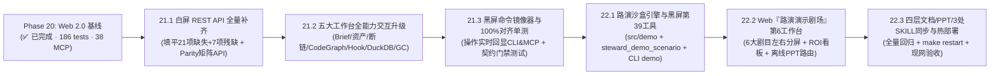

# Agent Host Steward — 黑白屏全能力对齐审计、路演产品策划与 Phase 21~22 演进路线图

> **编制**: Antigravity · **日期**: 2026-11-19  
> **基线 Commit**: `1d69999` (`v0.3.2`, Phase 1~20 全部交付，186 tests passed)  
> **对齐基准**: [README.md 核心设计原则与约束 §1-§15](../../README.md#L206-L271) & [未来演进与待探讨 ISSUE #6 / #7](../../README.md#L291-L294)  
> **断点续传检查点表**: [progress-phase21.md](progress-phase21.md)

---

## 一、代码与 README 全景扫描审计报告

在 Phase 1~20 完成后，对仓库全量源码（`src/` 下 22 个 `pub mod` 模块 + `src/main.rs` + `tests/`）、Web 2.0 控制台（`src/web/`）、两套路演幻灯片（`presentation.html`、`steward-deck.html`）以及 `README.md` 新增的 **ISSUE #6** 与 **ISSUE #7** 进行了逐项交叉审计。

### 1.1 当前实测基线事实

| 维度 | 实测基线数据 | 来源验证 |
|---|---|---|
| **模块与存储契约** | `src/lib.rs` 导出 **22 个顶层模块**；`StorageProvider` Trait 定义 **54 个方法**（SQLite / PostgreSQL / DuckDB 三后端） | `src/lib.rs`, `src/storage/spi.rs` |
| **黑屏侧（MCP / CLI / SKILL）** | `McpToolRegistry` 注册 **38 个原生 MCP 工具**，与 `src/main.rs` **25 个顶层 CLI `Commands` 子命令枚举** 100% 1:1 映射；沉淀 **3 套内置 SKILL** | `src/api/mcp_tools.rs`, `src/main.rs`, `skills/` |
| **白屏侧（Web UI / REST API）** | `WebServer` 暴露 **22 条 HTTP 路由**（3 类静态资源 `/app.{html,css,js}` + 1 条 SSE `/api/v1/stream` + 18 条 REST API），前端含 **5 大工作台**（`topology`, `facts`, `locks`, `ecosystem`, `governance`） | `src/web/server.rs`, `src/web/assets/mod.rs` |
| **质量与零 Panic 门禁** | `make lint-panic` 非测试生产路径 **0 处** `.unwrap()` / `.expect()`；`cargo test` **186 passed, 0 failed, 1 ignored** | `Makefile`, `cargo test` |

---

### 1.2 针对 ISSUE #6（黑屏与白屏功能双向同步）的 38 项全能力矩阵差距审计

> **ISSUE #6 原文**：“黑屏功能和白屏功能要同步，白屏主要体现在 WEB 端，黑屏体现在 MCP, SKILL, CLI 侧。”

对 `src/api/mcp_tools.rs` 中的 **38 个黑屏 MCP 工具（及对应 CLI 命令）** 与 `src/web/` 中的白屏能力逐一比对，发现当前白屏仅完整覆盖 **10 项**，**7 项** 仅静态展示或缺少关键交互参数，另有 **21 项完全缺失**；同时白屏操作缺乏向黑屏命令（CLI / MCP JSON-RPC）的实时映射回显：

| 领域分类 | 黑屏已具备的能力（MCP Tool / CLI 子命令） | 当前白屏（Web UI & REST API）状态 | 差距定性 |
|---|---|:---:|---|
| **A. 开工简报与放置规约** | 1. `steward_brief` (`steward brief`)：意图驱动自适应情境简报组装 + 质量评分 2. `steward_placement_suggest` (`steward place suggest`)：新对象放置路径推导、蛇形命名校验、冲突预警 3. `steward_placement_learn` (`steward place learn`)：聚类历史搬移行为，自演化推荐新规则 | ❌ 无 API / 无界面 ❌ 无推导沙盒（仅静态展示 `steward_placement_rules` 规则表） ❌ 无自演化候选预览 | **3 项缺失** |
| **B. 资产分级纳管与事实语义问答** | 4. `steward_asset_search` (`steward asset search`)：纳管资产 FTS5 检索与 `scan_tier` 标识 5. `steward_asset_register` (`steward asset register`)：手动登记资产与意图 KV 6. `steward_asset_scan` (`steward asset scan`)：目录黑白名单分级扫描（深度 vs 浅层阻断） 7. `steward_port_check` (`steward env port`)：指定端口防撞诊断 + 自动推荐空闲可用端口 8. `steward_fact_query` (`steward fact`)：跨 5 类事实的统一语义问答入口 | ❌ 无资产检索列表 ❌ 无资产登记入口 ❌ 无分级扫描演练 ⚠️ 仅端口列表，无防撞诊断与空闲端口推荐 ⚠️ 仅分 Tab 列表，无统一事实语义问答 | **3 项缺失 + 2 项残缺** |
| **C. 图智能深化与宏微联邦** | 9. `steward_links_audit` (`steward links audit`)：全局断链与悬空引用审计 + 健康评分 10. `steward_links_repair` (`steward links repair`)：基于 Levenshtein 与代码指纹推演断链修复补丁 11. `steward_links_visualize` (`steward links visualize`)：导出 Mermaid 拓扑源码 12. `steward_codegraph_bridge` (`steward links codegraph`)：从宏观文件节点下钻 CodeGraph 微观符号与调用链 | ❌ 无断链审计面板 ❌ 无断链智能修复预览 ❌ 无 Mermaid 导出 ❌ 拓扑节点抽屉无法下钻 CodeGraph 符号 | **4 项缺失** |
| **D. HOOK 门禁与 DuckDB 分析** | 13. `steward_hook_pre` (`steward hooks pre`)：事前静态冲突拦截（端口/协作锁/乱放违规） 14. `steward_hook_post` (`steward hooks post`)：事后变更通知与事实属性图增量刷新 15. `steward_hook_generate` (`steward hooks generate`)：生成 AGY/Cursor/Claude/Git 客户端 Hook 配置 16. `steward_analytics_heatmap` (`steward analytics heatmap`)：DuckDB 目录×时间变更热力图 17. `steward_analytics_trend` (`steward analytics trend`)：DuckDB 资产/记忆/变更时序趋势 18. `steward_analytics_export` (`steward analytics export`)：DuckDB 秒级导出 Parquet/CSV | ❌ 无 Pre-Hook 拦截演练场 ❌ 无 Post-Hook 触发器 ❌ 无客户端 Hook 生成器 ❌ 无 DuckDB 变更热力图 ❌ 无 DuckDB 趋势图 ❌ 无数据导出入口 | **6 项缺失** |
| **E. 记忆治理与生命周期自洁** | 19. `steward_memory_add` (`steward memory add`) & `steward_memory_search --hybrid` RRF 混合检索 20. `steward_memory_audit` (`steward memory audit`)：记忆半衰期衰减与对立语义矛盾仲裁 21. `steward_env_gc` (`steward gc`)：`/root/new/tmp/` 超期孤儿文件与僵尸进程 dry-run 诊断 22. `steward_session_close` (`steward close`)：会话完工结清清单预览与归档 | ❌ 无记忆写入 / ⚠️ 检索缺少混合 RRF 切换 ❌ 无记忆矛盾与衰减审计 ❌ 无宿主 GC 预览面板 ❌ 无会话结清 dry-run 面板 | **4 项缺失 + 1 项残缺** |
| **F. 协作锁申请/排队与生态/联邦主动交互** | 23. `steward_lock_acquire` & `steward_lock_wait`：申请协作锁或排队入队（触发 WFG 检测） 24. `steward_mcp_catalog(scan/route)`、`steward_service_contact(register/check)` & `steward_mesh_query(ping/port)`：主动扫描、探活与跨节点端口查询 | ❌ 缺少 Web 申请锁 (`lock_acquire`)；⚠️ 仅有等待队列列表而无入队操作 (`lock_wait`)，生态/Mesh 仅展示静态列表而缺少主动触发入口 | **1 项缺失 + 4 项残缺** |

> **双向同步缺口小结**：
> 1. **黑屏 → 白屏**：上述 **21 项缺失 + 7 项残缺** 能力必须在 Web REST API 与 Web UI 工作台中全部补齐，并提供自检端点 `GET /api/v1/parity/matrix` 验证 **100% 映射率**；
> 2. **白屏 → 黑屏**：Web 端的每次交互应实时回显等价的 **CLI 命令** 与 **MCP JSON-RPC 请求包**（黑白屏命令镜像器）；同时为 ISSUE #7 新增的 Web 路演演示引擎，必须反向同步注册为第 **39 个原生 MCP 工具 `steward_demo_scenario`**、CLI 子命令 `agent-steward demo` 以及 3 套 `SKILL.md` 指南。

---

### 1.3 针对 ISSUE #7（从产品经理与市场营销视角设计 Web 路演演示功能）的深度诊断

> **ISSUE #7 原文**：“要在 WEB 侧额外设计更多演示功能，路演和对外分享时使用，从产品经理和市场营销推广的角度来挑选哪些场景需要被拿来演示。”

站在 **产品经理与技术布道者（路演/大会演讲/视频号直播/开源推广）** 的视角审视当前 Web 控制台与根目录两份 PPT（[presentation.html](../presentation.html)、[steward-deck.html](../steward-deck.html)）：

1. **核心痛点 1 — 静态运维看板缺乏“痛点戏剧冲突”与“前后对比冲击力”**：
   - 平时系统健康运行时，看板显示 `0 死锁`、`0 冲突`。观众在 3 分钟路演中看不到 **“如果没有大管家，裸奔 Agent 会闯什么大祸（Without Steward）”** vs **“有了大管家，如何在亚毫秒内零幻觉化解危机（With Steward）”** 的直观对比。
2. **核心痛点 2 — 现场演示靠手敲多终端命令，门槛高且容易翻车**：
   - 要在台上展示“双 Agent 循环抢锁触发 WFG 死锁检测”或“Pre-Hook 拦截端口踩踏”，演讲者原本需要切多个黑屏终端手敲命令；缺少在 Web 端 **“一键沙盒实跑 + 实时拓扑/SSE 动画推流 + 一键无痕复位”** 的互动剧场。
3. **核心痛点 3 — 缺少可量化的商业价值账单（ROI Telemetry）与离线 PPT 一体化串联**：
   - 决策者与开发者最关心量化指标：**省了多少 % 的 Prompt Token？拦截了多少万个黑名单垃圾文件？核心 API 响应到底是不是微秒级（`μs`）？** 此外，根目录已有的 `steward-deck.html`（仍写“22 个工具”）与 `presentation.html` 尚未挂载进 `agent-steward web` 单二进制路由中。

---

## 二、产品演进方案对比与决策（第一性原理）

围绕 ISSUE #6 与 ISSUE #7，对比三种架构实现方案：

| 对比维度 | 方案 A：黑白屏 39 工具 100% 契约同步 + 真引擎隔离沙盒路演剧场（推荐） | 方案 B：前端硬编码写死几段假动画/假 JSON 应付路演 | 方案 C：仅在现有 5 个工作台零散加按钮，不设独立路演剧场 |
|---|---|---|---|
| **规约 #5（实事求是、零捏造）** | ✅ **100% 真引擎实跑**：所有路演剧目均调用宿主机真实 Rust 引擎（使用 `demo:*` 隔离沙盒命名空间并自动清理），输出真实微秒耗时 `elapsed_us` | ❌ 严重违反规约 #5（前端写死假数据，与 Phase 19 删除 `drawMockGraph` 背道而驰） | ✅ 调用真实接口 |
| **ISSUE #6（黑白屏双向同步）** | ✅ 补齐全部 38 项存量工具的白屏 API/UI + 新增第 39 工具 `steward_demo_scenario` & `steward demo` CLI + 全局黑屏命令镜像条 + 自动化 Parity 契约测试 | ❌ 演示逻辑仅存在于前端 JS，黑屏 CLI/MCP/SKILL 无法感知或调用 | ⚠️ 虽补齐接口，但缺乏统一的黑白屏命令镜像与 Parity 矩阵校验 |
| **ISSUE #7（路演与营销传播力）** | ✅ 独立 **「🎬 路演演示剧场」** 工作台：6 大王牌剧目、左右分屏（裸奔惨案 vs 管家护航）、ROI 价值仪表盘、自动巡航提词模式、内嵌 `/deck` 与 `/presentation` 离线 PPT | ⚠️ 表面热闹但禁不起现场观众提问或换参数实测 | ❌ 功能藏在深层表单里，路演时找不到故事主线，无法在 3 分钟内打动观众 |
| **生产安全性** | ✅ 所有写操作（如死锁模拟、GC/会话结清预览）严格限定在 `demo:*` 沙盒前缀或 `dry_run=true`，支持 1 键 `reset`，零污染生产库 | ✅ 无写操作 | ⚠️ 演讲者容易误操作真实锁或真实数据 |
| **结论** | ✅ **强烈推荐采纳** | ❌ 严禁采用（违背零捏造红线） | ❌ 不推荐（路演叙事碎片化） |

---

## 三、从产品经理与市场营销视角精选的「6 大黄金路演剧目」

结合 `README.md` 典型场景与 `steward-deck.html` 的五种翻车故事线，按 **“痛点共鸣强 → 视觉反差大 → 技术护城河深 → 商业 ROI 清晰”** 四个标准，精选 6 个标准路演剧目（由 `src/demo/mod.rs` 真引擎驱动）：

| 剧目 ID | 路演剧目名称 & 营销金句 | 左屏：裸奔 Agent 惨案现场 (Without Steward) | 右屏：大管家真引擎毫秒级护航 (With Steward 实跑) | 底层调用的真实引擎 & 黑屏映射 |
|:---:|---|---|---|---|
| **Scene 1** | **【防扫爆 & 武器库发现】** *“敲门但不进屋，不做装了 pdftotext 却去折腾 pip 的盲人”* | Agent 盲目全盘递归扫描工作区，把 `node_modules` / `.git` / `.cache` 数十万文件塞爆索引并触碰 `.ssh`；不知宿主机已装系统工具，反复 `pip install` 报错。 | 实跑 `CapabilityEngine` + `Scanner` 分级策略：展示白名单 `deep` 解析 vs 黑名单 `shallow` 浅层阻断（止于当层目录，过滤 >98% 垃圾文件），秒级返回宿主机真实 CLI 武器库与推荐参数。 | `steward_fact_query` `steward_asset_scan` `agent-steward fact / asset scan` |
| **Scene 2** | **【事前防撞 & Pre-Hook 急刹车】** *“把线上端口撞车和满地乱丢脚本扼杀在命令执行前 1 毫秒”* | Agent 在项目根目录随手创建 `TmpCrawler.py` 污染工作区，并尝试绑定宿主机的活跃监听端口（如 `:8756` / `:8080`），直接导致服务冲突崩溃。 | 实跑 `PlacementEngine` + `PortChecker` + `steward_hook_pre`：识别宿主机当前真实活跃端口占用进程/PID/目录，触发 Pre-Hook `BLOCK/WARN` 门禁，自动推荐空闲端口与 `/root/new/shared_proj/` 蛇形命名路径。 | `steward_hook_pre` `steward_port_check` `steward_placement_suggest` |
| **Scene 3** | **【蝴蝶效应 & 宏微双层穿透】** *“改一行代码前，先看清会炸到哪个 systemd 服务与定时任务”* | Agent 贸然重命名或修改一个公共脚本，不知后台 `systemd` 服务与凌晨 `crontab` 依赖它，导致断链与线上静默挂死。 | 实跑 `LinksEngine` 3 跳逆向爆炸半径 + `CodeGraphBridge` 微观符号下钻 + `LinkRepairer` 断链相似度自愈补丁推演，并在拓扑图联动高亮受影响链路。 | `steward_links_impact` `steward_codegraph_bridge` `steward_links_audit / repair` |
| **Scene 4** | **【多 Agent 并发抢锁 & WFG 死锁破局】** *“当多个 Agent 交叉抢占端口与目录，如何自动识别死锁环路？”* | Agent-Alpha 锁住端口等目录，Agent-Beta 锁住目录等端口；双方在无协调中心下无限轮询死等或暴力覆盖彼此代码。 | 在 `demo:*` 隔离命名空间内真实注入 `demo-agent-alpha` 与 `demo-agent-beta` 交叉持锁与 Wait-Queue 排队，实跑 `DeadlockDetector` (WFG DFS 环路检测)，在屏幕实时绘出死锁环路并推送 SSE 退让裁决，演练后支持一键清除沙盒锁。 | `steward_lock_acquire` `steward_lock_wait` `steward_lock_deadlock_check` |
| **Scene 5** | **【百级 SKILL Context 防爆路由器】** *“121+ 个 SKILL 全塞进 Prompt 必爆无疑，按预算精准路由省下 95%+ Token”* | 宿主机挂载 121+ 个 SKILL（全量约 45,000+ Tokens）与多个 MCP，全量塞入上下文导致注意力劣化、首字延迟飙升、账单爆炸。 | 实跑 `ContextBudgetRouter`（在 600 Token 预算下对多组真实任务意图做毫秒级评分路由），直观对比全量 Tokens vs 路由后 Tokens（节省率 >95%），精准召回 Top-K SKILL、MCP 与外部服务名片。 | `steward_skill_route` `steward_mcp_catalog` `steward_service_contact` |
| **Scene 6** | **【完工自洁 & 自适应开工简报】** *“干完活片叶不沾身，新 Agent 接手一秒继承完整记忆与态势”* | 旧 Agent 会话结束在 `/root/new/tmp/` 留下大批孤儿文件与互相矛盾的脏记忆；新 Agent 启动时两眼一抹黑重新踩坑。 | 实跑 `BriefAssembler`（生成带质量评分的三位一体自适应开工简报）+ `MemoryLifecycleManager`（记忆衰减与矛盾仲裁）+ `HostGarbageCollector`（`dry_run` 安全回收预览）。 | `steward_brief` `steward_memory_audit` `steward_env_gc` `steward_session_close` |

---

## 四、Phase 21 ~ Phase 22 演进路线图与原子任务计划

---

### Phase 21：黑白屏全能力双向同步与全景工作台升级（对齐 ISSUE #6 & 规约 #8/#9/#12/#13）

- **战略目标**：消除黑屏（38 个 MCP 工具 / CLI 子命令）与白屏（Web REST API / Web UI）之间的全部能力剪刀差，实现 **100% 黑白屏功能同源对齐**，并在白屏端内置实时「黑屏命令镜像器（CLI & MCP JSON-RPC Inspector）」。

#### 21.1 白屏后端 REST API 全量补齐与 Parity 自检矩阵
| 原子任务 | 涉及路径 | 具体改造方案 | 验收门禁 |
|---|---|---|---|
| **21.1.1** | `src/web/parity_api.rs` (新增) `src/web/mod.rs` `src/web/server.rs` | 补齐领域 A/B/C 的白屏 REST API： 1. `GET /api/v1/brief?intent=...&budget=2000`：调用 `BriefAssembler` 输出自适应情境简报 Markdown 与质量评分； 2. `POST /api/v1/placement/suggest` & `GET /api/v1/placement/learn`：调用 `PlacementEngine` 推导放置路径/蛇形命名校验，调用 `PlacementLearner` 输出自演化候选规则； 3. `GET /api/v1/assets/search?q=...`、`POST /api/v1/assets/register`、`POST /api/v1/assets/scan`：资产检索、登记与目录黑白名单分级扫描； 4. `GET /api/v1/facts/port-check?port=8080` & `GET /api/v1/facts/query?q=...&type=auto`：端口防撞诊断（含推荐空闲端口）与统一事实语义问答； 5. `GET /api/v1/links/audit`、`GET /api/v1/links/repair`、`GET /api/v1/links/mermaid`、`GET /api/v1/links/codegraph?path=...&symbol=...`：断链审计、智能修复补丁预览、Mermaid 导出与 CodeGraph 宏微桥接。 | 新增接口全部返回 `WebResponse<T>`，0 `.unwrap()`，`cargo check` 零警告。 |
| **21.1.2** | `src/web/parity_api.rs` `src/web/locks_api.rs` `src/web/server.rs` | 补齐领域 D/E/F 的白屏 REST API 与黑白屏对齐矩阵接口： 1. `POST /api/v1/hooks/pre`、`POST /api/v1/hooks/post`、`GET /api/v1/hooks/generate?client=agy`：Pre-Hook 冲突拦截、Post-Hook 回写与客户端 Hook 配置生成； 2. `GET /api/v1/analytics/heatmap?days=30`、`GET /api/v1/analytics/trend?metric=assets&days=30`、`POST /api/v1/analytics/export`：DuckDB 变更热力图、趋势统计与受控导出（限定 `/root/new/tmp/` 安全路径）； 3. `POST /api/v1/memories/add`、`GET /api/v1/memories/search?q=...&hybrid=true`、`GET /api/v1/memories/audit`：记忆写入、混合检索与衰减/矛盾审计； 4. `GET /api/v1/env/gc?max_age_hours=72` & `POST /api/v1/session/close`：默认强制 `dry_run=true` 的宿主 GC 预览与会话完工结清清单； 5. `POST /api/v1/locks/acquire`、`POST /api/v1/locks/wait`、`GET /api/v1/ecosystem/service-check?name=...`、`GET /api/v1/mesh/query?action=ping`：Web 端主动锁申请/排队、外部服务实时探活与联邦节点查询； 6. `GET /api/v1/parity/matrix`：自动内省全部 MCP 工具与 CLI/Web API/Web 视图的 1:1:1 映射状态，返回覆盖率报告。 | `/api/v1/parity/matrix` 实测返回全部 MCP 工具 100% 映射完成；破坏性操作默认强制 `dry_run`。 |

#### 21.2 白屏前端 5 大工作台交互升级与「黑屏命令镜像器」
| 原子任务 | 涉及路径 | 具体改造方案 | 验收门禁 |
|---|---|---|---|
| **21.2.1** | `src/web/assets/mod.rs` | 升级工作台 1~3 并内置全局「⌨️ 黑屏命令镜像抽屉/底栏 (CLI & MCP Inspector)」： 1. **工作台 1（事实拓扑）**：节点详情抽屉新增「🔬 CodeGraph 微观符号穿透」按钮；顶部工具栏新增「🩺 断链审计 & 修复补丁推演」与「📐 导出 Mermaid 源码」面板； 2. **工作台 2（事实雷达）**：顶部新增「🔍 统一事实语义问答 (`fact_query`)」与「🛡️ 端口防撞诊断器 (`port_check`)」快捷栏；子 Tab 新增「📦 纳管资产检索、登记与分级扫描 (`asset search/register/scan`)」； 3. **工作台 3（协作锁与死锁）**：新增「➕ 申请协作锁 / 排队等待 (`lock acquire / wait`)」交互栏，支持直接在白屏测试互斥与排队； 4. **全局黑屏命令镜像条**：任何白屏面板查询或操作时，同步展示等价的 `agent-steward <subcommand>` 与 `MCP JSON-RPC` 请求示例，支持一键复制。 | 工作台 1~3 新增交互全部接通真实 API，黑屏命令镜像实时更新。 |
| **21.2.2** | `src/web/assets/mod.rs` | 升级工作台 4~5： 1. **工作台 4（生态路由与 HOOK 门禁）**：新增「🪝 Pre/Post-Hook 门禁演练场 & 客户端配置生成器 (`agy/cursor/claude/git`)」卡片；外部服务列表新增「⚡ 探活」按钮； 2. **工作台 5（规约·简报·记忆·DuckDB 分析·自洁与 Mesh）**： - 新增「📋 自适应开工简报组装器 (`steward_brief`)」； - 放置规则升级为「🧭 交互式放置推导器 (`place suggest`) + 自演化候选 (`place learn`)」； - 记忆面板新增「✍️ 写入记忆 + RRF 混合检索 + 🩺 记忆矛盾/衰减审计 (`memory audit`)」； - 新增「🔥 DuckDB 变更热力图 & 趋势统计 (`analytics heatmap/trend`)」与「🧹 宿主 GC / 会话完工结清预览 (`gc / close --dry-run`)」； - Mesh 面板新增「🌐 Peer Ping / 联邦端口查询」按钮与「✅ 黑白屏 100% 同步矩阵」徽章。 | 38 项黑屏能力在 5 大工作台全部拥有可视化交互入口，无任何死桩。 |

---

### Phase 22：Web 路演演示剧场与产品营销互动引擎（对齐 ISSUE #7 & ISSUE #6 反向同步）

- **战略目标**：从产品经理与市场营销视角打造 **「🎬 路演与场景演示剧场 (Roadshow & Live Demo Theater)」**，提供 6 大黄金剧目的真引擎隔离沙盒推演、左右分屏对比、商业价值 ROI 实时账单、自动巡航演讲模式及离线 PPT 直达，并反向同步为第 39 个 MCP 工具与 CLI `demo` 子命令。

#### 22.1 路演沙盒内核引擎 `src/demo/` 与黑屏反向同步（39 MCP + CLI）
| 原子任务 | 涉及路径 | 具体改造方案 | 验收门禁 |
|---|---|---|---|
| **22.1.1** | `src/demo/mod.rs` (新增) `src/lib.rs` | 1. 构建 `DemoEngine`：提供 `list_scenarios()`、`run_scenario(id)`、`compute_roi()`、`reset_sandbox()` 四大核心能力； 2. 实现第三节定义的 **6 大黄金路演剧目**，每个剧目返回结构化 `DemoExecutionResult`： - `without_steward`（裸奔惨案痛点、典型报错信息、灾难代价评估）； - `with_steward`（本机真实 Rust 引擎实跑输出、实测微秒耗时 `elapsed_us`、拦截/优化结论）； - `roi_metrics`（Token 节省率、阻断垃圾文件比例、响应延迟对比）； - `black_screen_mirror`（等价的 CLI 命令与 MCP JSON-RPC Payload）； - `speaker_notes`（面向路演演讲者的 30 秒金句提词卡）； 3. 沙盒隔离保证：剧目 4（WFG 死锁演练）等涉及状态写入的场景统一使用 `demo:` 资源前缀（如 `demo:port:19090`、`demo:dir:/work/demo_app`），支持 `reset_sandbox()` 一键毫秒级清除，绝不触碰真实业务锁或生产文件。 | 6 大剧目 100% 调用真实引擎实跑，实测耗时 `<50ms`，`reset_sandbox()` 后数据库无残留。 |
| **22.1.2** | `src/api/mcp_tools.rs` `src/main.rs` `src/web/server.rs` | 1. **反向同步至黑屏 MCP（第 39 个原生工具）**：在 `McpToolRegistry` 注册 `steward_demo_scenario`（支持 `action = "list" | "run" | "roi" | "parity" | "reset"` 及 `scenario_id`）； 2. **反向同步至黑屏 CLI**：在 `src/main.rs` 新增 `agent-steward demo {list, run <id>, roi, parity, reset}` 子命令； 3. **挂载白屏 Web API 与离线 PPT 路由**：在 `src/web/server.rs` 新增 `GET /api/v1/demo/scenarios`、`POST /api/v1/demo/run`、`POST /api/v1/demo/reset`、`GET /api/v1/demo/roi`，并新增 `GET /deck`（返回 `steward-deck.html`）与 `GET /presentation`（返回 `presentation.html`），执行路演剧目时同步向 SSE `/api/v1/stream` 广播实时路演事件。 | MCP 39 工具与 CLI 26 命令族 1:1 对齐；`/api/v1/parity/matrix` 自动包含第 39 工具且覆盖率 = 100%。 |

#### 22.2 Web UI「🎬 路演演示剧场」第 6 工作台与演讲者模式
| 原子任务 | 涉及路径 | 具体改造方案 | 验收门禁 |
|---|---|---|---|
| **22.2.1** | `src/web/assets/mod.rs` | 1. 在左侧主导航新增醒目的 **「🎬 路演演示剧场」** 工作台（支持顶部一键进入「📽️ 演讲者大屏模式」及跳转离线 `/deck`、`/presentation` PPT）； 2. **顶部商业价值与 ROI 实时账单条**：展示宿主机实测 Context Token 节省率（>95%）、黑名单浅层阻断保护率、核心引擎微秒级延迟、单二进制轻量内存账单与「39/39 黑白屏 100% 同步」认证徽章； 3. **6 大王牌剧目点播台 + 自动路演巡航 (Auto-Cruise)**：支持点击任一剧目立即实跑，或开启「▶ 自动巡航路演（每幕 8 秒自动推进 + 进度条 + 空格暂停 + `←/→` 切幕 + 一键清理沙盒）」； 4. **左右分屏对比舞台 + 演讲者提词卡 + 黑屏命令同步框**：左屏红框呈现“裸奔 Agent 惨案”，右屏青绿框呈现“大管家真引擎微秒级护航结果 + 死锁/爆炸半径可视化高亮 + 演讲者金句提词 + CLI/MCP 等价代码”。 | 路演剧场视觉冲击力强、无文字重叠或越界，6 大剧目一键实跑与自动巡航丝滑稳定。 |

#### 22.3 自动化测试、四层贯通文档/PPT/SKILL 同步与现网热部署
| 原子任务 | 涉及路径 | 具体改造方案 | 验收门禁 |
|---|---|---|---|
| **22.3.T** | `src/demo/mod.rs` `src/web/mod.rs` `tests/test_web_dashboard.rs` | 1. 新增 `demo::tests` 单元测试：验证 6 大路演剧目真引擎执行、ROI 核算与 `reset_sandbox()` 零残留； 2. 新增黑白屏 Parity 契约测试：自动校验 `McpToolRegistry::list_tools()` 全部 39 个工具与 `/api/v1/parity/matrix` 100% 对齐； 3. 扩展 `tests/test_web_dashboard.rs` 端到端测试覆盖新增 Parity API、Demo API 与 `/deck`、`/presentation` 路由。 | `make lint-panic` 0 违规；`cargo check --tests` 0 warnings；`cargo test` 全绿（>= 195 passed）。 |
| **22.3.D** | `README.md` `docs/manual/03,04,08` `docs/arch/02` `steward-deck.html` `skills/agent-steward-*` | 1. 更新 `README.md`（标注 ISSUE #6、#7 已落地状态，更新 39 个 MCP 工具说明）、`docs/manual/03-cli-reference.md`、`docs/manual/04-mcp-integration.md`（39 工具完整字典）、`docs/manual/08-web-dashboard.md`（6 大工作台 + 路演演示剧场 + 黑白屏同步矩阵）、`docs/arch/02-for-developers.md`； 2. 刷新 `steward-deck.html` 中的工具数（39 个）与演进状态； 3. 同步 3 套 `SKILL.md` 至项目 `skills/`、`/root/new/skills/` 与 `/root/.gemini/antigravity-cli/skills/`； 4. 执行 `make restart` 热更新现网 `agent-steward.service`，实测现网 API 并通过 `rsync` 同步至 `/root/new/shared_git/agent-steward`。 | 四层文档与 3 处 SKILL 100% 一致；现网 `8756` 端口实测 39 工具同步矩阵与 6 大路演剧目全部正常。 |

---

## 五、DoD 总体交付门禁

1. **黑白屏 100% 同步硬门禁（ISSUE #6）**：`GET /api/v1/parity/matrix` 与自动化单元测试强制断言 **39 个 MCP 工具 × CLI 子命令 × SKILL × Web API/UI 100% 对齐**，无任何单边黑盒功能。
2. **真引擎零捏造硬门禁（ISSUE #7 & 规约 #5）**：路演剧场 6 大剧目全部由宿主机真实 Rust 引擎驱动，所有模拟锁/资产严格限制在 `demo:*` 沙盒命名空间并可一键无痕复位。
3. **零 Panic 与零警告红线（规约 #12 & #13）**：`make lint-panic` 严格保持 0 处生产 `.unwrap()` / `.expect()`，`cargo check --tests` 0 warnings。
4. **四层贯通与现网热部署闭环（规约 #10 & #11）**：代码、配置、手册/PPT、3 处全局 SKILL 以及现网 `agent-steward.service`、`/root/new/shared_git/agent-steward` 全部同步到位。
