# Agent Host Steward — Phase 30 ~ Phase 31 演进路线图：实际使用反馈闭环攻坚与 Benchmark 标准 v2.0 持续迭代

> **编制**: Antigravity · **日期**: 2026-11-19  
> **基线 Commit**: `cf38f53` (`v0.4.0` + Phase 29 全景属性字典 & 全链路 Ollama Embedding 已合入)  
> **对齐基准**: [README.md 规约 #1-#18](../../README.md#L209-L286) · [user_feedback.md](../../user_feedback.md) · [10-benchmark-spec.md](../design_doc/10-benchmark-spec.md)  
> **断点续传检查点表**: [progress-phase30.md](progress-phase30.md)

---

## 一、现网审计与立项背景（从真实数据逆向定位主要矛盾）

在完成 Phase 29 后，我们在本机现网环境（`/root/.steward/steward.db` + `./target/release/agent-steward`）进行了首次面向“真实生产体感 + Benchmark 标准校准”的全面核验，实测揭示出两组鲜明反差：

1. **底座资产治理已非常扎实（`PRO-01` ~ `PRO-05`）**：
   - `assets` 21,188 条、`fact_nodes` 350 个已 **100%** 补齐 `description` 与本地 Ollama Embedding 向量；
   - 微基准核心算子全面优于 SLA：`M1` 3 跳图遍历 P50 `129 μs`、`M2` FTS5 检索 P50 `250 μs`、`M3` 放置引擎 P50 `33 μs`；
   - `W7` 百级 SKILL 预算路由将 `450,003 tok` 压缩至 `358 tok`（`-99.9%`）。
2. **实际使用痛点与 Benchmark 评测口径失真成为当前主要矛盾（`CON-01` ~ `CON-06`, `BENCH-01` ~ `BENCH-04`）**：
   - **生产体感痛点**：
     - `steward_brief` 冷启动组装实测 **`474.18 ms`**（`W8`），比裸跑 6 条 Shell（`43.99 ms`）慢 10.7 倍，因为 `BriefAssembler::build_fact_section` 绕过了已索引的 `fact_nodes` / `assets` 持久化表，每次请求都重新遍历目录并派生外部 `git` 进程；
     - `agent-steward links audit` 报告 **101 处断链（健康分 `0/100`）**，其中至少 **77 处（`76.2%`）** 为动态模板截断（`%s`/`{var}`）、示例占位符（`...`/`xxx`）、`/tmp/` 临时路径和 `.json` 数据误判端口导致的假阳性；
     - `effectiveness_ledger` 仅记录 **4 条**流水，CLI 与 Web API 调用均未入账；`memories` 长期记忆表仅 **2 条**，导致简报里占比高达 40% 的记忆预算长期饥饿；
     - **磁盘水位与 GC 盲区（现场捕获 `CON-06`）**：同步 `/root/new/shared_git/agent-steward` 时暴露出 `work` 与 `shared_git` 两处 `target/` 构建缓存共占用 **`91GB`**（`53GB + 38GB`），直接将 233GB 根分区打满至 `100% (0 Avail)`，而大管家事前未给出磁盘高水位预警或冗余构建产物 GC 建议。
   - **Benchmark 标准本身存在失真**：
     - 算术总耗时比 `sum(base_us)/sum(stew_us)` 被单项 `W8` 拖垮至 **`0.38x`**；
     - `W2`、`W3`、`W4`、`W7` 的 Without vs With 对照存在物理不等价（如 `W4` Baseline 仅拼 8 行短字符串 `119 tok` vs Steward JSON `177 tok`，出现 `-48.7%` 负优化假象）；
     - 五维指标（`D1~D5`）缺乏 **D6 质量与准确率（Recall@K / Precision / 覆盖率）** 门禁，且未覆盖 Phase 29 的向量检索与复杂模板抗误报回归。

---

## 二、第一性原理候选方案对比与决策

| 对比维度 | 方案 A：「反馈—修复—基准迭代」双闭环演进架构（推荐） | 方案 B：纯文档台账 + 微调现有 `W1~W8` 阈值 | 方案 C：引入外部 LLM-as-a-Judge 在线打分套件 |
|---|---|---|---|
| **核心做法** | 1. 落地 `user_feedback.md` 权威总账与反馈→记忆沉淀漏斗； 2. 优先攻克 `CON-01~06` 生产痛点（含磁盘高水位与冗余 `target/` GC）； 3. 推进 Benchmark 标准版本化迭代（`v1.0 → v2.0`）：引入几何平均加速比、`D6` 质量维度、等价基线校准及 `W9/W10/DQ1~DQ3` 回归库。 | 仅维护静态 Markdown 台账，并在原 `W1~W8` 上调松或修改部分文本输出，不改 `BriefAssembler` / `LinksEngine` 核心路径。 | 调用外部大模型 API 对每次简报/搜索进行自然语言主观打分。 |
| **解决主要矛盾能力** | ✅ **治本**：既解决真实慢路径与 76.2% 断链假阳性，又从方法论上消除 Benchmark 失真并固化持续迭代机制。 | ❌ **治标不治本**：慢启动、假断链、记账漏失与对照组不等价依然存在。 | ⚠️ **偏离宿主定位**：无法校准微秒延迟与确定性精度指标。 |
| **工程规范与边界（规约 #2, #9, #18）** | ✅ 100% 本地确定性、亚毫秒/秒级自包含跑批、零云端 Token 消耗。 | ✅ 零外部依赖 | ❌ 违反规约 #2（不承担业务 LLM 推理）与 #9（亚毫秒响应），且单次跑批昂贵慢速。 |
| **可复现与可演进性** | ✅ `spec_version` 版本化隔离对比，后续每条 `user_feedback.md` 缺陷均可直接升级为回归语料。 | ⚠️ 缺乏跨版本标准演化协议。 | ❌ 受外部模型漂移影响，SHA-256 不可重复。 |
| **决策结论** | ✅ **强烈推荐采纳** | ❌ 不采纳 | ❌ 不采纳 |

**推荐理由（第一性原理）**：Benchmark 不是一次性写死的装饰品，而是产品质量的“刻度尺”。当实际使用证明产品本身有慢路径（`CON-01`）或误报（`CON-02`），同时刻度尺本身存在量纲扭曲（`BENCH-01`）与对照不公（`BENCH-02`）时，唯一正确的做法是**建立 `user_feedback.md` → 代码修复 → Benchmark 刻度升级的同步双闭环**——既不靠修改刻度尺来粉饰真问题，也不让有缺陷的刻度尺误导研发方向。

---

## 三、Benchmark 标准持续迭代机制设计 (`v1.0 → v2.0+`)

为确保 Benchmark 能够伴随项目长期演进而不丧失历史可比性，确立以下 4 条核心迭代协议：

### 3.1 原则 1：基准规格版本化 (`spec_version`)
- 在 `BenchmarkReportPayload` 与 `benchmark_runs` 表中显式持久化 `spec_version`（现有 `v1.0` 保持只读历史存证，新标准标记为 `v2.0`）。
- `compare_runs(run_a, run_b)` 在跨 `spec_version` 比对时自动提示口径差异，仅对共享工作负载与同类 SLA 做精准回归判定，严禁悄悄覆盖旧版历史口径。

### 3.2 原则 2：五维评估升级为六维正交矩阵 (`D1` ~ `D6`)
在现有 `D1`（Token 经济性）、`D2`（轮次收敛）、`D3`（端到端延迟）、`D4`（风险拦截）、`D5`（噪音阻断）基础上，新增第 6 维：

| 维度 ID | 维度名称 | 核心量化指标 | 物理门禁目标 |
|:---:|---|---|---|
| **D6** | **认知质量与准确率** (`Quality & Precision`) | `recall_at_k` / `mrr` `extraction_precision_pct` `false_positive_rate_pct` `metadata_emb_coverage_pct` | 混合检索 `Recall@5 >= 90%` 依赖抽取假阳性率 `< 5%` 核心资产描述/向量覆盖 `>= 99%` |

### 3.3 原则 3：科学的综合加速比汇总口径
- **主口径**：采用 **几何平均加速比 (`geometric_mean_speedup = (∏ speedup_i)^(1/N)`)**，消除单个重耗时负载对全局加速比的极端扭曲；
- **分组口径**：同时报告 **只读认知/防撞类 (`Query/Guard`: W1, W2, W4, W6, W7, W8, W9)** 与 **索引/分析治理类 (`Governance/Index`: W3, W5, W10)** 两组子加速比；
- **原口径保留**：保留 `arithmetic_total_speedup`（即 `sum(base_us)/sum(stew_us)`）作透明对照参考，绝不隐藏任何不利数字。

### 3.4 原则 4：反馈驱动的回归语料库 (`Feedback Regression Corpus`)
- 每当 `user_feedback.md` 确认一条真实生产痛点（如 `CON-01` Brief `474ms` 慢查询、`CON-02` `%s`/f-string 断链误报），完成修复后**必须将其脱敏复现样本写入 Benchmark 回归负载**（如 `W10` 与 `DQ1~DQ3`），做到“踩过的坑永不再犯”。

---

## 四、Phase 30 ~ Phase 31 演进全景与原子任务拆解

```mermaid
flowchart LR
    P29["Phase 29 基线\n(cf38f53 · 全景属性 + 向量)"] --> S30_1["30.1 user_feedback.md 总账\n& Phase 30-31 路线图"]
    S30_1 --> S30_2["30.2 BriefAssembler 索引优先\n(474ms -> <10ms)"]
    S30_2 --> S30_3["30.3 LinksEngine 假阳性治理\n(101 断链误报清零)"]
    S30_3 --> S30_4["30.4 全渠道账本 PR-01~10\n(CLI + Web + MCP 记账)"]
    S30_4 --> S30_5["30.5 反馈联动 & 记忆沉淀\n(激活 memories 40% 预算)"]
    S30_5 --> S30_6["30.6 磁盘水位预警 & 构建 GC\n(防 91GB target 满盘)"]
    S30_6 --> S31_1["31.1 Benchmark v2.0 协议\n(spec_version + Geomean + D6)"]
    S31_1 --> S31_2["31.2 W1~W8 等价基线校准\n(消除 -48.7% 与 0.00x 偏差)"]
    S31_2 --> S31_3["31.3 新增 W9 向量检索\n& W10 抗假阳性基准"]
    S31_3 --> S31_4["31.4 新增 DQ1~DQ3 数据门禁\n& 跨版本 Compare"]
    S31_4 --> S31_5["31.5 WebUI v2.0 + 四层文档\n+ 现网热部署验收"]
```

### 4.1 Phase 30：实际使用痛点攻坚与反馈—记忆—账本闭环（对应 `CON-01` ~ `CON-06`）

> 预期粒度：6 个串行原子步骤，每步 ≤ 30 分钟；严格执行 TDD、零 `unwrap`/`expect` 与 100% 黑白屏同步。

| 步骤 ID | 原子任务 | 涉及文件 | 具体改造方案 | 验收门禁 (DoD) |
|:---:|---|---|---|---|
| **30.1** | **`user_feedback.md` 建立与路线图登记** | `user_feedback.md` `docs/src_doc/roadmap-phase30.md` `docs/src_doc/progress-phase30.md` `README.md`, `docs/src_doc/progress.md` | 基于现网实测数据建立 `PRO/CON/BENCH/REQ` 反馈总账与 Phase 30~31 断点路线图，并同步索引与镜像仓库。 | ✅ 本步骤已就绪（事实与数字 100% 源自现网实查）。 |
| **30.2** | **`BriefAssembler` 索引优先加速（修复 `CON-01`）** | `src/brief/assembler.rs` `src/fact/mod.rs` `src/fact/assets_catalog.rs` `src/api/mcp_tools.rs` | 1. `build_fact_section()` 优先从 `Storage` 的 `fact_nodes`（`tool`/`port`/`project`）和 `assets` 表毫秒级查询组装，仅当表为空或 `fresh=true` 时才触发实时扫盘/子进程； 2. 优化 `ProcessNetTopology` 缓存 TTL，避免 `hook_pre` + `PortChecker` 重复读 `/proc`。 | `steward_brief` / `W8` 实测延迟从 `474.18 ms` 降至 **`< 10 ms`**，单测全绿。 |
| **30.3** | **`LinksEngine` 与 `LinkAuditor` 假阳性脱敏治理（修复 `CON-02`）** | `src/links/mod.rs` `src/links/extractor.rs`（或抽取子模块） `src/links/audit.rs` | 1. 识别并跳过含 `%s`/`%d`/`%f`/`{var}`/`<var>`/`...`/`xxx`/`placeholder` 的动态格式化模板路径； 2. 跳过 `.json`/`.jsonl`/`.csv` 纯数据文件的端口服务正则匹配； 3. 将 `/tmp/` 与 `/root/new/tmp/` 归类为 `ephemeral` 临时边，不计入断链扣分； 4. 现网库刷新提取与旧假边清理。 | 针对 `CON-02` 样本集测试 **Precision >= 95%**；现网 `links audit` 假阳性 `< 5%`，健康分恢复至 `>= 90/100`。 |
| **30.4** | **全渠道生产效能账本与 `PR-01~10` 扩展（修复 `CON-03`）** | `src/benchmark/provenance.rs` `src/benchmark/ledger.rs` `src/main.rs` `src/web/` | 1. 新增 `PR-09`（语义向量 + FTS RRF 混合检索）与 `PR-10`（反馈与长期记忆沉淀）； 2. 抽离轻量非阻塞 `record_action()`，补齐 CLI 高频只读命令与 Web API 调用记账； 3. 过滤空操作噪音事件，保持账本高信噪比。 | 执行 CLI `brief` / `search` / `links audit` 后 `effectiveness_ledger` 真实递增带 `PR-*` 规则记录，单次耗时 `< 100 μs`。 |
| **30.5** | **`user_feedback.md` 双向联动与反馈转长期记忆沉淀（修复 `CON-04`, `CON-05`）** | `src/feedback/mod.rs`（或轻量模块） `src/memory/mod.rs` `src/api/mcp_tools.rs` `src/main.rs`, `src/web/` | 1. 提供 `feedback list/add/verify` 能力，结构化解析与追加 `user_feedback.md`（不破坏人工 Markdown 格式）； 2. 在反馈标记为 `✅ Verified` 或触发 `session_close` 时，自动将根因与经验摘要生成 Ollama Embedding 写入 `memories` 表； 3. 保持黑白屏（CLI/MCP/WebUI）1:1 对齐。 | `memories` 表可真实沉淀经验并被 `steward_brief` 40% 记忆预算召回；`parity/matrix` 100% 通过。 |
| **30.6** | **宿主磁盘高水位预警与冗余构建缓存 GC 硬化（修复 `CON-06`）** | `src/preflight/mod.rs` `src/env/gc.rs` `Makefile` `skills/agent-steward-developer/SKILL.md` | 1. `PreflightChecker` 与 `steward_env_gc` 增加宿主机磁盘使用率（`>= 85%` 告警 / `>= 95%` 严重告警）及 `shared_git/` 冗余构建产物（`target/`、`node_modules/`）只读 `dry-run` 扫描建议； 2. 在 `Makefile` 新增 `sync-mirror` 目标并更新 SKILL，固化 `rsync -a --delete --exclude 'target/'`。 | `preflight` / `env gc --dry-run` 可精准检出冗余 `target/` 并给出可回收 GB 数；`make sync-mirror` 零误拷 `target/`。 |

---

### 4.2 Phase 31：Benchmark 标准 `v2.0` 持续迭代升级（对应 `BENCH-01` ~ `BENCH-04` & `REQ-02` ~ `REQ-03`）

> 预期粒度：5 个串行原子步骤，每步 ≤ 30 分钟；严格保证 `v1.0` 历史可查、`v2.0` 物理等价、零捏造。

| 步骤 ID | 原子任务 | 涉及文件 | 具体改造方案 | 验收门禁 (DoD) |
|:---:|---|---|---|---|
| **31.1** | **Benchmark `v2.0` 规格协议与六维模型扩展** | `src/benchmark/mod.rs` `src/benchmark/report.rs` `src/storage/{schema,pg_schema,duckdb_schema}.sql` `src/storage/models.rs` | 1. 在 `BenchmarkReportPayload` / `benchmark_runs` 增加 `spec_version`（默认 `"2.0"`）、`geometric_mean_speedup`、`query_guard_speedup` 与 `d6_quality_score`； 2. 为 `WorkloadResult` 新增可选 `quality_score` / `precision_pct` / `recall_pct` 字段； 3. 保证读取旧版 `"1.0"` 记录向后兼容反序列化。 | 兼容读取现网 3 条 `v1.0` 历史 `benchmark_runs` 记录；单测覆盖几何平均与旧版反序列化。 |
| **31.2** | **`W1~W8` 物理等价基线校准（修复 `BENCH-02`）** | `src/benchmark/workloads.rs` | 1. **`W2`**：Baseline 改为等价外调探测 + 试错重连，Steward 合并单次 `/proc` 检查； 2. **`W3`**：Baseline 改为在隔离内存库将 290 个文件全量读取并写入 SQLite+FTS5，对比 Steward 分级过滤入库； 3. **`W4`**：Baseline 计量 8 个错放文件从发现违规、规范回溯到重命名搬移的真实返工上下文，消除 `-48.7%` 畸变； 4. **`W7`**：Baseline 真实读取磁盘 `SKILL.md` 文件耗时（受控缓存/文件数），移除硬编码 `base_us.max(stew_us)`。 | `W1~W8` 全部物理等价、100% 真实运行，无硬编码拉平逻辑，SLA 全绿。 |
| **31.3** | **新增 `W9`（混合检索召回）与 `W10`（模板抗假阳性）** | `src/benchmark/workloads.rs` `tests/benchmarks.rs` | 1. **`W9 (hybrid_semantic_recall)`**：构建带中文语义近义词与概念错位样本库，对比纯关键词搜索 vs 语义向量 + 属性字典 RRF 混合检索的 `Recall@5`、`MRR` 与 Token 效率； 2. **`W10 (link_precision_regression)`**：直接使用 `CON-02` 沉淀的 `%s`/f-string/`...`/`xxx`/`.json` 真实对抗样本 + 真依赖样本，实测抽取 `Precision` 与 `FPR <= 5%`。 | `W9 Recall@5 >= 90%`、`W10 Precision >= 95%`（FPR `<= 5%`）写入自动化门禁。 |
| **31.4** | **新增 `DQ1~DQ3` 宿主机数据质量基准与跨版本对比** | `src/benchmark/dq.rs`（或子模块） `src/benchmark/ledger.rs` `src/benchmark/report.rs` | 1. **`DQ1`**：资产与事实节点 `description` 覆盖率（SLA `>= 99%`）； 2. **`DQ2`**：`assets` / `fact_nodes` / `memories` 本地向量覆盖率（SLA `>= 99%`）； 3. **`DQ3`**：当前宿主机 `links` 断链健康度与疑似假阳性率； 4. 升级 `compare_runs()` 支持识别 `spec_version` 差异并输出分项回归报告。 | 现网运行 `agent-steward bench run --suite full` 可输出 `W1~W10` + `M1~M5` + `DQ1~DQ3` 完整六维报告。 |
| **31.5** | **WebUI v2.0 升级、四层文档同步与现网验收部署** | `src/web/assets/mod.rs` `docs/design_doc/10-benchmark-spec.md` `docs/manual/10-benchmark-and-roi.md` `skills/agent-steward-*` `user_feedback.md` | 1. WebUI「📊 实证基准与效能账本」升级展示 `spec_version` 徽章、`Geomean` 加速比、D6 质量准确率柱条与 `DQ1~DQ3` 宿主机健康卡； 2. 同步更新 `docs/design_doc/10`、`docs/manual/10`、3 处 `SKILL.md`； 3. 全量 `make lint-panic`、`cargo check --tests`、`cargo test`、`cargo build --release`、实机重跑 `bench run --save`、热重启服务、并将 `CON-01~06` / `BENCH-01~04` 状态核验更新至 `✅ Verified` 并同步镜像。 | 全量门禁零违规零警告通过；现网报告与 WebUI 数据 100% 实测一致。 | |

---

## 五、总体验收红线 (Definition of Done)

1. **反馈条目与代码/Benchmark 一一闭环**：`user_feedback.md` 中的 `CON-01~06` 与 `BENCH-01~04` 在 Phase 30~31 完成后全部具备实测前/后对比证据并更新为 `✅ Verified`。
2. **真机量化硬指标达成**：
   - `steward_brief` (`W8`) 耗时 `< 10,000 μs`（从 `474,178 μs` 提速 `>= 40x`）；
   - `links audit` 假阳性率 `< 5%`，`W10 Precision >= 95%`；
   - `W9` 语义混合检索 `Recall@5 >= 90%`；
   - `DQ1/DQ2` 描述与向量覆盖率 `>= 99%`；
   - 综合几何平均加速比与分组加速比科学透明，无负向畸变指标。
3. **工程纪律红线（规约 #12, #13, #16）**：生产路径 0 `unwrap`/`expect`、`cargo check --tests` 0 warning、`cargo test` 100% 全绿、黑白屏 100% Parity 对齐、四层文档与 `/root/new/shared_git/agent-steward` 同步一致。
