# Agent Host Steward — Phase 32 ~ Phase 33 安全纵深防御与实证基准演进路线图

> **编制**: Antigravity · **日期**: 2026-11-20  
> **基线 Commit**: `5001ed9` (`v0.4.0` + Phase 30~31 反馈闭环 & Benchmark v2.0 已合入)  
> **安全规格基线**: [11-security-spec.md](../design_doc/11-security-spec.md) · [README.md 规约 #8 & #19](../../README.md) · [user_feedback.md](../../user_feedback.md) (`CON-07`, `REQ-06`, `REQ-07`)  
> **当前状态**: ✅ Phase 32 ~ Phase 33 全部完成 (`2026-11-20`) · `v2.1` 安全基准 (`W11`/`DQ4`) 已上线

---

## 一、立项背景与主要矛盾分析

在完成 Phase 1~31 的功能与效能闭环后，对 `v0.4.0` 全量源码与运行态进行安全基线审计，识别出一个结构性矛盾：**“核心底层已具备敏感文件阻断与局部脱敏意识，但缺乏顶层系统性安全规约，导致采集、执行、Web 写接口与外部语料引入链路上仍存在 5 处纵深断点（`SEC-GAP-01` ~ `SEC-GAP-05`）”**。

| 风险归类 | 现有状态 | 核心隐患 |
|---|---|---|
| **凭据采集链路** | 仅 `OllamaAnnotator` 与 `McpConfigScanner`/`ExternalContactsManager` 执行脱敏 | `/proc/<pid>/cmdline`（`process_net.rs`, `env/mod.rs`）、`MemoryManager::add` 与 `record_change` 未接入统一脱敏，CLI 传参密码会泄露进简报与 Mesh 接口。 |
| **执行与导出边界** | `HostGarbageCollector` 限制 `/tmp`；Web 层导出校验 `/root/new/tmp/` | `HookDispatcher` 直接字符串替换 `{path}` 交由 `sh -c` 存在命令注入风险；`DuckDbAnalyticsEngine::export_to_parquet` 底层直接 SQL 字符串拼接。 |
| **接口鉴权覆盖** | 锁写操作与 Mesh 锁申请校验 `auth_token` | `POST /api/v1/assets/scan`、`memories/add`、`session/close`、`analytics/export`、`feedback`、`demo/*`、`benchmark/*` 及 `GET /api/v1/env/gc` 未统一调用 `check_auth`。 |
| **门禁与抗投毒** | `pre_tool_call` 检查锁/端口/依赖/放置；`metadata.rs` 提取原文摘要 | 缺 `/etc/shadow`、`/etc/sudoers`、`~/.ssh/` 高危路径拦截；缺针对 `/root/new/src/` 外部语料的间接提示词注入（Indirect Prompt Injection）清洗。 |
| **权限基线与评测** | `PreflightChecker` 检查磁盘水位与核心依赖；Benchmark 覆盖 `W1~W10` | 缺 `~/.steward`（`0700`）与 `steward.db`/`config.toml`（`0600`）权限探针；缺安全维度自动化回归负载 `W11` 与 `DQ4`。 |

---

## 二、第一性原理候选方案对比与决策

| 对比维度 | 方案 A：内生微秒级确定性纵深防御体系（推荐） | 方案 B：仅靠文档声明与外部防火墙/容器隔离 | 方案 C：引入外部 LLM Guardrail 模型实时审查 |
|---|---|---|---|
| **核心做法** | 1. 补齐四层安全规约（文档/代码/反馈/SKILL）； 2. 扩展 `SecretRedactor` 至 `/proc`/记忆/变更全链路； 3. 硬化 Hook 参数转义、DuckDB 导出校验、Web 全量写接口鉴权与文件 `0600/0700` 权限； 4. 构建纯规则 `PromptInjectionScanner` + `W11`/`DQ4` 基准门禁。 | 仅在 `README.md` 提醒用户“只跑在受信单机内网”，不修改 `/proc`、Hook、Web 与语料清洗代码。 | 每次采集 `/proc`、扫描文件或写入记忆都调用外部大模型判断是否含密钥或提示词注入。 |
| **解决主要矛盾能力** | ✅ **治本**：在不突破“不替代 Docker/Vault”边界（规约 #2）的前提下，封死大管家自身数据链路全部缺口。 | ❌ **治标不治本**：进程明文密码照样进 DB，恶意文件名照样触发 `sh -c` 注入。 | ❌ **违背规约 #2/#9**：亚毫秒核心路径被拖垮至百毫秒级，且引入额外外部依赖与泄露面。 |
| **性能与确定性** | ✅ 纯 Rust 确定性规则，脱敏/清洗 `< 50 μs`，零网络开销、100% 可单测复现。 | ✅ 零耗时，但安全性不可证。 | ❌ 延迟不可控、无法通过离线确定性测试。 |
| **决策结论** | ✅ **强烈推荐采纳** | ❌ 不采纳 | ❌ 不采纳 |

---

## 三、Phase 32 ~ Phase 33 演进全景与串行任务拆解

```mermaid
flowchart LR
    Base["v0.4.0 Phase 31 基线<br/>(5001ed9 · 11-security-spec 确立)"] --> S32_1["32.1 全链路 SecretRedactor 扩展<br/>(/proc + memory + changes)"]
    S32_1 --> S32_2["32.2 Hook 防命令注入<br/>& DuckDB 导出沙盒校验"]
    S32_2 --> S32_3["32.3 Web 全量写操作鉴权<br/>& 非回环启动强门禁"]
    S32_3 --> S32_4["32.4 Pre-Hook 高危路径拦截<br/>(shadow / ssh / 破坏性指令)"]
    S32_4 --> S32_5["32.5 存储 0600/0700 收敛<br/>& Preflight 安全探针"]
    S32_5 --> S32_6["32.6 Phase 32 回归验证"]
    S32_6 --> S33_1["33.1 PromptInjectionScanner<br/>(外部语料与记忆抗投毒)"]
    S33_1 --> S33_2["33.2 Benchmark 安全负载<br/>(W11 脱敏防注入 + DQ4)"]
    S33_2 --> S33_3["33.3 WebUI 安全态势卡片<br/>& 100% Parity 同步"]
    S33_3 --> S33_4["33.4 四层文档同步<br/>& 现网热部署验收"]
```

### 3.1 Phase 32：安全基线硬化与现网漏洞闭环 (`SEC-GAP-01` ~ `03`, `05`)

> 预期粒度：6 个串行原子步骤，每步 ≤ 30 分钟；严格执行 TDD、`make lint-panic` 零 `unwrap`/`expect` 与 `cargo check --tests` 零警告。

| 步骤 ID | 原子任务 | 涉及文件 | 具体改造方案 | 验收门禁 (DoD) |
|:---:|---|---|---|---|
| **32.1** | **全链路 `SecretRedactor` 扩展与挂载** | `src/scanner/metadata.rs` `src/fact/process_net.rs` `src/env/mod.rs` `src/memory/mod.rs` `src/storage/sqlite_provider.rs` | 1. 增强 `SecretRedactor::redact()`，覆盖 URI 口令（`://user:pass@`）、`--password=`/`--token=` 参数、`Bearer eyJ...` JWT 与 PEM 私钥段； 2. 在 `ProcessNetTopology::resolve_proc_details()`、`EnvCollector::collect_and_sync_processes()` 采集的 `command` 上强制脱敏； 3. 在 `MemoryManager::add()`/`add_filtered()` 与 `record_change()` 入库前执行脱敏。 | 含模拟密码的 `/proc` cmdline、PG URI 与测试记忆入库后，查询 `active_processes`/`memories`/`changes` 均为 `<REDACTED>`；单测全绿。 |
| **32.2** | **Hook 执行器防命令注入与导出底层校验** | `src/hooks/dispatcher.rs` `src/storage/duckdb_analytics.rs` `src/web/parity_api.rs` | 1. 新增 `shell_escape_single_quote()`，在 `HookDispatcher::interpolate_command()` 中对 `{path}` 与 `{event}` 做严格 POSIX 单引号包裹，拒绝含 `\0`/`\n`/`\r` 的非法路径； 2. 在 `DuckDbAnalyticsEngine::export_to_parquet()` 底层加入路径规范化检查（拦截 `..`、仅允许白名单导出目录）与 SQL 单引号转义（`'` → `''`）。 | 恶意文件名 `a; touch /tmp/pwned; .md` 经 Hook 触发不会执行额外命令；恶意导出路径 `../../etc/passwd` 或含单引号路径在引擎底层被 `Err` 阻断。 |
| **32.3** | **Web REST API 统一写鉴权与绑定强告警** | `src/web/server.rs` `src/web/parity_api.rs` `src/config/mod.rs` | 1. 将 `check_auth(req, auth_token)` 接入 `route_request_arc` 的全部写端点（`assets/scan`, `assets/register`, `memories/add`, `session/close`, `analytics/export`, `feedback` POST, `demo/run|reset`, `benchmark/run|reset`）及 `GET /api/v1/env/gc`； 2. 当 `web.host != "127.0.0.1" && web.host != "localhost"` 且 `auth_token` 为空时，所有写端点与 `/api/v1/env/gc` 返回 `403 Forbidden`，并在 `Config::validate()` 与服务启动日志发出明确告警。 | 配置 `auth_token` 后未带/错带 Bearer Token 访问上述写接口返回 `401 Unauthorized`；非回环无 Token 拒绝写请求返回 `403`。 |
| **32.4** | **`pre_tool_call` 高危路径与破坏性动作门禁** | `src/api/hooks.rs` | 1. 新增静态高危路径清单（`/etc/shadow`、`/etc/sudoers`、`/etc/passwd`、`/.ssh/`、`/boot/`、`/.steward/steward.db`）； 2. 对写/删类工具命中高危路径或参数含高危破坏命令模式（`rm -rf /`、`mkfs`、`dd if=... of=/dev/`）时，生成 `[CRITICAL · 安全红线]` 告警与安全替代建议。 | `hook_pre("write_file", {"path": "/etc/sudoers"})` 稳定返回 `has_warnings=true` 与 `CRITICAL` 告警；单测覆盖。 |
| **32.5** | **存储最小权限收敛与 `PreflightChecker` 探针** | `src/preflight/mod.rs` `src/config/mod.rs` `src/storage/sqlite_provider.rs` | 1. 在 `#[cfg(unix)]` 下创建或打开 `~/.steward/`（`0700`）、`config.toml`（`0600`）、`steward.db`（`0600`）时主动收敛权限； 2. 在 `PreflightChecker::run_all()` 新增 `check_security_posture()`：校验上述文件权限、`web.host` 暴露状态与 `auth_token` 配置状态。 | 权限过宽（如 `0644`）时 `agent-steward preflight` 准确报 `WARN` 并给出 `chmod` 修复建议；新建库/配置默认权限收敛为 `0600`/`0700`。 |
| **32.6** | **Phase 32 集成测试与现网回归检查** | `tests/` `docs/src_doc/progress-phase32.md` | 运行 `make lint-panic`、`cargo check --tests`、`cargo test` 与现网 `agent-steward preflight` 验证，更新断点进度表。 | 全量单测/集成测试 100% PASS，零 warning，零 panic 违规。 |

### 3.2 Phase 33：上下文抗投毒防线与实证安全基准 (`SEC-GAP-04`, `W11` / `DQ4`)

> 预期粒度：4 个串行原子步骤，每步 ≤ 30 分钟；实现“不盲信外部仓库语料”与“安全效能可量化回归”。

| 步骤 ID | 原子任务 | 涉及文件 | 具体改造方案 | 验收门禁 (DoD) |
|:---:|---|---|---|---|
| **33.1** | **外部语料与记忆抗投毒清洗器 (`PromptInjectionScanner`)** | `src/scanner/metadata.rs` `src/memory/intake.rs` `src/brief/assembler.rs` | 1. 实现微秒级纯规则 `PromptInjectionScanner`（识别 `ignore previous instructions`、`<system>` 伪造标签、零宽隐藏字符 `\u{200B}`-`\u{200F}` 等）； 2. 在 `HeuristicMetadataExtractor` 处理外部代码/文档（尤其是 `/root/new/src/` 与第三方 `SKILL.md`）及 `MemoryIntakeFilter` 评估时调用清洗，标记 `security_flags` 并隔离转义可疑摘要。 | 构造含隐藏越狱指令的样本文件，扫描入库及注入 `steward_brief` 时原恶意指令被隔离清洗且打标；正常中文技术文档误杀率 `< 5%`。 |
| **33.2** | **Benchmark `v2.1` 安全回归扩展 (`W11` & `DQ4`)** | `src/benchmark/workloads.rs` `src/benchmark/dq.rs` `src/benchmark/mod.rs` `tests/benchmarks.rs` | 1. 新增 **`W11 (security_redaction_and_guardrail)`**：A/B 验证全链路脱敏率、`HookDispatcher` 注入字符拦截与抗投毒清洗延迟； 2. 新增 **`DQ4 (secret_hygiene_and_perm_gate)`**：检查当前库表明文密钥残留率与 `~/.steward/` 文件权限合规率。 | `agent-steward bench run --suite full` 输出 `W1~W11` 与 `DQ1~DQ4`；`W11` 泄露/逃逸 `== 0`、`DQ4` 合规率 `100%`。 |
| **33.3** | **WebUI 安全态势展示与 Parity 对齐** | `src/web/assets/mod.rs` `src/web/parity_api.rs` | 在 WebUI「📊 实证基准与效能账本」与概览面板展示 `W11`/`DQ4` 安全门禁状态、敏感拦截统计与接口鉴权状态；确保 `parity/matrix` 100% 对齐。 | Parity 契约测试 100% 通过。 |
| **33.4** | **四层文档/SKILL 同步与现网热部署验收** | `README.md`, `docs/manual/`, `skills/`, `user_feedback.md`, `docs/src_doc/progress-phase32.md` | 同步更新文档与 SKILL、将 `CON-07` 与 `REQ-07` 验证更新为 `✅ Verified`、现网运行 `bench run --save`、`preflight`、重编译部署 `agent-steward.service` 并 `make sync-mirror`。 | 现网服务运行稳定，所有安全门禁实测 PASS。 |

---

## 四、断点续传检查点追踪表 (Phase 32 ~ Phase 33)

> 若任何会话在执行期间中断，新接手 Agent 只需按此表从首个 `⬜ 待执行` 或 `⏳ 进行中` 条目继续推进即可。

| 阶段 | 步骤 ID | 任务摘要 | 对应缺口 / 反馈 | 状态 | 完成时间 |
|:---:|:---:|---|---|:---:|---|
| **前置基线** | **32.0** | 补齐安全架构规格（`docs/design_doc/11-security-spec.md`）、顶层规约 #19、代码 `conventions.rs` 安全规则、`CON-07`/`REQ-06`/`REQ-07` 与本路线图 | 安全方向规约与规划缺失 | ✅ 已规划就绪 | 2026-11-20 |
| **Phase 32** | **32.1** | 全链路 `SecretRedactor` 扩展与 `/proc`/`memory`/`changes` 挂载 | `SEC-GAP-01`, `CON-07` | ✅ 已完成 | 2026-11-20 |
| | **32.2** | `HookDispatcher` 防命令注入 & `DuckDbAnalyticsEngine` 导出底层沙盒校验 | `SEC-GAP-02`, `CON-07` | ✅ 已完成 | 2026-11-20 |
| | **32.3** | Web REST API 全量写操作 & GC 端点统一 `check_auth` 与非回环门禁 | `SEC-GAP-03`, `CON-07` | ✅ 已完成 | 2026-11-20 |
| | **32.4** | `AgentHookEngine::pre_tool_call` 高危路径与破坏性指令 `CRITICAL` 拦截 | `SEC-GAP-04`, `CON-07` | ✅ 已完成 | 2026-11-20 |
| | **32.5** | 存储 `0600`/`0700` 权限收敛 & `PreflightChecker::check_security_posture` | `SEC-GAP-05`, `CON-07` | ✅ 已完成 | 2026-11-20 |
| | **32.6** | Phase 32 全量单测、集成测试与现网 `preflight` 回归验收 | Phase 32 DoD | ✅ 已完成 | 2026-11-20 |
| **Phase 33** | **33.1** | `PromptInjectionScanner` 外部语料与记忆抗投毒清洗防线 | `SEC-GAP-04`, `CON-07` | ✅ 已完成 | 2026-11-20 |
| | **33.2** | Benchmark `v2.1` 安全回归扩展（`W11` 与 `DQ4`） | `SEC-GAP-05`, `REQ-07` | ✅ 已完成 | 2026-11-20 |
| | **33.3** | WebUI 安全态势面板升级与黑白屏 100% Parity 对齐 | 规约 #16 | ✅ 已完成 | 2026-11-20 |
| | **33.4** | 四层文档/SKILL 同步、`CON-07`/`REQ-07` 闭环核验与现网热部署 | 规约 #10~#19 | ✅ 已完成 | 2026-11-20 |

---

## 五、总体验收红线 (Definition of Done)

1. **零泄露红线**：`active_processes`、`memories`、`changes`、`assets`、`external_services` 五大核心表中敏感凭据前缀/连接串口令明文残留率 **`0%`**。
2. **防注入与鉴权红线**：Hook `{path}` 插值无法触发 Shell 命令逃逸；DuckDB 导出路径绕过 Web 层亦受引擎层白名单限制；配置 `auth_token` 后所有写端点无鉴权返回 `401`，非回环无 Token 拒绝写操作返回 `403`。
3. **存储与抗投毒红线**：`~/.steward/` (`0700`) 与 `steward.db`/`config.toml` (`0600`) 权限合规；外部源码/文档隐藏越狱指令经 `PromptInjectionScanner` 识别隔离率 `100%`。
4. **工程纪律红线（规约 #12, #13, #16, #19）**：`make lint-panic` 0 违规、`cargo check --tests` 0 warning、`cargo test` 全绿（含新增安全与 `W11`/`DQ4` 测试）、同步镜像至 `/root/new/shared_git/agent-steward/`。
