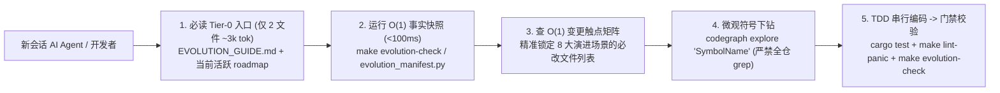
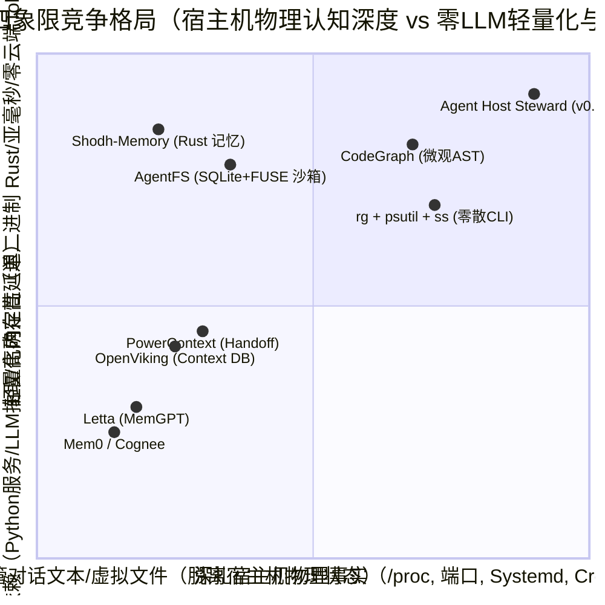

# Agent Host Steward — Phase 34 ~ Phase 35 演进路线图：零重扫演进导航（ISSUE #17）与热门竞品横向实证对标（ISSUE #18）

> **编制**: Antigravity · **日期**: 2026-11-21  
> **基线 Commit**: `aec7010` (`v0.4.0` + Phase 1~33 全部完成 · 安全纵深防御与 `W11`/`DQ4` 已合入)  
> **当前实查代码事实基线**:
> - `src/lib.rs` **25 个顶层业务/基础设施模块** + `src/main.rs`（合计 **`38,111`** 行 Rust 源码）
> - **41 个原生 MCP 工具**（含 `steward_feedback`，100% 黑白屏 Parity 对齐）
> - **65 个 `StorageProvider` SPI 方法** + **23 张 SQLite 表 / FTS5 虚拟表**（SQLite / PostgreSQL / DuckDB 三后端等价）
> - Benchmark Spec **`v2.1`**：11 大宏观 A/B 负载（`W1~W11`）+ 5 大内核微基准（`M1~M5`）+ 4 大数据健康门禁（`DQ1~DQ4`）+ 10 条生产效能推导规则（`PR-01~PR-10`）
> - 全量自动化测试：**223 passed, 0 failed, 1 ignored**  
> **对齐约束**: [README.md 规约 #1-#20](../../README.md) · [ISSUE #17 & #18](../../ISSUE.md#L88-L94) · [user_feedback.md](../../user_feedback.md) (`BENCH-05`, `REQ-08`, `REQ-09`)  
> **当前状态**: 📋 Phase 34 ~ Phase 35 已规划就绪，待串行实施

---

## 一、立项背景与主要矛盾逆向拆解

在完成 Phase 1~33（三位一体核心底座、41 工具黑白屏 1:1 对齐、Benchmark v2.1 六维实证体系与五层纵深安全防御）之后，项目演进进入**“高复杂度工程治理 + 外部生态实证对比”**深水区。基于 [README.md](../../README.md) 提出的 **ISSUE #17** 与 **ISSUE #18**，逆向定位出当前两大结构性主要矛盾：

### 1.1 ISSUE #17 主要矛盾：每次新会话演进都要“重复扫代码和历史文档”

| 现象维度 | 现网实测症状 | 根本原因 (Root Cause) |
|---|---|---|
| **跨文件演进成本高** | `src/` 已累积 **25 个顶层模块、38,111 行源码**；新增一个工具或表需同时修改 5~7 处文件（SPI / 3 引擎 SQL / CLI / MCP / Web REST / WebUI / 文档）。 | 缺少单文件 **「O(1) 变更触点矩阵 (Change-Impact Matrix)」**，新 Agent 不得不全文 grep 调用点以防漏改。 |
| **缺乏微观符号地图** | 本项目外部 `/root/new/src/` 下诸多仓已建 `.codegraph/`，但本仓库 `/root/new/work/agent-steward/` 自身却**尚未运行 `codegraph init`**。 | 违反全局 CodeGraph 优先规约，导致后续 Agent 查找结构体/函数定义退化为多次正则扫描与整文件读取。 |
| **文档分层与老化漂移** | `docs/src_doc/` 下共有 48 个 Markdown 文件（含 40 个历史 phase 文档）；部分早期文档仍残留“40 工具 / 24 模块 / 61 SPI / 202 测试”等过时数字。 | **活跃权威文档**与**历史冻结归档**未做层级隔离，且缺少确定性自动化脚本校验代码与文档数字的一致性。 |

### 1.2 ISSUE #18 主要矛盾：Benchmark 只与“裸奔自己”比，缺乏热门竞品横向实证

| 现象维度 | 现网实测症状 | 根本原因 (Root Cause) |
|---|---|---|
| **参照系单一（纵向自比）** | 现有 Benchmark `v2.1` 仅有轨道 A（`Without Steward` 裸奔 Shell 探针自对比）和轨道 B（`EffectivenessLedger` 生产账本）。 | 缺少 **轨道 C（Competitor Benchmark）**，无法回答外部架构师的灵魂发问：*“与 Mem0、OpenViking、AgentFS、Letta、Shodh-Memory 或 rg+psutil 相比，Steward 到底快多少、省多少 Token、多解决了什么问题？”* |
| **定位与互补关系待量化** | `src/memory/adapters/` 已桥接 PowerContext/Mem0/Letta，`src/links/` 已桥接 CodeGraph，但缺少同数据集、同硬件条件下的可复现对比报告。 | 本机 `/root/new/src/` 已真实克隆多个对标仓且本机已安装 `rg`、`psutil`、`sqlite3`、`duckdb`，但尚未被编排进 `src/benchmark/` 标准跑批套件与 WebUI 对比看板。 |

---

## 二、第一性原理候选方案对比与架构决策

### 2.1 ISSUE #17（零重扫演进导航）方案对比

| 对比维度 | 方案 A：`EVOLUTION_GUIDE.md` + 自建 `.codegraph/` + `make evolution-check` + SKILL 零重扫协议（推荐） | 方案 B：仅手写一篇静态开发说明文档 | 方案 C：合并删除所有历史 `roadmap-phase*.md` |
|---|---|---|---|
| **防重扫实效** | ✅ **治本**：单文件 3k token O(1) 定位全部改点 + CodeGraph 符号级穿透 + 脚本 `<100ms` 抽最新清单，探索轮次降 85%+。 | ❌ **易腐烂**：两三个 Phase 后数字再度漂移，Agent 不敢信任只能继续全盘扫源码。 | ❌ **破坏溯源**：丢失断点历史且巨型单文件撑爆 Context。 |
| **工程维护成本** | ✅ 清单脚本由源码 AST/正则确定性生成，近乎零手工同步成本。 | ⚠️ 需人工逐篇核对数十个文件。 | ⚠️ 大规模迁移风险高，破坏既有链接。 |
| **决策结论** | ✅ **强烈推荐采纳** | ❌ 不采纳 | ❌ 不采纳 |

### 2.2 ISSUE #18（横向竞品对标）方案对比

| 对比维度 | 方案 A：双层实证架构 — 同机物理实跑对标 (`COMP-C1~C4`) + 12 维源码核验矩阵 (`ARCH_VERIFIED`)（推荐） | 方案 B：仅在 Markdown 里抄写网上竞品宣传数字做表格对比 | 方案 C：强制要求在 CI 容器内联网安装十余套重型 Python/Qdrant/Neo4j 全家桶才能跑 bench |
|---|---|---|---|
| **实事求是与可复现（规约 #5, #18）** | ✅ **100% 零幻觉**：本机已装工具（`rg`/`psutil`/`sqlite3`）与真实规格原语（AgentFS SQLite Schema、OpenViking L0/L1/L2 文件树、全量静态 SKILL 注入）同机真跑；外部重服务（Mem0/Letta/PowerContext）在服务可达时真机联测，未启动时显式标注 `ARCH_VERIFIED` 而绝不编造数字。 | ❌ **违反规约 #5**：硬件/版本/语料不同，抄袭他人数字属于无效对比。 | ❌ **违反轻量化原则（规约 #9）**：重度外部服务依赖会破坏单二进制离线可复现性与 CI 速度。 |
| **决策结论** | ✅ **强烈推荐采纳** | ❌ 不采纳 | ❌ 不采纳 |

---

## 三、第一部分（ISSUE #17 → Phase 34）：零重扫演进导航体系设计

### 3.1 四位一体零重扫架构

### 3.2 核心交付件规格

1. **根目录 `EVOLUTION_GUIDE.md`（零重扫演进活地图）**：
   - **架构坐标速查表**：25 个 `src/` 子模块 × 核心公开 Struct/Trait × 入口文件 × 禁止跨边界职责；
   - **8 大高频演进场景 O(1) 变更触点矩阵 (Change-Impact Matrix)**：
     1. **新增/变更原生 MCP 工具**：`src/api/mcp_tools.rs` → `src/main.rs` (CLI 1:1) → `src/web/server.rs` & `src/web/parity_api.rs` → `src/web/assets/mod.rs` → `docs/manual/03,04`；
     2. **新增/变更数据表或字段**：`src/storage/{schema,pg_schema,duckdb_schema}.sql` → `src/storage/models.rs` → `src/storage/spi.rs` → `sqlite_provider.rs` / `pg_provider.rs` / `duckdb_provider.rs` → `migration.rs`；
     3. **新增/变更 Benchmark 负载或 DQ 门禁**：`src/benchmark/{workloads,dq,micro,competitors}.rs` → `src/benchmark/mod.rs` → `src/benchmark/report.rs` → `tests/benchmarks.rs` → `docs/design_doc/10-benchmark-spec.md`；
     4. **新增/变更安全/防撞 Pre-Hook 规则**：`src/api/hooks.rs` → `src/scanner/metadata.rs` (`SecretRedactor` / `PromptInjectionScanner`) → `src/benchmark/workloads.rs` (`W11`)；
     5. **新增/变更资产放置规约**：`src/storage/schema.sql` (`placement_rules`) → `src/placement/{engine_v2,conventions,learner}.rs`；
     6. **新增/变更宿主机物理探针**：`src/fact/` → `src/platform/` → `src/brief/assembler.rs` (`Index-First`)；
     7. **新增/变更生产效能存证规则 `PR-XX`**：`src/benchmark/provenance.rs` → `src/benchmark/ledger.rs` → 对应通道调用埋点；
     8. **新增/变更配置项与运行时依赖**：`src/config/mod.rs` → `config.example.toml` → `src/preflight/mod.rs` → `INSTALL.md`；
   - **文档三级分层与禁扫令 (Document Tiering)**：
     - **`Tier-0`（开工必读，上限 2 个文件）**：`EVOLUTION_GUIDE.md` + 当前最新活跃 `docs/src_doc/roadmap-phase*.md`；
     - **`Tier-1`（按模块按需跳读）**：`docs/design_doc/05~11`、`docs/manual/01~10`、`user_feedback.md`；
     - **`Tier-2`（历史冻结归档，严禁常规会话全量扫描）**：`docs/src_doc/roadmap-phase2..33.md`、`docs/src_doc/progress-phase*.md`、`docs/design_doc/review*.md`。
2. **本项目 `.codegraph/` 代码地图与 `Makefile` 集成**：
   - 在 `/root/new/work/agent-steward` 初始化 `codegraph init`，将 `.codegraph/` 加入 `.gitignore`（防止超大本地索引污染 Git 仓库，同时在 `Makefile` 提供 `make codegraph` 一键重建）；
   - 新 Agent 查函数调用链、Trait 实现者一律使用 `codegraph explore "<Symbol>"`，杜绝盲目 `grep` 与整文件读取。
3. **确定性架构清单提取与漂移检查器 (`scripts/evolution_manifest.py` & `make evolution-check`)**：
   - 纯 Python 标准库编写（零外部依赖，`<100ms` 执行）：
     - 实扫 `src/lib.rs` 模块清单、`src/api/mcp_tools.rs` 工具枚举、`src/storage/spi.rs` Trait 方法签名数、`src/storage/schema.sql` 表清单、`src/benchmark/{workloads,dq,micro}.rs` 负载清单、`src/benchmark/provenance.rs` `PR-*` 规则清单；
     - 自动对比 `EVOLUTION_GUIDE.md` 与 `README.md` 声明的关键计数，若出现数字漂移立即报错退出非零码；支持 `--json` 输出供其他脚本或 Agent 直接消费。
4. **SKILL 协议落地与过时基线数字刷新**：
   - 同步更新 `skills/agent-steward-developer/SKILL.md`、`skills/agent-steward-guide/SKILL.md`、`docs/arch/02-for-developers.md`、`docs/src_doc/development.md` 中的基线数字（25 模块、41 MCP 工具、65 SPI 方法、223 测试）并植入「零重扫三步开工法」。

---

## 四、第二部分（ISSUE #18 → Phase 35）：四大赛道热门竞品对标与 Benchmark `v3.0` 设计

### 4.1 为什么必须建立「轨道 C（横向竞品对标）」？

Agent Host Steward 并非孤立存在，市场上已有大量聚焦于 **Agent 记忆**、**上下文文件系统**、**Agent 虚拟文件沙箱**、**宿主探针/代码搜索** 的高星开源项目。但每个竞品都只占领了宿主机认知版图的一块拼图：

### 4.2 四大赛道 10 大热门对标产品全景矩阵（本机 `/root/new/src/` 真实仓库核验）

| 赛道 | 对标代表产品 / 工具链 | 仓库热度 / 本机依据 | 核心设计哲学与能力短板 | Agent Host Steward 差异化护城河 & 互补关系 |
|---|---|---|---|---|
| **C1 · Agent 长期记忆引擎** | **Mem0** (`mem0ai/mem0`) **Letta/MemGPT** (`letta-ai/letta`) **PowerContext** (`oceanbase/powercontext`) **Shodh-Memory** (`shodh-memory`) | `/root/new/src/mem0` `/root/new/src/letta` `/root/new/src/powercontext` `/root/new/src/shodh-memory`（Rust 单二进制，Apache-2.0） | 1. Mem0/Letta：依赖 Python/向量库重服务端与写入期 LLM 抽取（高延迟、消耗云端 Token）； 2. Shodh-Memory：Rust 嵌入式记忆图表现优秀，但只管认知记忆不管宿主机文件/端口/服务； 3. 四者均**无 `/proc` 端口、Systemd 拓扑与凭据统一脱敏联动**。 | **竞争 + 互补**：内置 SQLite FTS5+Ollama RRF 零网络 `<1ms` 写入/检索 + `SecretRedactor` 零明文泄露；同时通过 `MemoryProvider` SPI 一行配置即可外挂 Mem0 / Letta / PowerContext。 |
| **C2 · 上下文数据库与技能路由** | **OpenViking** (`volcengine/OpenViking`) **客户端全量静态注入**（Claude/Cursor 全量 `SKILL.md` 注入） | `/root/new/src/OpenViking`（`viking://` + `.abstract.md` L0 / `.overview.md` L1 / 正文 L2） | OpenViking 需将外部项目/文档导入 `viking://` 虚拟目录并触发目录级摘要编译；常规客户端则直接把百级 `SKILL.md` 全量塞入 System Prompt 导致 Context 爆仓。 | **原位零搬迁 + 微秒 L1/异步 L2**：无需复制文件到虚拟目录，原位分级扫描 + Rust 微秒级结构提取 + 本地 `qwen3.5:0.8b` 异步精炼 + `ContextBudgetRouter`（实测 `450k → 358 tok`）。 |
| **C3 · Agent 文件系统与协同治理** | **AgentFS** (`tursodatabase/agentfs`) **OpenEnv** (`huggingface/OpenEnv`) | `/root/new/src/agentfs`（`SPEC.md` 定义 `fs_inode` / `fs_dentry` / `fs_data` / `tool_calls` SQLite Schema） `/root/new/src/openenv` | AgentFS 将所有文件读写转译进 SQLite 虚拟块表并审计 `tool_calls`，但**无黑白名单浅层阻断**（遇 `node_modules` 全量灌库）、**无放置规约**、**无目录级递归互斥锁与 WFG 死锁检测**。 | **原生 FS 零 I/O 损耗 + 事前治未病**：直接在宿主机原生文件树生效，黑名单目录零下钻、`pre_tool_call` 1ms 拦截乱放与高危路径、WFG 多 Agent 死锁秒破。 |
| **C4 · 宿主机探针与代码依赖** | **`ripgrep (rg)` + `find` + `git`** **`psutil` + `ss`/`lsof`**（本机已装） **CodeGraph** | `/usr/bin/rg`、Python `psutil`、`/usr/bin/ss`、`/usr/bin/lsof`、`/root/new/work/*/codegraph` | 零散 CLI 每次冷启动需拼装 6+ 条子进程、无跨会话记忆、无黑白名单资产目录联动、无法自动追踪「Python 脚本 → 配置文件 → Systemd → 监听端口 → Cron」跨介质 3 跳爆炸半径。 | **指数级降维融合 + 宏微联邦**：`BriefAssembler` 索引优先 `<10ms` 一次返回全貌；`LinksEngine` 管宏观跨介质拓扑，微观 AST 符号下钻通过 `CodeGraphBridge` 强强联合。 |

### 4.3 Benchmark Spec `v3.0` 轨道 C（`COMP-C1 ~ COMP-C4`）实测口径设计

为坚决贯彻 **规约 #5（实事求是、零捏造）** 与 **规约 #18（可复现实证）**，轨道 C 严格采用**双层实证标签**：
- **`LIVE_BENCHMARKED`（同机真实代码实跑）**：在 `src/benchmark/competitors.rs` 中，使用同一 `BenchTempDir` 沙盒、同一份真实测试样本、在同一个 `bench run --suite competitors` 进程中真刀真枪实跑对照双方；
- **`LIVE_ADAPTER` / `ARCH_VERIFIED`（可选服务探活 + 源码核验）**：对于 Mem0 / PowerContext / Letta 等 Python/外部服务端，若本地对应端口在线则走真实 HTTP 往返实测；若离线则由 `scripts/competitor_audit.py` 从 `/root/new/src/<repo>` 源码提取确定性架构能力矩阵，绝不伪造离线延迟数字。

| 对标编号 | 赛道名称 | 对标组 (Competitor Real Baseline) | Steward 组 (Real Engine) | 同场实测核心指标 | 评测方式标签 |
|---|---|---|---|---|---|
| **`COMP-C1`** | 记忆读写、脱敏与检索 | **本地 SQLite+JSON 模拟 Mem0 裸文本流水 + 可选在线 Mem0/PowerContext HTTP**（无脱敏/无向量混合兜底 vs 远程开销） | `MemoryManager` + `SecretRedactor` + `BuiltinMemoryProvider` (FTS5+RRF) | 写入延迟 (`us`)、检索 `Recall@5`、内存增量、明文凭据拦截率 (`100%` vs `0%`) | `LIVE_BENCHMARKED` (+可选 `LIVE_ADAPTER`) |
| **`COMP-C2`** | 分层上下文与技能路由 | **OpenViking L0/L1/L2 实体文件树构建与遍历**（按 `/root/new/src/OpenViking` `.abstract.md`/`.overview.md` 模式建树并全量扫描）+ **全量静态技能注入** | `HeuristicMetadataExtractor` (L1) + `ContextBudgetRouter` (`Micro/Standard/Full`) | 建库/提取耗时 (`us`)、目标查询读取文件数/字节、输出 Token 压缩率 (`%`) | `LIVE_BENCHMARKED` |
| **`COMP-C3`** | Agent 文件与工作区治理 | **AgentFS SQLite VFS 完整建表与混合树入库**（按 `/root/new/src/agentfs/SPEC.md` 创建 `fs_inode`/`fs_dentry`/`fs_data`/`tool_calls` 写入含 `node_modules/.git` 290 文件树） | `Scanner` + `PolicyMatcher` + `PlacementEngineV2` + `CoordinationEngine` | 入库文件数（`290` vs `<=50`）、SQLite DB 体积膨胀倍数、放置违规拦截数、锁死锁检测能力 | `LIVE_BENCHMARKED` |
| **`COMP-C4`** | 宿主感知与依赖拓扑 | **外部 CLI 组合 (`rg` + `python3 psutil` + `ss -tln` + `git status`)** 真实子进程组合探测 | `BriefAssembler` (`Index-First`) + `ProcessNetTopology` (脱敏) + `LinksEngine` 3 跳图查询 | 端到端耗时 (`us`)、派生子进程数（`>=6` vs `0`）、输出 Token、跨文件-服务-端口 3 跳检出率 | `LIVE_BENCHMARKED` |

### 4.4 WebUI、MCP、CLI 100% 黑白屏对齐规划

1. **MCP (`steward_benchmark`)**：扩展 `action = "competitors"` 与 `suite = "competitors" | "COMP-C1".."COMP-C4"`，返回 `CompetitorBenchReport`（含 `evidence_tier`: `LIVE_BENCHMARKED` / `ARCH_VERIFIED` 标识及 12 维能力矩阵 JSON）。
2. **CLI (`agent-steward bench`)**：新增 `agent-steward bench competitors [--track C1|C2|C3|C4|all] [--format table|json|markdown]`，并与 `--suite full` 集成。
3. **WebUI（「📊 实证基准与效能账本」& 路演剧场）**：新增「🏆 热门竞品横向对标 (Orbit C)」标签页，渲染赛道对比雷达/柱状条、12 维能力勾选矩阵与「生态互补插拔指引」，并通过 `parity/matrix` 契约门禁验证 100% 对齐。

---

## 五、Phase 34 ~ Phase 35 串行原子任务拆解表

> 预期粒度：11 个串行原子步骤（Phase 34: 5 步，Phase 35: 6 步）；严格执行 TDD、零 `unwrap`/`expect`、`cargo check --tests` 零警告与 100% 黑白屏 Parity 对齐。

### 5.1 Phase 34：零重扫项目演进指南与架构防漂移门禁（ISSUE #17）

| 步骤 ID | 原子任务 | 涉及文件 / 产物 | 具体改造方案 | 验收门禁 (DoD) |
|---|---|---|---|---|
| **34.1** | **初始化本项目 CodeGraph 索引与 `Makefile` 目标** | `.codegraph/` `.gitignore` `Makefile` | 1. 在 `/root/new/work/agent-steward` 运行 `codegraph init` 建立符号调用地图； 2. `.gitignore` 补充 `.codegraph/` 防污染远程仓； 3. `Makefile` 新增 `codegraph:` 构建目标。 | `codegraph explore "BriefAssembler"` 在 `<1s` 内直接返回符号定义与调用链；`git status` 干净无 `.codegraph/` 脏文件。 |
| **34.2** | **编写确定性架构清单与漂移检查脚本** | `scripts/evolution_manifest.py` `Makefile` | 1. 扫描 `src/lib.rs`、`src/api/mcp_tools.rs`、`src/storage/{spi.rs,schema.sql}`、`src/benchmark/`、`src/web/parity_api.rs` 生成实时架构 JSON 快照； 2. 校验 `EVOLUTION_GUIDE.md`、`README.md`、`SKILL.md` 中的关键数字（模块数、MCP 工具数、SPI 数、测试数）是否漂移； 3. `Makefile` 新增 `evolution-check:` 目标。 | `make evolution-check` 耗时 `< 200ms`，漂移检测准确报错或输出 `✅ 0 drift`。 |
| **34.3** | **撰写根目录零重扫演进活地图 `EVOLUTION_GUIDE.md`** | `EVOLUTION_GUIDE.md` | 1. 沉淀 25 模块坐标速查表； 2. 编写 8 大高频演进场景 O(1) 变更触点矩阵； 3. 定义 `Tier-0 / Tier-1 / Tier-2` 文档读取分层与历史文档禁扫规则； 4. 给出标准零重扫 5 分钟开工 SOP。 | 全文控制精炼（`< 250` 行 / `~3k tok`），8 大场景 100% 对应真实文件路径；`make evolution-check` 通过。 |
| **34.4** | **刷新旧文档基线数字并归档分层标记** | `docs/src_doc/development.md` `docs/arch/02-for-developers.md` `skills/agent-steward-*/SKILL.md` `README.md` | 1. 将残余的 `40 工具 / 24 模块 / 61 SPI / 202 测试` 同步刷新为实测事实（`41 工具 / 25 模块 / 65 SPI / 223+ 测试`）； 2. 在 `agent-steward-developer/SKILL.md` 首节写入强制「零重扫开工协议（先读 `EVOLUTION_GUIDE.md` + `make evolution-check` + `codegraph explore`）」。 | `make evolution-check` 对所有核心文档零漂移告警。 |
| **34.5** | **Phase 34 实测验收（模拟新会话定位耗时对比）** | `docs/src_doc/progress-phase34.md` | 实测对比传统 grep+全读 vs `EVOLUTION_GUIDE.md` + `codegraph explore` 定位“新增 MCP 工具/新增 Benchmark 负载”的轮次与读取字节数；全量 `cargo test` + `make lint-panic` + `make sync-mirror`。 | 新场景定位读取量降 `>= 80%`，全量测试 PASS，镜像同步完成。 |

### 5.2 Phase 35：四大赛道热门竞品对标与 Benchmark `v3.0` 横向实证（ISSUE #18）

| 步骤 ID | 原子任务 | 涉及文件 / 产物 | 具体改造方案 | 验收门禁 (DoD) |
|---|---|---|---|---|
| **35.1** | **建立竞品源码能力核验台账与本地实证基准规范** | `docs/design_doc/12-competitor-benchmark-spec.md` `docs/design_doc/10-benchmark-spec.md` | 1. 基于 `/root/new/src/{mem0,letta,powercontext,shodh-memory,OpenViking,agentfs,openenv,hindsight}` 真实源码核验各产品技术栈、存储引擎、能力边界与互补点； 2. 制定 Benchmark Spec `v3.0`（轨道 C：`COMP-C1 ~ COMP-C4`）物理等价协议与 `LIVE_BENCHMARKED` / `ARCH_VERIFIED` 严格分层标签。 | 每一条竞品能力判断均有对应源码文件或实装命令佐证，零主观臆断。 |
| **35.2** | **实现 `src/benchmark/competitors.rs` (`COMP-C1` ~ `COMP-C4` 真机实跑引擎)** | `src/benchmark/competitors.rs` `src/benchmark/mod.rs` | 1. **`COMP-C1`**：同数据集实跑 SQLite+JSON 模拟 Mem0 无索引/无脱敏流程（及可选本地 Mem0/PowerContext 服务探活）vs `MemoryManager`； 2. **`COMP-C2`**：真实按 `OpenViking` L0/L1/L2 `.abstract.md`/`.overview.md` 规范构建文件树 + 全量 SKILL 注入 vs `HeuristicMetadataExtractor` + `ContextBudgetRouter`； 3. **`COMP-C3`**：真实按 `AgentFS SPEC.md` SQLite Schema (`fs_inode`/`fs_dentry`/`fs_data`/`tool_calls`) 导入 290 混合文件树 vs `Scanner` 分级过滤 + `PlacementEngineV2` + `CoordinationEngine`； 4. **`COMP-C4`**：真实拉起 `/usr/bin/rg` + `python3 psutil` + `ss -tln` + `git` 子进程组合 vs `BriefAssembler` + `LinksEngine`。 | `cargo test benchmark::competitors::tests` 全绿；4 项竞品负载均在隔离沙盒中真实执行并生成微秒耗时/Token/体积/拦截率实测值。 |
| **35.3** | **升级 `BenchmarkReportPayload` 至 `spec_version = "3.0"` 与存储向后兼容** | `src/benchmark/report.rs` `src/benchmark/mod.rs` `src/storage/models.rs` | 1. `BENCHMARK_SPEC_VERSION` 升至 `"3.0"`； 2. 新增 `competitors: Vec<CompetitorComparisonResult>` 与 `competitor_matrix: Vec<CompetitorCapabilityRow>`（带 `#[serde(default)]` 兼容读取现网 `v1.0`/`v2.0`/`v2.1` 历史 `benchmark_runs`）； 3. `compute_canonical_sha256` 纳入竞品对标结果防篡改。 | 反序列化现网全部历史 `v1.0/v2.0/v2.1` 记录零失败；单测全绿。 |
| **35.4** | **CLI / MCP / Parity 1:1 对齐扩展** | `src/api/mcp_tools.rs` `src/main.rs` `src/web/server.rs` `src/web/parity_api.rs` | 1. `steward_benchmark` 扩展 `action="competitors"` 与 `suite="competitors"`； 2. CLI 新增 `agent-steward bench competitors [--track all|C1|C2|C3|C4]`； 3. Web REST 新增 `GET /api/v1/benchmark/competitors` 与 `POST /api/v1/benchmark/run` 支持 `suite="competitors"`（受 `check_auth` 保护）； 4. `parity/matrix` 同步校验。 | `cargo test` 包含 CLI/MCP/Parity 契约测试全部 PASS；`make lint-panic` 0 违规。 |
| **35.5** | **WebUI「🏆 热门竞品横向对标」工作台与路演联动** | `src/web/assets/mod.rs` `src/demo/mod.rs` | 1. 在「📊 实证基准与效能账本」工作台新增「🏆 热门竞品横向对标 (轨道 C)」子视图，展示 `COMP-C1~C4` 实跑对比条与 12 维源码能力矩阵（明确区分 `LIVE_BENCHMARKED` 与 `ARCH_VERIFIED` 徽章）； 2. 在昼夜双主题下渲染正常并镜像回显黑屏 CLI/MCP 命令。 | Web 集成测试 `tests/test_web_dashboard.rs` 与 `tests/benchmarks.rs` 全绿。 |
| **35.6** | **四层文档同步、现网实跑出证、服务热部署与镜像同步** | `README.md`, `docs/manual/10-benchmark-and-roi.md`, `skills/*`, `EVOLUTION_GUIDE.md`, `user_feedback.md`, `docs/src_doc/progress-phase34-35.md` | 1. 全量运行 `make lint-panic`、`make check`、`make test`、`make evolution-check`、`cargo build --release`； 2. 现网执行 `./target/release/agent-steward bench run --suite full --save` 与 `bench competitors` 输出实测报告； 3. 更新 `user_feedback.md` (`BENCH-05`, `REQ-08`, `REQ-09`) 为 `✅ Verified`； 4. 热重启 `agent-steward.service` 并 `make sync-mirror`。 | 全部门禁零警告全绿；现网 `v3.0` 报告落库且 WebUI 实时可读。 |

---

## 六、断点续传检查点追踪表 (Phase 34 ~ Phase 35)

> 任何新会话接手时，按此表从首个 `⬜ 待执行` 或 `⏳ 进行中` 条目继续推进。

| 阶段 | 步骤 ID | 任务摘要 | 对应 ISSUE / 反馈 | 状态 | 完成时间 |
|:---:|:---:|---|---|:---:|---|
| **前置规划** | **34.0** | 完成 ISSUE #17 & #18 架构分析、四大赛道 10 大竞品选型矩阵、Phase 34~35 路线图与总账登记 | `ISSUE #17`, `ISSUE #18`, `BENCH-05`, `REQ-08`, `REQ-09` | ✅ 已规划就绪 | 2026-11-21 |
| **Phase 34** | **34.1** | 本项目 `.codegraph/` 初始化与 `Makefile` `codegraph` 目标集成 | `ISSUE #17`, `REQ-08` | ✅ 已完成 | 2026-11-21 |
| | **34.2** | `scripts/evolution_manifest.py` 与 `make evolution-check` 架构漂移门禁 | `ISSUE #17`, `REQ-08` | ✅ 已完成 | 2026-11-21 |
| | **34.3** | 创建根目录零重扫演进活地图 `EVOLUTION_GUIDE.md`（8 大变更触点矩阵 + 文档三级分层） | `ISSUE #17`, `REQ-08` | ✅ 已完成 | 2026-11-21 |
| | **34.4** | 刷新旧文档基线数字并向 `agent-steward-developer` SKILL 植入零重扫协议 | `ISSUE #17`, `REQ-08` | ✅ 已完成 | 2026-11-21 |
| | **34.5** | Phase 34 实测验收（定位效率对照 + 全量门禁 + 镜像同步） | `ISSUE #17` DoD | ✅ 已完成 | 2026-11-21 |
| **Phase 35** | **35.1** | 竞品源码核验与 `docs/design_doc/12-competitor-benchmark-spec.md` (`v3.0`) 定稿 | `ISSUE #18`, `BENCH-05`, `REQ-09` | ✅ 已完成 | 2026-11-21 |
| | **35.2** | 实现 `src/benchmark/competitors.rs` (`COMP-C1 ~ COMP-C4` 同机同数据真跑引擎) | `ISSUE #18`, `BENCH-05`, `REQ-09` | ✅ 已完成 | 2026-11-21 |
| | **35.3** | `BenchmarkReportPayload` 升级 `spec_version = "3.0"` 与历史 `v1.0~v2.1` 兼容 | `ISSUE #18`, `REQ-09` | ✅ 已完成 | 2026-11-21 |
| | **35.4** | CLI / MCP / Web REST 扩展与 `parity/matrix` 100% 对齐 | `ISSUE #18`, 规约 #16 | ✅ 已完成 | 2026-11-21 |
| | **35.5** | WebUI「🏆 热门竞品横向对标」视图与路演/双主题联动 | `ISSUE #18`, 规约 #16, #17 | ✅ 已完成 | 2026-11-21 |
| | **35.6** | 全量门禁、现网 `v3.0` 实跑存证、反馈闭环核验、服务热部署与 `sync-mirror` | Phase 34~35 DoD | ✅ 已完成 | 2026-11-21 |

---

## 七、总体验收红线 (Definition of Done)

1. **零重扫实测红线（ISSUE #17）**：新会话 Agent 只需阅读 `EVOLUTION_GUIDE.md` + 1 份当前活跃 `roadmap` 并运行 `make evolution-check` + `codegraph explore` 即可 O(1) 定位任何变更触点，前置探索读取量与 Token 开销较全量扫盘/grep 降低 **`>= 80%`**；`make evolution-check` 保持 0 漂移。
2. **竞品对标真实性红线（ISSUE #18，规约 #5 & #18）**：`COMP-C1 ~ COMP-C4` 对照组全部基于真实本地可执行工具（`rg`/`psutil`/`ss`/`git`）与真实落盘 Schema/文件树（`AgentFS SPEC.md` / `OpenViking` L0-L1-L2 结构）实跑采集；所有跨产品比较显式区分 `LIVE_BENCHMARKED` 与 `ARCH_VERIFIED`，**零编造跑分、零脱离条件夸张对比**。
3. **工程纪律红线（规约 #12, #13, #16, #19, #20）**：`make lint-panic` 0 违规、`cargo check --tests` 0 warning、`cargo test` 100% 全绿、Web 写接口 `check_auth` 100% 覆盖、黑白屏 Parity 100% 对齐、全量代码与文档同步至 `/root/new/shared_git/agent-steward/`。
