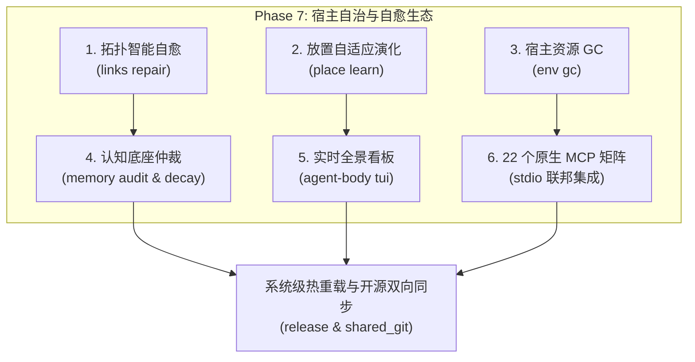

# Agent Body 研发演进路线图 — 第七阶段 (Phase 7)

> **目标**: 拓扑智能自愈、放置规则自进化、宿主孤儿垃圾回收与自治生态 (Topology Self-Healing, Placement Evolution & Host Autonomy)  
> **制定时间**: 2026-11-15T19:15:00+08:00  
> **制定人**: digoal 德哥 / Antigravity  
> **执行依据**: 遵循本项目内生技能 [agent-body-developer](../../skills/agent-body-developer/SKILL.md) 标准工作流  
> **基线状态**: Phase 1~6 全量通过（31 项单元测试 100% PASS，代码与文档 100% kebab-case 规范化，系统级常驻服务 `/usr/local/bin/agent-body` 运行中）  
> **当前状态**: 规划完成，待按需串行启动 (Ready for Resumable Execution)

---

## 一、阶段定位与核心设计信条对齐

Agent 本体（Agent Body）经历了从“单机 CLI 原型”（Phase 1）到“守护监听与 MCP 暴露”（Phase 2~3）、“图智能与 CodeGraph 宏微联邦”（Phase 4）、“宿主机实装运行与长文沉淀”（Phase 5）以及“全项目架构与路径规范化”（Phase 6）。

在长周期、高密度自主运行的 Agent 宿主机环境中，Agent 本体需要从“**被动感知与告警**”升级为“**主动自治与自愈**”。第七阶段的核心演进聚焦于以下 4 大核心维度：



1. **断链知情但无法自动修复（拓扑智能自愈）**:
   - `links audit` 目前能扫描出 404 断链与失效端口，但遇到文件改名、重构或移动时，需要人工/Agent 手工逐行定位修改代码。
   - **P7 方案**: 构建 `src/links/repair.rs`，实现 `agent-body links repair` 和 MCP 工具 `body_links_repair`。基于文件名编辑距离、Git rename 追踪、代码指纹哈希，自动给出断链重定向迁移建议与 diff patch，支持 `--apply` 一键自动修正依赖路径。
2. **放置规则静态固化，缺乏自适应学习（放置引擎动态演化）**:
   - 目前放置规则是写在 `schema.sql` 中的 8 大固定规则。若用户或 Agent 在新目录（如 `/root/new/datasets/` 或特定文件后缀）频繁创建文件，系统无法自适应识别新规律。
   - **P7 方案**: 构建 `src/placement/learner.rs`，实现 `agent-body place learn` 和 MCP 工具 `body_placement_learn`。通过聚类分析 `changes` 表和扫描记录中的路径分布特征，智能提取高频放置模式并计算置信度，经审批后一键动态沉淀进 `placement_rules`。
3. **宿主机死资源与孤儿进程积累（自动化宿主垃圾回收 GC）**:
   - 会话频繁启停后，后台容易遗留死锁进程、超长空闲 Python 进程、无主测试服务、以及 `/root/new/tmp/` 中堆积的大量孤儿临时文件。
   - **P7 方案**: 构建 `src/env/gc.rs`，实现 `agent-body gc` 和 MCP 工具 `body_env_gc`。基于 TTL 与访问时间策略安全回收 `/root/new/tmp/` 游离文件；基于 `/proc` 进程树分析无父进程 (PPID=1) 且空闲时间过长的孤儿 Worker，并提供 dry-run 审查与安全清理机制。
4. **长期记忆遗忘曲线与语义矛盾冲突仲裁（认知去芜存菁）**:
   - 长期记忆越积越多，旧结论与新结论出现冲突（例如过去记录“端口用 8000”，后来改为“端口改用 8080”），检索时产生双重幻觉。
   - **P7 方案**: 构建 `src/memory/lifecycle.rs`，实现 `agent-body memory audit` / `agent-body memory prune` 和 MCP 工具 `body_memory_audit`。基于时间衰减（遗忘曲线）降权低频未复用记忆，基于嵌入向量相似但文本语义矛盾的配对分析，标记矛盾记忆对并生成仲裁合并建议。

---

## 二、阶段任务状态看板 (Breakpoint Tracking Board)

本阶段严格遵循 `skills/agent-body-developer/SKILL.md` 的断点续传状态机规范，将工作拆解为 **8 个粒度 <= 30 分钟的原子子任务**：

| 任务编号 | 任务模块 | 核心工作内容 | 预期产出与验收门禁 | 状态 | 断点标记 | 完成时间 |
|---|---|---|---|:---:|:---:|:---:|
| **P7-1** | 拓扑自愈引擎 | 实现 `src/links/repair.rs`，基于 Levenshtein 相似度、Git 历史与指纹定位失效文件，生成修复 patch 并支持 `--apply` | `cargo test links::repair` 跑通，模拟断链自动修复成功 | ✅ 已完成 | `CHECKPOINT-P7-1-REPAIR` | 2026-11-15 19:18 |
| **P7-2** | 放置自演化引擎 | 实现 `src/placement/learner.rs`，聚类分析 `changes` 路径特征，推断沉淀新规则候选并入库 | `cargo test placement::learner` 跑通，成功从样本提取出规则 | ✅ 已完成 | `CHECKPOINT-P7-2-LEARN` | 2026-11-15 19:20 |
| **P7-3** | 宿主垃圾回收 | 实现 `src/env/gc.rs`，扫描 `/root/new/tmp/` 超期孤儿文件与 `/proc` 孤儿僵尸进程，支持 `--dry-run` | `cargo test env::gc` 跑通，安全隔离非临时目录 | ✅ 已完成 | `CHECKPOINT-P7-3-GC` | 2026-11-15 19:22 |
| **P7-4** | 记忆生命周期与仲裁 | 实现 `src/memory/lifecycle.rs`，引入时间衰减半衰期计算与矛盾候选对探测，生成知识合并建议 | `cargo test memory::lifecycle` 跑通，成功标记对立记忆 | ✅ 已完成 | `CHECKPOINT-P7-4-MEMORY` | 2026-11-15 19:24 |
| **P7-5** | 实时全景 TUI 看板 | 实现 `src/tui/` 交互式终端单屏仪表盘（硬件指标、动态进程树、端口拓扑、断链告警、变更流） | `agent-body tui` / `agent-body status --watch` 终端无闪烁正常渲染 | ✅ 已完成 | `CHECKPOINT-P7-5-TUI` | 2026-11-15 19:28 |
| **P7-6** | MCP 矩阵升级 (22工具) | 注册 `body_links_repair`, `body_placement_learn`, `body_env_gc`, `body_memory_audit` | `cargo test api::mcp::tests` 验证 22 个工具全部就绪 | ✅ 已完成 | `CHECKPOINT-P7-6-MCP` | 2026-11-15 19:30 |
| **P7-7** | 全量回归与生产升级 | 全量运行 `cargo test` (>= 40 tests)，构建 release 并热升级 `/usr/local/bin/agent-body` 与 systemd 服务 | 全量测试 100% PASS，systemd 守护进程状态为 active | ✅ 已完成 | `CHECKPOINT-P7-7-RELEASE` | 2026-11-15 19:32 |
| **P7-8** | 文档手册与镜像同步 | 同步更新 `docs/manual/01~07`、`docs/src_doc/product-manual.md`、`README.md`，同步镜像至 `/root/new/shared_git/agent-body` | 全局死链扫描 100% 通过，两处 Git 仓库状态对齐 | ✅ 已完成 | `CHECKPOINT-P7-8-DELIVERY` | 2026-11-15 19:39 |

---

## 三、子任务执行技术细节与设计规格

### 3.1 P7-1: 拓扑智能自愈 (`src/links/repair.rs`)
- **输入**: `LinksEngine::audit_links()` 产出的断链列表（状态为 404 或 target 不存在的记录）。
- **定位算法**:
  1. **文件名精准反查**: 在当前 `assets` 表中搜索同名但路径已迁移的文件；
  2. **Levenshtein 相似度反查**: 计算同目录下文件名相似度 > 0.85 的候选文件（应对小幅度重命名或拼写纠偏）；
  3. **Git History 追溯**: 通过 `git log --follow` 追踪被删除文件的重命名历史（如 `git mv` 产生的前后对应）；
- **输出**: 
  - CLI: `agent-body links repair [--dry-run | --apply]`
  - 格式化输出: 显示原引用文件路径、行号、失效路径、推荐重定向目标以及置信度（Confidence: High/Medium/Low）；
  - `--apply` 模式: 借助原子写与文件备份机制，替换引用文件中的失效引用路径，并在 `links` 表中更新关联记录。

### 3.2 P7-2: 放置规则动态自学习 (`src/placement/learner.rs`)
- **数据源**: 扫描过去 7 天内 `changes` 表的 `create` 事件与当前 `assets` 表中未被既有 8 大规则精确匹配的文件。
- **模式提取**:
  - 提取高频扩展名（如 `.parquet`, `.onnx`, `.duckdb`）；
  - 提取高频宿主父级目录（如 `/root/new/datasets/`, `/root/new/models/`）；
  - 当某个模式发生频次 >= 3 且路径高度收敛时，生成推荐规则：
    ```json
    {
      "name": "learned_datasets",
      "target_dir": "/root/new/datasets/",
      "naming_pattern": "kebab-case with timestamp",
      "description": "Auto-learned rule: parquet datasets storage",
      "confidence": 0.92,
      "sample_count": 5
    }
    ```
- **落地**: 支持 `agent-body place learn --accept <rule_id>` 直接持久化至 `placement_rules` 表，即刻生效。

### 3.3 P7-3: 宿主资源与孤儿进程 GC (`src/env/gc.rs`)
- **临时文件清理准则**:
  - 仅限于白名单中的临时目录 `/root/new/tmp/`；
  - 严禁触碰任何源码目录（`/root/new/work/`）、工具目录（`/root/new/shared_proj/`）或系统配置；
  - 判定条件: `mtime` > 72 小时，且未被当前 `/proc` 进程打开。
- **孤儿进程诊断准则**:
  - 仅识别非系统级、非 root 关键守护进程的 Python/Worker/Node 进程；
  - 判定条件: `PPID == 1`（父进程已被杀死而挂至 init 进程），且 CPU 使用率连续多个轮询周期为 0 或内存泄露；
  - 必须提供 `--dry-run` 预览列表（包含 PID、Cmdline、创建时间、占用内存），防止误杀合法后台常驻服务。

### 3.4 P7-4: 长期记忆遗忘曲线与矛盾仲裁 (`src/memory/lifecycle.rs`)
- **遗忘曲线时间衰减**:
  - 计算记忆有效得分: $Score = BaseWeight \times e^{-\lambda \cdot \Delta t} \times (1 + \log(1 + AccessCount))$；
  - 长期低频（$\Delta t > 30$ 天且 $AccessCount == 0$）的琐碎记录自动沉降为低优先级。
- **语义矛盾检测**:
  - 使用 BGE-M3 向量检索，找出语义相似度 > 0.85 但关键词情感或谓词对立（如包含 "禁止/允许"、"废弃/推荐"、"端口 8000/端口 8080"）的记忆候选对；
  - 生成《记忆冲突诊断报告》，提示 Agent 进行仲裁或自动合并。

### 3.5 P7-5: 实时全景 TUI 看板 (`src/tui/`)
- 提供双模式：
  1. **无依赖紧凑 ANSI 轮询模式** (`agent-body status --watch`): 适配各种终端和日志重定向环境，不引入复杂 C 依赖；
  2. **交互式仪表盘** (`agent-body tui`): 单屏展示系统信息（CPU/MEM/Disk）、过滤后进程列表、端口监听矩阵、断链健康评分柱状图与最新实时审计流。

### 3.6 P7-6: MCP 原生工具矩阵 (从 18 扩充至 22)
新增以下 4 个原生 MCP 工具并在 `src/api/mcp_tools.rs` 中注册：
1. `body_links_repair`: 诊断并自动修复断链拓扑与路径漂移；
2. `body_placement_learn`: 聚类推演自学习放置规则候选并支持一键采纳；
3. `body_env_gc`: 宿主机临时目录超期文件与孤儿僵尸进程安全回收诊断；
4. `body_memory_audit`: 记忆健康体检、冲突对诊断与遗忘衰减整理。

---

## 四、断点续传执行协议（严禁违背）

1. **原子化串行推进**: 依次执行 P7-1 至 P7-8，完成前一个任务且通过门禁后，才可开始下一个任务。
2. **状态实时落盘**: 每次完成一个子任务，必须在此看板中将状态更新为 `✅ 已完成`，并记录完成时间。
3. **断点无损恢复**: 任何意外中断后，接手 Agent 只需查看看板首个 `⬜ 待执行` 或 `⏳ 进行中` 的任务，即可立即接续。
4. **编译与回归约束**: 每次涉及代码修改，必须执行 `export PATH="/root/.cargo/bin:$PATH" && cargo test`，确保单测全部绿灯且总用例数只增不减。
5. **宿主安全红线**: GC 与自愈引擎必须强制具备 dry-run 机制，黑名单目录（`.git`, `.ssh`, `node_modules`, `/proc`）绝对禁止下钻破坏。
