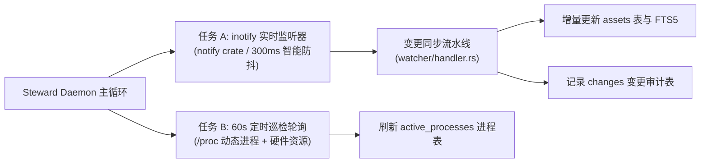

# 05 — 守护进程与 inotify 实时监听（Daemon & Watcher）

> **章节目标**: 掌握大管家常驻守护进程工作机制，理解 Linux inotify 异步文件监听、300ms 智能防抖流水线，以及如何配置 systemd 实现无人值守开机自启。

---

## 1. 守护进程主循环架构

大管家支持常驻后台运行（`agent-steward daemon`）。守护进程采用 Tokio 异步运行时，驱动两大核心任务：



---

## 2. inotify 文件监听与 300ms 智能防抖

### 2.1 为什么需要防抖？
当 Agent 或编辑器保存一个文件时，操作系统底层通常会密集连续触发多个底层事件（如：创建临时文件 -> 写入字节 -> 重命名替换原文件 -> 修改属性 -> 关闭句柄）。若对每个事件均触发一次数据库写入，将造成严重的 SQLite 锁竞争与 CPU 浪涌。

### 2.2 防抖策略
大管家在 `src/watcher/mod.rs` 中实现了 **300 毫秒批处理防抖队列**：
1. 捕获到文件创建/修改/删除事件后，暂存入内存通道；
2. 聚合 300ms 窗口内的同路径变动；
3. 将最终稳定态分发给 `src/watcher/handler.rs`：
   - **新增/修改文件**：读取元信息，更新 `assets` 记录与 FTS5 虚拟表，并在 `changes` 表中插入一条类型为 `file_created` 或 `file_modified` 的审计日志；
   - **删除文件**：将 `assets` 对应记录状态置为 `missing` 或清除，并在 `changes` 表中记录 `file_deleted`。

---

## 3. 手动启动与调试

在终端前台运行守护进程（按 `Ctrl+C` 触发 SIGINT 优雅退出）：

```bash
agent-steward daemon
```

**运行日志输出示例**:
```text
[INFO] 正在启动 Agent Host Steward 常驻守护服务 (v0.2.0)...
[INFO] inotify 实时监听已就绪，正在监听目录: ["/root/new/work", "/root/new/shared_proj", "/root/new/skills"]
[INFO] 定时巡检任务已启动，轮询间隔: 60 秒
[INFO] 正在监控动态任务进程... 当前纳管进程数: 198
```

---

## 4. systemd 开机自启服务配置

对于生产开发机，推荐将大管家配置为 systemd 用户服务或系统服务：

### 4.1 创建 service 单元文件
创建 `/etc/systemd/system/agent-steward.service`：

```ini
[Unit]
Description=Agent Host Steward Daemon Service
Documentation=https://github.com/digoal/agent-steward
After=network.target

[Service]
Type=simple
User=root
WorkingDirectory=/root/new/work/agent-steward
ExecStart=/usr/local/bin/agent-steward daemon
Restart=always
RestartSec=5
StandardOutput=journal
StandardError=journal
LimitNOFILE=65536

[Install]
WantedBy=multi-user.target
```

### 4.2 启动与开机自启
```bash
# 重新加载 systemd 配置
systemctl daemon-reload

# 启动大管家守护服务
systemctl start agent-steward

# 检查服务运行状态
systemctl status agent-steward

# 设置开机自动启动
systemctl enable agent-steward
```
