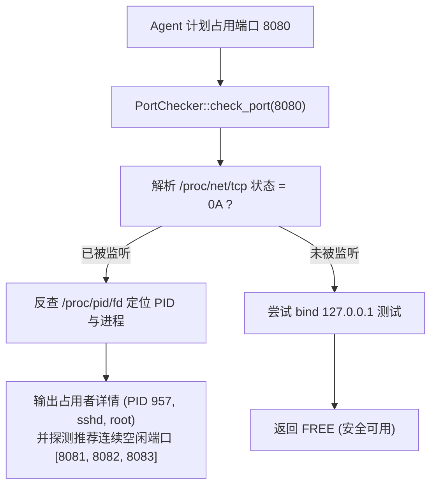

# 06 — v2.0 进阶特性指南（Advanced Features）

> **章节目标**: 详细介绍大管家 v2.0 的四大护城河进阶能力：端口防撞预警、变更爆炸半径推演、Ollama+FTS5 混合 RRF 检索、以及会话生命周期环境自洁。

---

## 1. 端口防撞预警与空闲推荐（Port Conflict Guard）

### 1.1 痛点
在单台宿主机上，常驻着数据库、缓存、推理模型以及各种定时任务。Agent 在接手临时任务（如“写个可视化看板”）时，一旦随机挑了个常见端口（如 8080 或 5432）并强行 bind，将造成线上服务崩溃或进程起不来的混乱。

### 1.2 原理与机制
大管家深度解析 Linux 内核 `/proc/net/tcp` 与 `/proc/[pid]/fd`：
1. 毫秒级探测端口是否处于 `TCP_LISTEN` 状态；
2. 反查持有该 socket 的进程 PID、可执行文件名、完整启动命令行与所属 UID 用户；
3. 若冲突，自动执行可用端口探测，返回后续连续空闲的推荐端口列表。



### 1.3 使用方式
- **CLI**: `agent-steward env port <PORT>`
- **MCP**: `steward_port_check(port, suggest_count)`

---

## 2. 变更爆炸半径推演（Blast Radius Analysis）

### 2.1 痛点
修改或重命名公共基础库（如 `/root/new/shared_proj/common_utils.py`）时，Agent 往往盲目直接修改，导致依赖它的定时任务或后台服务在夜间执行时大面积报 `ImportError` 崩溃。

### 2.2 原理与机制
基于 SQLite `links` 依赖图谱，执行 **广度优先搜索 (BFS) 逆向多跳推演**：
- 输入拟改动或删除的资产路径；
- 递归计算有多少上游应用、测试脚本或 cron 任务 `depends_on` 或 `references` 该资产；
- 根据依赖总数和资产是否属于核心目录（`shared_proj/`），评估输出综合风险等级：
  - `LOW`: 0 个依赖；
  - `MEDIUM`: 1~2 个普通依赖；
  - `HIGH`: >= 3 个依赖或属于核心库且有依赖；
  - `CRITICAL`: >= 5 个依赖或核心库受到多个应用强依赖。

### 2.3 使用方式
- **CLI**: `agent-steward links impact <TARGET>`
- **MCP**: `steward_links_impact(target, max_depth)`

---

## 3. 语义与全文混合检索（Hybrid RRF Search）

### 3.1 痛点
传统的 SQLite FTS5 全文搜索依赖关键词的字面精确匹配。当用户使用口语表述（例如“看看以前做过什么容灾预案”）而数据库中记录的是“PostgreSQL 连接池故障应急方案”时，单纯的全文搜索召回为 0 条。

### 3.2 原理与机制
大管家无缝融合了本地部署的 Ollama（推荐 `bge-m3:latest` 1024 维模型）：
1. **关键词通道**: FTS5 全文索引，负责精准命中专业术语；
2. **向量语义通道**: 异步计算 Query 向量，基于余弦相似度计算前 500 条记忆的语义距离；
3. **RRF 融合重排 (Reciprocal Rank Fusion)**:
   $$RRF\_score = \frac{1}{60 + rank_{fts}} + \frac{1}{60 + rank_{vec}}$$
4. **全自动优雅降级**: 若本地 Ollama 服务未启动或网络超时，大管家自动无感知降级为纯 FTS5 检索，系统 100% 不报错。

### 3.3 使用方式
- **CLI**: `agent-steward memory search "容灾预案" --hybrid`
- **MCP**: `steward_memory_search(query, limit, hybrid=true)`

---

## 4. 会话完工结算与环境治理（Session Close）

### 4.1 痛点
长任务会话结束后，Agent 往往在 `/root/new/tmp/` 产生大量测试碎片脚本，缺乏总结，下一次会话进来时环境杂乱。

### 4.2 原理与机制
在工单结束时调用 `close`：
1. **垃圾回收**: 自动扫描 `/root/new/tmp/` 下属于该会话 ID 或带有 `test_`/`tmp_` 标记的过期文件，安全删除并统计释放空间；
2. **工单纪要沉淀**: 提取该会话期间触发的 `changes` 审计流水线，自动格式化为标准 Markdown 总结，并沉淀入库为一条长期记忆。

### 4.3 使用方式
- **CLI**: `agent-steward close <SESSION_ID>`
- **MCP**: `steward_session_close(session_id, clean_temp=true)`

---

## 5. 宿主图智能与 CodeGraph 宏微联邦联动 (Graph Intelligence & CodeGraph Federation)

### 5.1 痛点与背景
在过去，实体图关联存在两大痛点：
1. **只知依赖、不知出处**：系统提示“A 依赖 B”，但不知道在 A 的哪一行、调用了什么代码；
2. **宏观微观割裂**：宿主大管家停留在“文件与服务”级，而代码仓库内可能已有 `codegraph` 建立的“AST 符号级”代码图，两者无法联动下钻。

### 5.2 原理与机制
大管家吸收 CodeGraph 的图谱模型设计：
1. **出处强化（Provenance & Snippet）**:
   - `links` 表扩展记录行号 `line_number`、截取代码 `snippet` 以及发现来源 `provenance`（`ast_import` / `path_regex` / `port_detect`）。
2. **断链体检与自愈 (`steward links audit`)**:
   - 定期或手动扫描全局拓扑，排查“目标文件已被物理删除”或“依赖的端口未监听”等坏死依赖，计算健康分，并支持 `--fix` 自动剔除死链。
3. **CodeGraph 宏微双层联邦 (`CodeGraphBridge`)**:
   - 自动向上溯源探测目标路径所在工程是否包含 `.codegraph/codegraph.db`；
   - 支持跨层下钻：直连代码图 SQLite，毫秒级查询特定函数或类的全部调用方（Callers）与定义位置。

### 5.3 使用方式
- **CLI**:
  ```bash
  agent-steward links audit [--fix]
  agent-steward links codegraph <PATH> [SYMBOL]
  ```
- **MCP**:
  - `steward_links_audit(fix_dangling=false)`
  - `steward_codegraph_bridge(path, symbol)`
