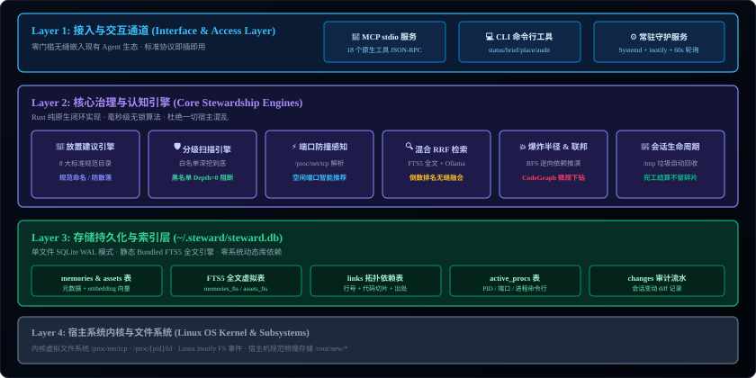
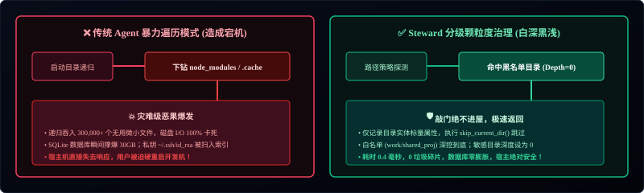
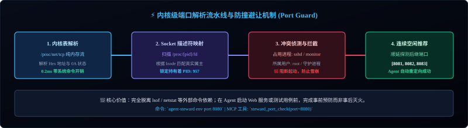
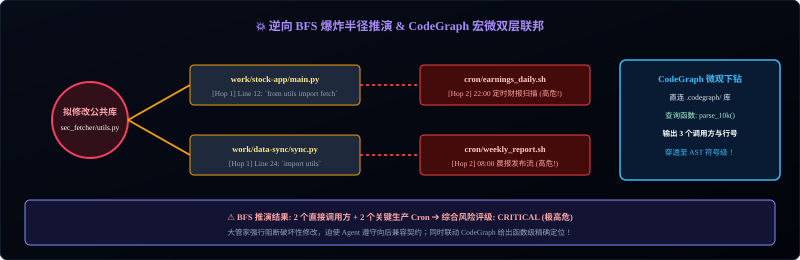
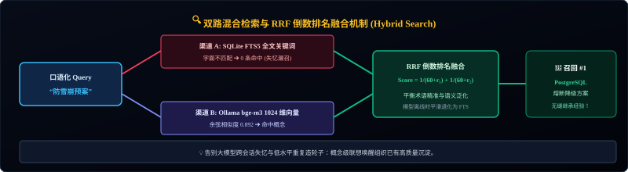

# 为什么你的 AI Agent 总在搞垮开发机？从 30GB 扫爆磁盘到端口防撞，我们用 Rust 写了一个“宿主环境大管家”

> **作者**: digoal德哥  
> **项目开源地址**: `https://github.com/digoal/agent-steward`  
> **核心定位**: 驻留在 Agent 宿主机中的轻量级、系统级全栈认知与规约底座 (Rust Edition)

---

## 引言：越聪明、越主动的 Agent，破坏力为什么越大？

最近半年，AI Agent 领域的发展速度令人目不暇接。从端到端自主编码、多 Agent 蜂群协作，到各大 IDE 深度集成的终端执行能力，Agent 正在从“单纯的代码补全工具”，演进为“拥有宿主机 Shell 执行权限的数字员工”。

然而，当我们在开发机、云服务器上真正放开权限让 Agent 7x24 小时自主干活时，接踵而来的往往不是生产力解放，而是令人啼笑皆非的“系统惨案”：

- **惨案一：暴力盲扫，磁盘吞入 30 万个小文件卡死**  
  你让 Agent “整理并索引一下机器上的项目”，它起手就是一个无边界的全局递归遍历。一头扎进 `node_modules`、`.cache` 和 `.git/objects`，一口气吞入 30 多万个碎片文件。磁盘 I/O 瞬间拉满卡死，SQLite 数据库膨胀到 30GB，甚至顺手把 `~/.ssh/id_rsa` 私钥也编入全局嵌入向量库；
- **惨案二：随手占端口，击沉主理人生产看板**  
  Agent 临时写了个数据分析 Demo，随手一行 `app.run(port=8080)`。而 8080 端口恰好是主理人已经在后台稳定运行了数周的核心监控服务。端口强占冲突，线上看板瞬间熔断报错；
- **惨案三：重构公共库，半夜 5 个定时任务全线瘫痪**  
  Agent 为了优化某个入参，顺手重构了公共工具库 `shared_proj/sec_fetcher/utils.py`。它以为这只是个局部改动，殊不知宿主机上 2 个爬虫、1 个每天凌晨 22:00 运行的财报扫描定时任务正强依赖它。半夜全部报 `ImportError` 崩溃；
- **惨案四：跨会话失忆，死板字面匹配阻断知识复用**  
  你口语化问它：“以前讨论过什么防雪崩预案没有？”库里存的标题是“PostgreSQL 连接池溢出与熔断降级方案”。因为字面不包含“防雪崩”，字面全文搜索返回 0 条，Agent 误以为“从没做过”，又开始重复造低质轮子。

**核心根因是什么？**  
大模型很聪明，上下文窗口也很长，但它**对所处的物理宿主机毫无感知与敬畏**。它不知道机器上已经跑了哪些进程、哪个端口被谁霸占着、哪些文件属于绝不能深入递归的黑名单、动了某个公共脚本会引发多大范围的连锁雪崩。

面对这一普遍恶疾，我们用 Rust 纯原生写了一个**宿主环境大管家（Agent Host Steward）**。

---

## 第一性原理：Agent 真正需要的系统底座

不是更大参数的模型，也不是花哨的 Prompt，而是让 Agent 在动手敲命令前，能一目了然看清宿主机全貌的**确定性系统底座**。



大管家采用高内聚的四层工业级解耦架构：
1. **接入与交互通道 (Interface Layer)**：内置免额外端口的标准 MCP Stdio 服务（提供 **40 个原生治理工具**，与 CLI、Web UI 2.0 保持 1:1:1 双向同步）、CLI 终端与内嵌 Tokio Web 监控大屏（支持昼夜双主题蓝图、6 幕路演剧场与实证基准工作台）；
2. **核心治理与认知引擎 (Core Engines)**：遵循「**宿主机事实图谱 × 用户偏好规约 × 可插拔记忆**」三位一体架构，涵盖放置建议、分级扫描（含黑名单浅层阻断与 `restricted` 入口过滤）、端口防撞、多 Agent 协作锁与 WFG 死锁检测、Ollama 小模型双轨元数据标注、混合检索、爆炸半径推演与会话自洁；
3. **存储持久化层 (Storage Layer)**：支持 SQLite（WAL + Bundled FTS5）、PostgreSQL（pgvector + Advisory Lock）与 DuckDB（OLAP 列存与增量同步）三后端 SPI 抽象；
4. **Linux 内核与物理文件系统**：直连 `/proc/net/tcp` 内存虚拟文件系统与 Linux inotify 事件。

---

## 核心绝杀特性一：分级颗粒度扫描（Granularity Tiering）——敲门绝不进屋

传统扫描工具面对文件系统往往是“一刀切”：要么全扫，要么配复杂的 `.ignore`。

大管家首创了**分级颗粒度扫描（Granularity Tiering）**：



- **白名单目录（Deep Tier）**：针对 `/root/new/work/`（工程区）、`/root/new/shared_proj/`（公共工具库），深度递归到底，提取结构化元数据、标签与全文索引；
- **黑名单目录（Shallow Tier）**：针对 `node_modules/`、`.cache/`、`.git/`、`/root/.ssh/`，底层遍历通过 Rust `WalkDir` 命中策略时，**严格将深度设为 0（调用 `skip_current_dir`）**。
- **“敲门但不进屋”**：仅记录该目录实体本身的存在标量（路径、所有者、类型为 directory），**绝不下钻、绝不遍历其内部数十万子文件、绝不建立子项 FTS 索引**。

**实战战报**：在包含数十个开发项目的真实宿主机上，分级扫描在 **0.4 毫秒** 内完成拦截，阻断了 `target/release`、`.git/objects` 等目录，吞吐 1000+ 核心资产，数据库体积仅增加不到 100KB，彻底消灭了 I/O 卡死与私钥越权。

---

## 核心绝杀特性二：内核级端口防撞预警（Port Conflict Guard）

在单机部署场景中，端口冲突是高危故障源。

传统排查依赖外部安装的 `lsof -i` 或 `netstat`，不仅输出格式脆弱易变，而且属于事后报错。

大管家直接深入 Linux 内核态：



1. **直接流式读取 `/proc/net/tcp`**：解析十六进制端口与 `0A`（TCP_LISTEN）状态，耗时仅 0.2ms；
2. **反查 `/proc/[pid]/fd` 描述符**：根据 Socket Inode 秒级锁定占用进程的真实 PID、可执行程序名、启动命令行与运行 UID；
3. **冲突阻断与自动避让**：侦测到占用立即报警，并顺延扫描推荐空闲可用端口（如 `[8081, 8082, 8083]`），实现智能避让。

Agent 无论是通过 CLI `agent-steward env port 8080` 还是 MCP `steward_port_check`，都能在写代码起服务前完成**事前防撞**。

---

## 核心绝杀特性三：逆向 BFS 爆炸半径推演 & CodeGraph 宏微双层联邦

在重构公共库时，如何杜绝“蝴蝶效应”导致的夜间生产故障？

大管家在 `links` 表中构建了全局实体依赖图谱，并在底层完成了三维图智能跃迁：



### 1. 语法级多语言依赖出处（Provenance & Snippet）
不仅记录“A 依赖 B”，更通过多语言语法抽取（Python `import/from`、Shell `source/.`、Node.js `require/import`），精准捕获**依赖所在的行号（`line_number`）与具体代码切片（`snippet`）**。

### 2. 逆向多跳 BFS 爆炸半径计算
输入目标路径，系统逆向推演多跳依赖拓扑：
- 计算哪些上游文件直接 import 了它；
- 计算哪些定时任务（Cron）在间接调度它；
- 输出评级：如果波及关键定时任务或核心工具库，自动给出 `🚨 CRITICAL` 极高危预警，强制阻断破坏性接口修改！

### 3. CodeGraph 宏微双层联邦联动
如果目标工程已经通过 `codegraph init` 建立了代码图，大管家不会重复造轮子，而是自动向上探测并直连 `.codegraph/codegraph.db`：
- **宏观层（Steward）**：掌控全机工程、文件、服务、端口与 Cron 的全局拓扑；
- **微观层（CodeGraph）**：当下钻到特定文件时，直查函数/类（如 `parse_10k()`）在项目内部的代码级调用方（Callers）。

宏观与微观无缝咬合，形成了目前 AI 开发机治理领域最优雅的图智能组合拳。

---

## 核心绝杀特性四：双路 RRF 混合记忆检索与会话自洁

### 1. RRF 倒数排名融合（Reciprocal Rank Fusion）
针对跨会话认知断裂问题，大管家融合了 SQLite FTS5 与本地 Ollama `bge-m3`（1024 维）模型：



$$RRF\_score(d) = \frac{1}{60 + rank_{fts}} + \frac{1}{60 + rank_{vec}}$$

- 用户用口语提问“防雪崩预案”；
- FTS5 虽未命中字面关键词，但 Ollama 向量通道凭借概念余弦相似度（0.892）高分召回“PostgreSQL 熔断降级方案”；
- 倒数排名平滑融合，成功将历史方案置顶在 Rank #1！
- 更加稳健的是：**若 Ollama 离线或超时，系统 100% 自动无感回退至 FTS 全文，服务永远不死。**

### 2. 会话生命周期自洁（Session Close）
Agent 每次任务结束后调用 `agent-steward close <SESSION_ID>`：
- 自动扫描清理 `/root/new/tmp/` 下的测试废弃脚本与临时文件，释放磁盘空间；
- 提取任务期间产生的 `changes` 审计流水线，自动汇总沉淀为一条结构化长期记忆。

---

## 极客级 Rust 工程落地与双轨实证（有据可查）

为了不给开发机和服务器增加额外负担，大管家坚决摒弃了臃肿的 Python 运行时与重型中间件：

- **单二进制交付**：静态内嵌 SQLite FTS5、DuckDB 列存引擎与 Web UI 2.0 全套前端，零外部运行时依赖（release 单二进制约 79MB，无 Python/Node.js 环境依赖）；
- **轻量常驻开销**：Systemd 常驻后台守护进程（Daemon）现网匿名内存（RssAnon）实测仅 **~20.8MB**，空闲 CPU 低于 0.1%；
- **亚毫秒级内核微基准实测**（`agent-steward bench run --suite full` 同机真机跑批，总耗时 1.9 秒）：
  - 放置推导 `M3` P95 **27 μs**（SLA `< 400 μs`）；
  - 3 跳依赖图查询 `M1` P95 **144 μs**（SLA `< 1500 μs`）；
  - FTS5 全文检索 `M2` P95 **269 μs**（SLA `< 1500 μs`）；
- **8 大标准业务负载 A/B 对照实证**：Without Steward 裸奔基线累计消耗 `76,690 tok`，启用大管家后降至 `1,381 tok`（**Prompt Token 节省 98.20%**），事前拦截 **16 次** 端口/锁/乱放/断链风险，阻断 **379 个** 垃圾噪音文件，评测报告自带 **SHA-256 防篡改存证指纹**；日常每次 MCP 调用自动写入生产效能存证账本（`PR-01`~`PR-08`），收益 100% 可复现、可审计；
- **开箱即用**：自带 SQLite / PostgreSQL / DuckDB Schema 自动建表与增量迁移。

---

## 真实环境验证与实操体验

大管家已正式编译并部署至 `/usr/local/bin/agent-steward`，并通过 Systemd 服务常驻守护：

```bash
# 1. 查看系统健康状态
agent-steward status

# 2. 全盘分级扫描核心目录（毫秒级纳管 1000+ 资产，黑名单自动跳过）
agent-steward asset scan /root/new/shared_proj

# 3. 事前端口防撞测试（秒级定位 PID 957，推荐安全空闲端口）
agent-steward env port 8080

# 4. 全局依赖断链主动体检
agent-steward links audit

# 5. 跨层穿透查询 CodeGraph 微观调用方
agent-steward links codegraph /root/new/src/hk2 interactive
```

同时，我们通过标准 Stdio 注册了 **40 个原生 MCP 工具**，无缝兼容 Claude Desktop、Cursor IDE 与 Antigravity CLI。Agent 每次开工前，输入首帧即自动收到宿主全貌简报（`steward_brief`），彻底告别盲人摸象。

---

## 结语：让每一个 Agent 都有条不紊

大模型赋予了 Agent 思考与编写代码的能力；  
而 **Agent Host Steward** 赋予了 Agent **敬畏系统、有条不紊的执行准则**。

未来每一台开发机与生产集群上都将常驻数十个甚至上百个自主协同的 Agent。在狂奔的 AI 浪潮中，我们不仅需要仰望大模型的星空，更需要为这些常驻数字员工打牢坚不可摧的宿主物理底座。

欢迎体验、共建与 Star：  
👉 GitHub 开源地址: [https://github.com/digoal/agent-steward](https://github.com/digoal/agent-steward)
