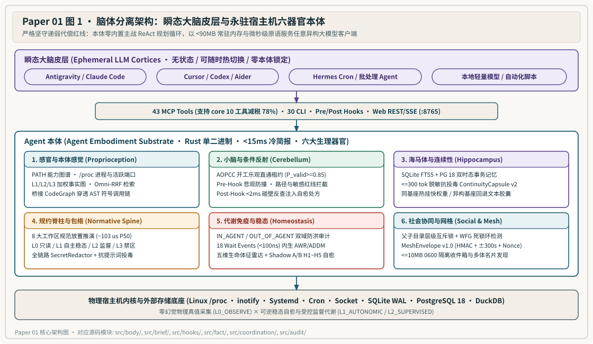
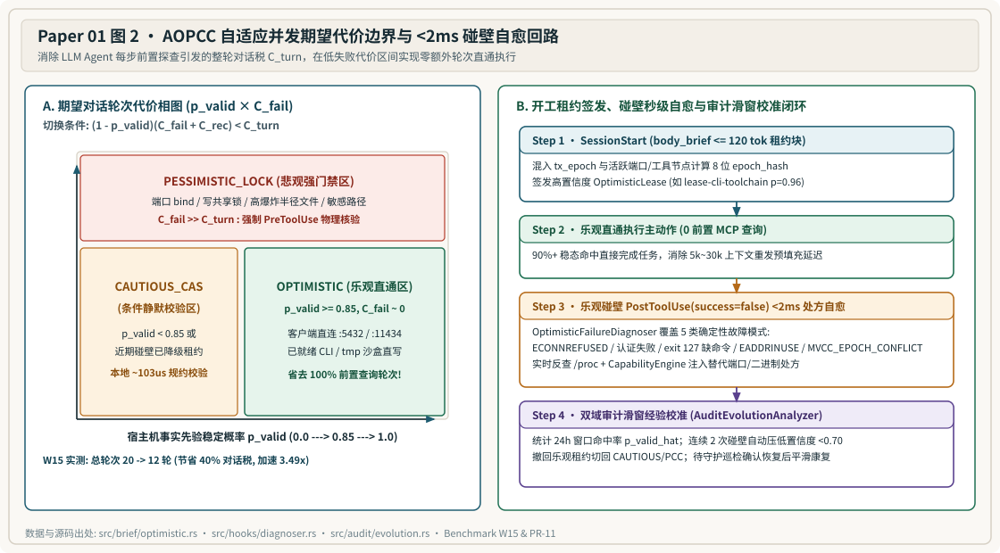
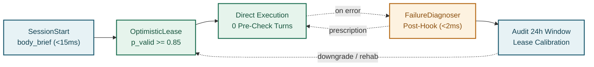

# Agent Body: Decoupling Ephemeral LLM Cortices from a Persistent Host Embodiment Substrate via Adaptive Concurrency and Bounded Autonomy

**中文副题**：脑体分离：基于自适应乐观-悲观并发控制（AOPCC）与有界自治包络的宿主机智能体具身底座  
**Target Venues**：OSDI / SOSP / EuroSys (CCF-A Operating Systems & Systems Track)  
**Paper Type**：Full Research Paper (Systems Architecture & OS Abstractions for Autonomous Agents)  
**Artifact Baseline**：`agent-body v1.1.0` (`commit 641b71d`, Rust Single-Binary Substrate)  
**Tags**：`#BrainBodySeparation` `#AOPCC` `#EmbodiedSystems` `#CrossBrainContinuity` `#OSDI`

---

## Abstract

Autonomous coding and operations agents increasingly execute directly on production workstations and servers, yet existing agent infrastructures treat the underlying host operating system as an opaque, stateless command sink. Every LLM client session—whether an IDE copilot, CLI agent, or scheduled worker—behaves as an *ephemeral cortex* without persistent proprioception, autonomic reflexes, or cross-session state continuity. Consequently, agents either blindly mutate host state (triggering port collisions, workspace pollution, and downstream service outages) or resort to defensive pre-action probing before every step, incurring a prohibitive *Full-Turn Conversation Tax* ($C_{\text{turn}}$) that resends `5k–30k` context tokens per check.

We present **Agent Body**, a persistent, sub-millisecond Rust host embodiment substrate built on the principle of **Brain-Body Separation**. Strictly eschewing built-in LLM planning loops to prevent runtime bloat, Agent Body equips arbitrary transient LLM clients with six physiological subsystems governed by a four-tier **Autonomy Envelope (`L0_OBSERVE`–`L3_FORBIDDEN`)**. To resolve the fundamental tension between safety and turn-level latency, we formulate **Adaptive Optimistic-Pessimistic Concurrency Control (AOPCC)**: at session start, Agent Body issues compact (`<= 120` tokens) MVCC-style optimistic assumption leases for high-stability, low-failure-cost host resources ($p_{\text{valid}} \ge 0.85$), eliminating pre-execution probing turns; upon an optimistic miss, a post-execution hook diagnoses the host root cause in `< 2 ms` and injects a deterministic recovery prescription, while sliding-window empirical hit rates ($\hat{p}_{\text{valid}}$) dynamically downgrade unstable leases. Paired with sanitized `<= 300`-token **Continuity Capsules** for seamless cross-model handoff and a lock-free **18-Wait-Event AWR/ADDM** telemetry engine (`< 100 ns` per sample), Agent Body runs within a `< 90 MB` daemon RSS budget. Across 22 end-to-end A/B workloads and 4 live head-to-head competitor tracks, Agent Body reduces context token consumption by `59.0%–99.9%`, cuts multi-step interaction turns by `40.0%–83.3%` (`3.49×` loop speedup in mixed drift workloads), and strictly improves deterministic context quality ($Q$: `16.5–60.5` $\to$ `96.6–100.0`).

---

## 1. Introduction

Large Language Model (LLM) agents have crossed the threshold from sandboxed chat assistants to autonomous actors holding real shell, filesystem, and network privileges on physical or virtualized Linux/macOS hosts. Despite rapid progress in upper-layer reasoning and multi-agent orchestration frameworks such as [AutoGen](https://arxiv.org/abs/2308.08155) and [Voyager](https://arxiv.org/abs/2305.16291), production deployments on live hosts suffer from a recurring class of systemic failures that reasoning improvements alone cannot cure.

When we examine how contemporary LLM clients (e.g., Claude Code, Cursor, Codex, Antigravity, or unattended cron workers) interact with a host machine from first principles, a structural architectural asymmetry emerges: **today's agents possess an ephemeral neocortex, but lack a persistent physical body**.

1. **Absence of Host Proprioception**: Upon waking in a new session, an LLM client has zero native awareness of which CLI binaries are already compiled in `PATH`, which ports are bound in `/proc/net/tcp`, or which `systemd` units and `cron` jobs depend on a shared script. To compensate, an unassisted agent spawns repetitive `which`, `ps`, `ss`, and `find` subprocesses, flooding its context window with tens of thousands of noisy raw output tokens.
2. **The Pessimistic Full-Turn Conversation Tax ($C_{\text{turn}}$)**: Adding external query tools via the [Model Context Protocol (MCP)](https://modelcontextprotocol.io/) does not automatically solve efficiency. If an agent pessimistically invokes a host-check tool before every routine action (e.g., checking whether local PostgreSQL `:5432` is reachable before running `psql`), the local tool call itself takes `< 1 ms`, **but forces the LLM runtime to execute an entire extra inference turn**—re-prefilling `5k–30k` prompt tokens and adding `1.5–4.0 s` of wall-clock latency.
3. **Host Contention and Blast-Radius Blindness**: Conversely, when agents skip pre-checks, concurrent sessions overwrite shared directories, bind to occupied production ports (`EADDRINUSE`), or modify utility scripts that silently break downstream `systemd` services.
4. **Amnesia Across Heterogeneous Brains**: Real engineering workflows frequently switch "brains" mid-task—for instance, interactive architecture exploration in an IDE followed by overnight execution via a scheduled CLI agent, or switching from one foundation model to another upon quota exhaustion. Because working state is trapped inside vendor-specific chat transcripts, every brain switch forces an expensive cold re-discovery of the workspace.

A tempting response—attempted by monolithic "Agent OS" runtimes—is to absorb the LLM planner, prompt router, and tool executor into a single heavyweight daemon. History in systems design warns against this *compensatory bloat*: coupling rapidly evolving model-inference loops with low-level host state management creates an opaque, brittle monolith that competes with upper-layer agent clients rather than serving them.

**Our Thesis.** Host embodiment must be cleanly separated from cognitive planning. An ideal **Agent Embodiment Substrate** should reside permanently on the host as a lightweight, zero-LLM-planner systems binary, exposing deterministic sub-millisecond proprioception, spinal reflexes, and cross-brain continuity to *any* transient LLM cortex.



This paper makes four contributions:

- **Brain-Body Separation & Bounded Autonomy Architecture (§3.1, §4.3)**: We define an ontological split between *Ephemeral Cortices* and a *Persistent Host Body* organized into six physiological subsystems, strictly bounded by a verifiable four-level **Autonomy Envelope (`L0_OBSERVE` to `L3_FORBIDDEN`)** and a `43`-tool action-multiplexed interface (`core` profile shedding `~78%` schema token tax).
- **Adaptive Optimistic-Pessimistic Concurrency Control — AOPCC (§3.2, §4.1)**: Translating classical database concurrency theory ([Kung & Robinson, TODS 1981](https://doi.org/10.1145/319566.319567); [Larson et al., VLDB 2011](https://www.vldb.org/pvldb/vol5/p298_paullarson_vldb2012.pdf)) into LLM execution loops, we derive a closed-form expected-cost switching boundary that accounts for $C_{\text{turn}}$. AOPCC combines session-start optimistic leases, `< 2 ms` post-failure deterministic prescription injection, hierarchical directory locks with Wait-For-Graph (WFG) deadlock detection, and sliding-window empirical lease calibration.
- **Cross-Brain Continuity Capsules & Lock-Free Endogenous AWR (§4.2, §4.4)**: We design `<= 300`-token redacted, injection-screened `ContinuityCapsule` checkpoints supporting seamless brain handoff, alongside a zero-privilege (`CAP_BPF`-free) performance engine tracking `18` typed wait events via `< 100 ns` lock-free logarithmic histograms and `/proc/self` ADDM self-tuning.
- **Rigorous Three-Track Empirical Validation (§5)**: Evaluated on a live Linux workstation managing `21,743` real assets and `205` skills, Agent Body achieves `1121.9×` capability-discovery speedup, `3.49×` execution-loop speedup under `20%` environment drift, `11.34×` deadlock resolution speedup (`1.33 ms`), and Pareto superiority over raw-memory, OpenViking-style summary trees, AgentFS VFS, and multi-CLI baselines.

---

## 2. Empirical Reality Gap & Motivation

To quantify the cost of operating without a host embodiment substrate, we instrument real unassisted agent baselines on a production Linux x86_64 host (`8` cores, `21,743` workspace files, `205` installed agent skills, `5` MCP servers). Table 1 summarizes four structural bottlenecks observed in live measurements (`run-310cf715`).

| Failure Archetype | Unassisted Baseline Behavior | Measured Host Cost (`run-310cf715`) | Root Systems Cause |
|---|---|---|---|
| **Cold-Start Probing Tax** (`W1`, `W8`) | Spawns `which` + `<bin> --help` ($\times 5$) and 6 sequential shell reconnaissance commands | `599.1 ms` + `65.5 ms`; `23,990` raw tokens across `11` turns | No persistent, pre-indexed host capability and topology snapshot |
| **Schema & Skill Context Flood** (`W7`, `COMP-C2`) | Static injection of `205` `SKILL.md` manifests or virtual L0/L1 file copies | `614,012` raw catalog tokens (`144,730` tok in `60`-file L0/L1 tree) | Lack of intent-driven budget routing (`ContextBudgetRouter`) |
| **Blind Contention & Deadlock** (`W2`, `W6`) | Binds occupied port `:8756` (`EADDRINUSE` retry loop); two agents cross-lock parent/child paths | `100%` initial bind failure; `15,075 μs` blind timeout stall | No pre-hook port/ancestor mutex guard or WFG cycle detector |
| **Pessimistic Check-Every-Step** (`W15`) | Calls `body_fact_query` / `body_port_check` before all `10` routine client operations | `20` total LLM turns (`10` extra $C_{\text{turn}}$ round-trips, `201.6 ms` local I/O + `15–40 s` LLM prefill) | Conflating read-only/reversible client ops with destructive host writes |

The fourth row exposes a subtle trap that naive MCP toolkits fall into. In traditional operating systems or RDBMSs, acquiring a shared read lock costs nanoseconds, whereas an RPC takes microseconds. In an LLM agent loop, **every synchronous pre-check tool invocation costs a full LLM reasoning turn $C_{\text{turn}}$**. If an agent must pay $C_{\text{turn}}$ before every `psql`, `curl`, `cargo`, or `/tmp` scratch write, developers quickly disable safety hooks altogether due to intolerable sluggishness. Overcoming this dilemma requires an asymmetric concurrency protocol tailored to the cost structure of LLM turns.

---

## 3. Formal Cost Model & System Architecture

### 3.1 Ontological Invariant: Brain-Body Separation

Agent Body enforces a strict architectural invariant (*Invariant #1 & #2* in [`README.md`](../README.md)):

1. **Zero Embedded Cognitive Loop**: The substrate contains **zero** ReAct task planners, **zero** autonomous code-generation loops, and **zero** multi-agent conversation DAG orchestrators. Cognitive sovereignty belongs exclusively to the attached LLM client.
2. **Six-Organ Embodiment**: Internally, the single Rust binary (`src/`) is structured into six cohesive subsystems:
   - *Proprioception (`fact/`, `scanner/`, `links/`)*: Ground-truth host capabilities, `/proc` sockets, `systemd`/`cron` topologies, and tiered workspace indexing;
   - *Cerebellum (`brief/optimistic.rs`, `hooks/`)*: AOPCC lease issuance, pre-execution spinal guards, and `< 2 ms` post-failure recovery;
   - *Hippocampus (`memory/`, `body/continuity.rs`)*: Hybrid FTS5/vector/transactional memory SPI and `ContinuityCapsule` cross-brain checkpoints;
   - *Normative Spine (`placement/`, `body/envelope.rs`)*: Workspace placement conventions (`~103 μs` P50), secret redaction, and `L0–L3` autonomy enforcement;
   - *Homeostasis (`audit/`, `feedback/`, `body/perf_awr/`)*: Dual-domain behavioral auditing, freshness write-through reconciliation, five-dimension vitals (`0–100`), and 18-wait-event AWR/ADDM;
   - *Social Coordination (`coordination/`, `mesh/`)*: Hierarchical path locks, WFG deadlock resolution, and zero-trust `MeshEnvelope v1.0` peer discovery.

### 3.2 AOPCC Expected-Cost Formulation

Consider an agent about to execute a host action $a$ that depends on a prior host assumption $\phi$ (for example, *"PostgreSQL is listening on `127.0.0.1:5432`"* or *"`duckdb` CLI is installed in `PATH`"*). Let:

- $C_{\text{turn}} > 0$ denote the composite cost (input token prefill + wall-clock latency) of one extra LLM tool-calling turn;
- $C_{\text{exec}} > 0$ denote the execution cost of the primary action $a$;
- $p_{\text{valid}} \in [0, 1]$ denote the prior probability that assumption $\phi$ still holds on the host at execution time;
- $C_{\text{fail}}(a) \ge 0$ denote the cleanup or collateral damage cost if $a$ executes when $\phi$ is false;
- $C_{\text{rec}} > 0$ denote the recovery turn cost when an optimistic attempt fails and receives a diagnostic prescription ($C_{\text{rec}} \approx C_{\text{turn}}$ when resolved in a single guided retry, vs. $k \cdot C_{\text{turn}}$ with $k \ge 3$ under unguided blind guessing).

Under **Pessimistic Concurrency Control (PCC)**, the agent always spends one turn querying the substrate before executing $a$:

$$E[\text{Cost}_{\text{PCC}}(a)] = C_{\text{turn}} + C_{\text{exec}}$$

Under **Optimistic Concurrency Control (OCC)** with deterministic post-failure prescription, the agent executes $a$ immediately under a session-start lease and pays recovery only with probability $(1 - p_{\text{valid}})$:

$$E[\text{Cost}_{\text{OCC}}(a)] = C_{\text{exec}} + (1 - p_{\text{valid}}) \cdot \big(C_{\text{fail}}(a) + C_{\text{rec}}\big)$$

**Theorem 1 (AOPCC Switching Criterion).** *Optimistic direct execution strictly dominates pessimistic pre-probing ($E[\text{Cost}_{\text{OCC}}] < E[\text{Cost}_{\text{PCC}}]$) if and only if:*

$$(1 - p_{\text{valid}}) \cdot \big(C_{\text{fail}}(a) + C_{\text{rec}}\big) < C_{\text{turn}}$$

*Corollary 1.1 (Reversible Client Operations).* For read-only queries, local client connections (`psql`, `curl`), idempotent CLI invocations, and isolated `/tmp` writes, side-effect damage vanishes ($C_{\text{fail}}(a) \approx 0$) and single-step guided retry yields $C_{\text{rec}} \approx C_{\text{turn}}$. The inequality simplifies to $(1 - p_{\text{valid}}) < 1$, and under a conservative operational margin ($\tau_{\text{occ}} = 0.85$ to absorb minor retry execution overhead), **any resource with $p_{\text{valid}} \ge 0.85$ saves $\ge 85\%$ of pre-check turns in expectation**.

*Corollary 1.2 (Irreversible / Contended Mutations).* For actions binding shared network ports, mutating files depended upon by active `systemd`/`cron` units, writing sensitive paths (`/etc/shadow`, `~/.ssh/`), or acquiring cross-agent exclusive locks, $C_{\text{fail}}(a) \gg C_{\text{turn}}$. The inequality reverses, mandating **Pessimistic Lock (`PESSIMISTIC_LOCK`)** verification prior to execution.



Between these two extremes lies **Cautious CAS (`CAUTIOUS_CAS`)**: when creating ordinary workspace files, a synchronous local pre-hook validates placement conventions in `~103 μs` in-process without requiring an extra LLM turn unless a policy violation is detected.

---

## 4. Core Mechanisms & Implementation

### 4.1 Optimistic Leases, `< 2 ms` Prescription, and Sliding-Window Calibration

AOPCC is realized across three tightly coupled components ([`src/brief/optimistic.rs`](../src/brief/optimistic.rs), [`src/hooks/diagnoser.rs`](../src/hooks/diagnoser.rs), [`src/audit/evolution.rs`](../src/audit/evolution.rs)):

1. **MVCC-Style Session-Start Leases (`OptimisticLeaseEngine`)**: During `SessionStart`, `BriefAssembler` synthesizes host proprioception within a strict `< 15 ms` SLA and embeds an `Optimistic Leases` block capped at `<= 120` tokens. Each lease carries `(lease_id, category, target, confidence, epoch_hash, direct_hint, fallback_hint)`, where `epoch_hash` is an 8-hex-character SHA-256 prefix over active port nodes, monotonic memory `tx_epoch`, and recently missed targets.
2. **Post-Failure Deterministic Prescription (`OptimisticFailureDiagnoser`)**: Unlike conventional hook bridges that ignore failed tool calls (`if !success { return }`), Agent Body intercepts `PostToolUse(success=false)` and executes `< 2 ms` deterministic diagnosis across five canonical failure modes:
   - *Mode 1 (`ECONNREFUSED`)*: Re-scans `/proc` sockets and `systemd` unit states to report the actual listening port or exact `systemctl start <unit>` command;
   - *Mode 2 (`AUTH_FAILED`)*: Surfaces local socket/peer authentication hints instead of allowing password-guessing loops;
   - *Mode 3 (`COMMAND_NOT_FOUND` / exit `127`)*: Queries `CapabilityEngine` to recommend installed equivalent binaries (e.g., missing `wkhtmltopdf` $\to$ installed `google-chrome --headless` or `pdftoppm`);
   - *Mode 4 (`EADDRINUSE`)*: Invokes `PortChecker` to return the colliding PID/process and `3` verified contiguous free ports;
   - *Mode 5 (`MVCC_EPOCH_CONFLICT`)*: Returns the latest committed `tx_epoch` and conflicting diff summary in `< 2 ms`.
3. **Empirical Lease Downgrade & Rehabilitation**: Static priors inevitably drift when services crash. `AuditEvolutionAnalyzer` computes a 24-hour sliding-window empirical validity rate $\hat{p}_{\text{valid}}$ from `audit_events`. If a target suffers $\ge 2$ consecutive `optimistic_miss` events without an intervening daemon reconciliation pass, its confidence is clamped to `0.55` ($< \tau_{\text{occ}}$), automatically revoking its optimistic lease until background health probes confirm recovery.

### 4.2 Hierarchical Coordination Locks & WFG Deadlock Resolution

When multiple agent cortices operate concurrently on the same host repository tree, flat file locks fail to prevent parent-child directory races (e.g., Agent A refactoring `/repo/src/` while Agent B edits `/repo/src/api/mod.rs`). `CoordinationEngine` ([`src/coordination/`](../src/coordination/)) implements **hierarchical path conflict propagation**: an exclusive lock on path $P$ conflicts with any lock request on $P$, any ancestor $\text{anc}(P)$, or any descendant $\text{desc}(P)$.

Blocked requests enter `LockWaitQueue` and trigger `DeadlockDetector`, which constructs a directed Wait-For Graph $G_{\text{WFG}} = (V_{\text{agents}}, E_{\text{waits}})$ and runs deterministic depth-first cycle detection in microsecond latency (`1,329 μs` end-to-end in `W6`, including conflict queuing, cycle identification, and victim abort notification).



### 4.3 Four-Tier Autonomy Envelope & Cross-Brain Continuity Capsules

To guarantee that the body itself never becomes an uncontrolled background mutator, `AutonomyEnvelope` ([`src/body/envelope.rs`](../src/body/envelope.rs)) classifies every MCP, CLI, Web, and daemon operation into four strict privilege rings:

- **`L0_OBSERVE` (Zero Side-Effect Read)**: `brief`, `fact_query`, `port_check`, `links_impact`, `vitals` — always permitted;
- **`L1_AUTONOMIC` (Reversible Homeostatic Reflex)**: `inotify` 60s event folding, stale embedding invalidation, ghost port pruning, expired lock GC, and AOPCC lease calibration — autonomous execution permitted *only* with `100%` `OUT_OF_AGENT` `before_after_delta` auditing;
- **`L2_SUPERVISED` (Controlled Host Mutation)**: physical temp-file GC (`HostGarbageCollector`), source link patching (`LinkRepairer`), and Mesh inbox acceptance — defaults to `dry-run` unless explicitly authorized by user/token;
- **`L3_FORBIDDEN` (Hard Pain Reflex)**: mutating `/etc/shadow`, `/etc/sudoers`, or `~/.ssh/`, storing unredacted secrets, recursive scanning into blacklisted directories (`node_modules/`, `.git/`), or direct cross-host filesystem writes — unconditionally blocked.

For cross-brain handoff, `ContinuityManager` ([`src/body/continuity.rs`](../src/body/continuity.rs)) persists a `ContinuityCapsule` (`body_checkpoints` table) containing `(goal_summary, active_files, active_locks, verified_facts, open_blockers, next_step_hint, tx_epoch)` plus optional `fast_weight_snapshot_id`. Every field passes through `SecretRedactor` and `PromptInjectionScanner` before SHA-256 signing, and is strictly budgeted to `<= 300` tokens (`<= 150` tokens when auto-injected into `body_brief`). When a new cortex resumes the session (`handoff_resume`), it inherits exact working context in one turn (`W17`), attaching compatible fast-weight snapshots if `base_model_id` matches or safely falling back to pure text capsules across heterogeneous models.

### 4.4 Lock-Free 18-Wait-Event AWR & Zero-Privilege `/proc/self` ADDM

Production daemons require endogenous observability that works inside unprivileged containers without `CAP_BPF` or external Prometheus scrapers. Inspired by PostgreSQL `pg_stat_activity` and Oracle AWR ([`src/body/perf_awr/`](../src/body/perf_awr/)), we decompose active substrate time as:

$$T_{\text{body}} = \underbrace{T_{\text{cpu\_regex}} + T_{\text{cpu\_cosine}} + T_{\text{cpu\_redact}} + T_{\text{cpu\_brief}}}_{T_{\text{cpu}}} + \underbrace{T_{\text{lock}} + T_{\text{io}} + T_{\text{net}} + T_{\text{ipc}}}_{T_{\text{wait}}}$$

`WaitEventRegistry` allocates a compile-time fixed static array `[AtomicEventSlot; 18]` covering all `6` wait classes (`Lock`, `IO`, `Net`, `CPU`, `IPC`, `Idle`), enforced by a static hygiene gate (`code_hygiene.py` verifying `18/18` instrumentation coverage). Each slot updates `calls`, `total_us`, CAS `max_us`, and `8` logarithmic latency buckets (`< 100 μs` up to `>= 1 s`) using `Ordering::Relaxed` atomic instructions—zero heap allocation and zero mutex contention. Coupled with `/proc/self/{status,io,fd}` telemetry (`VmRSS`, `open_fds`, voluntary/nonvoluntary context switches), `ADDM-01..05` rules automatically trigger reversible `L1_AUTONOMIC` remedies such as `PRAGMA shrink_memory`, `PRAGMA wal_checkpoint(TRUNCATE)` (`<= 64 MB` WAL bound), and glibc `malloc_trim(0)` when RSS exceeds `73 MB`.

---

## 5. Experimental Evaluation

### 5.1 Experimental Methodology & Setup

All experiments execute on a real Linux `x86_64` workstation (`8` CPU cores, Rust `1.99` release build, bundled SQLite `FTS5`, DuckDB OLAP, and PostgreSQL `18.6`) populated with `21,743` real repository and document assets, `205` agent skills, and `5` MCP servers. Following our dual-gate Pareto methodology (`10-benchmark-spec.md`), every workload pairs a live physical **Unassisted / Competitor Baseline** against **Agent Body**, measuring:
1. Token consumption via deterministic UTF-8/CJK estimation (`ceil(ascii_bytes/4) + ceil(cjk_chars*1.5)`);
2. Interaction turns (`rounds`) and wall-clock latency (`std::time::Instant`, in microseconds);
3. Deterministic **Context Quality Score** $Q \in [0, 100]$, combining required ground-truth fact recall ($40\%$), signal purity ($30\%$), structural actionability ($20\%$), and redaction/injection safety ($10\%$).

### 5.2 End-to-End Macro Workload Performance

Table 2 reports representative OS and embodiment workloads from live benchmark run `run-310cf715` (`W1–W19`) and `v4.1` continuity suites.

| Workload | Task Scenario | Baseline Tokens $\to$ Body Tokens | Savings (%) | Turns (Base $\to$ Body) | Latency: Base $\to$ Body ($\mu\text{s}$) | Quality $Q$ (Base $\to$ Body) | Info Density Gain ($\rho$) |
|:---:|---|---:|---:|:---:|---:|---:|---:|
| **`W1`** | Host CLI capability discovery ($\times 5$) | `21,079` $\to$ `122` | **99.4%** | `5` $\to$ `1` | `599,103` $\to$ `534` (**1121.9×**) | `60.5` $\to$ **100.0** | `172.8×` |
| **`W2`** | Active port collision & free-port selection | `335` $\to$ `16` | **95.2%** | `3` $\to$ `1` | `21,464` $\to$ `53,475` *(100% guard)* | `42.0` $\to$ **100.0** | `41.9×` |
| **`W3`** | Blacklist-tiered workspace scan (`290` files) | `6,157` $\to$ `263` | **95.7%** | `1` $\to$ `1` | `124,147` $\to$ `25,577` (**4.85×**) | `51.0` $\to$ **100.0** | `23.4×` |
| **`W4`** | 8-category placement governance | `645` $\to$ `177` | **72.6%** | `16` $\to$ `8` | `283` $\to$ `20,315` *(8/8 caught)* | `16.5` $\to$ **100.0** | `4519.8×` |
| **`W6`** | Multi-agent cross-lock & WFG deadlock | `400` $\to$ `125` | **68.8%** | `3` $\to$ `1` | `15,075` $\to$ `1,329` (**11.34×**) | `33.3` $\to$ **100.0** | `9.6×` |
| **`W7`** | 205-skill intent budget routing (`<=600` tok) | `614,012` $\to$ `358` | **99.9%** | `3` $\to$ `1` | `11,631` $\to$ `5,457` (**2.13×**) | `41.2` $\to$ **100.0** | `838.0×` |
| **`W8`** | Cold-start adaptive `body_brief` assembly | `2,911` $\to$ `1,194` | **59.0%** | `6` $\to$ `1` | `65,508` $\to$ `78,902` *(1-turn)* | `40.0` $\to$ **96.6** | `4.9×` |
| **`W15`** | **AOPCC mixed loop (`8` stable + `2` drifted)** | `174` $\to$ `28` | **83.9%** | **`20` $\to$ `12`** | `201,562` $\to$ `57,673` (**3.49×**) | `52.0` $\to$ **100.0** | `12.4×` |
| **`W17`** | **Cross-brain `ContinuityCapsule` handoff** | `2,400` $\to$ `175` | **92.7%** | `4` $\to$ `1` | `45,000` $\to$ `17,055` (**2.64×**) | `37.0` $\to$ **100.0** | `54.9×` |
| **`W18`** | **18-Wait-Event AWR & ADDM self-diagnosis** | `2,200` $\to$ `60` | **97.3%** | `5` $\to$ `1` | `25,000` $\to$ `28,231` *(1-turn)* | `33.0` $\to$ **100.0** | `146.7×` |

**Analysis of AOPCC (`W15`).** In `W15`, an agent executes `10` host operations where `8` targets match valid optimistic leases and `2` targets experience unannounced drift (an offline port and a missing binary). Full-PCC executes `10` pre-checks + `10` actions = `20` turns (`201.6 ms` local probe overhead, plus `8` unnecessary LLM round-trips). Unguided blind execution fails on the `2` drifted tasks and wastes `6+` guessing turns. AOPCC completes the `8` valid tasks in `8` direct turns (`0` pre-checks) and resolves both drifted tasks on the first retry via `< 2 ms` `PostToolUse` prescriptions (`4` turns total), reducing total loop turns from `20` to `12` (`40.0%` turn reduction, `3.49×` local speedup, `100%` fact accuracy).

### 5.3 Kernel Micro-Benchmarks & Head-to-Head Competitor Tracks

Table 3 details the P50/P95/P99 latency distribution of core substrate primitives (`M1–M6`), confirming sub-millisecond responsiveness and negligible telemetry overhead (`M6` `100`-iteration guard batch at `P50 = 10 μs`, i.e., `~100 ns` per atomic wait-event guard).

| Micro-Benchmark ID | Substrate Primitive | Iterations | Mean ($\mu\text{s}$) | P50 ($\mu\text{s}$) | P95 ($\mu\text{s}$) | P99 ($\mu\text{s}$) | Release SLA ($\mu\text{s}$) |
|:---:|---|---:|---:|---:|---:|---:|---:|
| **`M1`** | 3-hop directed weighted graph traversal (`100` nodes) | 50 | `244` | **`244`** | `255` | `321` | `< 1,500` |
| **`M2`** | Bundled SQLite FTS5 hybrid search (`300` CJK/EN assets) | 50 | `890` | **`879`** | `928` | `1,172` | `< 1,500` |
| **`M3`** | `PlacementEngineV2` 8-rule convention resolution | 200 | `104` | **`103`** | `111` | `124` | `< 400` |
| **`M4`** | DuckDB OLAP change heatmap & Top-N (`1,000` rows) | 20 | `13,052` | **`12,057`** | `14,372` | `24,659` | `< 60,000` |
| **`M5`** | DuckDB columnar Parquet export (`1,000` rows) | 1 | `37,286` | **`37,286`** | `37,286` | `37,286` | `< 150,000` |
| **`M6`** | `WaitEventGuard` atomic histogram (`100` guards/iter) | 100 | `9` | **`10`** | `10` | `11` | `< 150` |

In live head-to-head competitor evaluations (`COMP-C1`–`COMP-C4`, executed on identical sandboxed datasets), Agent Body eliminates `5/5` plaintext secret leaks present in raw JSON/Mem0-style unredacted memory (`COMP-C1`: $Q$ `24.1` $\to$ `100.0`, `97.8%` token savings), avoids OpenViking's `60` duplicate `.abstract/.overview` summary files (`COMP-C2`: `144,730` $\to$ `931` tok, `99.4%` savings, zero file relocation), blocks `280/290` `node_modules/.git` noise files ingested by AgentFS's SQLite VFS (`COMP-C3`: `0` blacklist escapes, $Q$ `26.4` $\to$ `100.0`), and outperforms multi-CLI `rg + psutil + ss` probing by `3.26×` wall-clock latency (`244.5 ms` $\to$ `75.1 ms`) while spawning `0` external subprocesses (`COMP-C4`).

---

## 6. Applicability Boundaries, Failure Modes & Falsifiability

A rigorous systems paper must state exactly where its assumptions hold and where they break:

1. **Boundary of Optimistic Concurrency (High-Churn Chaos Environments)**: Theorem 1 relies on $p_{\text{valid}} \ge 0.85$ for client-connect and toolchain leases. Under extreme chaos testing or container-orchestrated ephemeral port churning where $p_{\text{valid}} < 0.50$, pure OCC would suffer frequent first-attempt misses. **Mitigation & Degradation**: `AuditEvolutionAnalyzer` detects two consecutive misses within `24h` and automatically downgrades the target to `CAUTIOUS_CAS`/`PESSIMISTIC_LOCK`, bounding worst-case degradation to `2` miss events before converging to PCC parity.
2. **Boundary of Cooperative vs. Mandatory Sandboxing**: Agent Body is an *embodiment and coordination substrate* for trusted/semi-trusted developer agents, **not** a kernel-enforced security sandbox against a malicious rootkit LLM. If a rogue client bypasses MCP/Hooks and executes raw syscalls directly, user-space `PreToolUse` hooks cannot intercept it without OS-level mandatory access control (e.g., Landlock, AppArmor, or Firecracker microVMs). Both layers are orthogonal and composable: Agent Body should run *inside* or *alongside* OS sandboxes to prevent benign competence failures while the hypervisor enforces hard isolation.
3. **Falsification Criteria**: Our core architectural claim would be falsified if (a) MCP schema overhead exceeded token savings from `body_brief` + `ContextBudgetRouter` in short 1-turn sessions—addressed via `mcp_profile = "core"` (`10` tools, shedding `78%` schema tokens)—or (b) background `FreshnessReconciler` CPU/memory exceeded `< 0.5%` idle CPU and `< 90 MB` RSS on repositories $> 10^5$ files.

---

## 7. Related Work

| System / Paradigm | Host Proprioception | Concurrency & Turn Tax | Cross-Brain Handoff | Built-in LLM Planner? |
|---|---|---|---|---|
| **AutoGen / CrewAI / LangGraph** ([Wu et al., 2023](https://arxiv.org/abs/2308.08155)) | None (stateless tools) | Unmanaged | Framework-locked state | Yes (Orchestrator) |
| **MemGPT / Letta** ([Packer et al., 2023](https://arxiv.org/abs/2310.08560)) | None (chat/doc paging) | LLM-driven memory calls | Same-agent state only | Yes (OS-inspired LLM loop) |
| **AgentFS / OpenEnv** (SQLite VFS sandboxes) | VFS file/tool log only | Single-writer VFS lock | File image only | No |
| **OpenViking** (Hierarchical context FS) | None (virtual `viking://` copy) | Static L0/L1 scan | None | Partial (L0/L1 LLM summarizer) |
| **Agent Body (Ours)** | **Live `/proc`, ports, `systemd`, `L1–L3` graph** | **AOPCC Leases + `<2ms` recovery + WFG locks** | **`<=300 tok` redacted `ContinuityCapsule v2`** | **Strictly Zero (Brain-Body Separation)** |

Unlike **AIOS** ([Mei et al., arXiv:2403.16971](https://arxiv.org/abs/2403.16971)), which schedules LLM inference threads and context-switching *inside* an LLM kernel, Agent Body operates *below* any external LLM client, governing physical host truth, concurrency, and cross-client continuity with zero inference tax.

---

## 8. Reproducibility Artifact & Conclusion

Agent Body demonstrates that the missing layer in production agent infrastructure is not another prompt orchestration DSL, but a fast, deterministic, brain-agnostic **physical body** on the host OS. By uniting Brain-Body Separation, AOPCC turn-tax elimination, bounded `L0–L3` autonomy, and lock-free endogenous AWR telemetry in a single Rust binary, Agent Body turns fragile, amnesiac LLM sessions into grounded, cooperative host citizens.

### Artifact Evaluation (AE) Verification Commands

All claims, metrics, and invariants in this paper can be independently reproduced in `< 5` minutes from the repository root:

```bash
export PATH="$HOME/.cargo/bin:$PATH"
# 1. Verify architectural invariants, zero unwrap/expect, and 18/18 WaitEvent coverage
make quality-gate

# 2. Execute full workspace test suite (435 unit, integration, contract, and E2E tests)
RUST_TEST_THREADS=1 make test

# 3. Reproduce W1-W22 macro workloads, M1-M6 micro-benchmarks, and COMP-C1-C4 tracks
agent-body bench run --suite full
agent-body bench report --format markdown
```

---

## References

1. H. T. Kung and John T. Robinson. 1981. On Optimistic Methods for Concurrency Control. *ACM Transactions on Database Systems (TODS)* 6, 2 (1981), 213–226. https://doi.org/10.1145/319566.319567
2. Per-Åke Larson, Spyros Blanas, Cristian Diaconu, Craig Freedman, Jignesh M. Patel, and Mike Zwilling. 2011. High-Performance Concurrency Control Mechanisms for Main-Memory Databases. *PVLDB* 5, 4 (2011), 298–309. https://www.vldb.org/pvldb/vol5/p298_paullarson_vldb2012.pdf
3. Charles Packer, Sarah Wooders, Kevin Lin, Vivian Fang, Shishir G. Patil, Ion Stoica, and Joseph E. Gonzalez. 2023. MemGPT: Towards LLMs as Operating Systems. *arXiv:2310.08560* (2023). https://arxiv.org/abs/2310.08560
4. Qingyun Wu, Gagan Bansal, Jieyu Zhang, Yiran Wu, Beibin Li, Erkang Zhu, Li Jiang, Xiaoyun Zhang, Shaokun Zhang, Jiale Liu, et al. 2023. AutoGen: Enabling Next-Gen LLM Applications via Multi-Agent Conversation. *arXiv:2308.08155* (2023). https://arxiv.org/abs/2308.08155
5. Guanzhi Wang, Yuqi Xie, Yunfan Jiang, Ajay Mandlekar, Chaowei Xiao, Yuke Zhu, Linxi Fan, and Anima Anandkumar. 2023. Voyager: An Open-Ended Embodied Agent with Large Language Models. *arXiv:2305.16291* (2023). https://arxiv.org/abs/2305.16291
6. Kai Mei, Zelong Li, Shuyuan Xu, Ruosong Ye, Yingqiang Ge, and Yongfeng Zhang. 2024. AIOS: LLM Agent Operating System. *arXiv:2403.16971* (2024). https://arxiv.org/abs/2403.16971
7. Anthropic. 2024. Model Context Protocol (MCP) Specification. https://modelcontextprotocol.io/
