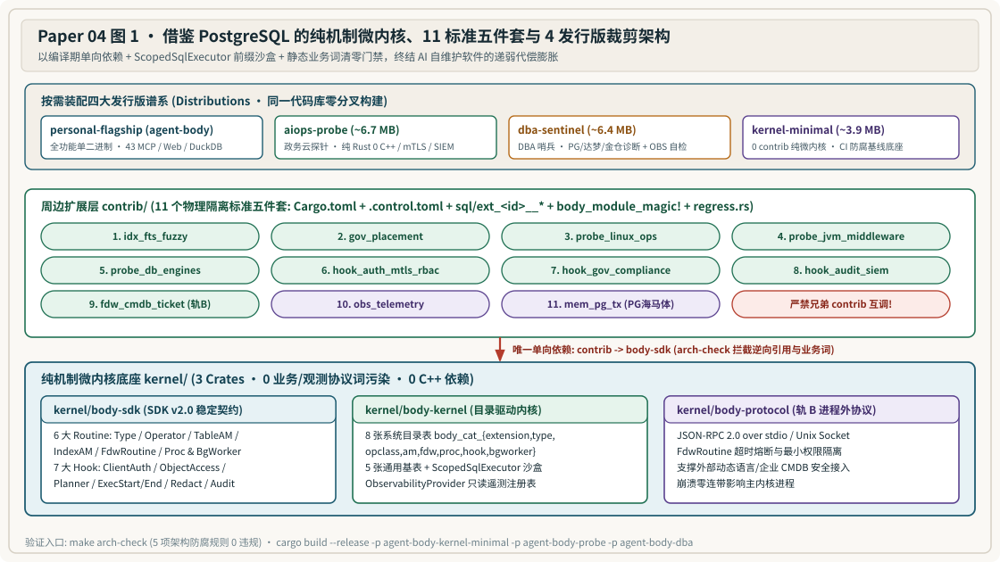
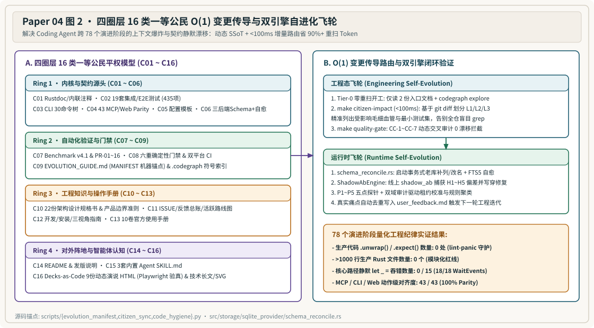
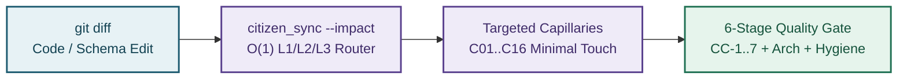

# Zero-Rescan Co-Evolution: PostgreSQL-Inspired Microkernel Isolation and O(1) First-Class Citizen Propagation for Agent-Maintained Systems

**中文副题**：零重扫协同进化：面向智能体自维护软件的类 PostgreSQL 微内核防腐隔离与 O(1) 一等公民确定性传导  
**Target Venues**：ICSE / FSE / ASE (CCF-A Software Engineering, Software Architecture & AI-Native SE Track)  
**Paper Type**：Full Research Paper (Autonomous Software Evolution, Microkernel Modularity & Cross-Artifact Consistency)  
**Artifact Baseline**：`kernel/` (3 Crates) · `contrib/` (11 Extensions) · `distributions/` (3 Slim Binaries) · `scripts/{evolution_manifest,citizen_sync,arch_boundary_check,code_hygiene}.py`  
**Tags**：`#AgenticSE` `#PostgreSQLMicrokernel` `#ZeroRescanEvolution` `#FirstClassCitizens` `#SchemaSelfHealing` `#ICSE`

---

## Abstract

Software systems iteratively built and maintained by AI coding agents over dozens of development phases suffer from two compounding forms of architectural entropy: **Compensatory Kernel Bloat**—where domain-specific probes, C++ OLAP runtimes, and compliance hooks leak into core modules, creating >1,000-line "God files" and brittle fat interfaces—and **Silent Capillary Drift**—where code mutations leave configuration templates, multi-engine SQL schemas, CLI help texts, MCP/Web APIs, benchmarks, user manuals, and presentation decks out of sync, forcing subsequent agent sessions to burn massive context budgets rescanning the entire repository.

We present **Zero-Rescan Co-Evolution**, an architectural and tooling discipline extracted from evolving **Agent Body** across `78` consecutive engineering phases (`435` passing tests, `27` flagship modules). First, inspired by PostgreSQL's `src/backend/` (`pg_catalog`) vs. `contrib/` separation ([Stonebraker & Rowe, SIGMOD 1986](https://doi.org/10.1145/16894.16888)), we refactor domain policy out of a **Pure-Mechanism Microkernel (`kernel/`)** driven by `8` system catalog tables (`body_cat_*`), `6` open `Routine` traits, and `7` lifecycle `Hook` slots. Domain extensions reside in `11` standardized five-piece **`contrib/`** packages constrained by unidirectional SDK dependencies, compile-time `body_module_magic!()` ABI stamps, `ScopedSqlExecutor` table-prefix sandboxes (`ext_<id>__*`), and automated zero-business-word boundary gates—enabling zero-C++ slim binaries down to `3.9 MB` (`kernel-minimal`) and `6.4–6.7 MB` (`dba-sentinel` / `aiops-probe`). Second, we formalize a **Four-Ring, 16-Citizen Equality Model (`C01–C16`)** paired with an **$O(1)$ Incremental Change Router (`citizen_sync`)** and `7` dynamic cross-citizen consistency audits (`CC-1`–`CC-7`), routing `git diff` footprints to affected documentation, tests, and Decks-as-Code artifacts in `< 100 ms` while eliminating `> 90%` of full-repo rescan tokens. Coupled with runtime `ShadowAbEngine` falsification and transactional SQLite schema self-healing (`schema_reconcile.rs`), the repository sustains `0` production `.unwrap()/.expect()` calls, `0` files $> 1,000$ LOC, `0/15` silent `let _ =` error drops on core paths, and `100%` (`43/43`) MCP/CLI/Web action parity.

---

## 1. Introduction

Recent benchmarks such as [SWE-bench (Jimenez et al., ICLR 2024)](https://arxiv.org/abs/2310.06770) evaluate whether an AI coding agent can resolve a *single isolated GitHub issue* against a human-architected codebase. Yet a far harder software engineering question looms as organizations adopt autonomous coding agents for continuous product development: **what happens at Phase 75 when AI agents themselves have authored, refactored, and extended the system across dozens of consecutive feature milestones?**

In our longitudinal development of Agent Body (`v0.1.0` $\to$ `v1.1.0`, `Phase 1` $\to$ `Phase 78`), unguarded agentic iteration exposed two severe failure modes that standard unit tests and linters fail to prevent:

1. **Compensatory Kernel Bloat & Coupling Decay**: When asked to support new enterprise scenarios—such as Linux `/proc` JVM/Nginx inspection, Dameng/Kingbase database diagnostics, DuckDB columnar analytics (`libstdc++6`), mTLS/RLS compliance, or PostgreSQL bitemporal fast-weight memory—coding agents naturally take the path of least resistance: *patching core structs, widening fat storage traits (`88` methods), hardcoding static SQL `CHECK` enums, and pulling heavyweight C++ dependencies into the root binary*. Without structural firewalls, an initially lean daemon balloons in binary size, loses deployability on constrained edge VMs, and accumulates `> 1,000`-line God files.
2. **Context Explosion vs. Silent Capillary Drift**: A production repository is not merely `src/*.rs`; it is an organism of `16` interdependent artifact classes—Rustdoc comments, `4` test tiers, CLI `--help` trees, MCP JSON schemas, Web REST/UI parity matrices, `config.example.toml`, `3`-backend SQL schemas + upgrade reconcilers, benchmarks, `10`-volume manuals, `SKILL.md` prompts, release notes, and architectural SVG/HTML decks. In naive workflows, a new agent session either (a) **blindly `grep`s and reads `70+` historical roadmap and source files**, exhausting `50k–150k` context tokens before writing a single line of code, or (b) **edits only the Rust source**, silently breaking legacy database upgrades, leaving `config.example.toml` missing new struct fields, or stranding stale version/metric counts across user manuals and slides.

**Our Thesis.** Sustaining velocity and zero-defect invariants across long-horizon agentic maintenance requires **replacing LLM memory with deterministic software architecture and $O(1)$ compiler/script gates**: mechanism-policy microkernel isolation prevents structural bloat in space, while Single-Source-of-Truth (SSoT) manifest extraction and incremental citizen routing prevent drift across time.



This paper makes three contributions to AI-native software engineering:

- **PostgreSQL-Inspired Pure-Mechanism Microkernel (`kernel/` + `contrib/`) (§2)**: We translate PostgreSQL's `pg_catalog` extensibility model into Rust agent infrastructure via `8` system catalog tables, `6` `Routine` traits, `7` `Hook` slots, Track-A compiled crates vs. Track-B out-of-process JSON-RPC sandboxes, and `ScopedSqlExecutor` table-prefix isolation, guarded by a 5-rule static architecture checker.
- **16-Class First-Class Citizen Model & $O(1)$ Incremental Propagation (§3)**: We elevate `16` code, test, schema, config, benchmark, skill, and presentation artifacts to equal first-class status (`C01–C16`), backed by `< 100 ms` `evolution_manifest` SSoT extraction, `citizen_sync --impact` change routing, and `CC-1..CC-7` cross-artifact audits—including **Decks-as-Code** generation verified by headless Playwright visual gates.
- **Dual-Flywheel Runtime-Engineering Self-Evolution (§4, §5)**: We close the loop between online runtime falsification (`ShadowAbEngine` `H1–H5`, transactional `schema_reconcile.rs` zero-loss legacy DB healing) and offline deterministic hygiene gates (`0` panics, `0` $>1000\text{L}$ files, `435` tests), validated across `4` assembled distributions and `78` evolutionary phases.

---

## 2. PostgreSQL-Inspired Microkernel & Five-Piece `contrib/` Architecture

### 2.1 Five Litmus Tests & Catalog-Driven Mechanism Separation

Why has PostgreSQL thrived for four decades without collapsing under extensions as diverse as PostGIS, `pgvector`, TimescaleDB, and Citus? Because `src/backend/` implements *pure domain-agnostic mechanisms* (catalogs, `TableAmRoutine`, `IndexAmRoutine`, FDWs, hooks, background workers), forcing domain *policies* into `contrib/` ([Stonebraker & Rowe, 1986](https://doi.org/10.1145/16894.16888)).

We codify **Five Litmus Tests** (`20-plugin-microkernel-architecture-spec.md`): any module that (1) depends on OS/distro/middleware specifics, (2) encodes organizational IAM/PII/SIEM rules, (3) links heavy C++/LLM runtimes (`duckdb`, `postgres`, `ollama`), (4) reflects workspace conventions, or (5) serves UI/benchmarking **is strictly barred from `kernel/`**.

The microkernel workspace ([`kernel/`](../kernel/)) comprises three minimal crates:
- **`agent-body-sdk` (`75` LOC root facade, `SDK_API_VERSION = "2.0"`)**: Defines `EvidenceTuple`, `6` open routines (`TypeRoutine`, `OperatorRoutine`, `TableAmRoutine`, `IndexAmRoutine`, `FdwRoutine`, `ProcRoutine` + `BgWorkerRoutine`), `7` lifecycle hooks (`ClientAuthHook`, `ObjectAccessHook`, `PlannerRewriteHook`, `ExecutorStartHook`, `ExecutorEndHook`, `TupleRedactHook`, `EmitAuditHook`), `ObservabilityProvider`, and `FastWeightCheckpointSpi`.
- **`agent-body-kernel`**: Replaces static SQL `CHECK` enums and the 88-method monolithic SPI with **`8` System Catalog Tables** (`body_cat_{extension,type,opclass,am,fdw,proc,hook,bgworker}`) plus `5` generic base tables (`kernel_{entities,edges,event_log,leases,checkpoints}`). Notably, `body_cat_proc` acts as the single registration point from which MCP tool schemas, CLI subcommands, and HTTP REST routes are uniformly dispatched.
- **`agent-body-protocol`**: Defines Track-B out-of-process JSON-RPC 2.0 over `stdio`/Unix domain sockets with hard timeout (`1,500 ms`) and crash isolation for untrusted or dynamic connectors (e.g., `contrib/fdw_cmdb_ticket`).

### 2.2 The Standardized Five-Piece `contrib/<ext>/` Contract & SQL Prefix Sandbox

Every peripheral extension in [`contrib/`](../contrib/) (`11` shipped packages, including `obs_telemetry` and `mem_pg_tx`) must satisfy a machine-checked **Five-Piece Contract** enforced by [`scripts/arch_boundary_check.py`](../scripts/arch_boundary_check.py):

1. **`Cargo.toml` (Unidirectional Dependency)**: May depend *only* on `agent-body-sdk` (and `agent-body-protocol` if Track-B); cross-`contrib` imports and reverse references from `kernel/` to `contrib/`/`distributions/`/root are compile-time and CI errors (*Rule 1*).
2. **`<ext>.control.toml`**: Declares `id`, `version`, `kind`, `requires` DAG, `default_autonomy`, and `table_prefix = "ext_<ext>__"`.
3. **`sql/<ext>--<ver>.sql` (`ScopedSqlExecutor` Isolation)**: Every `CREATE/ALTER/DROP TABLE` and `INSERT/UPDATE/DELETE` statement is parsed and validated against `ext_<ext>__*` (*Rule 3*), preventing Extension A from corrupting Extension B's private tables.
4. **`src/lib.rs` with `body_module_magic!()`**: Stamps compile-time `SDK_API_VERSION` and crate metadata (analogous to `PG_MODULE_MAGIC`), rejecting ABI-mismatched plugins before registration.
5. **`tests/regress.rs`**: Standalone `KernelRuntime` regression suite (analogous to `pg_regress`).

In addition, *Rule 2* scans non-test production slices across `kernel/**/src/**/*.rs` against an 18-term banned business/protocol vocabulary (`duckdb`, `ollama`, `systemd`, `crontab`, `jvm`, `nginx`, `cmdb`, `siem`, `kingbase`, `dameng`, `placement`, `prometheus`, `otlp`, etc.), guaranteeing **zero conceptual leakage** back into the microkernel.

---

## 3. Four-Ring 16-Citizen Model & $O(1)$ Zero-Rescan Propagation

### 3.1 Tier-0 Entry Protocol & Dynamic SSoT Manifest

To eliminate full-repository context thrashing when a fresh agent session starts, [`EVOLUTION_GUIDE.md`](../EVOLUTION_GUIDE.md) establishes a **5-Minute Tier-0 Entry Protocol**:
1. The agent is **prohibited** from `grep`-scanning the repository or reading frozen `Tier-2` historical phase logs (`roadmap-phase52..75.md`). It reads *only* `EVOLUTION_GUIDE.md` + the single active `Tier-0` roadmap (`roadmap-phase76-78.md`) and navigates symbols via `codegraph explore` ([`.codegraph/`](../EVOLUTION_GUIDE.md)).
2. [`scripts/evolution_manifest.py`](../scripts/evolution_manifest.py) extracts live ground-truth counts directly from AST/SQL/Cargo sources in `< 100 ms` (`modules=27`, `mcp_tools=43`, `spi_methods=88`, `tables=27`, `workloads=22`, `micro=6`, `dq=12`, `pr_rules=16`, `kernel_crates=3`, `contrib_exts=11`, `distributions=3`, `verified_tests=435`) and verifies `<!-- MANIFEST: ... -->` anchors.



### 3.2 `citizen_sync`: $O(1)$ Capillary Routing & `CC-1..CC-7` Cross-Audits

We organize all repository deliverables into **Four Concentric Rings of 16 First-Class Citizens (`C01–C16`)** in [`scripts/citizen_sync.py`](../scripts/citizen_sync.py):
- *Ring 1 (Kernel & Contracts)*: `C01` Rustdoc/inline comments · `C02` 4-tier tests · `C03` CLI tree/`--help` · `C04` MCP/Web Parity · `C05` `config.example.toml`/Docker · `C06` 3-backend SQL schemas & `schema_reconcile.rs`;
- *Ring 2 (Verification & Gates)*: `C07` Benchmark & `PR` ledger · `C08` 6 deterministic CI gates · `C09` `EVOLUTION_GUIDE.md` & `.codegraph`;
- *Ring 3 (Engineering Knowledge)*: `C10` 22 design specs & governance boundaries · `C11` `ISSUE.md`/`user_feedback.md`/active roadmap · `C12` Dev/Install/Arch guides · `C13` 10-volume manuals;
- *Ring 4 (External Surface & Agent Cognition)*: `C14` `README.md` & Release notes · `C15` built-in `SKILL.md` packages · `C16` **Decks-as-Code** (`scripts/deck_engine.py` dynamically reading `evolution_manifest` SSoT to build `9` HTML slide decks, verified for zero visual overflow via headless Playwright `make verify-decks`).

Given a working-tree `git diff`, `citizen_sync.py --impact` classifies the change into `L1` (internal fix), `L2` (interface/config), or `L3` (milestone/schema) in `< 100 ms`, emitting the **exact minimal set of affected capillary files and targeted test commands**. Prior to commit, `citizen_sync.py --audit` runs `7` cross-checks (`CC-1` stale version/count sweep; `CC-2` bidirectional Rust `Config` struct $\leftrightarrow$ `config.example.toml` field parity; `CC-3` `tests/*.rs` registration; `CC-4` Rustdoc freshness; `CC-5` zero hardcoded counts in deck generators; `CC-6` release/article/SVG parity; `CC-7` registry path validity).



---

## 4. Runtime Self-Healing & Dual-Flywheel Co-Evolution

Static CI gates alone cannot protect production databases created months earlier under older schemas, nor can they anticipate real-world query distributions. Zero-Rescan Co-Evolution closes the loop with a **Runtime Flywheel**:

1. **Lossless Transactional Schema Self-Healing ([`schema_reconcile.rs`](../src/storage/sqlite_provider/schema_reconcile.rs))**: Whenever an upgraded binary boots against a legacy `~/.agent-body/body.db`, `schema_reconcile` inspects live `PRAGMA table_info`, executes transactional column renames and missing-column backfills (e.g., `tx_epoch`, `fast_weight_snapshot_id`), detects FTS5 shadow-table desynchronization to trigger automatic index rebuilds, and enforces bounded `64 MB` WAL truncation—continuously regression-tested against synthetic historical schemas in [`tests/schema_migration_regression.rs`](../tests/schema_migration_regression.rs).
2. **Online Shadow A/B Falsification (`ShadowAbEngine`)**: In `shadow_ab` runtime mode, Agent Body runs candidate retrieval/lease policies alongside baseline heuristics on live traffic, logs `H1_RECALL_MISS`–`H5_LEASE_MISLEAD` discrepancies into `audit_events`, applies immediate write-through self-healing (`H1`/`H2`), and deduplicates recurring pain points into [`user_feedback.md`](../user_feedback.md)—feeding empirical issues directly back into the Engineering Flywheel (`Tier-0` planning).

---

## 5. Empirical Evaluation

### 5.1 Multi-Distribution Footprint & Boundary Isolation

Table 1 demonstrates how isolating `kernel/` from `contrib/` allows compiling four specialized distributions from a single Cargo workspace without `#ifdef`-style spaghetti or C++ runtime leakage (`distributions/`).

| Distribution Binary | Assembled Crates (`kernel` + `contrib`) | Release Binary Size | C++ / DuckDB Dependency | Primary Deployment Target & Self-Check |
|---|---|---:|:---:|---|
| **`agent-body-kernel-minimal`** | `body-kernel` + **`0` `contrib`** | **`~3.9 MB`** | **Zero (Pure Rust)** | CI anti-corruption baseline (`8` `body_cat_*` + `7` Hooks + `6` Routines) |
| **`agent-body-dba`** | `kernel` + `probe_db_engines` + compliance + `obs_telemetry` | **`~6.4 MB`** | **Zero (Pure Rust)** | Bastion / DB hosts (PG, Dameng, Kingbase config & `OBS-01..05` diagnostics) |
| **`agent-body-probe`** | `kernel` + `linux_ops`/`jvm`/mTLS/SIEM/CMDB + `obs_telemetry` | **`~6.7 MB`** | **Zero (Pure Rust)** | Gov-cloud / production VMs (`Dockerfile --target probe`, zero `libstdc++6`) |
| **`agent-body` (Flagship)** | Full `27` modules + SQLite + DuckDB + PG `mem_pg_tx` + Web UI | Full single binary | Bundled SQLite + DuckDB | Developer workstation (`43` MCP / `30` CLI / `9` Web workbenches / Bench `v4.1`) |

### 5.2 Longitudinal Code Hygiene & Drift Elimination Across 78 Phases

Table 2 summarizes repository-wide quality invariants enforced across `src/`, `kernel/`, `contrib/`, `distributions/`, `docs/`, `skills/`, and `presentation/` at Phase 78 (`commit 641b71d`).

| Software Engineering Metric | Enforcement Tool / Gate | Measured Value (`v1.1.0`) | Baseline Without Gate (Observed Pre-Phase 49–75) |
|---|---|---:|---|
| **Production `.unwrap()` / `.expect()`** | `make lint-panic` | **`0`** | Frequent panic risks on malformed `/proc` or JSON inputs |
| **Production Rust Files $> 1,000$ LOC** | `code_hygiene.py` (`MAX_PROD_LOC=1000`) | **`0` files** | `10` God files $> 1,000\text{L}$ (`mcp_tools.rs`, `workloads.rs`, etc.) |
| **Silent `let _ =` Error Drops (Core)** | `code_hygiene.py` (`<= 15` global) | **`0 / 15` (`100%` clean)** | `142` silent error drops hiding SQLite/watcher failures |
| **`WaitEventId` Instrumentation Coverage** | `code_hygiene.py` AST regex check | **`18 / 18` (`100%`)** | Dead/unwired telemetry enum variants |
| **Kernel Business-Word / Reverse-Dep Violations** | `arch_boundary_check.py --check` | **`0` violations** | `88`-method fat SPI & `duckdb` coupled into core |
| **Cross-Citizen Parity Drift (`CC-1..CC-7`)** | `citizen_sync.py --audit` | **`0` errors (`7/7` PASS)** | Stale tool/test counts across manuals, skills & HTML slides |
| **MCP / CLI / Web Action Parity** | `/api/v1/parity/matrix` + E2E suites | **`43 / 43` (`100%`)** | CLI-only or MCP-only feature skew |
| **Session Onboarding Rescan Cost** | `EVOLUTION_GUIDE` + `citizen-impact` | **`2` docs + `< 100 ms` (`>90%` tok saved)** | Full-repo `grep` across `70+` phase docs (`50k–150k` tok) |

---

## 6. Applicability Boundaries & Threats to Validity

1. **Declarative Rule Maintenance Cost**: `citizen_sync.py` relies on declarative regex path rules (`IMPACT_RULES`) mapping source directories to `C01–C16` targets. If a team introduces an entirely new artifact category (`C17`, e.g., a mobile companion app) without registering it in `CITIZEN_REGISTRY`, `CC-7` will not track it until registered. Keeping the category taxonomy stable (`16` canonical rings) amortizes this one-time registration across dozens of phases.
2. **Compile-Time Track-A vs. Dynamic `.so` Loading**: Unlike PostgreSQL's C `dlopen()` shared libraries, Track-A `contrib/` crates are statically linked per distribution profile to preserve Rust's single-binary zero-dependency deployment and avoid unstable Rust ABI hazards, while Track-B (`body-protocol` JSON-RPC) handles runtime hot-pluggable external extensions at the cost of IPC serialization (`~100–300 μs`).
3. **External Validity**: Our longitudinal evidence comes from a single systems-heavy Rust/SQL/Web/Skill monorepo (`~50k+` LOC across `435` tests). Applying `citizen_sync` to polyglot microservices requires extending manifest extractors per language grammar, though the Four-Ring SSoT architecture transfers directly.

---

## 7. Related Work

- **Extensibility in Data & OS Kernels**: **PostgreSQL** ([Stonebraker & Rowe, 1986](https://doi.org/10.1145/16894.16888)) and **SQLite Virtual Tables** pioneered catalog-driven extension hooks for databases; **eBPF** brought verified in-kernel hooks to Linux. We adapt catalog-driven `Routine + Hook + Prefix-Sandboxed SQL` modularity to AI agent substrates, explicitly solving the *compensatory LLM bloat* problem.
- **Coding Agents & Repository Navigation**: Agentic coding benchmarks ([SWE-bench, Jimenez et al., 2024](https://arxiv.org/abs/2310.06770); [SWE-agent, Yang et al., NeurIPS 2024](https://arxiv.org/abs/2405.15793)) optimize how an agent *searches* unfamiliar repositories. Conversely, our work asks **how a repository should be architected and self-governed so that maintaining agents never need expensive full-repo search or suffer cross-artifact drift**.
- **Documentation-Code Co-Evolution**: Prior SE tools detect stale code comments or API schemas in isolation; `citizen_sync` unifies `16` heterogeneous citizen types—from SQL migrations and Rust structs (`CC-2`) to Playwright-verified HTML slide decks (`CC-5/6`)—under one executable SSoT manifest.

---

## 8. Reproducibility Artifact & Conclusion

Long-lived AI-maintained software succeeds not by hoping LLMs "remember every file," but by embedding architectural modularity and cross-artifact invariants into deterministic fast gates. Combining a PostgreSQL-inspired pure-mechanism microkernel with $O(1)$ 16-citizen propagation allows coding agents to ship complex systems across `78+` phases with zero panics, zero God files, and zero documentation drift.

### Artifact Evaluation (AE) Verification Commands

```bash
export PATH="$HOME/.cargo/bin:$PATH"
# 1. Run O(1) manifest check, 16-citizen 7-way cross-audit, microkernel boundary check & code hygiene
python3 scripts/evolution_manifest.py --check
python3 scripts/citizen_sync.py --registry
python3 scripts/citizen_sync.py --audit
python3 scripts/arch_boundary_check.py --check
python3 scripts/code_hygiene.py --check

# 2. Build zero-C++ slim distributions and run built-in self-checks
cargo build --release -p agent-body-kernel-minimal -p agent-body-probe -p agent-body-dba
./target/release/agent-body-probe self-check && ./target/release/agent-body-dba self-check
```

---

## References

1. Michael Stonebraker and Lawrence A. Rowe. 1986. The Design of POSTGRES. In *Proceedings of the 1986 ACM SIGMOD International Conference on Management of Data*. 340–355. https://doi.org/10.1145/16894.16888
2. Carlos E. Jimenez, John Yang, Alexander Wettig, Shunyu Yao, Kexin Pei, Ofir Press, and Karthik Narasimhan. 2024. SWE-bench: Can Language Models Resolve Real-World GitHub Issues? In *ICLR 2024*. https://arxiv.org/abs/2310.06770
3. John Yang, Carlos E. Jimenez, Alexander Wettig, Kilian Lieret, Shunyu Yao, Karthik Narasimhan, and Ofir Press. 2024. SWE-agent: Agent-Computer Interfaces Enable Automated Software Engineering. In *NeurIPS 2024*. https://arxiv.org/abs/2405.15793
4. David L. Parnas. 1972. On the Criteria To Be Used in Decomposing Systems into Modules. *Communications of the ACM* 15, 12 (1972), 1053–1058. https://doi.org/10.1145/361598.361623
5. Jochen Liedtke. 1995. On $\mu$-Kernel Construction. In *Proceedings of the 15th ACM Symposium on Operating Systems Principles (SOSP '95)*. 237–250. https://doi.org/10.1145/224056.224075
