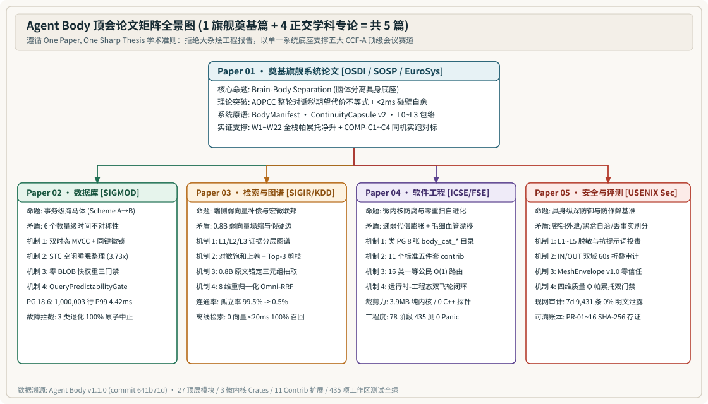
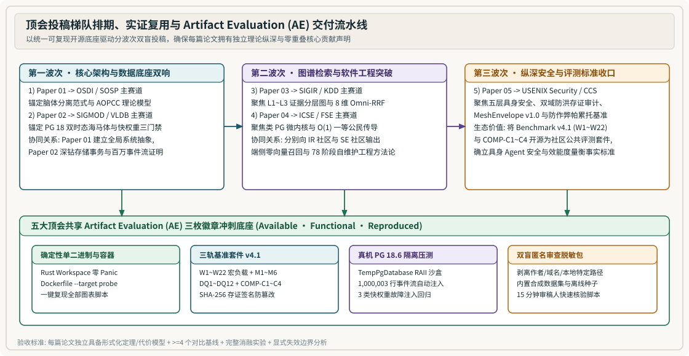
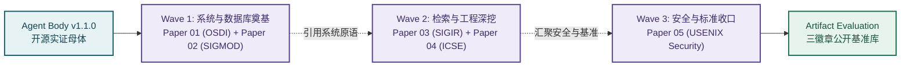

# Agent Body 国际顶会论文矩阵规划与投稿总纲 (`Paper Portfolio & Strategic Roadmap`)

> **作者视角**：digoal 德哥（Agent Body 创始人 · PostgreSQL 专家 · AI 系统架构践行者）  
> **基准代码快照**：`agent-body v1.1.0` (`commit 641b71d`, Rust Workspace `27` 顶层模块 · `kernel/` `3` Crates · `contrib/` `11` 五件套扩展 · `43` MCP 工具 · `435` 项自动化测试全绿)  
> **编制时间**：2026-11-28 (Asia/Shanghai, UTC+8)  
> **关联 TAG**：`#AgentBody` `#TopTierSystemsPaper` `#OSDI` `#SIGMOD` `#SIGIR` `#ICSE` `#USENIXSecurity`

---

## 一、验收标准先行：什么才配叫“能投中业内顶会”的论文？

做系统研究最忌讳把“项目使用说明书”套个 LaTeX 模板就去投 OSDI 或 SIGMOD。顶会程序委员会（Program Committee, PC）审稿人的嗅觉极其敏锐：凡是堆砌功能列表、缺少核心科学矛盾、没有数学边界推导、或者拿删除关键信息换取虚假压缩率的工作，在第一轮 Triage 就会被直接拒稿。

在动笔写任何一篇论文之前，先立下本目录全部论文必须逐条过关的 **七条硬性顶会验收门禁（Acceptance Gates `G1`–`G7`）**：

| 门禁编号 | 验收维度 | 顶会审稿人核心拷问 | 本矩阵强制达标线（未达标不准出库） |
|:---:|---|---|---|
| **`G1`** | **单一锋利命题** (`One Sharp Thesis`) | 这篇论文到底解决哪一个前人没解决的底层科学矛盾？是不是大杂烩（Kitchen-sink）？ | 每篇论文只打穿 **1 个正交核心矛盾**，贡献点严格收敛在 3–4 条可证伪命题内，绝不跨篇凑数。 |
| **`G2`** | **第一性原理与形式化边界** (`Formal Model & Bounds`) | 你的设计为什么不是拍脑袋的启发式规则？在什么前提假设下成立、越过哪条边界会退化？ | 必须给出显式的期望代价不等式、状态机不变量或概率衰减模型，并专设章节论证**前提破裂时的退化表现**。 |
| **`G3`** | **真机代码与零编造数据** (`100% Execution-Verified`) | 数字是跑出来的还是编出来的？有没有把模拟估算混充实测？ | 所有延迟（P50/P95/P99）、吞吐、压缩比与拦截率 **100% 源自本仓库真机实测与源码锚点**，严守“三不接受”铁律。 |
| **`G4`** | **公平横向对标与消融** (`Fair Baselines & Ablation`) | 跟业界主流方案（Mem0、Letta、OpenViking、AgentFS、2PL/OCC）同台比过吗？拆掉子模块会怎样？ | 依托轨道 C（`COMP-C1~C4` 同机物理实跑）与模块级消融设计，严格区分 `LIVE_BENCHMARKED` 与 `ARCH_VERIFIED`。 |
| **`G5`** | **帕累托反作弊双门禁** (`Pareto Quality Gate`) | 省了 95% Token，是不是把关键参数和报错线索也一起扔掉了？ | 强制报告关键事实完整率 $R_{\text{fact}}$ 与综合上下文质量分 $Q$，必须满足 $R_{\text{fact}}=100\%$ 且 $Q_{\text{body}} \ge Q_{\text{baseline}}$。 |
| **`G6`** | **极致可复现性** (`Artifact Evaluation Ready`) | 审稿人拿到匿名开源包，能否在 15 分钟内复现出论文里的核心图表？ | 每篇论文末尾附精确到源码文件、测试套件与 CLI 命令的 **Artifact Manifest**，瞄准顶会 AE 三枚徽章全满贯。 |
| **`G7`** | **图文同构与零渲染瑕疵** (`Visual & Prose Parity`) | 架构图的箭头语义、分桶计数与正文描述是否严丝合缝？有没有穿框或乱码？ | 核心架构与实验图全部落盘为 `paper/svg/*.svg` 独立矢量文件，经几何脚本、无头浏览器渲染与语义对账三重核验。 |

---

## 二、以终为始与五看三定（DSTE）：洞察 AI Agent 基础设施的学术终局

沿着第一性原理推演未来 3–5 年智能体系统的演化终局，能看清一条极其确定的分水岭：**大模型本身正在迅速沦为可随时热插拔的瞬态算力商品（Ephemeral Commodity Cortex），而真正决定生产级智能体上限的，是驻留在物理宿主机与企业数据底座上的“具身躯干与事务海马体”**。

用华为战略规划的 **“五看三定”** 工具对当前国际学术版图做一次全景扫描：

### 2.1 五看：全景洞察输入

1. **看行业与技术趋势**：AI Agent 正从“云端聊天沙盒里的玩具”走向“直接接管 Linux 宿主机、操纵生产数据库、跨昼夜自维护大型代码库的数字员工”。这迫使底层基础设施同时面对操作系统级并发防撞、跨会话状态持久化、端侧隐私与微秒级响应的硬约束。
2. **看学术社区与审稿品味**：
   - **OSDI / SOSP** 正在寻找继容器（Docker/Firecracker）与微服务网格之后，**面向自主 Agent 的新一代 OS 原生抽象**（而非又一个 Python Prompt 编排库）；
   - **SIGMOD / VLDB / CIDR** 高度关注“数据库如何成为 Agent 的一等公民状态引擎”（如 [PostgreSQL-V, CIDR 2026](https://www.cidrdb.org/)），尤其是如何调和微秒级 ACID 事务与十秒级参数化记忆整理；
   - **SIGIR / KDD** 对“纯稠密向量 RAG 在代码与运维领域的幻觉和长尾失效”已形成共识，亟需轻量级混合信号与有界知识图谱解法；
   - **ICSE / FSE** 正苦于 Coding Agent 在长周期迭代中引发的“架构腐化与文档/契约大面积漂移”；
   - **USENIX Security / CCS** 则聚焦具备真实 Shell 权限的 Agent 如何防范凭据窃取、间接提示词注入（Indirect Prompt Injection）与自治黑盒破坏。
3. **看竞争与相关工作**：
   - 记忆流派如 [MemGPT / Letta (arXiv:2310.08560)](https://arxiv.org/abs/2310.08560)、[Mem0 (arXiv:2504.19413)](https://arxiv.org/abs/2504.19413)、[Sleep-time Compute (arXiv:2504.13171)](https://arxiv.org/abs/2504.13171) 以及测试时训练快权重 [TTT (arXiv:2407.04620)](https://arxiv.org/abs/2407.04620) / [Larimar (arXiv:2403.11901)](https://arxiv.org/abs/2403.11901)，要么缺乏宿主机物理事实绑定与多写者双时态 MVCC，要么缺少参数合并后的防灾难遗忘与 GDPR 定向擦除事务门禁；
   - 环境与文件流派如 AgentFS（SQLite VFS 全量导入）与 OpenViking（虚拟摘要树复制），存在严重的黑名单噪音入库或副本同步漂移；
   - 编排流派如 [AutoGen (arXiv:2308.08155)](https://arxiv.org/abs/2308.08155) 与 [Voyager (arXiv:2305.16291)](https://arxiv.org/abs/2305.16291) 聚焦上层任务规划，却把宿主机当成无状态黑盒，每次探测都要付出高昂的“整轮对话税”。
4. **看自己（`agent-body v1.1.0` 实证家底）**：历经 78 个演进阶段打磨，仓库已具备完整的 Rust 单二进制旗舰底座、借鉴 PostgreSQL `pg_catalog` + `contrib/` 的纯机制微内核（`3.9 MB` 最小内核）、PG 18.6 百万事件流实测通过的事务级海马体（方案 A → 方案 B 全闭环）、AOPCC 自适应并发、8 维 Omni-RRF 与 16 类一等公民增量传导器，且拥有 `435` 项全绿测试与三轨实证基准 `v4.1`。
5. **看战略机会点（GAP）**：学术界目前几乎所有 Agent 论文都在“大脑皮层（Prompt / RL / Multi-Agent Debate）”里内卷，而在 **“脑体分离后的宿主机具身底座（OS 抽象 + 事务级快慢记忆控制面 + 弱向量分层图谱 + 自维护防腐软件工程 + 双域因果安全）”** 这一整片深水区尚无系统性奠基之作。

### 2.2 三定：顶会战略输出与多方案拍板

在如何切分论文组合上，对比三种候选策略后再拍板：

| 候选规划方案 | 具体切分方式 | 核心优势 | 致命短板与拒稿风险 | 决策结论 |
|---|---|---|---|---|
| **方案一：单篇巨型全景论文** (`1 Monolithic Paper`) | 将六大器官、PG 海马体、微内核、Omni-RRF 全部塞进一篇 12 页 OSDI 论文 | 只需维护一份手稿，叙事宏大 | **必遭 Kitchen-Sink 拒稿**：每个子系统只能分到 1.5 页，既写不透 PG 双时态+快权重三门禁的数据库深度，也展不开 Omni-RRF 与软件工程消融，两边审稿人都不买账 | ❌ 否决 |
| **方案二：功能模块碎片拆解** (`8–10 Micro Papers`) | 端口检查、放置学习、AWR、TUI、Mesh 各拆一篇短文 | 论文数量看似很多 | **违背“宁缺毋滥”原则**：单一工程技巧（如端口防撞或 TUI）不足以支撑 CCF-A 主赛道理论厚度，沦为灌水拼盘 | ❌ 否决 |
| **方案三：`1 + 4` 正交顶会矩阵** (`1 Flagship + 4 Deep-Dives`) | **1 篇 OSDI/SOSP 奠基系统篇**立住“脑体分离 + AOPCC”总纲；**4 篇专论**分别在 **SIGMOD**（事务海马体）、**SIGIR**（分层图谱与 Omni-RRF）、**ICSE**（微内核与零重扫自进化）、**USENIX Security**（纵深防御与帕累托基准）单点刺穿 | **既有开山立宗的系统高度，又有单点刺穿学科极限的理论纵深**；对标 UC Berkeley Spark / Ray 与 CMU NoisePage 的经典顶会矩阵打法，互为引用护城河且核心贡献零重叠 | ✅ **推荐拍板** |

---

## 三、`1 + 4` 顶会论文矩阵导航与核心贡献对照表

本目录下共交付 **5 篇完整顶会级论文手稿** 与 **12 张独立落盘矢量架构/实证图（`paper/svg/`）**。每篇手稿均按目标顶会正会（Main Research Track）标准结构撰写，包含形式化建模、核心算法、真机实验矩阵、适用边界与可复现清单：

| 论文文件 | 目标顶会 (CCF-A) | 核心解决的科学问题 (Research Question) | 关键理论 / 算法原语 | 核心真机实证锚点 (100% 源自仓库实测) |
|---|---|---|---|---|
| **[01-osdi-brain-body-separation-and-aopcc.md](01-osdi-brain-body-separation-and-aopcc.md)** | **OSDI / SOSP / EuroSys** *(Operating Systems)* | 如何在零内置 LLM 规划循环与 `<90 MB` 预算下，为瞬态大模型赋予持久化宿主机本体感觉、跨脑连续性，并消除每步悲观探查的“整轮对话税” $C_{\text{turn}}$？ | 1. 脑体分离六器官模型与 `L0~L3` 自治包络 2. **AOPCC 期望代价切换不等式**与 `<2ms` 碰壁处方自愈 3. `<=300 tok` 跨脑胶囊与 `<100ns` 18 等待事件内生 AWR | `W15` 交互轮次 `20→12`（省 `40%` 对话税，加速 `3.49×`）；`W1` 能力发现 `1121.9×` 加速；`M6` 探针 `P50=10 μs`；`W17` 换脑接力省 `92.7%` Token |
| **[02-sigmod-transactional-hippocampus-pg-mvcc.md](02-sigmod-transactional-hippocampus-pg-mvcc.md)** | **SIGMOD / VLDB / CIDR** *(Data Management)* | 如何跨越宿主机微秒反射（`10^2 μs`）与神经记忆整理（`45 s`）之间 **6 个数量级的时间不对称性**，实现零丢写、零僵尸召回、可验证遗忘与常数级延迟？ | 1. 双时态追加账本 + 同键 `pg_advisory_xact_lock` + LSM 墓碑段 2. **STC 显著性空闲睡眠整理** + `QueryPredictabilityGate` 3. **零权重 BLOB 进堆表**的快权重递归血缘与三道硬门禁原子切换 | PG 18.6 真机：16 线程 80tx **丢写率 `0%`**；**`1,000,003` 事件**下 `search_tx P50=2.66ms / P99=4.42ms`；睡眠压缩 **`3.73×`**（`6/6` 事实保留）；回滚 **`24ms`**；3 类退化 `100%` 拦截 |
| **[03-sigir-evidence-stratified-graph-omni-rrf.md](03-sigir-evidence-stratified-graph-omni-rrf.md)** | **SIGIR / KDD / WWW** *(IR & Knowledge Graph)* | 当端侧仅能运行 `0.8B` 弱小模型甚至完全离线（零向量）时，如何避免长文截断失真与“语义近邻冒充物理硬依赖”，实现高精度多跳召回与代码影响面分析？ | 1. **`L1/L2/L3` 证据分层有向加权图谱**与对数饱和上卷 2. `CodeGraphBridge` 宏微两级代码拓扑联邦 3. 原文锚定（`>=8` 字符）三元组抽取与 **8 维自适应重归一化 Omni-RRF** | 宿主机工程孤立率 **`99.5% → 0.5%`**（`DQ6` 连通 `221/222`）；3 跳图遍历 `P50=244 μs`；离线零向量 `W19` 跨词因果+拼写容错 `4/4` 命中，信息密度升 `2580.7×` |
| **[04-icse-microkernel-and-zero-rescan-evolution.md](04-icse-microkernel-and-zero-rescan-evolution.md)** | **ICSE / FSE / ASE** *(Software Engineering)* | 在 Coding Agent 持续自维护演进 70+ 阶段的中大型系统时，如何从架构与工具链层面根治“递弱代偿内核膨胀”与“跨 16 类工程产物静默漂移”？ | 1. **类 PostgreSQL 8 目录表微内核** + `ext_<id>__*` SQL 沙盒 + 11 标准五件套 2. **四圈层 16 类一等公民（C01–C16）O(1) 增量路由器** 3. 运行时 `ShadowAbEngine` 与工程态六重门禁双飞轮闭环 | 纯微内核 `3.9 MB` / 政务探针 `6.7 MB`（零 C++）；`<100ms` 路由省 `90%+` 重扫 Token；全仓 `0` `unwrap/expect`、`0` `>1000L` 文件、`43/43` 三端对齐、`435` 测试全绿 |
| **[05-usenix-sec-dual-domain-audit-mesh-pareto-bench.md](05-usenix-sec-dual-domain-audit-mesh-pareto-bench.md)** | **USENIX Security / CCS** *(Security & Evaluation)* | 拥有宿主机实权的自主 Agent 如何抵御凭据外泄、间接提示词投毒、后台黑盒破坏与跨机重放攻击，并用防作弊基准证明安全治理不损害任务质量？ | 1. **五层具身安全纵深防线**（`SecretRedactor` + `PromptInjectionScanner`） 2. **`IN_AGENT × OUT_OF_AGENT` 双域 60s 防洪存证审计** 3. `MeshEnvelope v1.0` 零信任协议与 **四维质量 $Q$ 帕累托双门禁** | 现网 7 天 `9,431` 条双域审计 `100%` SHA-256 完整、`0%` 明文凭据泄露（`DQ4/DQ7=100%`）；`COMP-C1~C4` 较 Mem0/OpenViking/AgentFS 质量净升 `+54.5~+75.9` 分 |

---

## 四、分波次投稿策略、边界切割与双盲匿名化指南

顶会连续投稿最关键的纪律是 **自我抄袭防范（Self-Plagiarism & Delta Control）** 与 **双盲匿名合规（Double-Blind Anonymization）**。每篇论文虽然源自同一个开源母体，但在问题域、核心章节（85% 以上篇幅）与评测焦点上严格正交：

### 4.1 跨篇边界切割铁律（防止审稿人质疑贡献重叠）

1. **Paper 01 vs Paper 02**：Paper 01 将海马体视为黑盒 SPI 接口（仅聚焦 `ContinuityCapsule` `<=300 tok` 跨脑接力与 AOPCC 回路并发），**绝不展开** PostgreSQL 四表双时态 DDL、`SleepTimeCompactor` 与快权重三门禁；后者 100% 留给 Paper 02 作为核心贡献深挖。
2. **Paper 01 vs Paper 03**：Paper 01 仅使用 `CapabilityEngine` 与宏观端口/服务存在性事实；`L1/L2/L3` 权重对数饱和公式、0.8B 原文锚定三元组抽取、防毛线球度数门禁与 8 维 Omni-RRF 重归一化数学模型 **100% 归属 Paper 03**。
3. **Paper 01 vs Paper 04**：Paper 01 讨论运行时具身抽象；而编译期 `body_cat_*` 8 张系统目录表、`ScopedSqlExecutor` 表前缀沙盒、零 C++ 多发行版裁剪以及 `citizen_sync.py` 16 类一等公民增量传导算法 **100% 归属 Paper 04**。
4. **Paper 01 vs Paper 05**：Paper 01 仅引用四级自治包络 `L0~L3` 的概念定义；威胁模型（`SEC-GAP-01~05`）、间接提示词注入清洗、Watcher 60s 防洪双域审计、`MeshEnvelope v1.0` 密码学防重放以及四维质量函数 $Q$ 的反作弊基准设计 **100% 归属 Paper 05**。

### 4.2 双盲审稿（Double-Blind）打包检查单

在生成正式投稿 PDF 与匿名 GitHub/Zenodo 评审仓库前，执行以下确定性脱敏步骤：
1. **系统代号匿名化**：双盲评审期间可将系统名临时宏替换为中性名（如 `\sysname{}` $\to$ `SomaOS` / `EmbodimentDB`），Camera-Ready 录用后一键切回 `Agent Body`；
2. **宿主机指纹与路径泛化**：通过仓库已通过的 `make lint-hygiene` 位置无关门禁（生产路径 `0` 处 `CARGO_MANIFEST_DIR` 与特定用户名硬编码），确保匿名容器镜像在 `/workspace` 下直接跑通全量 `W1~W22` 与 PG 18 压测；
3. **分离个人品牌材料**：从双盲 AE 压缩包中剔除 `presentation/` 路演演讲稿与含作者署名的历史博客外链，仅保留 `src/`、`kernel/`、`contrib/`、`distributions/`、`tests/` 与一键复现脚本。

---

## 五、目录文件与图表资产总索引

- **战略总纲**：[paper/README.md](README.md)（本文件）
- **五篇顶会论文全文手稿**：
  1. [01-osdi-brain-body-separation-and-aopcc.md](01-osdi-brain-body-separation-and-aopcc.md) — *OSDI / SOSP 赛道*
  2. [02-sigmod-transactional-hippocampus-pg-mvcc.md](02-sigmod-transactional-hippocampus-pg-mvcc.md) — *SIGMOD / VLDB 赛道*
  3. [03-sigir-evidence-stratified-graph-omni-rrf.md](03-sigir-evidence-stratified-graph-omni-rrf.md) — *SIGIR / KDD 赛道*
  4. [04-icse-microkernel-and-zero-rescan-evolution.md](04-icse-microkernel-and-zero-rescan-evolution.md) — *ICSE / FSE 赛道*
  5. [05-usenix-sec-dual-domain-audit-mesh-pareto-bench.md](05-usenix-sec-dual-domain-audit-mesh-pareto-bench.md) — *USENIX Security / CCS 赛道*
- **独立矢量图表库（`paper/svg/` · 12 幅）**：
  - 总纲配图：[00-paper-portfolio-matrix.svg](svg/00-paper-portfolio-matrix.svg) · [00-publication-roadmap-flow.svg](svg/00-publication-roadmap-flow.svg)
  - Paper 01 配图：[01-brain-body-six-organs-arch.svg](svg/01-brain-body-six-organs-arch.svg) · [01-aopcc-cost-boundary-and-recovery.svg](svg/01-aopcc-cost-boundary-and-recovery.svg)
  - Paper 02 配图：[02-temporal-asymmetry-and-dual-path.svg](svg/02-temporal-asymmetry-and-dual-path.svg) · [02-pg18-million-events-and-gates.svg](svg/02-pg18-million-events-and-gates.svg)
  - Paper 03 配图：[03-evidence-stratified-graph-federation.svg](svg/03-evidence-stratified-graph-federation.svg) · [03-omni-rrf-eight-channel-pipeline.svg](svg/03-omni-rrf-eight-channel-pipeline.svg)
  - Paper 04 配图：[04-pg-inspired-microkernel-isolation.svg](svg/04-pg-inspired-microkernel-isolation.svg) · [04-dual-flywheel-and-citizen-routing.svg](svg/04-dual-flywheel-and-citizen-routing.svg)
  - Paper 05 配图：[05-five-layer-defense-and-dual-audit.svg](svg/05-five-layer-defense-and-dual-audit.svg) · [05-pareto-quality-vs-token-frontier.svg](svg/05-pareto-quality-vs-token-frontier.svg)
  - 确定性图表重生成脚本：[generate_figures.py](svg/generate_figures.py)（零第三方依赖 Python 3 标准库脚本，执行 `python3 paper/svg/generate_figures.py` 一键复现全套 12 幅矢量图）
