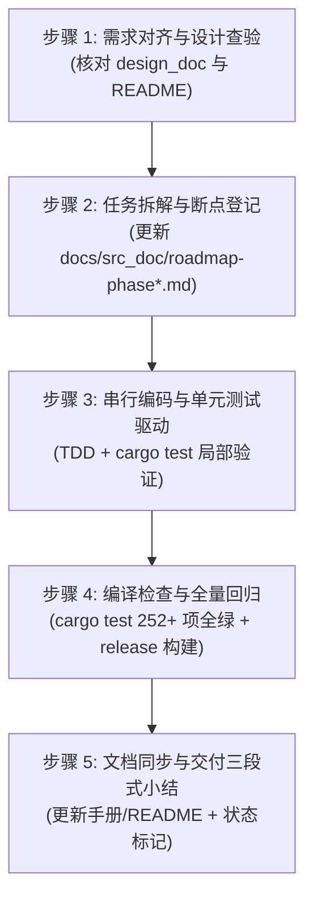

# Agent Body 持续迭代技能 (agent-body-developer)

> **定位**: 本技能驻留在 `agent-body` 项目内部（`skills/agent-body-developer/SKILL.md`），是指导任何接手该项目的 AI Agent（无论是主 Agent 还是 Subagent）进行高品质、自闭环、防御性演进的操作准则。

---

## 零、零重扫三步开工协议（Zero-Rescan Protocol，必先执行）

任何新会话接手迭代任务时，**严禁全仓 `grep` 或扫描历史 `docs/src_doc/roadmap-phase2..33.md` / `progress-phase*.md`**，必须先执行以下 3 步（2 轮内精准锁定改点）：
1. **读 `Tier-0` 入口（仅 2 文件）**：[EVOLUTION_GUIDE.md](../../EVOLUTION_GUIDE.md)（8 大演进场景 O(1) 变更触点矩阵）+ 当前活跃 `docs/src_doc/roadmap-phase*.md`；
2. **跑确定性架构快照**：`make evolution-check`（`<200ms` 获取最新模块/MCP/SPI/表/Benchmark 计数与零漂移校验）；
3. **查符号用 CodeGraph**：`codegraph explore "<SymbolName>"` 穿透源码定义与调用链。

---

## 一、项目核心信条与设计红线（必须严格遵守）

接手修改任何代码或文档前，必须在脑中重放本项目的核心定位与架构红线：

1. **宿主环境大管家，而非任务单次协作工具**:
   - 目标是让 Agent 清楚所处宿主机的全景静态/动态对象（硬件、文件、脚本、动态任务进程、网络端口、长期记忆与资产图谱）。
2. **放置建议（Placement Advice）是第一优先级**:
   - 任何产生新文件、新项目、新技能、新笔记的行为，必须优先通过 `PlacementEngine` 给出规范目录和命名，禁止散落。
3. **颗粒度分级与白黑名单深度法则（Granularity Tiering）**:
   - **白名单目录**（如 `/root/new/shared_proj/`, `/root/new/work/`）：必须深度递归解析到底，构建完整元数据与全文索引。
   - **黑名单目录**（如 `**/node_modules/**`, `**/.cache/**`, `**/.git/**`, `/root/.ssh/**`, `/proc/**`）：**仅记录当前目录实体本身**（`type: directory, scan_tier: shallow`），**严禁递归下钻，严禁扫描子文件，严禁入库子文件 FTS/向量**，防止数据库扫爆与敏感信息泄露。
   - **受限目录**（`restricted`）：受限深度扫描（如开源代码库仅索引 README 与入口）。
4. **动态任务进程过滤底噪**:
   - 进程纳管只抓取 Agent 会话任务、Python 脚本、构建编译 Worker、常见轻量测试服务；系统底噪（如内核工作线程、systemd 基础进程）必须通过白名单与启发式规则过滤。
5. **图智能与宏微双层联邦（Macro-Micro Federation）**:
   - 大管家负责**宏观宿主拓扑**（文件、服务、端口、定时任务间的依赖网络）；
   - 微观符号调用（函数、类、AST）下钻交给 **CodeGraph**，大管家通过 `CodeGraphBridge` 无缝桥接，绝不重复造轮子。
6. **零破坏与断点续传（No Breaking & Resumable）**:
   - 严禁一次性大范围盲改；必须使用串行原子化分步执行，在 `docs/src_doc/roadmap-phase*.md` 中建立检查点追踪。
7. **纵深安全防御、全链路脱敏与抗投毒（Defense-in-Depth，对齐规约 #8 & #19）**:
   - 任何写入资产库、`/proc` 进程记录、长期记忆、变更审计流水与本地大模型输入的内容，必须经过 `SecretRedactor` 脱敏；
   - `HookDispatcher` 命令插值强制安全转义防 Shell 注入，导出操作严格限定目录白名单与 SQL 转义；
   - Web REST 写端点及敏感接口必须统一校验 `auth_token`，`~/.agent-body/` (`0700`) 与 `body.db`/`config.toml` (`0600`) 保持最小权限；外部语料入库需警惕间接提示词注入。
8. **图谱证据分层与有向加权（Graph Evidence Tiering，对齐规约 #5 & #23）**:
   - 所有跨实体关系边必须标明 `evidence_tier`（`L1_EXPLICIT` 物理事实 / `L2_STRUCTURAL` 结构聚合 / `L3_SEMANTIC` 向量标签隐式发现）、方向语义与合法权重；严禁将语义相似边混作物理硬依赖。
9. **联邦网格信封协议与沙盒收件箱隔离（Mesh Wire Protocol & Sandbox，对齐规约 #2, #19 & #24）**:
   - 跨节点协同（对话、文件投递、跨机锁）必须走 `MeshEnvelope v1.0`（HMAC-SHA256 签名 + 时间窗/Nonce 防重放 + Peer Scope 校验）；文件传输严格限制体积上限并隔离落盘至 `~/.agent-body/mesh_inbox/`，严禁跨机直写宿主机路径。
10. **悲观与乐观并发自适应（AOPCC，对齐规约 #8 & #25）**:
   - 高危/写共享/绑定端口/高爆炸半径操作必须坚守悲观前置门禁（`body_hook_pre`）；可逆只读/服务客户端连接/已授权工具优先消费开工乐观租约直行，并由 `body_hook_post` 兜底碰壁秒级自愈，禁止低风险回路强行加塞无谓全悲观查询税。
11. **双域全链路行为审计与自治动作留痕（Dual-Domain Behavioral Audit，对齐规约 #4, #8, #18, #22 & #26）**:
    - 严禁仅审计含 `path` 参数的写文件操作而丢弃命令/服务/锁/非路径工具调用，更严禁后台 `Daemon`、`Reconciler`、`HostGC`、`LinkRepair`、`PlacementLearner` 等 Agent 之外主动/被动更改宿主对象时静默“黑盒变更”；所有双域关键行为必须经 `SecretRedactor` 脱敏、附带 `before_after_delta` 与 `evidence_sha256` 落库，并对 `Watcher` 高频事件实施时间窗折叠防洪。
12. **Agent 本体脑体分离、四级自治包络与三层命名兼容（Agent Embodiment，对齐规约 #1, #2, #3, #8 & #27）**:
    - 确立 LLM=瞬态大脑、本项目=永驻宿主机的 Agent 本体（感官/小脑反射/海马体连续性/代谢稳态/多体联邦）；严守递弱代偿，绝不内置主战 LLM 规划循环或替代编排框架；自治行为严格遵循 `L0_OBSERVE` / `L1_AUTONOMIC` / `L2_SUPERVISED` / `L3_FORBIDDEN` 四级权限包络；对外叙事升级为「Agent 本体」，但工程标识（`agent-body` / `body_*` / `~/.agent-body/`）100% 向后兼容。

---

## 二、项目目录结构与资产指引

| 路径 | 角色与用途 | 读写权限/规则 |
|---|---|---|
| `Cargo.toml`, `Cargo.lock` | Rust 依赖与工作空间配置 | 引入新 crate 需考虑编译耗时与轻量化 |
| `src/` | Rust 核心源码目录（27 个顶层模块） | 业务实现与单元测试所在 |
| ├── `src/config/` | 配置文件结构体与 `~/.agent-body/config.toml` 引导、参数校验 | 保持向后兼容 |
| ├── `src/preflight/` | 运行时环境与依赖完整性预检引擎 | 严格保障可移植部署与优雅降级 |
| ├── `src/storage/` | SQLite/PG/DuckDB 三引擎、82 方法 SPI 抽象、27 张表与热迁移 | 任何表变更必须同步 schema |
| ├── `src/audit/` | 双域行为审计（`IN_AGENT`/`OUT_OF_AGENT`）、脱敏防洪与 AOPCC 自进化 | 写入严禁 Panic，强制脱敏 |
| ├── `src/body/` | Agent 本体中枢（`BodyManifest`、`<300 tok` 接力胶囊、五维稳态、`L0~L3` 包络） | 严守脑体分离不内置 LLM 循环 |
| ├── `src/coordination/` | 多 Agent 协作锁中枢 (Port/Dir/File 互斥、TTL、WFG 死锁、Advisory Lock) | 跨 Agent 资源互斥保证 |
| ├── `src/fact/` | 宿主机客观事实图谱 (工具能力/端口/Systemd/Cron/资料编目/L1~L3 属性图) | 客观图谱抽取与语义查询 |
| ├── `src/brief/` | 自适应情境组装引擎 (`BriefAssembler` + `OptimisticLeaseEngine`) | 意图驱动自适应情境裁剪与 AOPCC 租约 |
| ├── `src/placement/` | 8 大规范放置引擎与建议逻辑 (自演化学习) | 严格对齐 README 与放置规则 |
| ├── `src/scanner/` | 分级扫描器、`SecretRedactor`、`PromptInjectionScanner` 与 `OllamaAnnotator` | 深度递归、全链路脱敏与阻断的核心 |
| ├── `src/env/` | 系统硬件规格、端口防撞、`/proc` 进程采集与白名单 GC | 过滤系统级底噪与端口冲突检测 |
| ├── `src/memory/` | 跨会话长期记忆与多适配器体系 (内置/PowerContext/Mem0/Letta) | 降级机制保障 |
| ├── `src/watcher/` | inotify 监听器与变更同步流水线 | 300ms 防抖，同步 `changes` 表与写穿失效 |
| ├── `src/daemon/` | 常驻守护进程主循环与定时轮询、依赖预检 | 优雅信号捕获与 Systemd 托管 |
| ├── `src/links/` | 分层加权关联拓扑图、Mermaid 导出、断链审计与 CodeGraph 桥接 | AST 引用提取与宏微联邦 |
| ├── `src/changes/` | 变更历史回溯与 Agent 会话简报 | 生成开工 markdown |
| ├── `src/session/` | 会话绑定、完工结清与临时垃圾回收 | 会话生命周期自洁 |
| ├── `src/hooks/` | 事件总线、`AutoSyncEngine`、客户端生成器与 `OptimisticFailureDiagnoser` | POSIX 转义防注入与碰壁自愈 |
| ├── `src/api/` | 43 个原生 MCP (JSON-RPC 2.0 stdio) 工具注册与 Hook 门禁 | 必须与 CLI/Web 1:1:1 映射 |
| ├── `src/benchmark/` | 双轨/三轨实证 Benchmark 引擎（`W1~W17` + `M1~M5` + `DQ1~DQ8` + `COMP-C1~C4` + `PR-01~13` 账本） | 必须真机实测与 SHA-256 存证 |
| ├── `src/demo/` | 路演沙盒引擎（6 大黄金剧目、ROI 核算、`demo:*` 隔离） | 严禁假数据，必须真引擎实跑 |
| ├── `src/feedback/` | `user_feedback.md` 双向总账、`FreshnessReconciler` 与 `P1~P5` 五点对比自进化探针 | 探针自愈与反馈沉淀闭环 |
| ├── `src/platform/` | 跨平台原生探针 (Linux/macOS/Windows) | 解析函数纯函数跨平台编译 |
| ├── `src/mesh/` | 轻量多机联邦 HTTP Peer Mesh & `MeshEnvelope v1.0` | 写接口鉴权、HMAC 签名防重放与沙盒收件箱 |
| ├── `src/ecosystem/` | MCP/SKILL 目录、外部服务通讯录与 Context 防爆路由 | 严禁存明文密钥 |
| ├── `src/tui/` | 终端单屏实时看板 | 轻量 ANSI 交互刷新 |
| └── `src/web/` | 内嵌单二进制 HTTP/SSE、昼夜双主题 8 大工作台与 Parity 校验 | 写端点强制鉴权与 100% 黑白屏对齐 |
| `EVOLUTION_GUIDE.md` | 零重扫演进活地图与 8 大场景变更触点矩阵 | 新会话 `Tier-0` 必读入口 |
| `INSTALL.md` | 生产安装、依赖矩阵、Docker 与 Systemd 部署指南 | 与 `preflight` 保持事实对齐 |
| `ISSUE.md` | 未来演进与待探讨 ISSUE 总账 | 与 Roadmap 及反馈总账协同 |
| `user_feedback.md` | 主理人与 Agent 实际使用体验与探针自上报总账 | `body_feedback` 双向读写目标 |
| `docs/manual/` | 面向使用者与架构师的分卷深度技术手册 (01~10) | 保持与代码演进实时同步 |
| `docs/src_doc/` | 开发者手册、产品手册与各阶段研发断点状态表 | 任务流转枢纽，统一 kebab-case |
| `docs/design_doc/` | 架构设计文档闭环交付件 (01~08, init.sql) | 顶层架构事实依据，统一 kebab-case |
| `docs/idea_doc/` | 初始思考、方案推导与设计全过程长文 | 原始产品哲学思考沉淀 |
| `docs/markdown/` | 面向公众传播的技术长文与高保真 SVG 架构图 | 宣传与技术分享沉淀 |
| `skills/` | 本项目内置技能库 (`developer`, `doc-writer`, `guide`) | 指导 Agent 认知与自闭环自进化 |

---

## 三、持续迭代标准工作流（五步法）

当被要求增加功能、修复缺陷或重构时，Agent 必须按以下标准闭环流程推进：



### 步骤 1: 需求对齐与设计查验
1. 检查用户的需求是否符合第一节的“核心信条与设计红线”。
2. 查阅 `docs/design_doc/` 中对应章节（如 API 规范查 [06-api-spec.md](../../design_doc/06-api-spec.md)，数据模型查 [07-data-model.md](../../design_doc/07-data-model.md)，图智能查 [08-graph-intelligence.md](../../design_doc/08-graph-intelligence.md) 与 [14-graph-intelligence-and-mesh-protocol-spec.md](../../design_doc/14-graph-intelligence-and-mesh-protocol-spec.md)，AOPCC 并发策略查 [15-adaptive-optimistic-pessimistic-concurrency-spec.md](../../design_doc/15-adaptive-optimistic-pessimistic-concurrency-spec.md)，双域审计与自进化查 [16-dual-domain-audit-and-self-evolution-spec.md](../../design_doc/16-dual-domain-audit-and-self-evolution-spec.md)，Agent 本体与跨大脑连续性查 [17-agent-embodiment-and-continuity-spec.md](../../design_doc/17-agent-embodiment-and-continuity-spec.md)）。
3. 如涉及新增数据表或字段，先在 `src/storage/schema.sql`、`src/storage/models.rs`、`src/storage/mod.rs` 设计对齐。

### 步骤 2: 任务拆解与断点登记（严禁大步跨越）
1. 将大任务拆解为粒度在 30 分钟以内的原子任务（如：数据模型扩展 -> 核心算法实现 -> MCP 工具注册 -> CLI 命令暴露 -> 单元测试）。
2. 在 `docs/src_doc/roadmap-phase*.md` 中追加或认领任务，标记当前正在进行的任务为 `⏳ 进行中`。
3. 确保任何环节遭遇会话重置或中断，后续 Agent 只需读取该状态表即可瞬间无缝续传。

### 步骤 3: 串行编码与测试驱动
1. **测试先行或同步编写**:
   - 存储层新增方法 -> 在 `src/storage/mod.rs` 的 `tests` 模块编写单元测试；
   - 引擎新增逻辑 -> 在对应子模块内编写 `tests`；
   - MCP 工具扩展 -> 在 `src/api/mcp.rs` 测试 JSON-RPC 解析与工具调用。
2. **环境路径提醒**:
   - 本机 Rust 工具链位于 `/root/.cargo/bin`，执行命令时必须前置环境变量：
     `export PATH="/root/.cargo/bin:$PATH"`
   - 运行针对性测试：`cargo test <module_name>::tests`。

### 步骤 4: 编译检查与全量回归
1. 运行全量单元测试：
   ```bash
   export PATH="/root/.cargo/bin:$PATH" && cargo test
   ```
   **门禁要求**: 目前必须达到 **252+ 个 tests 全部 `ok`**，0 failed（另允许 1 项 doc-test ignored）。
2. 运行 release 生产构建：
   ```bash
   export PATH="/root/.cargo/bin:$PATH" && cargo build --release
   ```
   **门禁要求**: 编译无 error，binary 产物位于 `target/release/agent-body`。
3. 冒烟运行验证命令：
   ```bash
   ./target/release/agent-body status
   ./target/release/agent-body brief
   ./target/release/agent-body links audit
   ```

### 步骤 5: 文档同步与交付小结
1. 若新增或调整了 CLI 子命令，必须同步更新：
   - [docs/src_doc/product-manual.md](../../src_doc/product-manual.md)
   - [docs/manual/03-cli-reference.md](../../manual/03-cli-reference.md)
2. 若新增或调整了 MCP 工具，必须同步更新：
   - [docs/src_doc/hooks-and-integration.md](../../src_doc/hooks-and-integration.md)
   - [docs/manual/04-mcp-integration.md](../../manual/04-mcp-integration.md)
3. 更新 Roadmap 中的任务状态为 `✅ 已完成`，并记录完成时间。
4. 按照“digoal德哥”三段式交付格式向用户汇报：
   - **文件路径**: 改动和新建的文件列表。
   - **做了什么**: 核心逻辑与功能演进。
   - **验证与下一步建议**: 包含测试用例通过数、编译耗时以及下一步规划。

---

## 四、常见场景与标准模板（Cookbook）

### 场景 A: 新增一个 MCP 宿主感知工具
1. 在 `src/api/mcp_tools.rs` 的 `list_tools()` 向量中追加工具定义，给出清晰的 `description` 与 JSON Schema 参数校验。
2. 在 `call_tool()` 的 `match name` 分支中注入执行代码。
3. 在 `src/main.rs` 对应子命令中保持对等支持。
4. 编写 `cargo test api::mcp::tests` 确保通过 mock stdio 测试。

### 场景 B: 扩展图智能与依赖推演规则
1. 修改 `src/links/` 中的正则与语义提取器（支持新的语言或框架，如 Java、Go import 语法）。
2. 在 `src/links/audit.rs` 补充针对新型挂载资产的可用性探针（如 Unix Domain Socket、自定义 Health Check 接口）。
3. 运行 `cargo test links::tests` 确保通过单测。

### 场景 C: 扩展扫描策略或放置规则
1. 修改 `src/storage/schema.sql` 初始插入的预置规则（`INSERT OR IGNORE INTO placement_rules ...`）。
2. 在 `src/placement/mod.rs` 中调整评分与推荐优先级匹配算法。
3. 运行 `cargo test placement::tests` 验证不会对既有 `/root/new/shared_proj/`、`/root/new/work/` 产生回退断言。

---

## 五、自检 Checklist（提交前必查）

- [ ] 是否在任务开始前已将任务标记为 `⏳ 进行中`？
- [ ] 代码中是否存在对黑名单目录进行深度递归扫描的风险？
- [ ] **安全自检（规约 #19 & #24）**：新增采集/记忆/变更/跨机对话路径是否经过 `SecretRedactor` 脱敏与 `PromptInjectionScanner` 检查？新增 Web 写端点是否已接入 `check_auth`？Mesh 协同是否校验证书/HMAC 签名、防重放与 `~/.agent-body/mesh_inbox/` 沙盒？Hook 命令插值与导出路径是否已防注入与防目录穿越？
- [ ] **图谱分级自检（规约 #5 & #23）**：新增图谱连边是否已明确标注 `evidence_tier`（`L1_EXPLICIT`/`L2_STRUCTURAL`/`L3_SEMANTIC`）、方向语义与合法权重，避免语义边伪装物理硬依赖？
- [ ] **并发模式自检（规约 #8 & #25）**：涉及高危/写共享/绑定端口是否坚守悲观门禁？可逆/客户端连接等高频路径是否支持消费开工乐观租约直行并由 `post_tool_call` 兜底碰壁自愈？
- [ ] **双域审计自检（规约 #4, #8, #18, #22 & #26）**：新增 `IN_AGENT` 工具/Hook/Web 写操作或 `OUT_OF_AGENT` 守护巡检/GC/修复/写穿动作是否已写入脱敏 `audit_events` 并携带 `before_after_delta` 与 `evidence_sha256`？被动 `Watcher` 事件是否已防洪折叠？
- [ ] **本体边界与命名兼容自检（规约 #2 & #27）**：是否严守脑体分离不内置业务 LLM 规划循环？自治行为是否遵守 `L0~L3` 权限包络（不越权执行 `L2/L3`）？对外叙事升级为「Agent 本体」的同时，是否保证 `agent-body` / `body_*` / `~/.agent-body/` 100% 向后兼容？
- [ ] 新增的字段和表结构是否已在 `schema.sql`、`models.rs`、`storage/mod.rs` 保持三位一体同步？
- [ ] **新增外部依赖或环境假设时，是否已同步在 `INSTALL.md` 说明并在 `src/preflight/mod.rs` 中增加预检探针？**
- [ ] 是否执行了 `make quality-gate`（`evolution-check` + `lint-panic` + `lint-hygiene` 位置无关性与错误可观测性 + `lint-strict` 零警告编译）且 `cargo test` 全部通过（**要求 >= 268 tests 全部通过，零 warning**）？
- [ ] **二进制位置无关与发版一致性自检（规约 #11 & #28）**：生产路径是否 0 处 `env!("CARGO_MANIFEST_DIR")`？改名/核心修复提交后是否已重编安装 `make restart` 并核验 `agent-body --version` hash 与 `HEAD` 一致且 `DQ5 >= 98%`？
- [ ] 是否执行了 `agent-body preflight` 验证环境诊断通过？
- [ ] 是否执行了 `cargo build --release` 并且生成了可执行文件？
- [ ] 相关的文档（`product-manual.md` / `INSTALL.md` / `roadmap-phase*.md`）是否已同步刷新？
- [ ] 工作区改动是否已通过 `make sync-mirror`（`rsync -a --delete --exclude 'target/'`）镜像同步至 `/root/new/shared_git/agent-body`？
- [ ] 是否给出了清晰规范的 Git Commit 建议？
