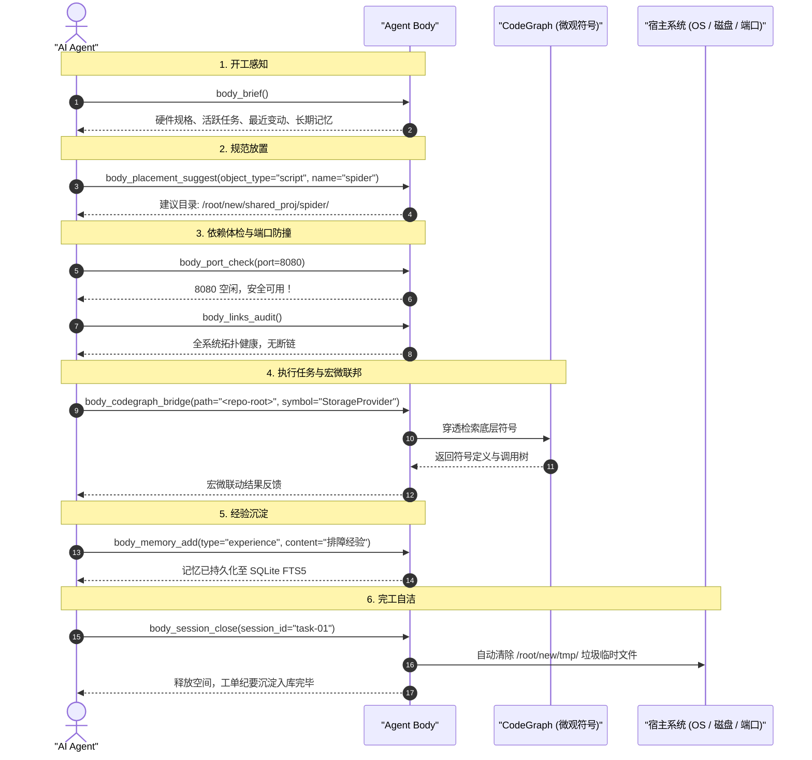

# Agent Body (Agent 本体) 全景向导与部署使用技能 (agent-body-guide)

> **定位**: 本技能内置于 `agent-body` 项目仓库中（`skills/agent-body-guide/SKILL.md`）。当任何瞬态 LLM 大脑初次接入该项目、或需要将本 Agent 本体部署到新宿主机、或需要了解如何与本机物理身体协同工作时，本技能提供一站式、可实操、零废话的行动向导。

---

## 一、本项目是什么？（核心作用与定位）

### 1.1 一句话定义
**Agent Body（Agent 本体 · 宿主机具身底座）** 是脑体分离架构下常驻在宿主机中的数字躯干与轻量级认知底座：**管物理感官（软件/进程/端口/图谱）、管规约脊柱与 `L0~L3` 权限红线、管海马体记忆与跨大脑接力、管一切静态与动态对象的位置规范**。

### 1.2 它不是什么？
- ❌ 它**不是**为了让 Agent 完成某一次具体编写代码或对话任务的协作框架（它不抢 LangChain、CrewAI 的活）；
- ❌ 它**不是**盲目的文件爬虫，绝不一股脑把宿主机扫爆；
- ❌ 它**不是**单纯的 key-value 缓存；
- ❌ 它**不是**重复造轮子的 AST 解析器（微观代码符号解析直接桥接已有的 CodeGraph）。

### 1.3 它的核心作用（解决什么核心痛点）
1. **彻底解决“跨会话失忆”**：Agent 开工第一秒，无需人工反复交代机器上有啥，调用 `body_brief` 瞬间获取全局上下文（硬件规格、活跃进程、最近变动、长期记忆）；
2. **规范文件存放（放置建议 Placement Advice）**：当 Agent 产生新脚本、新工程、临时测试文件或重要笔记时，Agent 本体主动推荐存放目录与命名模式（工具进 `/root/new/shared_proj/`、项目进 `/root/new/work/`、临时进 `/root/new/tmp/`、技能进 `/root/new/skills/`），终结散落污染；
3. **分级颗粒度扫描（Granularity Tiering）**：白名单深挖到底建立 FTS5 全文索引，黑名单（`node_modules`, `.cache`, `.git`, `.ssh`）**严格止于当前目录层级仅记标量，绝不下钻**，保护数据库不被垃圾碎片扫爆；
4. **动态任务与进程感知**：采集非 systemd 的 Python 脚本、构建 Worker 进程与端口占用，过滤内核系统底噪，排查后台死锁与僵尸任务；
5. **事前防撞与影响面推演**：启动测试服务前用 `body_port_check` 防端口踩踏；改动核心代码前用 `body_links_impact` 推演多跳爆炸半径；
6. **图智能与宏微双层联邦（CodeGraph Bridge）**：
   - Agent 本体管理**宏观宿主依赖**（文件、服务、端口、定时任务间的依赖网络），支持 `body_links_audit` 拓扑断链体检；
   - 跨层下钻微观代码符号（函数、调用方、定义）时，无缝桥接调用 **CodeGraph**，实现宏观拓扑与微观符号的联邦联动；
7. **会话生命周期自洁**：任务完成调用 `body_session_close`，自动回收 `/root/new/tmp/` 临时文件并沉淀会话纪要进长期记忆。

---

## 二、运行依赖与一键部署指南

> 💡 **详细依赖全景与跨环境矩阵**: 请优先查阅项目根目录下的 [INSTALL.md](../../INSTALL.md) 与 [config.example.toml](../../config.example.toml)。

Agent 本体采用 **Rust** 编写，原生单二进制交付，依赖极简、轻量可控。

### 2.1 环境依赖要求

| 依赖组件 | 规格要求 | 用途与说明 |
|---|---|---|
| **操作系统** | Linux (Ubuntu / Debian / CentOS / 统信 / 麒麟) | 深度利用 Linux `/proc` 文件系统与 `inotify` 机制 |
| **C/C++ 工具链 (旗舰版编译期)** | GCC/G++ >= 9, CMake >= 3.15, make | 旗舰版 DuckDB bundled 构建必须；精简发行版（`probe`/`dba`/`kernel-minimal`）无需 CMake/DuckDB |
| **C++ 运行时 (`libstdc++.so.6`)** | 仅旗舰全功能版必选 | 精简发行版 `agent-body-probe` (6.7M) / `agent-body-dba` (6.4M) / `agent-body-kernel-minimal` (3.9M) **零 C++ 运行时依赖** |
| **Rust 工具链 (编译期)** | Rust >= 1.88 (实测 1.99+) + Cargo | 源码编译构建工具（`Cargo.lock` 依赖 `edition = "2024"` crate），安装于 `$HOME/.cargo/bin` |
| **SQLite3 运行环境** | 内置 Bundled FTS5 (无需外装系统级动态库) | `rusqlite` 以 bundled 特性编译，单二进制自包含 |
| **本地 Ollama (可选)** | `http://127.0.0.1:11434` (模型推荐 `nomic-embed-text` 或 `bge-m3`) | 提供语义向量混合检索（RRF）。若未安装自动降级为 FTS5 |
| **PostgreSQL (可选)** | PostgreSQL >= 14 (`pgvector` 可选) | 跨机多 Agent 高并发共享存储后端（默认应用层余弦运算，无需强装扩展） |
| **CodeGraph (可选)** | 本机安装有 `codegraph` CLI 并在目标项目建立索引 | 提供微观函数与符号级调用链穿透 |

### 2.2 一键编译与系统安装

在项目根目录下执行：

```bash
# 1. 确保 Rust 工具链路径生效
export PATH="$HOME/.cargo/bin:$PATH"

# 2. 编译生产优化二进制 (旗舰版含 DuckDB/WebUI；精简发行版零 DuckDB/C++)
make build
# 或按需编译精简发行版：
cargo build --release -p agent-body-kernel-minimal -p agent-body-probe -p agent-body-dba
./target/release/agent-body-probe self-check && ./target/release/agent-body-dba self-check
./target/release/agent-body-probe metrics | head -n 20
./target/release/agent-body-probe diagnose

# 3. 运行全工作区 414 项自动化测试验证环境（及可选 WebUI Playwright E2E）
RUST_TEST_THREADS=1 make test
# 或: RUST_TEST_THREADS=1 cargo test --workspace
# 可选 WebUI 9 工作台 + 老库无损迁移验真: make verify-webui

# 4. 运行环境与依赖完整性预检 (Preflight)
agent-body preflight

# 5. 安装到系统全局 PATH
sudo make install
# 或: sudo install -m 755 target/release/agent-body /usr/local/bin/agent-body

agent-body --version
# 输出: agent-body 1.1.0 (git-hash, macos/x86_64 | linux/x86_64)
```

### 2.3 配置文件与初始化存储

Agent 本体首次启动或跨版本升级时会自动在用户家目录初始化并执行事务式无损 Schema 自愈（`src/storage/sqlite_provider/schema_reconcile.rs`，自动兼容老库列改名与 FTS5 重建）：
- **数据存储**: `~/.agent-body/body.db`（SQLite WAL 模式，集成 FTS5 全文虚拟表与触发器）；
- **主配置文件**: `~/.agent-body/config.toml`（支持通过 `AGENT_BODY_CONFIG` 指定自定义路径；参数详解见 [config.example.toml](../../config.example.toml)）。

核心配置参数示例：
```toml
db_path = "~/.agent-body/body.db"

[workspace]
# 留空自动探测 $AGENT_BODY_WORKSPACE / $HOME；可显式配置工作区根目录
# base_dir = "~/workspace"

[storage]
provider = "sqlite"

[memory]
# 支持 builtin / powercontext / mem0 / letta
provider = "builtin"

[assets]
auto_scan_dirs = ["~/workspace/work", "~/workspace/shared_proj"]

[embedding]
ollama_url = "http://localhost:11434"
model = "nomic-embed-text"
dimensions = 768
fallback_fts_only = true

[annotation]
enabled = true
model = "qwen3.5:0.8b"
multimodal_tools_enabled = true
multimodal_tool_timeout_ms = 500

[runtime]
# 运行模式: body_only | bypass | shadow_ab (支持 ~/.agent-body/runtime_mode.override 热切换)
mode = "shadow_ab"
mcp_profile = "core"
shadow_primary = "live"
auto_heal_on_hindering = true
```

### 2.4 Systemd 后台常驻守护服务（生产托管）

本体守护服务已实装 Systemd 服务单元（全功能常驻含 Web/DuckDB 内存 `< 90 MB`，inotify 300ms 防抖监听）：

配置文件路径：`/etc/systemd/system/agent-body.service`
```ini
[Unit]
Description=Agent Body Daemon (脑体分离架构 · Agent 本体宿主机具身底座)
After=network.target

[Service]
Type=simple
ExecStart=/usr/local/bin/agent-body daemon
Restart=always
RestartSec=5s
User=root
WorkingDirectory=/root
Environment="RUST_LOG=info"

[Install]
WantedBy=multi-user.target
```

常用服务管理命令：
```bash
systemctl daemon-reload
systemctl enable --now agent-body
systemctl status agent-body
```

---

## 三、如何使用本项目？（三大交互通道）

Agent 本体提供 **CLI 命令行**、**MCP 原生协议** 与 **Daemon 常驻守护** 三种等价交互方式。

### 3.1 命令行通道（CLI 实战手册）

#### 场景 1: 开工获取全局态势简报
```bash
agent-body brief
```
> 输出系统 CPU/内存/磁盘、活跃动态任务（PID、命令、内存）、最近资产与长期记忆。

#### 场景 2: 新建对象前索取放置建议（Placement Advice）
```bash
# 咨询一个爬虫脚本应该放哪里
agent-body place suggest \
  --type script \
  --name sec_fetcher \
  --intent "抓取美国 SEC EDGAR 财报"

# 查看内置的 8 大目录放置规范
agent-body place rules
```

#### 场景 3: 启动测试服务前探测端口冲突（防撞预警）
```bash
# 检查 8080 端口是否已被占用
agent-body env port 8080
```
> 若冲突，自动展示占用该端口的进程 PID、名称、命令行、用户，并推荐连续空闲端口。

#### 场景 4: 修改核心代码前推演变更爆炸半径（Blast Radius）
```bash
agent-body links impact /root/new/shared_proj/sec_fetcher/utils.py
```
> 返回直接依赖该脚本的程序、下游定时任务及风险评级（LOW / HIGH / CRITICAL）。

#### 场景 5: 图拓扑依赖断链体检（Links Audit）
```bash
agent-body links audit
```
> 自动诊断全系统悬空引用、已删除的依赖文件与离线服务端口。

#### 场景 6: 宏微联邦拓扑与 CodeGraph 穿透（Links Query / Bridge）
```bash
# 查询指定项目或文件的 L1/L2/L3 分层加权关联拓扑
agent-body links query -t project project:agent-body --max-hops 2 --include-semantic

# 穿透调用本地已建索引的 .codegraph/ 微观函数符号调用方
agent-body links codegraph <repo-root> StorageProvider
```

#### 场景 7: 跨会话长期记忆检索（混合模式）
```bash
# 默认启用 FTS5 + Ollama 向量 RRF 混合重排
agent-body memory search "数据库连接池应急"

# 写入一条决策或排障经验
agent-body memory add \
  --type decision \
  --content "PostgreSQL 连接池溢出时，优先调低 max_connections 并开启 pgbouncer 事务池模式" \
  --summary "PG 连接池应急决策"
```

#### 场景 8: 信息新鲜度对账与五点自进化探针（Freshness & Probes）
```bash
# 运行 Agent 执行回路五点对比探针 (P1~P5)
agent-body feedback probes

# 执行全生命周期信息新鲜度对账（失效重算标记、幽灵节点剪枝、重复记忆归档）
agent-body feedback reconcile
```

#### 场景 9: 实证 Benchmark 与竞品横向对标（v3.9）
```bash
# 真机运行全量套件 (W1~W19 + M1~M6 + DQ1~DQ10 + COMP-C1~C4)
agent-body bench run --suite full --save false

# 查看生产运行态效能存证账本 (PR-01~PR-14)
agent-body bench ledger --window 7d --limit 20

# 运行 Shadow A/B 实测对照与帮倒忙诊断 (H1~H5 + 自动写穿自愈)
agent-body body ab-compare "ShadowAbEngine" --limit 10
agent-body body ab-report --window 7d
```

#### 场景 9.5: 多模态资产深度检索 (`kv_filter`) 与 Know-How 知识建网
```bash
# 按多模态类别 + 多谓词结构化过滤 + Omni-RRF 8 维融合检索
agent-body asset search "" --asset-type document --kv-filter "schema_version=2.0,importance_score>=0.7,has:doc_title" --limit 10

# 分级扫描 + 知识网络构建 + 小模型 L2 Know-How 抽取 + 存量多模态无损回填
agent-body asset scan /path/to/repo --mine-knowledge --extract-knowhow --backfill-multimodal
```

#### 场景 10: 会话结束完工结算与环境自洁
```bash
agent-body close session-20261115-01 --clean-temp
```
> 自动清理 `/root/new/tmp/` 下临时残留文件，生成变更摘要并沉淀进长期记忆。

---

### 3.2 Agent 接入通道（MCP 协议接入）

本项目原生支持 **Model Context Protocol (MCP)**，通过标准 JSON-RPC 2.0 stdio 协议与任何 Agent 宿主环境无缝通信。

#### 步骤 1: Agent 客户端配置挂载
在 Agent 工具配置文件（例如 `claude_desktop_config.json` 或 Antigravity MCP 配置文件）中追加：

```json
{
  "mcpServers": {
    "agent-body": {
      "command": "/usr/local/bin/agent-body",
      "args": ["mcp"]
    }
  }
}
```

#### 步骤 2: 43 个原生 MCP 工具全景矩阵

| 分类 | 工具名称 | 核心功能说明 |
|---|---|---|
| **开工与全景** | `body_brief` | 一键获取宿主机全局上下文、自适应融合简报与 AOPCC 乐观直通租约 (`<=120 tok`) |
| **规范放置** | `body_placement_suggest` | 咨询新文件/工程的规范存放路径与命名建议 |
| | `body_placement_rules` | 查看生效的 8 大目录放置规则清单 |
| | `body_placement_learn` | 放置规范自演化：聚类挖掘新规则候选与持久化 |
| **资产纳管** | `body_asset_search` | Omni-RRF 多路融合 + 多模态/领域/`asset_type`/`kv_filter` 多谓词精确过滤检索 |
| | `body_asset_register` | 手动纳管或标记特定路径资产 |
| | `body_asset_scan` | 触发指定目录白黑名单三级分级扫描（支持 `mine_knowledge`/`extract_knowhow`/`backfill_multimodal`） |
| **客观事实图谱**| `body_fact_query` | 宿主机事实图谱语义只读查询 (工具能力/端口/Systemd/Cron/资料) |
| **生命周期门禁**| `body_hook_pre` | AOPCC 三态并发路由与防撞门禁 (端口绑定/高爆炸半径/敏路径/锁冲突校验) |
| | `body_hook_post` | 操作后状态同步；当 `success=false` 且含 `error_output` 时 `<2ms` 注入碰壁自愈处方 |
| | `body_hook_generate` | 自动生成 Antigravity / Cursor / Claude / Codex / Hermes / Git 的 Hook 配置 |
| **环境与防撞** | `body_env_processes` | 抓取活跃非系统动态任务脚本进程（过滤底噪与脱敏 cmdline） |
| | `body_env_show` | 查看宿主机 CPU、内存、磁盘与系统规格 |
| | `body_env_gc` | 宿主垃圾回收：安全清理超期临时文件与孤儿进程 (默认 dry-run) |
| | `body_port_check` | 探测网络端口冲突并推荐连续空闲端口 |
| **长期记忆** | `body_memory_add` | 写入架构决策、踩坑教训或项目笔记 (可插拔多后端 + 脱敏) |
| | `body_memory_search` | BGE-M3/Nomic 向量 + FTS5 RRF 倒数融合混合检索 |
| | `body_memory_audit` | 长期记忆体检：认知矛盾对与衰减淘汰仲裁 |
| **图智能与联邦**| `body_links_query` | 查询实体双向依赖与 `L1/L2/L3` 分层有向加权属性图谱 |
| | `body_links_visualize` | 将资产与项目依赖关系导出为 Mermaid 图表 (支持触发 L2/L3 挖掘) |
| | `body_links_impact` | 变更爆炸半径推演：跳数衰减加权计算 (`L1+L2` 强影响 + 可选 `L3` 语义) |
| | `body_links_audit` | 拓扑健康体检：扫描断链、缺失资产与离线服务 (免疫测试/示例假边) |
| | `body_links_repair` | 断链智能修复与重定向推演 (生成 patch 或自动应用) |
| | `body_codegraph_bridge`| 宏微双层联邦：穿透调用 CodeGraph 探索微观代码符号 |
| **列存时序分析**| `body_analytics_heatmap` | 宿主文件变更日历热力图分析 (DuckDB 列存聚合) |
| | `body_analytics_trend` | 资产与代码时序演进趋势对比 |
| | `body_analytics_export`| 宿主全景数据高性能导出 (Parquet / CSV，白名单沙盒校验) |
| **多Agent协作锁**| `body_lock_acquire` | 跨 Agent 资源互斥/共享锁申请 (端口/目录/文件/服务，带TTL) |
| | `body_lock_release` | 协作锁释放或提前退租 |
| | `body_lock_list` | 查看当前全系统活跃协作锁看板 |
| | `body_lock_wait` | 协作锁排队等待与释放唤醒（含 WFG 死锁环路预检） |
| | `body_lock_deadlock_check` | 执行 Wait-For Graph 全局死锁环路与等待队列检测 |
| **会话与审计** | `body_changes_since` | 回溯指定时间窗口内的资产创建/修改/删除审计流 |
| | `body_session_close` | 会话完工结算：归档工单、自洁 `/tmp` 垃圾 |
| **生态防爆路由** | `body_mcp_catalog` | 扫描与路由宿主机客户端已配置的 MCP Server 目录（脱敏） |
| | `body_skill_route` | 按任务意图与 Token 预算路由 Top-K SKILL（防止 Context 被打爆） |
| | `body_service_contact` | 管理外部可用服务通讯录与轻量健康探活（严禁存明文密钥） |
| **多机联邦 Mesh** | `body_mesh_query` | `MeshEnvelope v1.0` HMAC 防重放联邦协同：ping/facts/locks/port/acquire/跨机图谱/脱敏对话/<=10MB 沙盒投递 |
| **路演与对齐** | `body_demo_scenario` | Web/黑屏同源 7 大路演剧目真引擎实跑、ROI 核算、43/43 Parity 对齐与沙盒复位 |
| **实证基准与账本** | `body_benchmark` | `v3.9` 基准评测：`W1~W19` A/B 负载 + `M1~M6` 微基准 + `DQ1~DQ10` + `COMP-C1~C4` 竞品对标与 `PR-01~14` 账本 |
| **反馈与自进化** | `body_feedback` | `user_feedback.md` 双向总账读写、已验证反馈沉淀记忆、`reconcile` 新鲜度对账（含多模态回填）与 `P1~P5` 探针 |
| **双域行为审计** | `body_audit_query` | `IN_AGENT` + `OUT_OF_AGENT` 双域审计查询、因果钻取、DuckDB OLAP 导出与租约滑窗自进化 |
| **Agent 本体中枢** | `body_state` | 六器官自省 (`manifest`)、五维稳态 (`vitals`)、三态模式 (`runtime_status`/`runtime_mode`/`ab_compare`/`ab_report`)、OpenMetrics/JSON 实时指标 (`metrics`)、跨大脑接力 (`handoff_save`/`handoff_resume`)、`L1` 自愈 (`heal`) 与 AWR 诊断 (`perf_*`) |
| **可观测与追踪** | `GET /metrics` & `X-Trace-Id` | 旗舰 Web 端暴露 Prometheus `/metrics` 与 W3C `traceparent` 响应头，支持 `AGENT_BODY_LOG_FORMAT=json`；精简发行版挂载第 10 扩展 `contrib/obs_telemetry` 提供 `body_obs_metrics` 与 `body_obs_diagnose` (`OBS-01~05`) |

---

## 四、Agent 日常协同推荐心法（六步闭环法）

当一个 Agent 在当前机器上工作时，遵循以下六步心法，让Agent 本体发挥最大效能：



1. **进门先问候并领租约（body_brief）**：接手任务第一件事，调用 brief 看一眼宿主机运行状态、历史经验与 **⚡ AOPCC 乐观直通契约**；
2. **乐观直通省轮次，碰壁交由后置自愈**：拥有高置信乐观租约的客户端直连（如本机 `:5432` PostgreSQL、已就绪 CLI 与 `/root/new/tmp/` 沙盒）可直接执行，省去整轮对话税；一旦执行报错，由 `body_hook_post(success=false)` `<2ms` 注入宿主机替代处方；
3. **动刀先请教（placement_suggest）**：产生任何新脚本、新工程、新技能先问放置建议，禁止散落；
4. **写前与起网守悲观红线（hook_pre / port_check / links_impact）**：绑定服务端监听端口、修改高爆炸半径或系统高危路径前坚守悲观前置门禁，防止端口打架与破坏依赖；
5. **遇码穿宏微（links_query & codegraph_bridge）**：宏观分层拓扑（`L1/L2/L3`）看 `agent-body`，微观代码符号穿透调用 CodeGraph；
6. **经验随时存，出门随手关（memory_add & session_close）**：攻克棘手 bug 或做出架构决策立刻记一条长期记忆，任务结束清理垃圾并沉淀工单总结，保持宿主机自洁。
