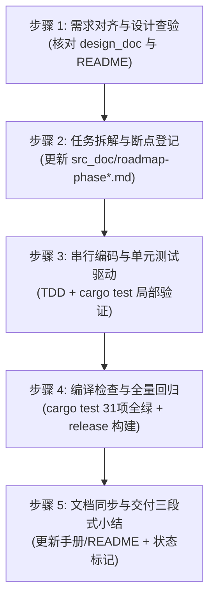

# Agent Host Steward 持续迭代技能 (agent-steward-developer)

> **定位**: 本技能驻留在 `agent-steward` 项目内部（`skills/agent-steward-developer/SKILL.md`），是指导任何接手该项目的 AI Agent（无论是主 Agent 还是 Subagent）进行高品质、自闭环、防御性演进的操作准则。

---

## 一、项目核心信条与设计红线（必须严格遵守）

接手修改任何代码或文档前，必须在脑中重放本项目的核心定位与架构红线：

1. **宿主环境大管家，而非任务单次协作工具**:
   - 目标是让 Agent 清楚所处宿主机的全景静态/动态对象（硬件、文件、脚本、动态任务进程、网络端口、长期记忆与资产图谱）。
2. **放置建议（Placement Advice）是第一优先级**:
   - 任何产生新文件、新项目、新技能、新笔记的行为，必须优先通过 `PlacementEngine` 给出规范目录和命名，禁止散落。
3. **颗粒度分级与白黑名单深度法则（Granularity Tiering）**:
   - **白名单目录**（如 `/root/new/shared_proj/`, `/root/new/work/`）：必须深度递归解析到底，构建完整元数据与全文索引。
   - **黑名单目录**（如 `**/node_modules/**`, `**/.cache/**`, `**/.git/**`, `/root/.ssh/**`, `/proc/**`）：**仅记录当前目录实体本身**（`type: directory, scan_tier: shallow`），**严禁递归下钻，严禁扫描子文件，严禁入库子文件 FTS/向量**，防止数据库扫爆与敏感信息泄露。
   - **受限目录**（`restricted`）：受限深度扫描（如开源代码库仅索引 README 与入口）。
4. **动态任务进程过滤底噪**:
   - 进程纳管只抓取 Agent 会话任务、Python 脚本、构建编译 Worker、常见轻量测试服务；系统底噪（如内核工作线程、systemd 基础进程）必须通过白名单与启发式规则过滤。
5. **图智能与宏微双层联邦（Macro-Micro Federation）**:
   - 大管家负责**宏观宿主拓扑**（文件、服务、端口、定时任务间的依赖网络）；
   - 微观符号调用（函数、类、AST）下钻交给 **CodeGraph**，大管家通过 `CodeGraphBridge` 无缝桥接，绝不重复造轮子。
6. **零破坏与断点续传（No Breaking & Resumable）**:
   - 严禁一次性大范围盲改；必须使用串行原子化分步执行，在 `src_doc/roadmap-phase*.md` 中建立检查点追踪。

---

## 二、项目目录结构与资产指引

| 路径 | 角色与用途 | 读写权限/规则 |
|---|---|---|
| `Cargo.toml`, `Cargo.lock` | Rust 依赖与工作空间配置 | 引入新 crate 需考虑编译耗时与轻量化 |
| `src/` | Rust 核心源码目录 | 业务实现与单元测试所在 |
| ├── `src/config/` | 配置文件结构体与 `~/.steward/config.toml` 引导 | 保持向后兼容 |
| ├── `src/storage/` | SQLite (bundled FTS5) 存储层、schema.sql 与 CRUD | 任何表变更必须同步 schema.sql |
| ├── `src/placement/` | 8 大规范放置引擎与建议逻辑 | 严格对齐 README 与放置规则 |
| ├── `src/scanner/` | 分级扫描器与 `matcher.rs` (globset) | 深度递归与阻断的核心 |
| ├── `src/env/` | 系统硬件规格、端口防撞与 `/proc` 进程采集 | 过滤系统级底噪与端口冲突检测 |
| ├── `src/memory/` | 跨会话长期记忆与 Ollama BGE-M3 + FTS5 RRF 混合检索 | 降级机制保障 |
| ├── `src/watcher/` | inotify 监听器与变更同步流水线 | 300ms 防抖，同步 `changes` 表 |
| ├── `src/daemon/` | 常驻守护进程主循环与定时轮询 | 优雅信号捕获与 Systemd 托管 |
| ├── `src/links/` | 关联拓扑图、Mermaid 导出、断链审计与 CodeGraph 桥接 | AST 引用提取与宏微联邦 |
| ├── `src/changes/` | 变更历史回溯与 Agent 会话简报 | 生成开工 markdown |
| └── `src/api/` | 18 个原生 MCP (JSON-RPC 2.0 stdio) 工具注册 | 必须与 CLI 功能一一映射 |
| `manual/` | 面向使用者与架构师的分卷深度技术手册 (01~07) | 保持与代码演进实时同步 |
| `src_doc/` | 开发者手册、产品手册与各阶段研发断点状态表 | 任务流转枢纽，统一 kebab-case |
| `design_doc/` | 架构设计文档闭环交付件 (01~08, init.sql) | 顶层架构事实依据，统一 kebab-case |
| `idea_doc/` | 初始思考、方案推导与设计全过程长文 | 原始产品哲学思考沉淀 |
| `markdown/` | 面向公众传播的技术长文与高保真 SVG 架构图 | 宣传与技术分享沉淀 |
| `skills/` | 本项目内置技能库 (`developer`, `doc-writer`, `guide`) | 指导 Agent 认知与自闭环自进化 |

---

## 三、持续迭代标准工作流（五步法）

当被要求增加功能、修复缺陷或重构时，Agent 必须按以下标准闭环流程推进：



### 步骤 1: 需求对齐与设计查验
1. 检查用户的需求是否符合第一节的“核心信条与设计红线”。
2. 查阅 `design_doc/` 中对应章节（如 API 规范查 [06-api-spec.md](../../design_doc/06-api-spec.md)，数据模型查 [07-data-model.md](../../design_doc/07-data-model.md)，图智能查 [08-graph-intelligence.md](../../design_doc/08-graph-intelligence.md)）。
3. 如涉及新增数据表或字段，先在 `src/storage/schema.sql`、`src/storage/models.rs`、`src/storage/mod.rs` 设计对齐。

### 步骤 2: 任务拆解与断点登记（严禁大步跨越）
1. 将大任务拆解为粒度在 30 分钟以内的原子任务（如：数据模型扩展 -> 核心算法实现 -> MCP 工具注册 -> CLI 命令暴露 -> 单元测试）。
2. 在 `src_doc/roadmap-phase*.md` 中追加或认领任务，标记当前正在进行的任务为 `⏳ 进行中`。
3. 确保任何环节遭遇会话重置或中断，后续 Agent 只需读取该状态表即可瞬间无缝续传。

### 步骤 3: 串行编码与测试驱动
1. **测试先行或同步编写**:
   - 存储层新增方法 -> 在 `src/storage/mod.rs` 的 `tests` 模块编写单元测试；
   - 引擎新增逻辑 -> 在对应子模块内编写 `tests`；
   - MCP 工具扩展 -> 在 `src/api/mcp.rs` 测试 JSON-RPC 解析与工具调用。
2. **环境路径提醒**:
   - 本机 Rust 工具链位于 `/root/.cargo/bin`，执行命令时必须前置环境变量：
     `export PATH="/root/.cargo/bin:$PATH"`
   - 运行针对性测试：`cargo test <module_name>::tests`。

### 步骤 4: 编译检查与全量回归
1. 运行全量单元测试：
   ```bash
   export PATH="/root/.cargo/bin:$PATH" && cargo test
   ```
   **门禁要求**: 目前必须达到 **31 个 tests 全部 `ok`**，0 failed，0 ignored。
2. 运行 release 生产构建：
   ```bash
   export PATH="/root/.cargo/bin:$PATH" && cargo build --release
   ```
   **门禁要求**: 编译无 error，binary 产物位于 `target/release/agent-steward`。
3. 冒烟运行验证命令：
   ```bash
   ./target/release/agent-steward status
   ./target/release/agent-steward brief
   ./target/release/agent-steward links audit
   ```

### 步骤 5: 文档同步与交付小结
1. 若新增或调整了 CLI 子命令，必须同步更新：
   - [src_doc/product-manual.md](../../src_doc/product-manual.md)
   - [manual/03-cli-reference.md](../../manual/03-cli-reference.md)
2. 若新增或调整了 MCP 工具，必须同步更新：
   - [src_doc/hooks-and-integration.md](../../src_doc/hooks-and-integration.md)
   - [manual/04-mcp-integration.md](../../manual/04-mcp-integration.md)
3. 更新 Roadmap 中的任务状态为 `✅ 已完成`，并记录完成时间。
4. 按照“digoal德哥”三段式交付格式向用户汇报：
   - **文件路径**: 改动和新建的文件列表。
   - **做了什么**: 核心逻辑与功能演进。
   - **验证与下一步建议**: 包含测试用例通过数、编译耗时以及下一步规划。

---

## 四、常见场景与标准模板（Cookbook）

### 场景 A: 新增一个 MCP 宿主感知工具
1. 在 `src/api/mcp_tools.rs` 的 `list_tools()` 向量中追加工具定义，给出清晰的 `description` 与 JSON Schema 参数校验。
2. 在 `call_tool()` 的 `match name` 分支中注入执行代码。
3. 在 `src/main.rs` 对应子命令中保持对等支持。
4. 编写 `cargo test api::mcp::tests` 确保通过 mock stdio 测试。

### 场景 B: 扩展图智能与依赖推演规则
1. 修改 `src/links/` 中的正则与语义提取器（支持新的语言或框架，如 Java、Go import 语法）。
2. 在 `src/links/audit.rs` 补充针对新型挂载资产的可用性探针（如 Unix Domain Socket、自定义 Health Check 接口）。
3. 运行 `cargo test links::tests` 确保通过单测。

### 场景 C: 扩展扫描策略或放置规则
1. 修改 `src/storage/schema.sql` 初始插入的预置规则（`INSERT OR IGNORE INTO placement_rules ...`）。
2. 在 `src/placement/mod.rs` 中调整评分与推荐优先级匹配算法。
3. 运行 `cargo test placement::tests` 验证不会对既有 `/root/new/shared_proj/`、`/root/new/work/` 产生回退断言。

---

## 五、自检 Checklist（提交前必查）

- [ ] 是否在任务开始前已将任务标记为 `⏳ 进行中`？
- [ ] 代码中是否存在对黑名单目录进行深度递归扫描的风险？
- [ ] 新增的字段和表结构是否已在 `schema.sql`、`models.rs`、`storage/mod.rs` 保持三位一体同步？
- [ ] 是否执行了 `cargo test` 且全部通过（**要求 >= 31 tests 全部通过**）？
- [ ] 是否执行了 `cargo build --release` 并且生成了可执行文件？
- [ ] 相关的文档（`product-manual.md` / `manual/` / `roadmap-phase*.md`）是否已同步刷新？
- [ ] 工作区改动是否已通过 `rsync` 镜像同步至 `/root/new/shared_git/agent-steward`？
- [ ] 是否给出了清晰规范的 Git Commit 建议？
